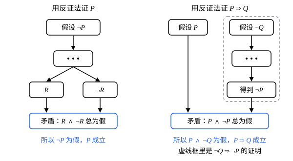

## 这一节要回答的问题

「$\sqrt2$是无理数」「素数有无穷多个」说的都是「不」：前者说$\sqrt2$不等于任何一个分数，后者说素数不会只有有限个。正面去证，「不等于」「不会只有有限个」都给不出能拿来算的式子。这样的命题怎样证明？证「对每个$\varepsilon>0$，都有$\delta>0$……」这样的命题，又该先做什么、后做什么；拿到一个命题，怎样挑一种证法？

## 讲解

### 先任取，再构造

看这样一个命题，$\varepsilon$、$\delta$都在实数里取值：

$$
\forall\varepsilon>0,\ \exists\delta>0,\ \forall x\in\R,\quad |x|<\delta\Rightarrow|3x|<\varepsilon .
$$

证明分三步：任给$\varepsilon>0$；取$\delta=\frac\varepsilon3$，它是正数；任取满足$|x|<\delta$的实数$x$，则$|3x|=3|x|<3\delta=\varepsilon$。

次序照[多重量词](lesson:math.logic-sets.nested-quantifiers)里的读法：量词（quantifier）从左往右读，后面的变量可以依赖前面的。$\delta$在$\varepsilon$后面，所以先任给$\varepsilon$、再用它造出$\delta$；$x$在最后，等$\delta$取定再任取。每一层照[直接证明与逆否证明](lesson:math.logic-sets.direct-proof)的办法：遇到:term[全称量词]{id="math.logic-sets.universal-quantifier"}（universal quantifier）就任取一个，遇到:term[存在量词]{id="math.logic-sets.existential-quantifier"}（existential quantifier）就造出一个。

$\delta=\frac\varepsilon3$是从结论往回推出来的：要$|3x|<\varepsilon$，只要$|x|<\frac\varepsilon3$。取得更小也行，比如$\delta=\frac\varepsilon4$：造出的$\delta$只要够用，不必最大。

次序不能反过来：先取定$\delta$、再让$\varepsilon$任意，证的就成了$\exists\delta>0,\ \forall\varepsilon>0,\ \cdots$，这句话是假的：对任何正数$\delta$，$\varepsilon$取$\delta$、$x$取$\frac\delta2$时，$|3x|=\frac{3\delta}2>\varepsilon$。

以后数学分析里证一列数趋于一个数，也是这三步：任给$\varepsilon>0$；找出正整数$N$；验证$n>N$时，第$n$项和那个数相差小于$\varepsilon$。

### 反证法

回到$\sqrt2$。「不等于任何分数」没法拿来算；反过来设它是有理数，就有了等式$\sqrt2=\frac pq$，可以平方、看奇偶，要是推出了矛盾，这个假设就站不住。

::anchor{id="def-proof-by-contradiction"}
要证命题$P$，先假设$P$不成立，即$\neg P$成立，由此推出某个命题$R$和它的:term[否定]{id="math.logic-sets.negation"}（negation）$\neg R$都成立，从而断定$P$成立，这种证法叫作:term[反证法]{id="math.logic-sets.proof-by-contradiction"}（proof by contradiction）。

为什么这样证是对的：由$\neg P$推出了$R\land\neg R$，即$\neg P\Rightarrow(R\land\neg R)$成立。由[命题与逻辑联结词](lesson:math.logic-sets.propositions#thm-contradiction)里的定理，$R\land\neg R$总是假的；要是$\neg P$为真，这个:term[蕴含]{id="math.logic-sets.implication"}（implication）就是条件真、结论假，不能成立。所以$\neg P$为假，$P$为真。

边界情况：假设的必须是结论的准确的否定。要证$\forall x\in A,\ S(x)$，该假设$\exists x\in A,\ \neg S(x)$；假设成$\forall x\in A,\ \neg S(x)$，推出矛盾只说明了$\exists x\in A,\ S(x)$，证不出「每个都满足」。否定照[全称量词与存在量词](lesson:math.logic-sets.quantifiers#thm-quantifier-negation)和[多重量词](lesson:math.logic-sets.nested-quantifiers#thm-nested-negation)里的定理写。

写的时候常这样开头：「反证：设……」或「用反证法。假设……」；推出$R$和$\neg R$以后写「……，矛盾」。

::anchor{id="thm-sqrt2"}
**定理**　$\sqrt2$是无理数。

**证明**：反证：设$\sqrt2$是有理数。$\sqrt2>0$，而每个正有理数都能写成既约分数，即分子、分母是正整数，除了$1$没有别的公共正因数，这是中学学过的事实；所以可设$\sqrt2=\frac pq$，$p$、$q$是这样的两个正整数。平方得$p^2=2q^2$，$p^2$是偶数，由[直接证明与逆否证明](lesson:math.logic-sets.direct-proof)的例 1，$p$是偶数。

设$p=2k$，$k$是正整数，代入得$4k^2=2q^2$，即$q^2=2k^2$；同样，$q$也是偶数。于是$2$是$p$、$q$的公共正因数，和「除了$1$没有别的公共正因数」矛盾，这一句就是定义里的$R$。

### 素数有无穷多个

「素数有无穷多个」正好用反证，下面的证法出自古希腊的欧几里得（Euclid）。先证一个要用到的事实。

::anchor{id="thm-prime-divisor"}
**定理**　每个大于$1$的整数$m$都有素因数，也就是说，有素数整除$m$。

**证明**：$m$的大于$1$的正因数里至少有$m$自己；它们都不超过$m$，只有有限个，其中有最小的，记作$d$。若$d$不是素数，它就有正因数$a$满足$1<a<d$；$a$整除$d$，$d$整除$m$，所以$a$整除$m$。$a$也是$m$的大于$1$的正因数，却比$d$小，和$d$最小矛盾。所以$d$是$m$的素因数。

::anchor{id="thm-infinitely-many-primes"}
**定理**　素数有无穷多个。

**证明**：反证：设素数只有有限个，全部列出是$p_1,p_2,\dots,p_k$。令$N=p_1p_2\cdots p_k+1$，则$N>1$，由上面的定理，$N$有素因数$p$。素数都已列出，$p$是其中的某个$p_i$；$p_i$整除$N$，也整除$p_1p_2\cdots p_k$，所以整除它们的差$N-p_1p_2\cdots p_k=1$。可素数都大于$1$，不能整除$1$，矛盾。

### 反证法与逆否命题

要证$P\Rightarrow Q$，也常用:term[反证法]{id="math.logic-sets.proof-by-contradiction"}：由[蕴含与充要条件](lesson:math.logic-sets.implication#thm-implication-negation)里的定理，它的:term[否定]{id="math.logic-sets.negation"}是$P\land\neg Q$，所以假设$P$成立而$Q$不成立，再从$\neg Q$推出$\neg P$，和$P$矛盾，这时$R$就是条件$P$。从$\neg Q$推出$\neg P$的那一段，证的正是:term[逆否命题]{id="math.logic-sets.contrapositive"}（contrapositive）$\neg Q\Rightarrow\neg P$，它和原命题[同真同假](lesson:math.logic-sets.implication#thm-contrapositive)。

例如[直接证明与逆否证明](lesson:math.logic-sets.direct-proof)例 1 的后一半写成反证：设$n^2$是偶数而$n$不是偶数，则$n$是奇数，$n^2$也是奇数，而奇数不是偶数，矛盾；中间的推理和改证逆否命题一样。所以这样的论证叫反证法、叫证明逆否命题（proof by contraposition）都对。

### 按命题的形式选方法

拿到一个命题，先看它是什么形式，下表是常用的选法。

| 命题的形式 | 常用的证法 |
| --- | --- |
| $\forall x\in A,\ P(x)$ | 任取$x\in A$，推出$P(x)$ |
| $\exists x\in A,\ P(x)$ | 造出一个，验证它 |
| $\forall x\,\exists y$ | 先任取$x$，再造出依赖于$x$的$y$ |
| $P\Rightarrow Q$ | :term[直接证明]{id="math.logic-sets.direct-proof"}（direct proof）；从条件推不动、结论的:term[否定]{id="math.logic-sets.negation"}好算时，改证:term[逆否命题]{id="math.logic-sets.contrapositive"} |
| $P\lor Q$ | 设$P$不成立，推出$Q$ |
| $P\iff Q$ | 两个方向分开证 |
| 结论是「不是」「不存在」「有无穷多个」 | :term[反证法]{id="math.logic-sets.proof-by-contradiction"} |
| 唯一性 | 设有两个都满足条件，推出相等或者矛盾 |

表里的选法不是规定：$P\Rightarrow Q$也可以反证，:term[全称量词命题]{id="math.logic-sets.universal-statement"}（universal statement）也可以假设它有反例（counterexample）。结论是否定的说法时，假设它不成立，手里常常就多了能算的东西。能直接证明的就不必绕道反证，套上「假设结论不成立……矛盾」的外壳，反倒让人看不清起作用的是哪几步。

## 几何图像

每个方框是论证里的一句话，每个箭头是有依据的一步推理。左图是:term[反证法]{id="math.logic-sets.proof-by-contradiction"}：从「假设$\neg P$」出发，推出$R$和$\neg R$两支，两支合起来是总为假的$R\land\neg R$，所以$\neg P$为假，$P$成立。右图用反证法证$P\Rightarrow Q$：假设$P$和$\neg Q$，从$\neg Q$推出$\neg P$，和假设的$P$合起来，同样是矛盾。

右图就是左图把$R$取成条件$P$的情形。虚线框里的一段从$\neg Q$走到$\neg P$，单独拿出来就是:term[逆否命题]{id="math.logic-sets.contrapositive"}$\neg Q\Rightarrow\neg P$的证明，所以这样的论证叫反证法、叫证明逆否命题都行。

## 例题

### 例 1　先限制，再取较小的那个

证明：

$$
\forall\varepsilon>0,\ \exists\delta>0,\ \forall x\in\R,\quad |x-1|<\delta\Rightarrow|x^2+x-2|<\varepsilon .
$$

**为什么想到这么做**：先任给$\varepsilon$，再造$\delta$。往回推：$|x^2+x-2|=|x-1|\cdot|x+2|$，第一个因子能用$\delta$管住，第二个却随$x$变；先要求$|x-1|<1$，把$|x+2|$管住；$\delta$要同时满足两个要求，就取较小的那个。

**推导**：任给$\varepsilon>0$，取$\delta=\min\{1,\frac\varepsilon4\}$，它是正数。任取满足$|x-1|<\delta$的实数$x$。由$\delta\le1$得$|x-1|<1$，即$0<x<2$，所以$0<x+2<4$，$|x+2|<4$。于是

$$
|x^2+x-2|=|x-1|\cdot|x+2|\le4|x-1|<4\delta\le\varepsilon ,
$$

最后一步用了$\delta\le\frac\varepsilon4$。

### 例 2　$\log_23$是无理数

证明$\log_23$是无理数。

**为什么想到这么做**：「不等于任何分数」给不出能算的式子；反过来设$\log_23$等于一个分数，就能化成整数之间的等式，再看两边的奇偶。

**推导**：反证：设$\log_23$是有理数。由$3>1$得$\log_23>\log_21=0$，所以可以写成$\log_23=\frac pq$，$p$、$q$是正整数。由对数的定义，$2^{p/q}=3$，两边$q$次方，得$2^p=3^q$。

$p\ge1$，所以$2^p$是偶数；$3^q$是$q$个奇数的积，奇数乘奇数还是奇数，所以$3^q$是奇数。同一个整数不能既是偶数又是奇数，矛盾。所以$\log_23$是无理数。

这里用不着既约分数：矛盾出在奇偶上，和$p$、$q$有没有公因数无关。

## 常见误区

- 「用:term[反证法]{id="math.logic-sets.proof-by-contradiction"}证『若$P$则$Q$』，先假设『若$P$则非$Q$』。」不对：反证要假设结论的:term[否定]{id="math.logic-sets.negation"}，由[蕴含与充要条件](lesson:math.logic-sets.implication#thm-implication-negation)里的定理，「若$P$则$Q$」的否定是「$P$且非$Q$」。「若$P$则非$Q$」不是它的否定：$P$为假时，两句都为真。
- 「欧几里得的证明说明，把前几个素数乘起来再加$1$，得到的总是素数。」不对：证明说明的只是，这个数的素因数都不在乘起来的那几个素数里；它的素因数可以是它本身，也可以比它小。前六个素数乘起来再加$1$就不是素数，见第 4 题。
- 「推出和条件矛盾的论证只能叫反证法，叫『证明:term[逆否命题]{id="math.logic-sets.contrapositive"}』是叫错了。」不对：假设$P$而非$Q$、从非$Q$推出非$P$，这一段正是逆否命题的证明，两种叫法都对。反证法更一般，推出的矛盾也可以和条件无关，比如$\sqrt2$是无理数的证明，矛盾出在既约分数上。
