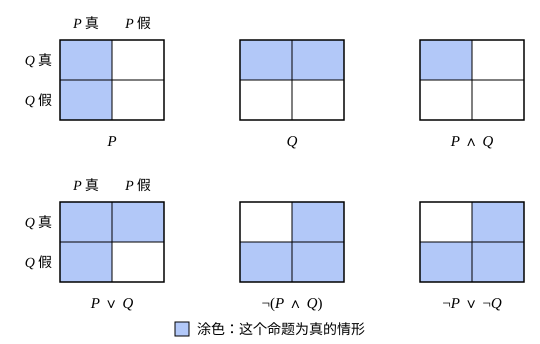

## 这一节要回答的问题

以后在数学分析里，要把「数列趋于一个数」写成一句既能拿来证明、又能拿来否定的话。可要否定一句话，先得知道它什么时候算真、什么时候算假。「两个数都小于$1$」不成立，是说两个数都不小于$1$，还是至少有一个不小于$1$？「$6$是偶数或$6$是$3$的倍数」前后两半都对，这句话算不算对？

## 讲解

### 命题与真值

「$7$是素数」说得对，「$3>5$」说得不对，「这道题真难」却说不上对不对。「$x>1$」也说不上：$x=2$时对，$x=0$时不对，要先取定$x$，或者加上「对所有实数$x$」这样的话，见[全称量词与存在量词](lesson:math.logic-sets.quantifiers)。

::anchor{id="def-proposition"}
能判断真假的陈述句叫作命题（proposition）。命题的真假叫作它的:term[真值]{id="math.logic-sets.truth-value"}（truth value）：成立为真，叫真命题；不成立为假，叫假命题。

为什么这样定义：推理要从真的话推出真的话，说不清真假的话没法往下推。

边界情况：哥德巴赫猜想（Goldbach's conjecture）说每个大于$2$的偶数都是两个素数之和，至今没人证明或推翻。可它非真即假，所以是命题；是真是假，不要求现在就知道。

命题常用大写字母$P$、$Q$、$R$表示，课本上也写成小写的$p$、$q$。

### 非、且、或

取$P$为「$6$是偶数」（真），$Q$为「$6$是$4$的倍数」（假）。「$6$不是偶数」假；「$6$是偶数，并且是$4$的倍数」假，后一半不对；「$6$是偶数，或者是$4$的倍数」真，前一半对就够了。

::anchor{id="def-negation"}
命题$P$的:term[否定]{id="math.logic-sets.negation"}（negation）是命题「$P$不成立」，记作$\neg P$，读作「非$P$」：$P$真时$\neg P$假，$P$假时$\neg P$真。

为什么这样定义：否定就是说「它不成立」，所以真假互换。以后几节反复要做的正是否定：[蕴含与充要条件](lesson:math.logic-sets.implication)里否定「若……则……」，[全称量词与存在量词](lesson:math.logic-sets.quantifiers)里否定带「任意」「存在」的话。

边界情况：对取定的实数$a$，「$a>0$」的否定是「$a\le0$」，不是「$a<0$」：$a=0$时「$a>0$」不成立，「$a<0$」也不成立。

::anchor{id="def-and-or"}
$P\land Q$叫作$P$与$Q$的:term[合取]{id="math.logic-sets.conjunction"}（conjunction），读作「$P$且$Q$」，只有$P$、$Q$都真时它才真；$P\lor Q$叫作:term[析取]{id="math.logic-sets.disjunction"}（disjunction），读作「$P$或$Q$」，$P$、$Q$至少有一个真时它就真，两个都真也算真。

$P$、$Q$真假的四种组合下，三个新命题的真假如下表，行的次序约定为真真、真假、假真、假假。

| $P$ | $Q$ | $\neg P$ | $P\land Q$ | $P\lor Q$ |
| --- | --- | --- | --- | --- |
| 真 | 真 | 假 | 真 | 真 |
| 真 | 假 | 假 | 假 | 真 |
| 假 | 真 | 真 | 假 | 真 |
| 假 | 假 | 真 | 假 | 假 |

数字电路（digital circuit）里把真记作$1$、假记作$0$，行按 00、01、10、11 排，正好和这里倒过来。

为什么「或」两个都真也算真：数学里的「$P$或$Q$」说的是「至少有一个成立」，两个都成立当然也算。例如「$a\le b$或$b\le a$」对任何实数$a$、$b$都该成立，$a=b$时两半都对。

边界情况：日常说「要么$P$，要么$Q$」，常指恰有一个成立；它和「$P$或$Q$」只在$P$、$Q$都真的那一行不同，见例 1。

::anchor{id="def-connective"}
「非」「且」「或」这样由命题造出新命题的词，叫作:term[逻辑联结词]{id="math.logic-sets.connective"}（logical connective），简称联结词；用联结词连成的命题叫作:term[复合命题]{id="math.logic-sets.compound-proposition"}（compound proposition），例如$P\land\neg Q$、$\neg(P\lor Q)$。

为什么这样定义：这样连成的命题，真假只由各部分的真假决定，和它们说的是什么无关。

边界情况：「因为$2$是偶数，所以$7$是素数」两句都真，整句却说不通，可见「因为……所以……」不是联结词。

约定：$\neg$只作用于紧跟它的字母或括号，$\neg P\lor Q$指$(\neg P)\lor Q$；「且」「或」混用时一律加括号，如$P\land(Q\lor R)$。

### 真值表

::anchor{id="def-truth-table"}
把组成:term[复合命题]{id="math.logic-sets.compound-proposition"}的各个命题的真假组合逐行列出，再写出复合命题在每一行的真假，这样的表叫作:term[真值表]{id="math.logic-sets.truth-table"}（truth table）。

为什么要列表：组合列全了，复合命题就完全说清了。每多一个字母，每行都分成它真、假两行，所以$n$个字母有$2^n$行。

边界情况：一个字母只有两行。三个字母有$8$行，照样从全真排到全假，第一个字母变得最慢，最后一个最快。

### 逻辑等价与德摩根律

::anchor{id="def-logical-equivalence"}
如果两个:term[复合命题]{id="math.logic-sets.compound-proposition"}（单独一个字母也算在内）在:term[真值表]{id="math.logic-sets.truth-table"}的每一行真假都相同，就说它们:term[逻辑等价]{id="math.logic-sets.logical-equivalence"}（logically equivalent），记作${\iff}$，读作「等价于」。例如$\neg\neg P\iff P$：真假换两次，又换回原样。

为什么这样定义：逻辑等价的两个命题，不管字母取什么真假都同真同假，推理时可以互相替换。

边界情况：$P\land Q$和$P\lor Q$在真真、假假两行真假相同，另两行不同，所以不逻辑等价：要每一行都相同才算。

::anchor{id="thm-de-morgan"}
**定理（:term[德摩根律]{id="math.logic-sets.de-morgan-laws"}，De Morgan's laws）**　$\neg(P\land Q)\iff\neg P\lor\neg Q$，$\neg(P\lor Q)\iff\neg P\land\neg Q$。

**证明**：列真值表，逐行比较两边。

| $P$ | $Q$ | $\neg(P\land Q)$ | $\neg P\lor\neg Q$ | $\neg(P\lor Q)$ | $\neg P\land\neg Q$ |
| --- | --- | --- | --- | --- | --- |
| 真 | 真 | 假 | 假 | 假 | 假 |
| 真 | 假 | 真 | 真 | 假 | 假 |
| 假 | 真 | 真 | 真 | 假 | 假 |
| 假 | 假 | 真 | 真 | 真 | 真 |

每格都照定义算出，如第二行$P\land Q$假，所以$\neg(P\land Q)$真；$\neg Q$真，所以$\neg P\lor\neg Q$真。第三、四列逐行相同，第五、六列也是，所以两条都成立。

用中文说：「并非$P$且$Q$」就是「$P$、$Q$至少有一个不成立」，「并非$P$或$Q$」就是「$P$、$Q$都不成立」。所以「两个数都小于$1$」的:term[否定]{id="math.logic-sets.negation"}是「至少有一个不小于$1$」，开头的问题就答上了。否定「且」得「或」、否定「或」得「且」，每部分各取否定。

由定义，$P\land Q\iff Q\land P$，$(P\land Q)\land R\iff P\land(Q\land R)$，两边都是「都真时才真」；「或」也一样，两边都是「至少有一个真时就真」。所以全用「且」或者全用「或」连起来时，括号可以省掉，如$P\land Q\land R$。

::anchor{id="thm-distributive"}
**定理（分配律，distributive laws）**　(1) $P\land(Q\lor R)\iff(P\land Q)\lor(P\land R)$；(2) $P\lor(Q\land R)\iff(P\lor Q)\land(P\lor R)$。

**证明**：按$P$的真假把$8$行分成两组。对任一命题$X$，$P$真时$P\land X$和$X$同真假，$P\lor X$真；$P$假时$P\land X$假，$P\lor X$和$X$同真假。所以$P$真的$4$行，(1) 两边都和$Q\lor R$同真假，(2) 两边都真；$P$假的$4$行，(1) 两边都假，(2) 两边都和$Q\land R$同真假。

::anchor{id="thm-contradiction"}
**定理**　对任何命题$R$，$R\land\neg R$总是假的。

**证明**：$R$真时$\neg R$假，$R$假时$R$本身假，所以每一行都有一部分假；由:term[合取]{id="math.logic-sets.conjunction"}的定义，$R\land\neg R$在每一行都假。

从一些前提推出「$R$且非$R$」，就说明这些前提不能都成立，[反证法与证明方法的选择](lesson:math.logic-sets.proof-methods)一节的证法就靠这一点。

## 几何图像

每个方格的四格对应:term[真值表]{id="math.logic-sets.truth-table"}的四行：左列$P$真、右列$P$假，上行$Q$真、下行$Q$假，涂色的格子就是这个命题为真的那几行。$P\land Q$只涂$P$那一列和$Q$那一行重叠的一格，$P\lor Q$涂两者合起来的三格。第二行后两个方格涂得一模一样，这就是:term[德摩根律]{id="math.logic-sets.de-morgan-laws"}的第一条：:term[逻辑等价]{id="math.logic-sets.logical-equivalence"}就是涂色相同，而加一个「非」就是把涂色反过来。

以后讲集合时，「重叠的部分」「合起来的部分」就叫:term[交集]{id="math.logic-sets.intersection"}（intersection）、:term[并集]{id="math.logic-sets.union"}（union），见[集合的运算](lesson:math.logic-sets.set-operations)。

## 例题

### 例 1　「要么……要么……」

列出$(P\lor Q)\land\neg(P\land Q)$的:term[真值表]{id="math.logic-sets.truth-table"}，说出它在什么情形下为真。

**为什么想到这么做**：两个字母只有四种组合，从里往外逐列算出来就行。

**推导**：先算$P\lor Q$、$P\land Q$，再算$\neg(P\land Q)$，最后用「且」连起来。

| $P$ | $Q$ | $P\lor Q$ | $P\land Q$ | $\neg(P\land Q)$ | $(P\lor Q)\land\neg(P\land Q)$ |
| --- | --- | --- | --- | --- | --- |
| 真 | 真 | 真 | 真 | 假 | 假 |
| 真 | 假 | 真 | 假 | 真 | 真 |
| 假 | 真 | 真 | 假 | 真 | 真 |
| 假 | 假 | 假 | 假 | 真 | 假 |

它恰在第二、三行为真，即$P$、$Q$恰有一个为真时，正是日常说的「要么$P$，要么$Q$」，叫作不相容的或（exclusive or），$P\lor Q$则叫相容的或（inclusive or）。两者只差在第一行。数学书里写「要么……要么……，两者必居其一」，说的就是恰有一种成立。

## 常见误区

- 「『$P$或$Q$』为真，就是$P$、$Q$恰有一个为真。」不对：数学里的「或」两个都真也算真。「恰有一个为真」是例 1 里不相容的或，两者只在$P$、$Q$都真的那一行不同。
- 「『$P$且$Q$』的:term[否定]{id="math.logic-sets.negation"}是『非$P$且非$Q$』。」不对：由:term[德摩根律]{id="math.logic-sets.de-morgan-laws"}，应是「非$P$或非$Q$」。只要$P$、$Q$中有一个不成立，「$P$且$Q$」就不成立，不必两个都不成立。
- 「『$x>1$』是假命题，因为$x=0$时它不成立。」不对：$x$没有取定时，它根本不是命题，谈不上真假；$x=2$时它就成立。
