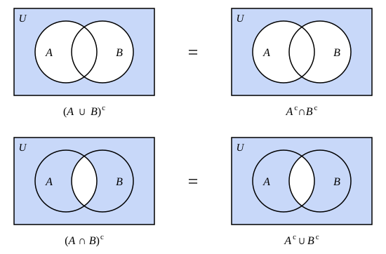

## 这一节要回答的问题

$[0,1]\cup[2,3]$、$\Q\cap[0,1]$、$\R\setminus\{0\}$这样的写法，以后到处都会遇到：把两个集合合起来、取公共部分、去掉一部分，都得到新的集合。这几种运算有哪些规律，又怎样证明？命题有:term[德摩根律]{id="math.logic-sets.de-morgan-laws"}（De Morgan's laws），「不属于$A\cup B$」是不是就是「既不属于$A$，也不属于$B$」？

## 讲解

### 并集与交集

设$A=\{1,2,3\}$，$B=\{2,3,4\}$。把两者的元素合在一起，得到$\{1,2,3,4\}$；只取两者都有的元素，得到$\{2,3\}$。区间也一样：$[0,1]$和$[2,3]$合在一起是两段，$\Q$和$[0,1]$都有的，是$[0,1]$里的有理数（含$0$和$1$）。

::anchor{id="def-union-intersection"}
属于$A$或属于$B$的元素组成的集合，叫作$A$与$B$的:term[并集]{id="math.logic-sets.union"}（union），记作$A\cup B$；既属于$A$又属于$B$的元素组成的集合，叫作$A$与$B$的:term[交集]{id="math.logic-sets.intersection"}（intersection），记作$A\cap B$。也就是说，对任何$x$，$x\in A\cup B$就是$x\in A\lor x\in B$，$x\in A\cap B$就是$x\in A\land x\in B$。

为什么用「或」「且」来定义：这样「属于并集」就是两个命题的:term[析取]{id="math.logic-sets.disjunction"}（disjunction），「属于交集」就是两个命题的:term[合取]{id="math.logic-sets.conjunction"}（conjunction），命题的运算律逐个元素翻译过来，就成了集合的运算律。

边界情况：这里的「或」包括两个都成立的情形，同时属于$A$、$B$的元素也在$A\cup B$里，只是不重复写，所以$\{1,2,3\}\cup\{2,3,4\}$有$4$个元素，不是$6$个。交集也可以一个元素都没有，如$\{1,2\}\cap\{3,4\}=\varnothing$。

::anchor{id="def-disjoint"}
若$A\cap B=\varnothing$，就说$A$与$B$:term[不相交]{id="math.logic-sets.disjoint"}（disjoint），也说它们互不相交。

为什么起这个名字：没有公共元素的情形很常用，例如偶数集和奇数集不相交，合在一起是$\Z$。边界情况：$[0,1]$和$(1,2]$不相交，$[0,1]$和$[1,2]$却相交，交集是$\{1\}$，差一个端点就不同。三个以上的集合说:term[两两不相交]{id="math.logic-sets.pairwise-disjoint"}（pairwise disjoint），是说其中任意两个都不相交，见[集族的并与交](lesson:math.logic-sets.indexed-families)。

### 差集与补集

从$\R$里去掉$0$，剩下的非零实数也组成一个集合；数学分析、复分析里常这样「去掉一点」。

::anchor{id="def-difference"}
属于$A$而不属于$B$的元素组成的集合，叫作$A$与$B$的:term[差集]{id="math.logic-sets.set-difference"}（set difference），记作$A\setminus B$，即$A\setminus B=\{x\in A:x\notin B\}$。

为什么这样定义：「去掉一部分」很常用，非零实数组成的集合就是$\R\setminus\{0\}$；反过来，给集合$A$添上元素$a$，写成$A\cup\{a\}$。有的书把差集写作$A-B$，本站不用。边界情况：$B$不必是$A$的:term[子集]{id="math.logic-sets.subset"}（subset），$\{1,2\}\setminus\{2,3\}=\{1\}$，$B$里不属于$A$的$3$不起作用。

::anchor{id="def-complement"}
一个问题里讨论的集合都是某个集合$U$的子集时，$U$叫作:term[全集]{id="math.logic-sets.universal-set"}（universal set）；$U$中不属于$A$的元素组成的集合，叫作$A$的:term[补集]{id="math.logic-sets.complement"}（complement），记作$A^{\mathrm c}$，即$A^{\mathrm c}=U\setminus A$。

为什么要先定全集：$A^{\mathrm c}=\{x\in U:x\notin A\}$是从$U$里挑元素，要先说好从哪个集合里挑，不说好会出什么毛病，见第 8 题。高中课本写作$\complement_UA$，把全集写进记号；本站写$A^{\mathrm c}$，全集由上下文定。不写$\bar A$、$A'$：上划线留给共轭复数，撇号留给导数。

边界情况：全集换了，补集也跟着变。取$A=\Q$，全集是$\R$时，$A^{\mathrm c}$是全体无理数组成的集合；全集是$\Q$时，$A^{\mathrm c}=\varnothing$。数学分析用有理数的集合造出实数（:term[戴德金分割]{id="math.analysis.dedekind-cut"}，Dedekind cut），那里的$\Q\setminus\alpha$就是集合$\alpha$在全集$\Q$里的补集。

::anchor{id="thm-difference-complement"}
**定理**　设$A$、$B$都是全集$U$的子集，则$A\setminus B=A\cap B^{\mathrm c}$。

**证明**：$x\notin A$时，$x$既不属于左边，也不属于右边。$x\in A$时$x\in U$，由补集的定义，$x\notin B$就是$x\in B^{\mathrm c}$，所以$x\in A\setminus B$和$x\in A\cap B^{\mathrm c}$同真同假。两边的元素完全相同，所以相等。

### 运算律

要证两个集合相等，可以逐个元素看：对每个$x$，「$x$属于左边」和「$x$属于右边」同真同假，两边的元素就完全相同。把「属于」翻译成命题，集合的运算就成了「或」「且」「非」：

| 集合 | 命题 |
| --- | --- |
| $x\in A\cup B$ | $x\in A\lor x\in B$ |
| $x\in A\cap B$ | $x\in A\land x\in B$ |
| $x\in A\setminus B$ | $x\in A\land x\notin B$ |
| $x\in A^{\mathrm c}$ | $x\in U\land x\notin A$ |
| $A\subseteq B$ | $\forall x\,(x\in A\Rightarrow x\in B)$ |
| $A=B$ | $\forall x\,(x\in A\iff x\in B)$ |

命题的「且」「或」都可以交换次序、省掉括号（见[命题与逻辑联结词](lesson:math.logic-sets.propositions)），翻译过来，$A\cup B=B\cup A$，$(A\cup B)\cup C=A\cup(B\cup C)$，:term[交集]{id="math.logic-sets.intersection"}也一样。所以几个集合的:term[并集]{id="math.logic-sets.union"}、交集都可以不加括号，写成$A\cup B\cup C$、$A\cap B\cap C$。

::anchor{id="thm-distributive-sets"}
**分配律（集合形式）**　对任何集合$A$、$B$、$C$，$A\cap(B\cup C)=(A\cap B)\cup(A\cap C)$。

**证明**：对任何$x$，$x\in A\cap(B\cup C)$就是$x\in A\land(x\in B\lor x\in C)$。由[命题与逻辑联结词](lesson:math.logic-sets.propositions#thm-distributive)里的分配律 (1)，它和$(x\in A\land x\in B)\lor(x\in A\land x\in C)$同真同假，而后者就是$x\in(A\cap B)\cup(A\cap C)$。两边的元素完全相同，所以相等。

把交和并对调，$A\cup(B\cap C)=(A\cup B)\cap(A\cup C)$也成立，用的是命题的分配律 (2)，证明见第 5 题。

::anchor{id="thm-de-morgan-sets"}
**:term[德摩根律]{id="math.logic-sets.de-morgan-laws"}（集合形式）**　设$A$、$B$都是:term[全集]{id="math.logic-sets.universal-set"}$U$的:term[子集]{id="math.logic-sets.subset"}，则$(A\cup B)^{\mathrm c}=A^{\mathrm c}\cap B^{\mathrm c}$。

**证明**：两边都是$U$的子集，只需看$U$中的$x$。这时$x\in(A\cup B)^{\mathrm c}$就是$\neg(x\in A\lor x\in B)$，由[命题与逻辑联结词](lesson:math.logic-sets.propositions#thm-de-morgan)里的德摩根律，它和$x\notin A\land x\notin B$同真同假，也就是$x\in A^{\mathrm c}\land x\in B^{\mathrm c}$，即$x\in A^{\mathrm c}\cap B^{\mathrm c}$。两边的元素完全相同，所以相等。

同样有$(A\cap B)^{\mathrm c}=A^{\mathrm c}\cup B^{\mathrm c}$，证明见第 6 题。用中文说，不属于$A\cup B$，就是既不属于$A$、也不属于$B$；不属于$A\cap B$，就是不属于$A$或不属于$B$。取:term[补集]{id="math.logic-sets.complement"}把并集、交集互换，正像「非」把「或」「且」互换。

## 几何图像

每幅都是一张:term[韦恩图]{id="math.logic-sets.venn-diagram"}（Venn diagram）：矩形是:term[全集]{id="math.logic-sets.universal-set"}$U$，两个圆是$A$、$B$，涂色的是下面写的那个集合。$A^{\mathrm c}$是$A$外面的部分，$B^{\mathrm c}$是$B$外面的部分，两者的公共部分是两个圆的外面，合在一起是除重叠部分以外的全部。所以上排两幅涂的是同一块，下排两幅也是，这正是:term[德摩根律]{id="math.logic-sets.de-morgan-laws"}的两条。图只画了两个圆相交的一种情形，不能代替证明。

## 例题

### 例 1　区间的运算

:term[全集]{id="math.logic-sets.universal-set"}取$\R$，$A=[-1,2)$，$B=[1,4]$。求$A\cup B$、$A\cap B$、$A\setminus B$、$B\setminus A$和$A^{\mathrm c}$。

**为什么想到这么做**：两个区间在数轴上画出来，结果的大致范围一眼就看得出。容易错的是端点，要逐个看它属不属于$A$、属不属于$B$。

**推导**：$A$从$-1$（含）到$2$（不含），$B$从$1$（含）到$4$（含）。合在一起从$-1$到$4$，两端都含，$A\cup B=[-1,4]$；两段从$1$到$2$重叠，$1$两个区间都含，$2$不属于$A$，所以$A\cap B=[1,2)$。

$A\setminus B$是$A$里小于$1$的部分，$1\in B$，要去掉，所以$A\setminus B=[-1,1)$；$B\setminus A$是$B$里不小于$2$的部分，$2\notin A$，要留下，所以$B\setminus A=[2,4]$。$A^{\mathrm c}$由$\R$中不属于$A$的数组成，$-1\in A$，$2\notin A$，所以$A^{\mathrm c}=(-\infty,-1)\cup[2,+\infty)$。

### 例 2　差集的德摩根律

证明：对任何集合$A$、$B$、$C$，$A\setminus(B\cap C)=(A\setminus B)\cup(A\setminus C)$。

**为什么想到这么做**：可以像证分配律那样逐个元素推。也可以先用讲解里的定理把:term[差集]{id="math.logic-sets.set-difference"}化成:term[交集]{id="math.logic-sets.intersection"}和:term[补集]{id="math.logic-sets.complement"}，再用已有的:term[德摩根律]{id="math.logic-sets.de-morgan-laws"}、分配律一步步算。

**推导**：取:term[全集]{id="math.logic-sets.universal-set"}$U=A\cup B\cup C$，三个集合都是它的:term[子集]{id="math.logic-sets.subset"}。先把差集化成交集和补集，再依次用德摩根律的第二条和分配律，最后把差集换回来：

$$
\begin{aligned}
A\setminus(B\cap C)&=A\cap(B\cap C)^{\mathrm c}=A\cap(B^{\mathrm c}\cup C^{\mathrm c})\\
&=(A\cap B^{\mathrm c})\cup(A\cap C^{\mathrm c})=(A\setminus B)\cup(A\setminus C).
\end{aligned}
$$

用中文说：从$A$里去掉$B$、$C$都有的元素，剩下的就是「从$A$里去掉$B$剩下的」和「从$A$里去掉$C$剩下的」合在一起。

## 常见误区

- 「$\R\setminus\{0\}$也可以写成$\R\setminus0$，$\{0\}$和$0$是一回事。」不对：$0$是一个数，$\{0\}$是只含$0$这一个元素的集合。:term[差集]{id="math.logic-sets.set-difference"}是两个集合之间的运算，要去掉的是集合$\{0\}$。
- 「$(A\cup B)^{\mathrm c}=A^{\mathrm c}\cup B^{\mathrm c}$。」不对：由:term[德摩根律]{id="math.logic-sets.de-morgan-laws"}，应是$A^{\mathrm c}\cap B^{\mathrm c}$。取:term[全集]{id="math.logic-sets.universal-set"}$U=\{1,2\}$，$A=\{1\}$，$B=\{2\}$，左边是$\varnothing$，右边却是$\{2\}\cup\{1\}=U$。
- 「由$A\cup B=A\cup C$，两边消去$A$，就得$B=C$。」不对：$A=\{1,2\}$，$B=\{1\}$，$C=\{2\}$时，$A\cup B=A\cup C=\{1,2\}$，可$B\ne C$。:term[并集]{id="math.logic-sets.union"}一般不能像数的加法那样消去。
