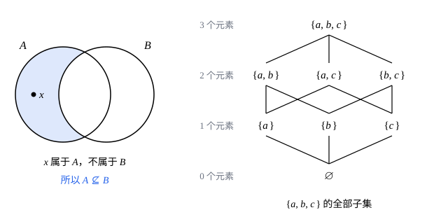

## 这一节要回答的问题

「所有有理数」「方程$x^2=2$的实数解」「区间$[0,1]$里的数」，都是把一些对象放在一起，当作一个整体来看。两种不同的写法，什么时候说的是同一个集合（set），$\{1,2\}$和$\{2,1,1\}$算不算一样？$\{1\}$是$\{1,\{1\}\}$的元素（element），还是它的:term[子集]{id="math.logic-sets.subset"}（subset），还是两者都是？

## 讲解

### 集合与元素

任给一个数，它在不在「所有有理数」里是确定的：$\frac12$在，$\sqrt2$不在。

::anchor{id="def-set"}
把一些确定的对象放在一起当作一个整体，叫作集合（set），其中每个对象叫作它的元素（element）。$a$是集合$A$的元素，记作$a\in A$，读作「$a$属于$A$」；不是，就记作$a\notin A$。

为什么只能这样描述：集合是最基本的概念，没法用更基本的东西定义；要紧的是「$a\in A$」对任何对象$a$都非真即假。

边界情况：「很大的数」组不成集合，说不清哪个算很大。元素也可以是集合：数学分析把每个实数定义成一个有理数的集合（:term[戴德金分割]{id="math.analysis.dedekind-cut"}，Dedekind cut），$\R$就成了集合的集合。

::anchor{id="def-number-sets"}
几个常用的数集记作：自然数集$\N$（含$0$），正整数集$\N^+$，整数集$\Z$，有理数集$\Q$，实数集$\R$。

为什么定下来：高中课本把正整数集写成$\N^*$或$\N_+$，各书的$\N$含不含$0$也不同。边界情况：$0\in\N$，$0\notin\N^+$。

### 列举法与描述法

小于$4$的正整数能一个个写出来，平方小于$2$的有理数却写不完。

::anchor{id="def-roster-builder"}
把元素一一写在花括号里，如$\{1,2,3\}$，叫作列举法（roster notation）；写成$\{x\in A:P(x)\}$，表示$A$中使$P(x)$成立的元素组成的集合，叫作描述法（set-builder notation），这里$P(x)$是含有变量$x$的语句。

为什么要描述法：写不完的集合，常常只能用一条性质从已有的集合里挑，如$\{x\in\Q:x^2<2\}$。高中课本把冒号写成竖线，本站的竖线留给:term[增广矩阵]{id="math.linear-algebra.augmented-matrix"}（augmented matrix）和整除。不说从哪个集合里挑会出毛病，见第 7 题。

边界情况：列举法不管先后和重复，$\{1,2\}$、$\{2,1\}$、$\{1,1,2\}$是同一个集合。数学分析的数列$\{a_n\}$却有先后、可以重复，不是集合，它其实是:term[映射]{id="math.logic-sets.map"}（map）$\N^+\to\R$，见[映射](lesson:math.logic-sets.functions)。

几种常见的简写：

| 写法 | 意思 |
| --- | --- |
| $\{f(x):x\in D\}$ | 所有形如$f(x)$的元素（$x$取遍$D$），即函数值的集合；$\{2k:k\in\Z\}$是偶数集 |
| ${\{a+b:a\in A,\ b\in B\}}$ | $a$、$b$分别取遍$A$、$B$时所有的$a+b$ |
| ${\{x>0:x^2<2\}}$ | $x$在哪里取看上下文，在$\R$里取就是$\{x\in\R:x>0,\ x^2<2\}$；逗号表示「且」 |
| $\{x:x^2<2\}$ | 在$\R$里取值时省掉$x\in\R$ |
| $\{a_k:k\ge n\}$ | 数列从第$n$项起各项组成的集合 |
| $[a,b]$ | $\{x\in\R:a\le x\le b\}$ |

### 子集与集合相等

$\{1,2\}$的元素都在$\{1,2,3\}$里，$\{1\}$和$\{2\}$却不是这样。

::anchor{id="def-subset"}
如果集合$A$的每个元素都是集合$B$的元素，就说$A$是$B$的:term[子集]{id="math.logic-sets.subset"}（subset），记作$A\subseteq B$，读作「$A$包含于$B$」；也说$B$包含$A$，记作$B\supseteq A$。

为什么这样定义：它就是$\forall x\in A,\ x\in B$，比较两个集合最常问这一句。由[全称量词与存在量词](lesson:math.logic-sets.quantifiers#thm-quantifier-negation)里否定量词命题的定理，$A$不是$B$的子集（记作$A\not\subseteq B$）就是$\exists x\in A,\ x\notin B$：找出一个在$A$里、不在$B$里的元素就够了。

边界情况：两个集合可以谁也不包含谁，如$\{1\}$和$\{2\}$，所以由$A\not\subseteq B$推不出$B\subseteq A$。

::anchor{id="def-set-equality"}
两个集合的元素完全相同，就说它们相等，记作$A=B$。

为什么这样定义：集合只由元素决定，和写法无关，如$\{x\in\R:x^2=1\}=\{-1,1\}$。边界情况：$\{\{1\}\}$的元素是集合$\{1\}$，$\{1\}$的元素是数$1$，两者不相等。

::anchor{id="thm-set-equality"}
**定理**　$A=B$当且仅当$A\subseteq B$且$B\subseteq A$。

**证明**：$A=B$时两者元素相同，自然互相包含。反过来，互相包含时，属于其中一个的元素都属于另一个，两者元素相同，即$A=B$。

所以证两个集合相等，就证互相包含：任取$x\in A$，推出$x\in B$；再反过来，见例 1。

::anchor{id="def-proper-subset"}
若$A\subseteq B$且$A\ne B$，就说$A$是$B$的:term[真子集]{id="math.logic-sets.proper-subset"}（proper subset），记作$A\subsetneq B$，高中课本写作$A\subsetneqq B$。

为什么这样定义：有时要说$B$确实多出元素，如$\{1,2\}\subsetneq\{1,2,3\}$。边界情况：每个集合都是自己的子集，不是自己的真子集。

[蕴含与充要条件](lesson:math.logic-sets.implication)的几何图像，用小椭圆套在大椭圆里画出包含。

::anchor{id="def-venn"}
用平面上封闭曲线围成的区域表示集合、区域里的点表示元素，这样的图叫作:term[韦恩图]{id="math.logic-sets.venn-diagram"}（Venn diagram），课本写作 Venn 图。

为什么画它：包含、相交一眼看得出。边界情况：图只是示意，不能代替证明。

### 空集

方程$x^2=-1$没有实数解，$\{x\in\R:x^2=-1\}$里一个元素也没有。

::anchor{id="def-empty-set"}
不含任何元素的集合叫作:term[空集]{id="math.logic-sets.empty-set"}（empty set），记作$\varnothing$；不是空集的集合叫作非空集合（nonempty set），$A$的非空子集就是$A$的不是空集的:term[子集]{id="math.logic-sets.subset"}。

为什么需要它：有了它，一个元素也挑不出的描述法照样表示一个集合。边界情况：$\varnothing$没有元素，$\{\varnothing\}$却有一个元素$\varnothing$，两者不同。

::anchor{id="thm-empty-subset"}
**定理**　对任何集合$A$，$\varnothing\subseteq A$；空集只有一个。

**证明**：$\varnothing\subseteq A$即$\forall x\in\varnothing,\ x\in A$。取值范围里没有元素，找不到反例（counterexample），照[全称量词与存在量词](lesson:math.logic-sets.quantifiers#def-universal)里的定义为真；读成「若$x\in\varnothing$，则$x\in A$」也一样，条件永远不成立，照:term[蕴含]{id="math.logic-sets.implication"}（implication）的定义为真。若$E_1$、$E_2$都是空集，则$E_1\subseteq E_2$且$E_2\subseteq E_1$，所以$E_1=E_2$。

同样，「$\varnothing$的每个元素都……」不管后面说什么都为真：数学分析说每个实数都是空集的:term[上界]{id="math.analysis.upper-bound"}（upper bound），道理就在这里。

### 幂集

设$a\ne b$，$\{a,b\}$的:term[子集]{id="math.logic-sets.subset"}有$\varnothing$、$\{a\}$、$\{b\}$、$\{a,b\}$四个，把它们收在一起，又是一个集合。

::anchor{id="def-power-set"}
集合$A$的所有子集组成的集合，叫作$A$的:term[幂集]{id="math.logic-sets.power-set"}（power set），记作$\Pow(A)$，如$\Pow(\{a,b\})=\{\varnothing,\{a\},\{b\},\{a,b\}\}$。

为什么这样定义：子集本身成了可以讨论、计数的对象；$X\in\Pow(A)$就是$X\subseteq A$，$\in$和$\subseteq$在这里对上了。边界情况：$\Pow(\varnothing)=\{\varnothing\}$，有一个元素，不是:term[空集]{id="math.logic-sets.empty-set"}。

::anchor{id="thm-subset-count"}
**定理**　有$n$个元素的集合恰有$2^n$个子集。

**证明**：造一个子集，就是对每个元素决定放还是不放；每个元素两种选法，由乘法原理（multiplication principle）共$2^n$种。不同的选法给出不同的子集，每个子集也由一种选法得到：放进它含有的元素。所以子集恰有$2^n$个。

## 几何图像

左图是一张:term[韦恩图]{id="math.logic-sets.venn-diagram"}：圆点$x$在$A$里、不在$B$里，有这样一个$x$，就说明$A$不是$B$的:term[子集]{id="math.logic-sets.subset"}。两个圆相交、画多大，都只是示意。

右图是$\{a,b,c\}$（$a$、$b$、$c$互不相同）的全部子集，也就是:term[幂集]{id="math.logic-sets.power-set"}$\Pow(\{a,b,c\})$的元素，按元素个数从下到上排成四层，每层依次有$1$、$3$、$3$、$1$个，一共$2^3=8$个。每条线连着的两个子集，下面的是上面的子集，并且只少一个元素：从$\varnothing$顺着线往上走，每一步添进一个元素，最后到$\{a,b,c\}$。

元素有无穷多个时，一个集合和它的幂集谁的元素多，要等[不可数集与对角线论证](lesson:math.logic-sets.uncountable-sets)才说得清。

## 例题

### 例 1　证明两个集合相等

证明$\{6m+4n:m,n\in\Z\}=\{2k:k\in\Z\}$。

**为什么想到这么做**：按定理证互相包含。左边的数显然是偶数；反过来，像证:term[存在量词命题]{id="math.logic-sets.existential-statement"}（existential statement）那样，给每个偶数造出一组$m$、$n$。

**推导**：记左边为$A$，右边为$B$。任取$x\in A$，有整数$m$、$n$使$x=6m+4n=2(3m+2n)$，$3m+2n$是整数，所以$x\in B$，$A\subseteq B$。

反过来，任取$x\in B$，有整数$k$使$x=2k$；取$m=k$、$n=-k$，则$6m+4n=2k=x$，所以$x\in A$，$B\subseteq A$。由定理，$A=B$。

### 例 2　元素也是集合

设$A=\{1,\{1\}\}$。写出$\Pow(A)$，并判断$\{1\}\in A$、$\{1\}\subseteq A$、$\{\{1\}\}\subseteq A$、$\{\{1\}\}\in\Pow(A)$、$1\in\Pow(A)$是否成立。

**为什么想到这么做**：先认清$A$只有两个元素：数$1$和集合$\{1\}$。「$\in$」看左边是不是其中之一，「$\subseteq$」看左边的元素是不是都在其中。

**推导**：$A$有$2$个元素，:term[子集]{id="math.logic-sets.subset"}有$2^2=4$个：$\Pow(A)=\{\varnothing,\{1\},\{\{1\}\},\{1,\{1\}\}\}$。

$\{1\}$是$A$的元素，$\{1\}\in A$；它的元素$1$也属于$A$，所以$\{1\}\subseteq A$，两者都成立。$\{\{1\}\}$的元素$\{1\}$属于$A$，所以$\{\{1\}\}\subseteq A$，由:term[幂集]{id="math.logic-sets.power-set"}的定义，$\{\{1\}\}\in\Pow(A)$。$\Pow(A)$的四个元素里没有$1$，所以$1\notin\Pow(A)$。

## 常见误区

- 「$\{1,2\}\in\{1,2,3\}$，因为$1$、$2$都在$\{1,2,3\}$里。」不对：$\{1,2,3\}$的元素是$1$、$2$、$3$三个数，集合$\{1,2\}$不是其中之一。$1$、$2$都在里面，说明的是$\{1,2\}$是$\{1,2,3\}$的:term[子集]{id="math.logic-sets.subset"}。
- 「要证$A=B$，证出$A\subseteq B$就够了。」不对：$\{1\}\subseteq\{1,2\}$，两者却不相等。还要反过来证$B\subseteq A$，两个方向缺一不可。
- 「:term[空集]{id="math.logic-sets.empty-set"}没有元素，所以它不是任何集合的子集。」不对：正因为空集没有元素，「空集的每个元素都属于$A$」找不到反例，为真，空集是任何集合的子集。
- 「$A\subset B$一定是说$A$是$B$的:term[真子集]{id="math.logic-sets.proper-subset"}。」不一定：有的书把$\subseteq$写成$\subset$，有的书用$\subset$表示真子集，要看那本书的约定。本站子集写$\subseteq$、真子集写$\subsetneq$，个别地方写的$\subset$按「包含于」读。
