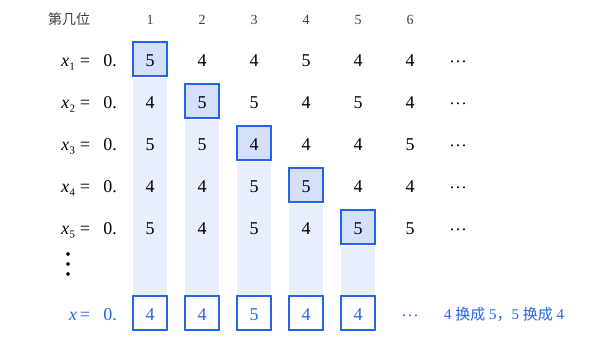
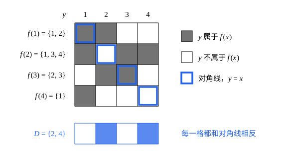

## 这一节要回答的问题

$\Z$、$\N\times\N$看着比$\N$大得多，却都能排成一列。数学分析一次次取小区间，证过$[0,1]$里的数怎样排都有漏的；有没有更直接的办法，不靠区间，还能用到别的集合上？元素有无穷多个时，一个集合和它的:term[幂集]{id="math.logic-sets.power-set"}（power set）谁的元素多，有没有元素最多的集合？

## 讲解

### 不可数集

[闭区间套定理](lesson:math.analysis.nested-intervals)例 2 证过：任给一列实数，$[0,1]$里总有一个数不在其中。$[0,1]$怎样排都有漏的，和$\Z$、$\N\times\N$不一样。

::anchor{id="def-uncountable"}
不是:term[至多可数集]{id="math.logic-sets.at-most-countable"}（at most countable set）的集合，即既不是:term[有限集]{id="math.logic-sets.finite-set"}（finite set）、又不与$\N$:term[等势]{id="math.logic-sets.equinumerous"}（equinumerous）的集合，叫作:term[不可数集]{id="math.logic-sets.uncountable-set"}（uncountable set）。

为什么这样定义：:term[无限集]{id="math.logic-sets.infinite-set"}（infinite set）由此分成两种，:term[可数集]{id="math.logic-sets.countable-set"}（countable set）排得成一列，不可数集怎样排都有漏的。边界情况：$\{1,2,3\}$既不是可数集，也不是不可数集；一种排法不成，不等于不可数，$\Z$从小到大排没有第一个，照$0,1,-1,2,-2,\dots$却排得成。

::anchor{id="thm-uncountable-criterion"}
**定理**　设$A$不是:term[空集]{id="math.logic-sets.empty-set"}（empty set）。若任给$A$的一列元素$x_1,x_2,x_3,\dots$（可以重复），$A$中总有元素不在其中，则$A$是不可数集。

**证明**：$A$要是可数集，它的元素能排成一列，一个不漏；要是有限集，因为不空，写成$\{a_1,a_2,\dots,a_n\}$（$n\ge1$），$a_1,a_2,\dots,a_n,a_n,a_n,\dots$也是一列，一个不漏。都和条件矛盾，所以$A$是不可数集。

[闭区间套定理](lesson:math.analysis.nested-intervals)例 2 说的，就是$[0,1]$不可数。

### 对角线论证

夹区间的办法，对象不是数时没有区间可夹。换一个，照数位来造：让$x$的第$n$位和$x_n$的第$n$位不同。麻烦在于数位不同，数未必不同：$0.5000\cdots$和$0.4999\cdots$每一位都不同，却是同一个数。只用数字$4$和$5$，就没有这种麻烦。

::anchor{id="thm-decimals"}
**定理**　设$d_1,d_2,d_3,\dots$都是$4$或$5$，$s_n=0.d_1d_2\cdots d_n$。(1) 数列$s_1,s_2,s_3,\dots$有极限（limit），它在$\bigl[\frac49,\frac59\bigr]$里，就是无限小数$0.d_1d_2d_3\cdots$表示的实数；(2) 两个这样的无限小数只要有一位不同，表示的实数就不同。

**证明**：(1) $0.44\cdots4\le s_n\le0.55\cdots5$（都是$n$位），即$\frac49(1-10^{-n})\le s_n\le\frac59(1-10^{-n})$。$s_n$随$n$递增，又都小于$\frac59$，由[单调有界原理](lesson:math.analysis.bounded-monotone#thm-monotone-convergence)（monotone convergence theorem）有极限；两头的极限是$\frac49$、$\frac59$，由[保不等式性](lesson:math.analysis.limit-properties#thm-order-limit)（order limit theorem），它在$\bigl[\frac49,\frac59\bigr]$里。

(2) 设第$j$位第一次不同，一个是$5$，另一个是$4$；$n>j$时，截到第$n$位分别是$s_n$、$t_n$。第$j$位让$s_n$多出$10^{-j}$，后面的第$k$位至多让它少$10^{-k}$，所以

$$
s_n-t_n\ge10^{-j}-\bigl(10^{-(j+1)}+\cdots+10^{-n}\bigr)>10^{-j}-\frac19\cdot10^{-j}=\frac89\cdot10^{-j} .
$$

两边取极限，两个实数至少相差$\frac89\cdot10^{-j}$，所以不同。

::anchor{id="thm-reals-uncountable"}
**定理**　任给一列实数，$[0,1]$里总有数不在其中；所以$\R$和$[0,1]$都是:term[不可数集]{id="math.logic-sets.uncountable-set"}。

**证明**：任给一列实数$x_1,x_2,x_3,\dots$。$x_n$等于某个只含$4$、$5$的无限小数时，由上面的定理，写法只有一种，记作$0.a_{n1}a_{n2}a_{n3}\cdots$，取$d_n$为$4$、$5$中不等于$a_{nn}$的那个；否则取$d_n=4$。令$x=0.d_1d_2d_3\cdots$，$x\in\bigl[\frac49,\frac59\bigr]\subseteq[0,1]$。

对每个$n$，$x\ne x_n$：前一种情形，两者的第$n$位不同，由上面的定理，是不同的实数；后一种情形，$x$是这样的小数，$x_n$不是。所以$x$不在这一列里，由第一个定理，$\R$和$[0,1]$都不可数。

::anchor{id="def-diagonal-argument"}
任给一列对象，造一个同类的对象，让它和第$n$个在第$n$处不同（编号也可以用别的集合的元素），由此断定它不在其中、这一列没有排全，这样的论证叫作:term[对角线论证]{id="math.logic-sets.diagonal-argument"}（diagonal argument）。

为什么叫这个名字：把各个数的数位一行一行写成一张表，要躲开的$a_{11},a_{22},a_{33},\dots$正在对角线上，见几何图像。[闭区间套定理](lesson:math.analysis.nested-intervals)例 2 用越来越小的区间逐个躲开$x_n$，这里给每个$x_n$派一个数位专门躲它。边界情况：造出来的要和列里的同类，才说得上漏了；$x$是实数，换成一列有理数就说不成，见常见误区。

### 康托尔定理

有$n$个元素的集合有$2^n$个:term[子集]{id="math.logic-sets.subset"}（subset），总比$n$多；元素有无穷多个时谁多，[集合与子集](lesson:math.logic-sets.sets)没有说。

::anchor{id="thm-cantor"}
**:term[康托尔定理]{id="math.logic-sets.cantor-theorem"}（Cantor's theorem）**　设$A$是任何集合，从$A$到:term[幂集]{id="math.logic-sets.power-set"}$\Pow(A)$的:term[映射]{id="math.logic-sets.map"}（map）都不是:term[满射]{id="math.logic-sets.surjective"}（surjective），所以$A$与$\Pow(A)$不:term[等势]{id="math.logic-sets.equinumerous"}。

**证明**：任给$f:A\to\Pow(A)$，每个$f(x)$都是$A$的子集，$x$属不属于它是确定的。令$D=\{x\in A:x\notin f(x)\}$，也是$A$的子集。任取$a\in A$，$a\in D$当且仅当$a\notin f(a)$，所以$D$和$f(a)$在$a$这一处不同，$D\ne f(a)$。于是$D$不是任何元素的像（image），$f$不是满射。

另一方面，$x\mapsto\{x\}$是从$A$到$\Pow(A)$的:term[单射]{id="math.logic-sets.injective"}（injective）。有单射，没有:term[双射]{id="math.logic-sets.bijective"}（bijective），「幂集的元素更多」就这样说清了，有限、无限都一样。于是$\Pow(\N)$比$\N$多，$\Pow(\Pow(\N))$又更多，哪个集合都不是元素最多的。

这也是:term[对角线论证]{id="math.logic-sets.diagonal-argument"}，编号用的是$A$的元素。列一张表，第$x$行第$y$列写$y$属不属于$f(x)$，第$x$行就是$f(x)$；$D$把对角线上的每一格反过来，和第$a$行在第$a$格不同，所以不是任何一行。

每个$S\subseteq A$都有:term[指示函数]{id="math.logic-sets.indicator-function"}（indicator function，见[映射](lesson:math.logic-sets.functions#def-indicator-function)）$\mathbf 1_S:A\to\{0,1\}$，由它认得出$S=\{x\in A:\mathbf 1_S(x)=1\}$；反过来，映射$g:A\to\{0,1\}$就是$\{x\in A:g(x)=1\}$的指示函数。所以$S\mapsto\mathbf 1_S$是双射，$\Pow(A)$和全体映射$A\to\{0,1\}$组成的集合等势。$A$有$n$个元素时，这样的映射有$2^n$个（$n=3$见那一节例 2），有的书因此把$\Pow(A)$写成$2^A$。

数学分析另有一条:term[康托尔定理]{id="math.analysis.heine-cantor-theorem"}（Heine-Cantor theorem），讲的是:term[一致连续]{id="math.analysis.uniform-continuity"}（uniform continuity），只是同名。

## 几何图像

每行是一个$x_n$的前六位，方框里是第$n$行的第$n$位，正好排在一条对角线上。把方框里的数字换成另一个（$4$换成$5$，$5$换成$4$），写到最下面同一列，就是$x$：它和$x_n$在第$n$位不同，所以不等于任何一个$x_n$。图里的$x_n$都是只含$4$、$5$的小数，别的实数不用躲。

$A=\{1,2,3,4\}$，$f:A\to\Pow(A)$。第$x$行就是$f(x)$，涂色的格子是它的元素；粗框是对角线，第$x$行的那一格涂没涂，就看$x$属不属于$f(x)$。$D$的每一格都和对角线相反，$1$、$3$不在里面，$2$、$4$在里面，所以它和第$x$行在第$x$格不同，不是四行中的任何一行：四行至多给出四个:term[子集]{id="math.logic-sets.subset"}，$\Pow(A)$却有$16$个元素。把涂色写成$1$、不涂写成$0$，每一行就是一列$0$、$1$，和例 1 的表一样。

## 例题

### 例 1　全体 0、1 数列

每一项都是$0$或$1$的数列，全体组成的集合是:term[可数集]{id="math.logic-sets.countable-set"}吗？

**为什么想到这么做**：任给一列这样的数列，第$n$个写成第$n$行，排成一张表。把对角线上的$0$、$1$对调，得到的还是$0$、$1$数列，又和每一行都不同。

**推导**：任给一列这样的数列，第$n$个记作$a_{n1},a_{n2},a_{n3},\dots$。令$b_n=1-a_{nn}$，数列$b_1,b_2,b_3,\dots$的每一项是$0$或$1$，它和第$n$个数列的第$n$项不同，所以不在这一列里。由讲解的第一个定理，这个集合是:term[不可数集]{id="math.logic-sets.uncountable-set"}。

### 例 2　再短的开区间也不可数

设$a<b$。证明开区间$(a,b)$是:term[不可数集]{id="math.logic-sets.uncountable-set"}。

**为什么想到这么做**：讲解造出的$x$落在$\bigl[\frac49,\frac59\bigr]$里，所以$(0,1)$也不可数；$(a,b)$和$(0,1)$:term[等势]{id="math.logic-sets.equinumerous"}，不可数跟着传过去。

**推导**：任给一列实数，都有$\bigl[\frac49,\frac59\bigr]\subseteq(0,1)$中的数不在其中，所以$(0,1)$不可数。由[等势与可数集](lesson:math.logic-sets.countable-sets)例 1，$(a,b)$与$(0,1)$等势；假如$(a,b)$:term[至多可数]{id="math.logic-sets.at-most-countable"}，$(0,1)$也就至多可数，矛盾。再短的一段，也排不成一列。

## 常见误区

- 「照样的论证说明$\Q$也:term[不可数]{id="math.logic-sets.uncountable-set"}。」不对：对一列有理数照样造得出$x$，可$x$是无限小数，只知道它是实数，没有理由说它是有理数；这一列要是包括了所有的有理数，$x$就一定是无理数。$\Q$其实是:term[可数集]{id="math.logic-sets.countable-set"}，见[可数集的子集与有理数集](lesson:math.logic-sets.countable-subsets)。
- 「举出一列漏了元素的，就说明$A$不可数。」不对：要任给一列都有漏的。$0,2,4,\dots$漏了$1$，$\N$却可数。
- 「把造出的$x$补进这一列，就排全了。」不对：补了以后是另一列，对它再造一次，又有漏的；论证对每一列都管用。
- 「把$\N\times\N$按对角线排成一列，就是:term[对角线论证]{id="math.logic-sets.diagonal-argument"}。」不对：那里沿一条条斜线走遍整张表，说明排得成；对角线论证只取表里的一条对角线，造一个不在列里的对象，说明排不全。
- 「不可数集都一样多。」不对：任给$\R$的一列:term[子集]{id="math.logic-sets.subset"}$S_1,S_2,S_3,\dots$，$\{n\in\N^+:n\notin S_n\}$不在其中，所以$\Pow(\R)$也不可数；由:term[康托尔定理]{id="math.logic-sets.cantor-theorem"}，它和$\R$不:term[等势]{id="math.logic-sets.equinumerous"}。有没有集合比$\N$多、又比$\R$少（怎样比，见[康托尔-伯恩斯坦定理](lesson:math.logic-sets.cantor-bernstein)）？连续统假设（continuum hypothesis）说没有；集合论通常的公理只要不自相矛盾，就既证不出它，也推不翻它。
