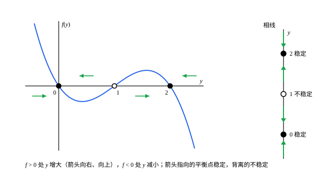

## 这一节要回答的问题

[逻辑斯谛方程](lesson:math.ode.separable#def-logistic)（logistic equation）$y'=ry\bigl(1-\frac yK\bigr)$里，$y$的变化率只由$y$本身决定，和时间无关。这样的方程，不解出来能不能知道解最终趋于哪里？哪些常数解在稍受扰动后还会回来，哪些一碰就跑掉？

## 讲解

### 自治方程与平衡点

:term[逻辑斯谛方程]{id="math.ode.logistic-equation"}、衰变方程$y'=-ky$、$y'=y^2$都有一个共同点：右边只出现$y$，不出现$t$。

::anchor{id="def-autonomous"}
右边不显含自变量的一阶方程$y'=f(y)$，叫作:term[自治方程]{id="math.ode.autonomous-equation"}（autonomous equation）。下面总设$f$连续可导。

为什么这样定义：规律本身不随时间变，所以把一个解在时间上平移，$y(t-c)$仍是解：今天从$y_0$出发和明天从$y_0$出发，走的是同一条路，只是晚一天。边界情况：$y'=y-t$的右边含$t$，不是自治的，平移以后的函数一般不再是解。

::anchor{id="def-equilibrium"}
使$f(y^*)=0$的数$y^*$叫作:term[平衡点]{id="math.ode.equilibrium-point"}（equilibrium point）；常数函数$y\equiv y^*$是一个解，叫作平衡解（equilibrium solution）。

为什么这样定义：在$y^*$处变化率是$0$，从那里出发就一直不动。边界情况：平衡点不一定「平衡得住」：逻辑斯谛方程的$y=0$是平衡点，可只要有一点点个体，数量就会增长离开$0$。

### 相线

$y'=f(y)$说的是：$y$此刻在哪里，就以$f(y)$的速度移动。$f>0$时$y$增大，$f<0$时$y$减小，只看$f$的符号，就知道$y$往哪边走。

::anchor{id="def-phase-line"}
在一条竖直的$y$轴上标出所有:term[平衡点]{id="math.ode.equilibrium-point"}，在$f>0$的区间里画向上的箭头，在$f<0$的区间里画向下的箭头，得到的图叫作这个方程的:term[相线]{id="math.ode.phase-line"}（phase line）。

为什么这样定义：相线把解的整个走向压缩在一条线上：从哪里出发，就顺着箭头走，走向箭头指着的平衡点。边界情况：相线只画方向，不画快慢，从相线上读不出走到某处要多久。

::anchor{id="thm-phase-line"}
**相线上的解**　(1) 不同的:term[解曲线]{id="math.ode.solution-curve"}（solution curve）不相交，非常数的解不会在有限时间内到达平衡点；(2) 非常数的解严格单调；(3) 解有界时，$t\to+\infty$时趋于一个平衡点。

**证明思路**：(1) 来自解的唯一性：$f$连续可导时，经过每一点的解只有一条，见[解的存在唯一性](lesson:math.ode.existence-uniqueness)；要是一个解在某时刻到达$y^*$，它就和平衡解$y\equiv y^*$交在一点。(2) 由 (1)，解夹在两个相邻的平衡点之间（或在最外面的一个之外），那里$f$不变号，$y'$也就不变号。(3) 单调有界的函数有极限$L$；若$f(L)\ne0$，$y'$最终接近$f(L)\ne0$，$y$会越过$L$，所以$f(L)=0$。详细的证明见第 5 题。

### 稳定性

::anchor{id="def-stability"}
从:term[平衡点]{id="math.ode.equilibrium-point"}$y^*$附近出发的解都留在$y^*$附近，并且$t\to+\infty$时趋于$y^*$，就说$y^*$:term[渐近稳定]{id="math.ode.asymptotically-stable"}（asymptotically stable），本节简称稳定（stable）；如果有一个固定的范围，离$y^*$任意近处出发的解里，总有跑出这个范围的，就说$y^*$不稳定（unstable）。一侧的解趋于它、另一侧的解离开它时，叫作半稳定（semi-stable），它是不稳定的一种。

为什么这样定义：真实的系统总有扰动，只有扰动以后能回来的平衡态，才看得到、守得住。边界情况：在:term[相线]{id="math.ode.phase-line"}上，稳定的平衡点两侧的箭头都指向它；不稳定的两侧都背离它；$y'=y^2$的$0$，左侧箭头指向它、右侧背离它，是半稳定的。

::anchor{id="thm-linearization"}
**判别法**　设$f(y^*)=0$。若$f'(y^*)<0$，$y^*$稳定；若$f'(y^*)>0$，$y^*$不稳定；若$f'(y^*)=0$，判别法不能下结论，要看$f$在$y^*$两侧的符号。

**证明思路**：$f'(y^*)<0$时，$f$在$y^*$左边附近为正、右边附近为负，两侧的箭头都指向$y^*$，由相线上的解的性质 (3)，附近的解趋于$y^*$。另一种看法：令$w=y-y^*$，$w'=f(y^*+w)\approx f'(y^*)w$，偏差像$e^{f'(y^*)t}$那样衰减或增长。$f'(y^*)=0$时线性项消失，三种情形都可能出现：$y'=-y^3$、$y'=y^3$、$y'=y^2$在$0$处分别是稳定、不稳定、半稳定。

## 几何图像

左边是$f(y)=y(1-y)(y-2)$的图像，右边是$y'=f(y)$的:term[相线]{id="math.ode.phase-line"}。$f$由正变负的零点$0$、$2$处，两侧的箭头都指向它，是稳定的:term[平衡点]{id="math.ode.equilibrium-point"}；$f$由负变正的零点$1$是不稳定的。

:::anim{component="phase-portrait"}
system: { x: "1", y: "4*y*(1 - y)*(y - a)" }
range: { x: [0, 12], y: [-0.3, 1.3] }
dt: 0.005
trail: full
initial:
  - [0, -0.2]
  - [0, 0.1]
  - [0, 0.3]
  - [0, 0.5]
  - [0, 0.7]
  - [0, 0.9]
  - [0, 1.2]
sliders:
  - name: a
    min: 0.2
    max: 0.8
    step: 0.05
    default: 0.4
    label: |
      门槛$a$
:::

这是$y'=4y(1-y)(y-a)$，横轴是时间（图上写作 x），三个平衡点是$0$、$a$、$1$。拖动$a$：$0$和$a$之间出发的解都降向$0$，$a$和$1$之间出发的都升向$1$，$a$是不稳定的「门槛」；$0$和$1$是稳定的，外侧的解也被拉回它们。生态学里的阿利效应（Allee effect）说的就是这种情形：数量太少的物种维持不下去。

## 例题

### 例 1　逻辑斯谛方程的两个平衡点

判断:term[逻辑斯谛方程]{id="math.ode.logistic-equation"}$y'=ry\bigl(1-\frac yK\bigr)$（$r,K>0$）的:term[平衡点]{id="math.ode.equilibrium-point"}是否稳定。

**为什么想到这么做**：平衡点是$f$的零点；稳定性用判别法看$f'$的符号最快。

**推导**：$f(y)=ry-\frac{r}{K}y^2$的零点是$0$和$K$。$f'(y)=r-\frac{2r}{K}y$，$f'(0)=r>0$，$0$不稳定；$f'(K)=-r<0$，$K$稳定。这和[可分离变量的方程](lesson:math.ode.separable)里解出来的结果一致：正的解都趋于$K$。

### 例 2　判别法失效时

判断$y'=y^2(1-y)$的:term[平衡点]{id="math.ode.equilibrium-point"}是否稳定。

**为什么想到这么做**：$f(y)=y^2(1-y)$在$0$处$f'(0)=0$，判别法不能下结论，只好直接看$f$在两侧的符号，画:term[相线]{id="math.ode.phase-line"}。

**推导**：零点是$0$和$1$。$f'(1)=2y-3y^2\big|_{y=1}=-1<0$，$1$稳定。在$0$的两侧，$y^2\ge0$，$1-y>0$，所以$f$在$0$左右都是正的：左侧的箭头指向$0$，右侧的背离$0$，$0$是半稳定的。从$-0.1$出发的解慢慢爬向$0$，从$0.1$出发的解离开$0$，升向$1$。

## 常见误区

- 「:term[平衡点]{id="math.ode.equilibrium-point"}就是稳定的状态。」平衡点只是变化率为$0$的点，可能稳定、不稳定或半稳定。
- 「$f'(y^*)=0$说明$y^*$不稳定。」这时判别法不能下结论，要看两侧的符号（例 2）。
- 「解会越过平衡点。」不会：由唯一性，非常数的解不会碰到平衡解，只能在相邻的两个平衡点之间单调地走。
