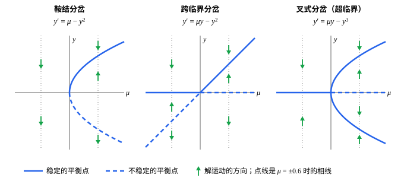

## 这一节要回答的问题

鱼塘每年捕走固定数量的鱼。捕捞量慢慢加大时，鱼群的稳定数量起初只是跟着慢慢下降；可捕捞量一越过某个值，鱼群就会突然崩溃。方程里的参数连续地变，解的长期行为为什么会突然改变？这样的突变有哪几种基本的样子？

## 讲解

### 分岔与分岔图

:term[自治方程]{id="math.ode.autonomous-equation"}（autonomous equation）里常常带着参数：增长率、捕捞量、温度。把它写成$y'=f(y,\mu)$，$\mu$是参数；对每个固定的$\mu$，它都是一个自治方程，有自己的:term[平衡点]{id="math.ode.equilibrium-point"}（equilibrium point）和:term[相线]{id="math.ode.phase-line"}（phase line）。

记$f_y$为把$\mu$当作常数、$f$对$y$求的导数。由[判别法](lesson:math.ode.autonomous-equations#thm-linearization)，$f_y(y^*,\mu)<0$的平衡点稳定，$f_y(y^*,\mu)>0$的不稳定；这里的稳定和上一节一样，都指:term[渐近稳定]{id="math.ode.asymptotically-stable"}（asymptotically stable）。

::anchor{id="def-bifurcation"}
参数$\mu$越过某个值$\mu_0$时，如果平衡点的个数或某个平衡点的稳定性发生改变，就说方程在$\mu_0$处发生了:term[分岔]{id="math.ode.bifurcation"}（bifurcation），$\mu_0$叫作分岔值（bifurcation value）。

为什么这样定义：参数稍微变一点，平衡点一般只是稍微挪动位置，相线的样子不变，解的长期行为也不变；只有平衡点出现、消失或改变稳定性时，系统的「命运」才会变。边界情况：$y'=\mu-y$的平衡点$y=\mu$随参数移动，可始终只有一个、始终稳定，没有分岔。

::anchor{id="def-bifurcation-diagram"}
以$\mu$为横轴、$y$为纵轴，画出所有满足$f(y,\mu)=0$的点，稳定的平衡点连成实线，不稳定的连成虚线，得到的图叫作:term[分岔图]{id="math.ode.bifurcation-diagram"}（bifurcation diagram）。

为什么这样定义：分岔图上的每一条竖线$\mu=c$，正是$\mu=c$时的相线；分岔图就是把各个参数下的相线并排摆在一起，平衡点怎样随参数变化一目了然。边界情况：分岔值那条竖线上的平衡点常常是半稳定的（semi-stable），在分岔图上正好是实线和虚线接在一起的地方。

### 鞍结分岔

$f(y,\mu)=\mu-y^2$的图像是开口向下的抛物线，$\mu$增大时整条抛物线往上平移。顶点还在横轴下面时，$f$没有零点；顶点碰到横轴，出现一个零点；再往上，零点一分为二，向两边分开。

::anchor{id="def-saddle-node"}
两个:term[平衡点]{id="math.ode.equilibrium-point"}随参数靠近、合并，然后一起消失，叫作:term[鞍结分岔]{id="math.ode.saddle-node-bifurcation"}（saddle-node bifurcation）。标准的例子是$y'=\mu-y^2$：$\mu<0$时没有平衡点；$\mu=0$时只有一个半稳定的平衡点$0$；$\mu>0$时有两个，$\sqrt\mu$稳定，$-\sqrt\mu$不稳定。

为什么这样定义：这是最常见的:term[分岔]{id="math.ode.bifurcation"}。一般的$f$随参数变化时，图像上的一个极值点越过横轴，零点就成对地出现或消失，合并的两点总是一个稳定、一个不稳定。名字来自平面上的方程组：合并的两个平衡点在那里一个是鞍点（saddle）、一个是结点（node），见以后的[平面线性系统的相图](lesson:math.ode.phase-plane-linear)。边界情况：$y'=\mu+y^2$方向相反，$\mu<0$时有两个平衡点，$\mu>0$时一个也没有。

### 跨临界分岔与叉式分岔

有些方程里，某个:term[平衡点]{id="math.ode.equilibrium-point"}对所有参数都存在：种群数量为$0$，就一直是$0$。这时另一支平衡点没法凭空出现或消失，只能穿过它。

::anchor{id="def-transcritical"}
两个平衡点随参数靠近、重合，然后穿过彼此并交换稳定性，叫作:term[跨临界分岔]{id="math.ode.transcritical-bifurcation"}（transcritical bifurcation）。标准的例子是$y'=\mu y-y^2$：平衡点是$0$和$\mu$，$\mu<0$时$0$稳定、$\mu$不稳定，$\mu>0$时$0$不稳定、$\mu$稳定。

为什么这样定义：$f_y=\mu-2y$在$0$处等于$\mu$、在$\mu$处等于$-\mu$，两者总是异号，参数穿过$0$时同时变号，稳定性就交换了。边界情况：$\mu=0$时两点重合为$0$，方程是$y'=-y^2$，$0$是半稳定的。

如果方程关于$y\mapsto-y$对称，即$f(-y,\mu)=-f(y,\mu)$，那么$0$总是平衡点，其余的平衡点成对出现。

::anchor{id="def-pitchfork"}
在关于$y\mapsto-y$对称的方程里，一个平衡点随参数分成三个，叫作:term[叉式分岔]{id="math.ode.pitchfork-bifurcation"}（pitchfork bifurcation）。标准的例子是$y'=\mu y-y^3$：$\mu\le0$时只有稳定的平衡点$0$；$\mu>0$时$0$变得不稳定，两侧多出两个稳定的平衡点$\pm\sqrt\mu$。新出的两个平衡点稳定时叫作超临界的（supercritical），像$y'=\mu y+y^3$那样新出的两个不稳定时，叫作亚临界的（subcritical）。

为什么这样定义：对称性让平衡点只能成对地从$0$分出来，:term[分岔图]{id="math.ode.bifurcation-diagram"}像一把三齿的叉子，名字由此而来。边界情况：亚临界的$y'=\mu y+y^3$里，$\mu<0$时$0$稳定、两侧的$\pm\sqrt{-\mu}$不稳定；$\mu$越过$0$后，$0$变得不稳定，附近又没有别的稳定平衡点，解会跑到很远的地方去。

### 到哪里去找分岔

::anchor{id="thm-bifurcation-condition"}
**:term[分岔]{id="math.ode.bifurcation"}的必要条件**　设$f$、$f_y$连续（$(y,\mu)$靠近$(y^*,\mu_0)$时，函数值也靠近），$f(y^*,\mu_0)=0$，$f_y(y^*,\mu_0)\ne0$。那么$\mu$在$\mu_0$附近时，$y^*$附近恰好有一个:term[平衡点]{id="math.ode.equilibrium-point"}，它随$\mu$连续移动，稳定性和$y^*$相同。所以只要平衡点不从无穷远处来、也不跑到无穷远去，分岔就只可能发生在同时满足$f(y^*,\mu_0)=0$、$f_y(y^*,\mu_0)=0$的点上。

**证明思路**：不妨设$f_y(y^*,\mu_0)<0$。由连续性，在$(y^*,\mu_0)$附近$f_y<0$，$f$对$y$严格递减；取小的$\delta>0$，$f(y^*-\delta,\mu_0)>0>f(y^*+\delta,\mu_0)$，$\mu$稍有变化时这两个符号保持不变。由介值定理（intermediate value theorem），$f(y,\mu)$在$(y^*-\delta,y^*+\delta)$里恰有一个零点，那里$f_y<0$，仍然稳定。详细的证明见第 5 题。

找分岔的办法因此是：联立$f=0$、$f_y=0$，解出可能的点，再逐个检查平衡点的个数或稳定性是否真的在那里改变。三个标准例子的分岔都发生在$(y,\mu)=(0,0)$，那里$f=0$，$f_y=0$。平衡点跑到无穷远的分岔要另外看：$y'=\mu-e^y$在$\mu\le0$时没有平衡点，$\mu>0$时有一个$\ln\mu$，$\mu\to0^+$时它跑向$-\infty$，可$f_y=-e^y$处处不为$0$。

## 几何图像

左、中、右依次是:term[鞍结分岔]{id="math.ode.saddle-node-bifurcation"}、:term[跨临界分岔]{id="math.ode.transcritical-bifurcation"}和:term[叉式分岔]{id="math.ode.pitchfork-bifurcation"}的:term[分岔图]{id="math.ode.bifurcation-diagram"}。每条竖线都是一条:term[相线]{id="math.ode.phase-line"}：箭头指向实线，背离虚线；三张图里，:term[平衡点]{id="math.ode.equilibrium-point"}的个数或稳定性都在$\mu=0$处改变。

:::anim{component="phase-portrait"}
system: { x: "1", y: "mu*y - y^3" }
range: { x: [0, 10], y: [-1.6, 1.6] }
dt: 0.01
trail: full
initial:
  - [0, -1.5]
  - [0, -1]
  - [0, -0.5]
  - [0, -0.1]
  - [0, 0.1]
  - [0, 0.5]
  - [0, 1]
  - [0, 1.5]
sliders:
  - name: mu
    min: -1
    max: 1
    step: 0.05
    default: 0.5
    label: |
      参数$\mu$
:::

这是$y'=\mu y-y^3$，横轴是时间（图上写作 x）。拖动$\mu$：$\mu<0$时所有的解都趋于$0$；$\mu>0$时$0$变得不稳定，上半边出发的解趋于$\sqrt\mu$，下半边的趋于$-\sqrt\mu$。$\mu$越接近$0$，解靠近平衡点就越慢。

## 例题

### 例 1　按比例捕捞

鱼群按逻辑斯谛规律增长，每年按现有数量的比例$E$捕捞（$E\ge0$是捕捞强度），方程是$y'=y(1-y)-Ey$。求分岔值，并说明$E$越过它时鱼群会怎样。

**为什么想到这么做**：先求:term[平衡点]{id="math.ode.equilibrium-point"}，再用$f_y$的符号判断稳定性，看它在哪个$E$处改变。

**推导**：$f(y,E)=(1-E)y-y^2=y(1-E-y)$，平衡点是$0$和$1-E$。$f_y=1-E-2y$，在$0$处等于$1-E$，在$1-E$处等于$E-1$。$E<1$时$0$不稳定、$1-E$稳定，鱼群稳定在$1-E$；$E>1$时$1-E<0$，$0$变得稳定，鱼群灭绝。两个平衡点在$E=1$处穿过彼此、交换稳定性，这是:term[跨临界分岔]{id="math.ode.transcritical-bifurcation"}，分岔值是$1$；鱼群的稳定数量随$E$连续地降到$0$，没有突然的崩溃。

### 例 2　跳变与滞后

求$y'=\mu+3y-y^3$的分岔值，画出:term[分岔图]{id="math.ode.bifurcation-diagram"}，并说明$\mu$从$-3$慢慢增大到$3$、再慢慢减小回$-3$时，解会怎样变化。

**为什么想到这么做**：$\mu$有界时，三次方程$\mu+3y-y^3=0$的根也有界，:term[平衡点]{id="math.ode.equilibrium-point"}不会跑到无穷远，所以:term[分岔]{id="math.ode.bifurcation"}只可能发生在$f=0$、$f_y=0$的点上，先联立求出这些点。平衡点满足$\mu=y^3-3y$，把$\mu$看成$y$的函数来画，比解三次方程方便。

**推导**：$f_y=3-3y^2=0$得$y=\pm1$，代入$\mu=y^3-3y$，$y=1$时$\mu=-2$，$y=-1$时$\mu=2$，分岔值是$\pm2$。曲线$\mu=y^3-3y$在分岔图上是一条 S 形的线：$-2<\mu<2$时有三个平衡点，$|y|>1$的上下两支上$f_y<0$，稳定，中间$|y|<1$的一支不稳定；$|\mu|>2$时只有一个稳定的平衡点。两个分岔都是:term[鞍结分岔]{id="math.ode.saddle-node-bifurcation"}。

$\mu$从$-3$开始慢慢增大时，解跟着下面那支稳定的平衡点走；到$\mu=2$，这一支和中间那支合并消失，解只好跳到上面那支，从$-1$跳到$2$附近。反过来减小$\mu$，解留在上面那支，直到$\mu=-2$才从$1$跳到$-2$附近。上升和下降时跳变发生在不同的参数值上，状态不只取决于现在的$\mu$，还取决于它是从哪边变过来的；物理和生态里的滞后现象（hysteresis）多半就是这样来的。

## 常见误区

- 「参数连续地变，稳定状态也连续地变。」越过:term[鞍结分岔]{id="math.ode.saddle-node-bifurcation"}时会突变：例 2 里$\mu$增大越过$2$时，稳定状态从$-1$跳到$2$附近。
- 「:term[分岔]{id="math.ode.bifurcation"}就是:term[平衡点]{id="math.ode.equilibrium-point"}的个数变了。」:term[跨临界分岔]{id="math.ode.transcritical-bifurcation"}前后都是两个平衡点，变的是稳定性。
- 「满足$f=0$、$f_y=0$的点一定是分岔点。」这只是必要条件：$y'=\mu-y^3$在$(0,0)$处满足这两个条件，可对每个$\mu$都只有一个稳定的平衡点$\sqrt[3]{\mu}$，没有分岔。
- 「把参数调回原来的值，状态就会回到原来的样子。」有滞后时不会（例 2）。
