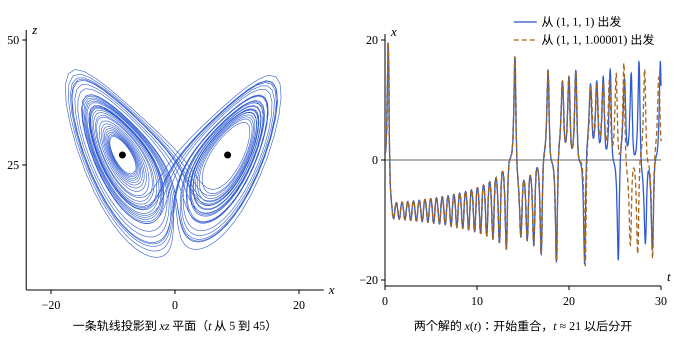

## 这一节要回答的问题

1963 年，气象学家洛伦茨（Edward Lorenz）从大气对流的一个简化模型得到三个方程，数值求解时发现：解既不停到:term[平衡点]{id="math.ode.equilibrium-point"}（equilibrium point），也不进入周期运动，初值差一点点，过一阵子结果就完全不同。方程是确定的，没有任何随机的成分，为什么会长期不可预测？[极限环](lesson:math.ode.limit-cycles)里说，平面上的:term[轨线]{id="math.ode.trajectory"}（trajectory）只要一直留在没有平衡点的有界区域里，就是一条:term[闭轨]{id="math.ode.closed-orbit"}（closed orbit），或者趋于一条闭轨：为什么三维就不一样了？

## 讲解

### 洛伦茨系统

::anchor{id="def-lorenz"}
方程组$x'=\sigma(y-x)$、$y'=x(\rho-z)-y$、$z'=xy-\beta z$（$\sigma,\rho,\beta>0$）叫作:term[洛伦茨系统]{id="math.ode.lorenz-system"}（Lorenz system）；洛伦茨取的参数是$\sigma=10$、$\beta=\frac83$、$\rho=28$，下面不加说明时都用这一组。

为什么这样定义：这是一个三维的:term[自治]{id="math.ode.autonomous-equation"}（autonomous）方程组，非线性项只有$xz$和$xy$两个，形式很简单，却已经能产生复杂的运动。它的:term[平衡点]{id="math.ode.equilibrium-point"}是原点，以及$\rho>1$时的$C_\pm=\bigl(\pm\sqrt{\beta(\rho-1)},\pm\sqrt{\beta(\rho-1)},\rho-1\bigr)$。边界情况：$\rho<1$时原点是唯一的平衡点，所有的解都趋于它（第 5 题），没有任何复杂的运动。

在原点:term[线性化]{id="math.ode.linearization"}（linearization），雅可比矩阵（Jacobian matrix）的特征值（eigenvalue）是$-\beta$和$\lambda^2+(\sigma+1)\lambda+\sigma(1-\rho)=0$的两个根；$\rho>1$时其中一个为正，原点不稳定。$\rho=28$时，$C_\pm$处的特征值数值上约为$-13.85$和$0.094\pm10.19i$，实部有正的，$C_\pm$也不稳定。这两处的特征值实部都不为零，:term[哈特曼-格罗布曼定理]{id="math.ode.hartman-grobman-theorem"}（Hartman-Grobman theorem）在三维同样成立（这里不证），所以由线性化判断稳定性是可靠的。所有的解最后都进入一个有界的椭球（第 6 题），可里面没有稳定的平衡点；数值计算也找不到稳定的周期运动，解在有界的区域里永远绕来绕去。

### 耗散与吸引子

在三维的状态空间（state space）里取一小团初值，它的体积随着解的流动而变化。可以证明，体积的相对变化率（单位时间里变化的比例）等于雅可比矩阵的迹（trace），也就是$\frac{\partial f_1}{\partial x}+\frac{\partial f_2}{\partial y}+\frac{\partial f_3}{\partial z}$：一般情形的推导见分析力学[相空间与刘维尔定理](lesson:physics.analytical-mechanics.phase-space-liouville)，常系数线性方程组这一特殊情形另见[矩阵指数](lesson:math.ode.matrix-exponential)第 5 题。对:term[洛伦茨系统]{id="math.ode.lorenz-system"}，它处处等于$-\sigma-1-\beta=-\frac{41}{3}$，体积按$e^{-41t/3}$缩小。

::anchor{id="def-dissipative"}
如果方程组让状态空间里任何一团初值的体积都随时间缩小，就说它是:term[耗散系统]{id="math.ode.dissipative-system"}（dissipative system）；有界的集合$A$，如果从$A$里出发的解都留在$A$里，$A$附近出发的解都随$t\to+\infty$趋近$A$，并且$A$里没有更小的集合也满足这两条，就叫作:term[吸引子]{id="math.ode.attractor"}（attractor）。

为什么这样定义：耗散系统里，一团初值越缩越小，最后贴到体积为零的集合上，这个集合就是吸引子，它决定了系统长期的样子。要求最小，是因为第 6 题里解进去就出不来的那个椭球也满足前两条，可它有体积，里面的解还会接着缩，系统长期的样子要看最后贴上的那一部分。:term[渐近稳定]{id="math.ode.asymptotically-stable"}（asymptotically stable）的:term[平衡点]{id="math.ode.equilibrium-point"}、稳定的:term[极限环]{id="math.ode.limit-cycle"}（limit cycle）都是吸引子。边界情况：分析力学里的哈密顿系统（Hamiltonian system）保持体积，体积不能缩小，也就没有吸引子，见[哈密顿系统中的混沌](lesson:physics.analytical-mechanics.hamiltonian-chaos)。

::anchor{id="def-strange-attractor"}
既不是平衡点、也不是:term[闭轨]{id="math.ode.closed-orbit"}，而是一层叠一层、有无穷多层的吸引子，叫作:term[奇怪吸引子]{id="math.ode.strange-attractor"}（strange attractor）；洛伦茨系统的吸引子就是这样，体积是零，形状像一对蝴蝶的翅膀，上面的运动对初值敏感，下面就来看。

### 对初值的敏感依赖

::anchor{id="def-sensitive"}
:term[吸引子]{id="math.ode.attractor"}上任意靠近的两个初值，它们的解之间的距离$|\vb\delta(t)|$随时间大致按$|\vb\delta(0)|e^{\lambda t}$增长，$\lambda>0$，这叫作:term[对初值的敏感依赖]{id="math.ode.sensitive-dependence"}（sensitive dependence on initial conditions）；增长率$\lambda$叫作:term[李雅普诺夫指数]{id="math.ode.lyapunov-exponent"}（Lyapunov exponent）。

为什么这样定义：误差按指数增长，就有一个很短的「可预报时间」（predictability time）：初值误差是$\delta_0$、能容忍的误差是$\Delta$时，大约只能算到$t\approx\frac1\lambda\ln\frac{\Delta}{\delta_0}$。初值精度提高$10$倍，可预报时间只多$\frac{\ln10}{\lambda}$。数值计算给出:term[洛伦茨系统]{id="math.ode.lorenz-system"}的$\lambda\approx0.9$，所以每多算准一位有效数字，只多换来约$2.6$个时间单位。边界情况：在:term[渐近稳定]{id="math.ode.asymptotically-stable"}的:term[平衡点]{id="math.ode.equilibrium-point"}、稳定的:term[极限环]{id="math.ode.limit-cycle"}附近，邻近的解靠近或保持距离，$\lambda\le0$，长期是可以预报的。

::anchor{id="def-chaos"}
有界、长期既不趋于平衡点也不趋于周期运动、又对初值敏感依赖（李雅普诺夫指数为正）的确定性（deterministic）运动，叫作:term[混沌]{id="math.ode.chaos"}（chaos）。

为什么这样定义：这三条缺一不可：无界的发散（如$x'=x$）误差也指数增长，却谈不上复杂；周期运动对初值不敏感；而「确定性」强调这不是随机，同样的初值永远给出同样的解。严格的定义有好几种，这里用的是描述性的说法。边界情况：分析力学里保守的哈密顿系统也会混沌，只是没有吸引子。

### 平面上为什么没有混沌

::anchor{id="thm-no-planar-chaos"}
**平面上没有:term[混沌]{id="math.ode.chaos"}**　设平面:term[自治]{id="math.ode.autonomous-equation"}方程组$\vb x'=\vb f(\vb x)$的$\vb f$有连续的偏导数（partial derivative），只有有限个:term[平衡点]{id="math.ode.equilibrium-point"}。则一条有界的:term[轨线]{id="math.ode.trajectory"}（trajectory）随$t\to+\infty$趋于一个平衡点、一条:term[闭轨]{id="math.ode.closed-orbit"}（closed orbit），或者由几个平衡点和连接它们的轨线组成的闭环。

**证明思路**：这里不证，它是:term[庞加莱-本迪克松定理]{id="math.ode.poincare-bendixson-theorem"}（Poincaré-Bendixson theorem）的推广，关键同样是平面上的轨线不能相交：有界的轨线转回来时会被自己走过的路挡住，没有不规则地来回的余地。三维时这个限制消失了：:term[洛伦茨系统]{id="math.ode.lorenz-system"}的轨线可以从旁边绕过去，在两个翅膀之间不规则地来回，永远不闭合也不停下。

所以自治的方程组要出现混沌，至少要三维。受周期外力驱动的二维系统，例如$x''+\delta x'-x+x^3=\gamma\cos\omega t$，右边显含$t$，把$t$也当作一个状态变量，就是三维的自治方程组（[一阶线性方程组](lesson:math.ode.first-order-systems)第 7 题），可以出现混沌。

## 几何图像

左图是:term[洛伦茨系统]{id="math.ode.lorenz-system"}的一条:term[轨线]{id="math.ode.trajectory"}投影到$xz$平面，两个圆点是:term[平衡点]{id="math.ode.equilibrium-point"}$C_\pm$：轨线绕着一个转几圈，又不规则地跳到另一个周围，这就是洛伦茨的:term[奇怪吸引子]{id="math.ode.strange-attractor"}。右图是从$(1,1,1)$和$(1,1,1.00001)$出发的两个解的$x(t)$：初值只差$10^{-5}$，在$t\approx21$以前两条曲线分不开，以后就各走各的，这正是:term[对初值的敏感依赖]{id="math.ode.sensitive-dependence"}。

:::anim{component="phase-portrait"}
system: { x: "y", y: "x - x^3 - 0.25*y + g*cos(t)" }
range: { x: [-2, 2], y: [-1.5, 1.5] }
dt: 0.01
initial:
  - [1, 0]
  - [1.001, 0]
sliders:
  - name: g
    min: 0
    max: 0.4
    step: 0.1
    default: 0.3
    label: |
      驱动的幅度$\gamma$
:::

这是受周期驱动的杜芬振子（Duffing oscillator）$x''+0.25x'-x+x^3=\gamma\cos t$，横轴是$x$，纵轴是$x'$（图上写作 y）；右边显含$t$，图上的小箭头是当前时刻的方向，会随时间变化，所以轨线并不沿着某一时刻的箭头走。两条轨线从相距$0.001$的两点出发。$\gamma=0.3$、$0.4$时，两条轨线一开始重合，大约$t=35$前后分开，以后各走各的，数值算出的:term[李雅普诺夫指数]{id="math.ode.lyapunov-exponent"}分别约为$0.12$和$0.15$。拖动$\gamma$：$\gamma=0.1$、$0.2$时两条轨线一直贴在一起，最后落到同一个周期运动上；$\gamma=0$时没有驱动，两条都停在平衡点$(1,0)$。

## 例题

### 例 1　洛伦茨系统的平衡点

求:term[洛伦茨系统]{id="math.ode.lorenz-system"}（$\sigma=10$、$\beta=\frac83$、$\rho=28$）的全部:term[平衡点]{id="math.ode.equilibrium-point"}，并说明原点是否稳定。

**为什么想到这么做**：平衡点要三个方程的右边同时为零；判断原点是否稳定，用雅可比矩阵在原点:term[线性化]{id="math.ode.linearization"}，它是双曲的，:term[哈特曼-格罗布曼定理]{id="math.ode.hartman-grobman-theorem"}在三维同样成立，结论可靠。

**推导**：$x'=0$给出$y=x$；$z'=0$给出$z=\frac{x^2}{\beta}$；代入$y'=x(\rho-z)-x=x(\rho-1-z)=0$，得$x=0$或$z=\rho-1=27$。所以平衡点是原点和$C_\pm=(\pm\sqrt{72},\pm\sqrt{72},27)$，$\sqrt{72}=6\sqrt2\approx8.485$。原点处的雅可比矩阵是$\begin{pmatrix}-10&10&0\\28&-1&0\\0&0&-\frac83\end{pmatrix}$，特征值是$-\frac83$和$\lambda^2+11\lambda-270=0$的根，其中$\frac{-11+\sqrt{1201}}{2}\approx11.83>0$，原点不稳定。

### 例 2　体积和可预报时间

:term[洛伦茨系统]{id="math.ode.lorenz-system"}里一团初值的体积每过一个时间单位缩小到原来的几分之一？如果初值的误差是$10^{-6}$，$\lambda=0.9$，误差长到$1$大约要多久？

**为什么想到这么做**：体积的变化率是雅可比矩阵的迹，对:term[耗散系统]{id="math.ode.dissipative-system"}它是负数；误差按$e^{\lambda t}$增长，解$10^{-6}e^{\lambda t}=1$。

**推导**：迹是$-\sigma-1-\beta=-\frac{41}{3}$，处处相同，体积按$e^{-41t/3}$变化，一个时间单位缩小到原来的$e^{-41/3}\approx1.2\times10^{-6}$。误差：$t=\frac{\ln10^6}{0.9}\approx15.4$。初值误差降到$10^{-7}$，时间只变成$\frac{\ln10^7}{0.9}\approx17.9$，多出约$2.6$。

## 常见误区

- 「:term[混沌]{id="math.ode.chaos"}就是随机。」方程是确定的，同样的初值永远给出同样的解；不可预测，是因为初值的微小误差被指数地放大。
- 「初值测得足够准，就能一直预报下去。」误差按$e^{\lambda t}$增长，初值精度提高$10$倍，只多换来$\frac{\ln10}{\lambda}$的时间。
- 「非线性项够复杂，平面:term[自治]{id="math.ode.autonomous-equation"}方程组也能混沌。」不论非线性项多复杂，平面自治系统都不会混沌；受周期外力驱动的二维系统能混沌，是因为它相当于三维。
- 「:term[耗散系统]{id="math.ode.dissipative-system"}最后都停在:term[平衡点]{id="math.ode.equilibrium-point"}或周期运动上。」:term[洛伦茨系统]{id="math.ode.lorenz-system"}是耗散的，体积缩小到零，可它的:term[吸引子]{id="math.ode.attractor"}是:term[奇怪吸引子]{id="math.ode.strange-attractor"}，上面的运动是混沌的。
