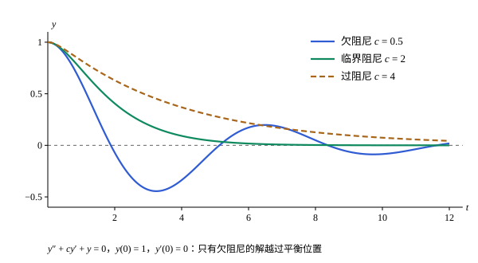

## 这一节要回答的问题

弹簧振子满足$my''+cy'+ky=0$，三个系数都是常数。指数函数求导以后还是它自己的常数倍，能不能用它凑出解？阻尼大小不同时，振子是来回振荡着停下，还是不越过平衡位置、慢慢回去？

## 讲解

### 特征方程

对常系数的齐次方程（homogeneous equation）$y''+ay'+by=0$（$a$、$b$是实常数），试$y=e^{rx}$：$y'=re^{rx}$，$y''=r^2e^{rx}$，代入得$(r^2+ar+b)e^{rx}=0$。$e^{rx}$不为零，所以$e^{rx}$是解，当且仅当$r$满足一个二次方程。

::anchor{id="def-characteristic-equation"}
方程$r^2+ar+b=0$叫作$y''+ay'+by=0$的:term[特征方程]{id="math.ode.characteristic-equation"}（characteristic equation），它的根叫作特征根（characteristic root）。

为什么这样定义：求导把$e^{rx}$变成$re^{rx}$，于是:term[微分方程]{id="math.ode.differential-equation"}（differential equation）变成了关于$r$的代数方程，解微分方程变成解二次方程。首项系数不是$1$时也一样，$my''+cy'+ky=0$的特征方程是$mr^2+cr+k=0$。边界情况：$y''+y=0$的特征方程$r^2+1=0$没有实根，这时要用复数根$\pm i$，再借助欧拉公式（Euler's formula）取实部和虚部。

::anchor{id="thm-constant-coefficients"}
**常系数齐次方程的解法**　设特征方程$r^2+ar+b=0$的两个根是$r_1$、$r_2$。(1) $r_1\ne r_2$都是实数时，:term[通解]{id="math.ode.general-solution"}（general solution）是$y=C_1e^{r_1x}+C_2e^{r_2x}$；(2) $r_1=r_2=r$时，通解是$y=(C_1+C_2x)e^{rx}$；(3) $r_{1,2}=\alpha\pm\beta i$（$\beta>0$）时，通解是$y=e^{\alpha x}(C_1\cos\beta x+C_2\sin\beta x)$。

**证明思路**：由[解空间是二维的](lesson:math.ode.second-order-linear#thm-solution-space)，只要找出两个线性无关的解，看它们的:term[朗斯基行列式]{id="math.ode.wronskian"}（Wronskian）不为零即可。(1) $W(e^{r_1x},e^{r_2x})=(r_2-r_1)e^{(r_1+r_2)x}\ne0$。(2) 重根时$r=-\frac a2$，代入可以验证$xe^{rx}$也是解（第 5 题），$W(e^{rx},xe^{rx})=e^{2rx}\ne0$。(3) 由[欧拉公式](lesson:math.complex-analysis.complex-exponential)，$e^{(\alpha+\beta i)x}=e^{\alpha x}(\cos\beta x+i\sin\beta x)$满足方程，系数是实数，它的实部和虚部各自满足方程（第 5 题），朗斯基行列式是$\beta e^{2\alpha x}\ne0$。

$n$阶常系数方程$y^{(n)}+a_{n-1}y^{(n-1)}+\dots+a_0y=0$也一样：特征方程是$n$次方程，一个$k$重的根$r$给出$k$个解$e^{rx}$、$xe^{rx}$、…、$x^{k-1}e^{rx}$，一对$k$重的复根同样给出$2k$个实的解，合起来正好$n$个线性无关的解。证明的办法和二阶时一样，这里不展开。

### 阻尼振动

弹簧振子$my''+cy'+ky=0$里，$y$是$t$时刻的位移，$m,k>0$，阻尼系数$c\ge0$。它的:term[特征方程]{id="math.ode.characteristic-equation"}$mr^2+cr+k=0$的判别式是$c^2-4mk$，按它的符号分三种情形。

::anchor{id="def-damping-cases"}
$c^2<4mk$时特征根是一对共轭复根（complex conjugate roots）$-\frac{c}{2m}\pm\beta i$，解是振幅按$e^{-\frac{c}{2m}t}$衰减的振荡，叫作:term[欠阻尼]{id="math.ode.underdamped"}（underdamped）；$c^2=4mk$时是重根，叫作:term[临界阻尼]{id="math.ode.critically-damped"}（critically damped）；$c^2>4mk$时是两个负实根，叫作:term[过阻尼]{id="math.ode.overdamped"}（overdamped），解不振荡。

为什么这样定义：三种情形的分界是判别式为零，解的样子在那里由振荡变成不振荡。临界阻尼和过阻尼时，解至多越过平衡位置一次，然后单调地回去。边界情况：$c=0$时特征根是$\pm\sqrt{k/m}\,i$，解是振幅不变的简谐振动（simple harmonic motion），角频率是$\sqrt{k/m}$。

## 几何图像

三条曲线的初始位移和初速度相同，只有阻尼不同：:term[欠阻尼]{id="math.ode.underdamped"}的解在平衡位置两侧来回振荡，:term[临界阻尼]{id="math.ode.critically-damped"}和:term[过阻尼]{id="math.ode.overdamped"}的解不越过平衡位置；阻尼过了临界值以后再加大，回去反而更慢。

:::anim{component="oscillator"}
masses: [1]
springs: [1, 0]
damping: c
initial: [1]
dt: 0.01
sliders:
  - name: c
    min: 0
    max: 4
    step: 0.1
    default: 0.5
    label: |
      阻尼系数$c$
:::

这是$y''+cy'+y=0$，物块从位移$1$处静止释放。拖动$c$：$c=0$时物块一直以同样的振幅振动；$0<c<2$时来回振荡，振幅越来越小；$c=2$时是临界阻尼，物块不越过平衡位置；$c$再大，物块回去得反而更慢。下面的曲线是位移随时间的变化，纵轴是位移$y$（图上写作 x）。

## 例题

### 例 1　两个实根

求$y''-y'-6y=0$满足$y(0)=0$、$y'(0)=5$的解。

**为什么想到这么做**：常系数齐次方程，先解:term[特征方程]{id="math.ode.characteristic-equation"}，再用初值定出两个常数。

**推导**：特征方程$r^2-r-6=(r-3)(r+2)=0$，特征根$3$、$-2$，:term[通解]{id="math.ode.general-solution"}$y=C_1e^{3x}+C_2e^{-2x}$。由$C_1+C_2=0$、$3C_1-2C_2=5$得$C_1=1$、$C_2=-1$，所以$y=e^{3x}-e^{-2x}$。

### 例 2　一对复根

求$y''+2y'+10y=0$满足$y(0)=1$、$y'(0)=-1$的解。

**为什么想到这么做**：:term[特征方程]{id="math.ode.characteristic-equation"}的判别式$4-40<0$，是一对共轭复根，用实形式的:term[通解]{id="math.ode.general-solution"}。

**推导**：$r^2+2r+10=0$的根是$-1\pm3i$，通解$y=e^{-x}(C_1\cos3x+C_2\sin3x)$。$y(0)=C_1=1$；$y'=-e^{-x}(C_1\cos3x+C_2\sin3x)+e^{-x}(-3C_1\sin3x+3C_2\cos3x)$，$y'(0)=-C_1+3C_2=-1$，得$C_2=0$。所以$y=e^{-x}\cos3x$：角频率为$3$的振荡，振幅按$e^{-x}$衰减。

## 常见误区

- 「:term[特征方程]{id="math.ode.characteristic-equation"}没有实根，方程就没有实数解。」一对复根$\alpha\pm\beta i$给出$e^{\alpha x}\cos\beta x$、$e^{\alpha x}\sin\beta x$两个实数解。
- 「重根时:term[通解]{id="math.ode.general-solution"}是$C_1e^{rx}+C_2e^{rx}$。」这只是$(C_1+C_2)e^{rx}$，只用到一个解；第二个解是$xe^{rx}$。
- 「阻尼越大，回到平衡位置越快。」过了:term[临界阻尼]{id="math.ode.critically-damped"}，再加大阻尼反而回去得更慢（第 7 题）。
- 「复根时只能写复数形式的通解。」复数形式$C_1e^{(\alpha+\beta i)x}+C_2e^{(\alpha-\beta i)x}$在$C_2=\overline{C_1}$时给出实数解，和实形式的通解是同一族函数。
