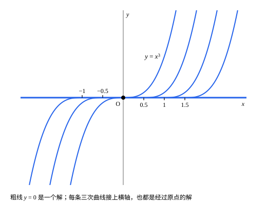

## 这一节要回答的问题

前面几节一直默认：:term[初值问题]{id="math.ode.initial-value-problem"}（initial value problem）有解，而且只有一个。可$y'=3y^{2/3}$、$y(0)=0$既有解$y\equiv0$，又有解$y=x^3$；$y'=y^2$、$y(0)=1$的解$y=\frac{1}{1-x}$走到$x=1$就跑到了无穷。什么条件下初值问题的解一定存在、一定唯一？为什么？

## 讲解

### 化成积分方程

设$f$在包含$(x_0,y_0)$的区域上连续。如果$y$是:term[初值问题]{id="math.ode.initial-value-problem"}$y'=f(x,y)$、$y(x_0)=y_0$的解，两边从$x_0$积到$x$，由微积分基本定理（fundamental theorem of calculus），

$$
y(x)=y_0+\int_{x_0}^{x}f(s,y(s))\dd s .
$$

反过来，连续函数$y$满足这个积分方程（integral equation）时，右边可导，求导就回到$y'=f(x,y)$，代入$x=x_0$又得到$y(x_0)=y_0$。所以两者等价。积分方程的好处是不含导数，只要求$y$连续，适合用极限来构造解。

### 利普希茨条件

$y'=3y^{2/3}$出问题的地方在$y=0$附近：$f(y)=3y^{2/3}$在那里陡得没有边，解可以从$0$「长」出来。下面的条件正好排除这种情况。

::anchor{id="def-lipschitz"}
如果有常数$L$，使区域$D$里任意两点$(x,y_1)$、$(x,y_2)$都满足$|f(x,y_1)-f(x,y_2)|\le L|y_1-y_2|$，就说$f$在$D$上对$y$满足:term[利普希茨条件]{id="math.ode.lipschitz-condition"}（Lipschitz condition），$L$叫作利普希茨常数（Lipschitz constant）。

为什么这样定义：它限制$f$随$y$变化的快慢：两个解之间距离的变化率，至多是距离的$L$倍，两个解就不能在有限的时间里从重合变成分开。$f(y)=3y^{2/3}$在含$y=0$的区域上不满足，因为$\frac{|f(y)-f(0)|}{|y-0|}=3|y|^{-1/3}$在$y\to0$时无界。边界情况：$f(y)=y^2$在每个有界的矩形上都满足，因为$|y_1^2-y_2^2|=|y_1+y_2|\,|y_1-y_2|$，在整个平面上却不满足。

常用的充分条件：记$f_y$为把$x$当作常数、$f$对$y$求的导数。如果$D$是矩形，$f_y$在$D$上连续且$|f_y|\le L$，由微分中值定理（mean value theorem），$|f(x,y_1)-f(x,y_2)|=|f_y(x,\xi)|\,|y_1-y_2|\le L|y_1-y_2|$。有界闭矩形上的连续函数有界，证法和[有界性定理与最值定理](lesson:math.analysis.extreme-value)一样，只是要用两次致密性定理（Bolzano–Weierstrass theorem）；所以$f$、$f_y$在有界闭矩形上连续时，利普希茨条件总成立。

### 皮卡迭代

::anchor{id="def-picard-iteration"}
从常数函数$\varphi_0(x)\equiv y_0$出发，令$\varphi_{n+1}(x)=y_0+\int_{x_0}^{x}f(s,\varphi_n(s))\dd s$，依次得到的函数$\varphi_0,\varphi_1,\varphi_2,\dots$叫作:term[皮卡迭代]{id="math.ode.picard-iteration"}（Picard iteration）。

为什么这样定义：积分方程说的是，解在映射$\varphi\mapsto y_0+\int_{x_0}^{x}f(s,\varphi(s))\dd s$下不变；把这个映射反复作用下去，就像在计算器上对任意一个数反复按$\cos$键，最后会停在方程$\cos x=x$的根上，期望它停在解上。边界情况：对$y'=y$、$y(0)=1$，$\varphi_1=1+x$，$\varphi_2=1+x+\frac{x^2}{2}$，一般地$\varphi_n(x)=\sum_{k=0}^{n}\frac{x^k}{k!}$。下面的定理只保证它们在$0$附近一致收敛（uniformly converge）到解$e^x$；不过这里相邻两项之差$\frac{x^{n+1}}{(n+1)!}$在任何有界区间$|x|\le a$上都不超过$\frac{a^{n+1}}{(n+1)!}$，照定理的证明思路，它们在每个有界区间上都一致收敛到$e^x$，这顺便说明了$e^x=\sum_{k=0}^{\infty}\frac{x^k}{k!}$。

### 皮卡-林德勒夫定理

::anchor{id="thm-picard-lindelof"}
**:term[皮卡-林德勒夫定理]{id="math.ode.picard-lindelof-theorem"}（Picard–Lindelöf theorem）**　设$f$在矩形$R$（$|x-x_0|\le a$，$|y-y_0|\le b$）上连续，$|f|\le M$，并且对$y$满足:term[利普希茨条件]{id="math.ode.lipschitz-condition"}，常数为$L$。令$h=\min\bigl(a,\frac bM\bigr)$，则:term[初值问题]{id="math.ode.initial-value-problem"}$y'=f(x,y)$、$y(x_0)=y_0$在区间$[x_0-h,x_0+h]$上有解，并且只有一个；:term[皮卡迭代]{id="math.ode.picard-iteration"}在这个区间上一致收敛到它。

**证明思路**：

- 迭代不出界：若$\varphi_n$的图像留在$R$里，则$|\varphi_{n+1}(x)-y_0|\le M|x-x_0|\le Mh\le b$，所以每个$\varphi_n$都能代进$f$；$h$里的$\frac bM$就是为此取的。
- 迭代收敛：由利普希茨条件和归纳法，$|\varphi_{n+1}(x)-\varphi_n(x)|\le\frac{ML^n|x-x_0|^{n+1}}{(n+1)!}$，在区间上不超过$c_n=\frac{ML^nh^{n+1}}{(n+1)!}$。$\frac{c_{n+1}}{c_n}=\frac{Lh}{n+2}$在$n\ge2Lh$以后不到$\frac12$，所以$\sum c_n$的部分和（partial sum）单调增，又不超过前面几项加上一个几何级数（geometric series），由单调有界原理（monotone convergence theorem）收敛。由:term[魏尔斯特拉斯判别法]{id="math.analysis.weierstrass-m-test"}（Weierstrass M-test，见[函数项级数](lesson:math.analysis.function-series#thm-weierstrass-m-test)），$\varphi_n$一致收敛到连续函数$\varphi$。细节见第 6 题。
- 极限是解：一致收敛时[积分和极限可以交换](lesson:math.analysis.uniform-limit-theorems#thm-integral-interchange)，在迭代式两边取极限，$\varphi$满足积分方程。
- 解唯一：若$\psi$也是解，$w=|\varphi-\psi|$满足$w(x)\le L\left|\int_{x_0}^{x}w(s)\dd s\right|$，由此可以推出$w\equiv0$，见第 5 题。

### 方程组与高阶方程

::anchor{id="thm-systems"}
**方程组与高阶方程**　把$y$换成向量$\vb y=(y_1,\dots,y_n)$、$f$换成向量值函数$\vb f(x,\vb y)$、绝对值换成向量的长度$|\vb y|=\sqrt{y_1^2+\dots+y_n^2}$，定理和证明都不用改：$\vb f$在$(x_0,\vb y_0)$附近连续，并且满足$|\vb f(x,\vb y)-\vb f(x,\vb z)|\le L|\vb y-\vb z|$时，方程组$\vb y'=\vb f(x,\vb y)$、$\vb y(x_0)=\vb y_0$在$x_0$附近有唯一的解。$n$阶方程$y^{(n)}=g(x,y,y',\dots,y^{(n-1)})$令$y_1=y$、$y_2=y'$、…、$y_n=y^{(n-1)}$，就化成一阶方程组；所以$g$满足同样的条件时，给定$y(x_0)$、$y'(x_0)$、…、$y^{(n-1)}(x_0)$这$n$个初始条件，解唯一。

例如$y''=-y$令$y_1=y$、$y_2=y'$，得到$y_1'=y_2$、$y_2'=-y_1$。右边$\vb f(\vb y)=(y_2,-y_1)$满足$|\vb f(\vb y)-\vb f(\vb z)|=|\vb y-\vb z|$，:term[利普希茨条件]{id="math.ode.lipschitz-condition"}成立，$L=1$。所以给定$y(0)$和$y'(0)$，解唯一：$y(0)=0$、$y'(0)=1$的解只有$\sin x$。

### 条件不满足时

皮亚诺存在定理（Peano existence theorem）说，只要$f$连续，:term[初值问题]{id="math.ode.initial-value-problem"}在$x_0$附近就至少有一个解；可解不一定唯一。$y'=3y^{2/3}$、$y(0)=0$的解有无穷多个：对任意$c\ge0$，在$x\le c$时取$0$、在$x>c$时取$(x-c)^3$的函数都是解，解可以在横轴上停留任意长的时间，再离开。

即使解唯一，定理也只保证它在$x_0$附近存在。$y'=y^2$的右边在每个有界矩形上都满足:term[利普希茨条件]{id="math.ode.lipschitz-condition"}，可$y(0)=1$的解$\frac{1}{1-x}$在$x\to1^-$时趋于无穷：解越大，$|f|$的上界$M$越大，$h=\min\bigl(a,\frac bM\bigr)$就越小。$f$、$f_y$在整个平面上连续时，解往右延伸，要么对所有$x>x_0$都存在，要么在某个有限的$x$处爆破（blow-up），$|y|$趋于无穷：从走到的端点再用定理往前接，只要$|y|$有界，每次能接上的长度就有一个正的下界。

## 几何图像

经过原点的解有无穷多条：它们在横轴上停留一段，再沿三次曲线离开。$f=3y^{2/3}$在$y=0$附近不满足:term[利普希茨条件]{id="math.ode.lipschitz-condition"}，唯一性就在那里失效；离开横轴以后，每条曲线附近的解又是唯一的。

:::anim{component="function-plot"}
range: { x: [-2, 2], y: [-1.5, 8] }
functions:
  - expr: "exp(x)"
    label: |
      解$y=e^x$
  - expr: "sum(k, 0, N, x^k / prod(j, 1, k, j))"
    label: |
      第$N$次迭代$\varphi_N$
sliders:
  - name: N
    min: 0
    max: 8
    step: 1
    default: 1
    label: |
      迭代次数$N$
:::

这是$y'=y$、$y(0)=1$的:term[皮卡迭代]{id="math.ode.picard-iteration"}。拖动$N$：$\varphi_0$是常数$1$，以后每迭代一次多出一项，曲线一次比一次贴近$e^x$；离$x_0=0$越近，贴得越早，这和误差估计里的因子$|x-x_0|^{n+1}$一致。

## 例题

### 例 1　用皮卡迭代解$y'=2xy$

对$y'=2xy$、$y(0)=1$作:term[皮卡迭代]{id="math.ode.picard-iteration"}，猜出$\varphi_n$的一般形式，并求它的极限。

**为什么想到这么做**：迭代式里每一步只做一次积分，前几步可以直接算出来，看出规律再用归纳法证明。

**推导**：$\varphi_0=1$；$\varphi_1=1+\int_0^x2s\dd s=1+x^2$；$\varphi_2=1+\int_0^x2s(1+s^2)\dd s=1+x^2+\frac{x^4}{2}$。归纳可得$\varphi_n=\sum_{k=0}^{n}\frac{x^{2k}}{k!}$：若它对$n$成立，则$\varphi_{n+1}=1+\int_0^x\sum_{k=0}^{n}\frac{2s^{2k+1}}{k!}\dd s=1+\sum_{k=0}^{n}\frac{x^{2k+2}}{(k+1)!}$，正是$n+1$时的式子。$n\to\infty$时$\varphi_n\to\sum_{k=0}^{\infty}\frac{(x^2)^k}{k!}=e^{x^2}$，和[分离变量](lesson:math.ode.separable#thm-separation)解出的结果一致。

### 例 2　用唯一性证明加法公式

已知$\sin'=\cos$、$\cos'=-\sin$，$\sin0=0$、$\cos0=1$。用解的唯一性证明$\sin(x+a)=\sin x\cos a+\cos x\sin a$。

**为什么想到这么做**：两边都是$x$的函数；如果它们满足同一个二阶方程和同样的两个初始条件，由方程组形式的:term[皮卡-林德勒夫定理]{id="math.ode.picard-lindelof-theorem"}，它们只能是同一个函数。

**推导**：记$u(x)=\sin(x+a)$，$v(x)=\sin x\cos a+\cos x\sin a$。两者都满足$y''=-y$：$u''=-\sin(x+a)=-u$，$v''=-\sin x\cos a-\cos x\sin a=-v$。初始条件也相同：$u(0)=\sin a=v(0)$，$u'(0)=\cos a=v'(0)$。上面已经说明$y''=-y$化成的方程组满足:term[利普希茨条件]{id="math.ode.lipschitz-condition"}，解唯一，所以$u=v$。

## 常见误区

- 「$f$连续，解就唯一。」连续只保证存在：$y'=3y^{2/3}$、$y(0)=0$有无穷多个解。
- 「定理给出的区间$[x_0-h,x_0+h]$就是解存在的全部范围。」那只是保证的范围，解往往能延伸得更远（第 3 题）。
- 「:term[利普希茨条件]{id="math.ode.lipschitz-condition"}要求$f$对$y$可导。」不要求；$f_y$连续且有界只是一个方便的充分条件。
- 「二阶方程给一个初始条件就够了。」要给$y(x_0)$和$y'(x_0)$两个，化成一阶方程组以后才是完整的初值。
