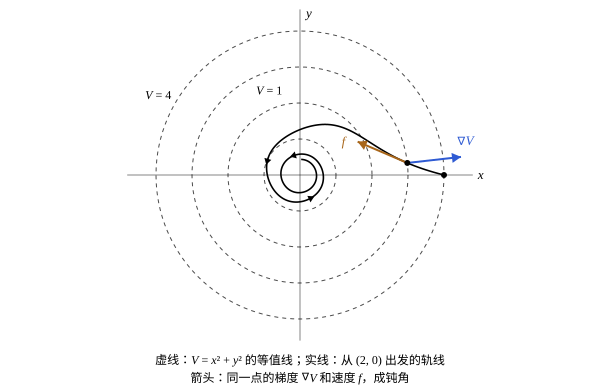

## 这一节要回答的问题

碗底的小球，没有摩擦时轻轻一碰会一直来回滚，有摩擦时会慢慢停在碗底；两种情况都该叫「稳定」，可只有后一种是解趋于:term[平衡点]{id="math.ode.equilibrium-point"}（equilibrium point）。[非线性系统与线性化](lesson:math.ode.nonlinear-systems)里，:term[线性化]{id="math.ode.linearization"}（linearization）在:term[中心]{id="math.ode.center"}（center）这类不是双曲的平衡点上失效。能不能像看小球的能量那样，找一个沿着解只减不增的函数，不解方程、也不靠线性化，就判断平衡点稳不稳定？

## 讲解

### 稳定与渐近稳定

::anchor{id="def-lyapunov-stable"}
设$\vb x^*$是$\vb x'=\vb f(\vb x)$的:term[平衡点]{id="math.ode.equilibrium-point"}（equilibrium point）。如果对任意$\varepsilon>0$，都有$\delta>0$，使从$|\vb x(0)-\vb x^*|<\delta$出发的解对所有$t\ge0$都满足$|\vb x(t)-\vb x^*|<\varepsilon$，就说$\vb x^*$是:term[稳定]{id="math.ode.lyapunov-stable"}的（stable，也叫李雅普诺夫稳定，Lyapunov stable），否则说它不稳定（unstable）；如果$\vb x^*$稳定，并且附近出发的解在$t\to+\infty$时都趋于$\vb x^*$，就说它:term[渐近稳定]{id="math.ode.asymptotically-stable"}（asymptotically stable）。

为什么这样定义：「附近出发的解都留在附近」要说清楚多近：要求解一直待在$\varepsilon$以内，只要出发时足够近，$\varepsilon$再小也做得到。稳定只要求留在附近，渐近稳定还要求趋于它。边界情况：平面上的:term[中心]{id="math.ode.center"}是稳定而不渐近稳定的：附近的解绕着它转，不跑远，也不靠近；分析力学[小振动与简正坐标](lesson:physics.analytical-mechanics.small-oscillations)里没有阻尼时的稳定平衡点也是这样。

[自治方程与平衡点](lesson:math.ode.autonomous-equations)里把渐近稳定简称为稳定，在一维、平衡点孤立（附近没有别的平衡点）时，两者确实一样。因为一维的解是单调的：从孤立的稳定平衡点$y^*$附近出发的解单调而有界，只能趋于一个平衡点，又待在$y^*$附近，只能趋于$y^*$（第 6 题）。平衡点不孤立时就不一样，例如$y'=0$的每个点都稳定，却都不渐近稳定。

### 李雅普诺夫函数

设$V(\vb x)$有连续的偏导数（partial derivative），$\vb x(t)$是一个解。由链式法则（chain rule），$V$沿着这个解的变化率是$\frac{\dd}{\dd t}V(\vb x(t))=\nabla V\cdot\vb f(\vb x)$，记作$\dot V(\vb x)$，$\nabla V$是$V$的梯度（gradient）；它只依赖于点$\vb x$，不用解出$\vb x(t)$就能算。

::anchor{id="def-lyapunov-function"}
设$V$在:term[平衡点]{id="math.ode.equilibrium-point"}$\vb x^*$附近有连续的偏导数，$V(\vb x^*)=0$，附近别的点上$V>0$。如果在$\vb x^*$附近$\dot V=\nabla V\cdot\vb f\le0$，就说$V$是$\vb x^*$的:term[李雅普诺夫函数]{id="math.ode.lyapunov-function"}（Lyapunov function）；如果除$\vb x^*$外$\dot V<0$，就说它是严格的李雅普诺夫函数（strict Lyapunov function）。

为什么这样定义：$V$像一个以$\vb x^*$为最低点的「碗」，它的等值线（level curve）是一圈套一圈围着$\vb x^*$的闭曲线。梯度$\nabla V$垂直于等值线、指向$V$增大的外侧，$\dot V\le0$说明速度$\vb f$和$\nabla V$成钝角或直角，:term[轨线]{id="math.ode.trajectory"}（trajectory）穿过等值线时只能往里走或沿着走。边界情况：能量正是这样的函数，例如没有阻尼的振子$x'=v$、$v'=-x$，$V=\frac12(x^2+v^2)$，$\dot V=xv-vx=0$。

::anchor{id="thm-lyapunov"}
**李雅普诺夫稳定性定理（Lyapunov stability theorem）**　设$V$是平衡点$\vb x^*$的李雅普诺夫函数，则$\vb x^*$:term[稳定]{id="math.ode.lyapunov-stable"}；如果$V$是严格的李雅普诺夫函数，则$\vb x^*$:term[渐近稳定]{id="math.ode.asymptotically-stable"}。

**证明思路**：给定小的$\varepsilon$，$V$在圆周$|\vb x-\vb x^*|=\varepsilon$上的最小值$m>0$；由连续性，可以取$\delta$使$|\vb x-\vb x^*|<\delta$时$V<m$。从那里出发的解$V$不增，始终小于$m$，到不了那个圆周，于是一直在$\varepsilon$以内。严格时$V(\vb x(t))$单调减小，有极限$c\ge0$；若$c>0$，解始终待在$V\ge c$的一圈里，那里$\dot V$有负的上界，$V$会减到负数，矛盾，所以$c=0$，解趋于$\vb x^*$（第 5 题）。

### 拉萨尔不变原理

有阻尼时，能量常常只是「不增」，不是严格减小：有阻尼的单摆$\theta'=v$、$v'=-\sin\theta-bv$，取$E=\frac12v^2+1-\cos\theta$，$\dot E=-bv^2\le0$，在$v=0$的那条线上等于零。上面的定理只给出:term[稳定]{id="math.ode.lyapunov-stable"}，可:term[线性化]{id="math.ode.linearization"}（linearization）说$(0,0)$是:term[渐近稳定]{id="math.ode.asymptotically-stable"}的。

::anchor{id="thm-lasalle"}
**:term[拉萨尔不变原理]{id="math.ode.lasalle-invariance-principle"}（LaSalle's invariance principle）**　设$V$是:term[平衡点]{id="math.ode.equilibrium-point"}$\vb x^*$的:term[李雅普诺夫函数]{id="math.ode.lyapunov-function"}。如果在$\vb x^*$附近，除了$\vb x^*$本身，没有一个解能一直待在$\dot V=0$的点组成的集合里，则$\vb x^*$渐近稳定。

**证明思路**：这里不证。直观上，$V$沿着解减小，最后停在某个值上；解趋近的那些点上，$V$不再变化，也就是$\dot V=0$，而且从那些点出发的解要一直保持$\dot V=0$。如果这样的解只有平衡点本身，解就只能趋于它。

对有阻尼的单摆，$\dot E=0$要求$v=0$；一直保持$v\equiv0$的解，要$v'=-\sin\theta=0$，在$(0,0)$附近只有$\theta=0$，所以只有平衡点本身。由拉萨尔不变原理，$(0,0)$渐近稳定（例 1）。

## 几何图像

这是$x'=-y-x^3$、$y'=x-y^3$，取$V=x^2+y^2$，$\dot V=2x(-y-x^3)+2y(x-y^3)=-2(x^4+y^4)$。虚线是$V$的等值线，实线是从$(2,0)$出发的一条:term[轨线]{id="math.ode.trajectory"}：速度$\vb f$和梯度$\nabla V$成钝角，轨线每次穿过等值线都从外往里走，$V$越来越小。

:::anim{component="phase-portrait"}
system: { x: "-y - a*x^3", y: "x - a*y^3" }
range: { x: [-2.5, 2.5], y: [-2.5, 2.5] }
dt: 0.01
initial:
  - [2, 0]
  - [0, -1.5]
  - [0.5, 0]
sliders:
  - name: a
    min: -1
    max: 1
    step: 0.5
    default: 0.5
    label: |
      $a$
:::

这是$x'=-y-ax^3$、$y'=x-ay^3$，不论$a$取多少，原点处的:term[线性化]{id="math.ode.linearization"}都是$x'=-y$、$y'=x$，原点是:term[中心]{id="math.ode.center"}。取$V=x^2+y^2$，$\dot V=-2a(x^4+y^4)$。拖动$a$：$a>0$时$V$严格减小，轨线慢慢盘旋着进入原点，原点:term[渐近稳定]{id="math.ode.asymptotically-stable"}；$a=0$时轨线是圆，原点:term[稳定]{id="math.ode.lyapunov-stable"}而不渐近稳定；$a<0$时轨线盘旋着离开，原点不稳定。

## 例题

### 例 1　有阻尼的单摆

证明$\theta'=v$、$v'=-\sin\theta-bv$（$b>0$）的:term[平衡点]{id="math.ode.equilibrium-point"}$(0,0)$:term[渐近稳定]{id="math.ode.asymptotically-stable"}。

**为什么想到这么做**：能量$E=\frac12v^2+1-\cos\theta$在$(0,0)$处为零、附近为正，是天然的候选；阻尼让它不增，但只在$v\ne0$时严格减小，要用:term[拉萨尔不变原理]{id="math.ode.lasalle-invariance-principle"}补上最后一步。

**推导**：$1-\cos\theta$在$0<|\theta|<\pi$时为正，所以$E$在$(0,0)$附近除原点外为正。$\dot E=v\cdot v'+\sin\theta\cdot\theta'=v(-\sin\theta-bv)+v\sin\theta=-bv^2\le0$，$E$是:term[李雅普诺夫函数]{id="math.ode.lyapunov-function"}。$\dot E=0$即$v=0$；一直保持$v\equiv0$要$v'=-\sin\theta\equiv0$，在$|\theta|<\pi$里只有$\theta=0$。由拉萨尔不变原理，$(0,0)$:term[渐近稳定]{id="math.ode.asymptotically-stable"}。

### 例 2　线性化判断不了

判断$x'=-x^3-y$、$y'=x-y^3$的:term[平衡点]{id="math.ode.equilibrium-point"}$(0,0)$是否:term[稳定]{id="math.ode.lyapunov-stable"}。

**为什么想到这么做**：原点处的:term[线性化]{id="math.ode.linearization"}是$x'=-y$、$y'=x$，是:term[中心]{id="math.ode.center"}，不是双曲的，线性化判断不了；试最简单的$V=x^2+y^2$。

**推导**：$\dot V=2x(-x^3-y)+2y(x-y^3)=-2x^4-2xy+2xy-2y^4=-2(x^4+y^4)$，除原点外小于零。$V$是严格的:term[李雅普诺夫函数]{id="math.ode.lyapunov-function"}，由李雅普诺夫稳定性定理，$(0,0)$:term[渐近稳定]{id="math.ode.asymptotically-stable"}。线性部分只让点转圈，是三次项把它慢慢拉向原点。

## 常见误区

- 「:term[稳定]{id="math.ode.lyapunov-stable"}就是附近的解都趋于:term[平衡点]{id="math.ode.equilibrium-point"}。」那是:term[渐近稳定]{id="math.ode.asymptotically-stable"}；:term[中心]{id="math.ode.center"}附近的解留在附近却不趋于它，稳定而不渐近稳定。
- 「找不到:term[李雅普诺夫函数]{id="math.ode.lyapunov-function"}，平衡点就不稳定。」定理只是充分条件，找不到不说明任何事；要证明不稳定得另想办法。
- 「$\dot V\le0$就能推出渐近稳定。」只能推出稳定；要渐近稳定，需要$\dot V<0$，或者用:term[拉萨尔不变原理]{id="math.ode.lasalle-invariance-principle"}排除别的待在$\dot V=0$上的解。
- 「李雅普诺夫函数只有一个。」同一个平衡点可以有很多李雅普诺夫函数；常从能量、平方和$x^2+cy^2$这类函数试起（第 3 题）。
