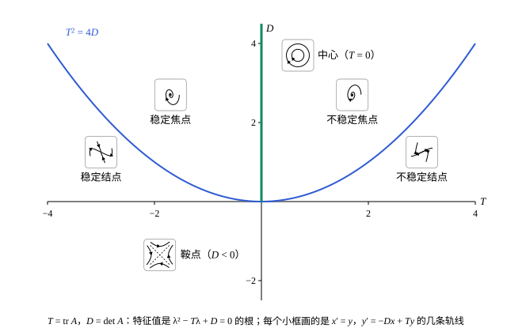

## 这一节要回答的问题

平面上的常系数方程组$\vb x'=A\vb x$（$A$是$2\times2$的实矩阵），原点总是:term[平衡点]{id="math.ode.equilibrium-point"}（equilibrium point）。弹簧振子化成方程组以后，原点附近的:term[轨线]{id="math.ode.trajectory"}（trajectory）可能直直地进入原点，可能一圈圈盘旋着进入，也可能绕着原点不停地转，单摆的小振动就是这样（[自治方程与平衡点](lesson:math.ode.autonomous-equations)第 7 题）。平衡点附近的:term[相图]{id="math.ode.phase-portrait"}（phase portrait）一共有几种样子？能不能不解方程，直接从$A$看出来？

## 讲解

### 相图

::anchor{id="def-phase-portrait"}
在:term[相平面]{id="math.ode.phase-plane"}（phase plane）上画出有代表性的几条:term[轨线]{id="math.ode.trajectory"}（trajectory），标出运动的方向，得到的图叫作方程组的:term[相图]{id="math.ode.phase-portrait"}（phase portrait）。

为什么这样定义：一张相图把从各处出发的解的去向画在一起，不用写出公式，就看得出哪里是:term[平衡点]{id="math.ode.equilibrium-point"}、解是趋近还是远离、会不会转圈。对$\vb x'=A\vb x$，$\det A\ne0$时$A\vb x=\vb 0$只有零解，原点是唯一的平衡点；它附近的相图由$A$的两个特征值（eigenvalue）决定，它们是$\lambda^2-(\operatorname{tr}A)\lambda+\det A=0$的根，$\operatorname{tr}A$是$A$的迹（trace），即对角元之和。边界情况：$\det A=0$时，过原点的一整条直线上的点都是平衡点（$A=O$时是整个平面），这种情形放在第 7 题。

### 实特征值：结点与鞍点

设$A$的特征值$\lambda_1$、$\lambda_2$是不相等的实数，特征向量（eigenvector）是$\vb v_1$、$\vb v_2$。由[用特征向量写出全部的解](lesson:math.ode.eigen-solutions#thm-eigen-general)，解是$\vb x=c_1e^{\lambda_1t}\vb v_1+c_2e^{\lambda_2t}\vb v_2$：特征向量方向上的:term[轨线]{id="math.ode.trajectory"}是直线，其余的是两种指数运动的叠加。

::anchor{id="def-node-saddle"}
两个特征值是同号的实数时，原点叫作:term[结点]{id="math.ode.node"}（node）：都为负时所有轨线都趋于原点，原点是:term[渐近稳定]{id="math.ode.asymptotically-stable"}（asymptotically stable）的；都为正时所有轨线都离开原点，原点不稳定。两个特征值是异号的实数时，原点叫作:term[鞍点]{id="math.ode.saddle-point"}（saddle point）：负特征值的特征向量方向上的两条轨线趋于原点，正特征值方向上的两条离开原点，其余的轨线先靠近、再离开。

为什么这样定义：设$\lambda_1<\lambda_2<0$，$t\to+\infty$时$e^{\lambda_1t}$比$e^{\lambda_2t}$衰减得快，解越来越接近$c_2e^{\lambda_2t}\vb v_2$，所以除了$\vb v_1$方向上的两条，轨线都贴着衰减得慢的$\vb v_2$方向进入原点。鞍点附近，特征向量方向上的四条轨线把平面分成四块，其余的轨线像双曲线一样从原点旁边绕过：一维的线性方程$x'=\lambda x$（$\lambda\ne0$）里，:term[平衡点]{id="math.ode.equilibrium-point"}两侧的箭头只能都指向它或都背离它，平面上却可以一个方向进、另一个方向出。边界情况：$\lambda_1=\lambda_2=\lambda$时，若$A=\lambda I$，过原点的每条直线都是轨线；若$A\ne\lambda I$，只有一个特征向量方向，轨线都贴着它进入或离开（见[矩阵指数](lesson:math.ode.matrix-exponential)的几何图像），这两种情形也都叫结点。

:term[鞍结分岔]{id="math.ode.saddle-node-bifurcation"}（saddle-node bifurcation）的名字就来自这两种平衡点：平面上的方程组随参数变化时，一个鞍点和一个结点可以靠近、合并，然后一起消失（见[分岔](lesson:math.ode.bifurcations#def-saddle-node)）。

### 复特征值：焦点与中心

实矩阵的复特征值成对出现，是$\alpha\pm i\beta$（$\beta>0$），对应的特征向量也互为共轭。$e^{(\alpha+i\beta)t}$乘特征向量是一个复的解，可我们要的是实的解。

::anchor{id="thm-complex-solutions"}
**复特征值给出的实解**　设实矩阵$A$有特征值$\alpha+i\beta$（$\beta\ne0$），对应的特征向量是$\vb a+i\vb b$，$\vb a$、$\vb b$是实向量。则$e^{\alpha t}(\vb a\cos\beta t-\vb b\sin\beta t)$和$e^{\alpha t}(\vb a\sin\beta t+\vb b\cos\beta t)$是$\vb x'=A\vb x$的两个线性无关的实解。

**证明思路**：和[特征值给出的解](lesson:math.ode.eigen-solutions#thm-eigen-solution)一样代入，$\vb z=e^{(\alpha+i\beta)t}(\vb a+i\vb b)$满足$\vb z'=A\vb z$。由欧拉公式（Euler's formula）展开，$\vb z$的实部和虚部正是上面两个函数；$A$是实矩阵，$\vb z'=A\vb z$的实部、虚部各自成立，所以它们都是解。它们在$t=0$处的值是$\vb a$、$\vb b$，$\beta\ne0$时这两个向量线性无关（第 5 题）。

::anchor{id="def-focus-center"}
$\alpha\ne0$时，:term[轨线]{id="math.ode.trajectory"}绕着原点盘旋，原点叫作:term[焦点]{id="math.ode.focus"}（focus，也叫 spiral point）：$\alpha<0$时盘旋着进入原点，:term[渐近稳定]{id="math.ode.asymptotically-stable"}；$\alpha>0$时盘旋着离开，不稳定。$\alpha=0$时，轨线是绕原点的闭曲线（椭圆），原点叫作:term[中心]{id="math.ode.center"}（center）。

为什么这样定义：上面的实解是「以角频率$\beta$绕原点转动」再乘上$e^{\alpha t}$，$\alpha$的符号决定盘进去还是盘出来，$\alpha=0$时每转一圈回到原处，周期是$\frac{2\pi}{\beta}$。中心附近出发的解一直留在附近，却不趋于原点，所以中心不是渐近稳定的；按以后[李雅普诺夫函数与稳定性](lesson:math.ode.lyapunov-stability)里的说法，它是:term[稳定]{id="math.ode.lyapunov-stable"}（stable）而不渐近稳定的。转动的方向看$A$的左下角元素$a_{21}$：在$(1,0)$处速度是$A$的第一列$(a_{11},a_{21})$，$a_{21}>0$时逆时针转，$a_{21}<0$时顺时针转。

### 用迹和行列式分类

::anchor{id="thm-trace-det"}
**用迹和行列式分类**　设$T=\operatorname{tr}A$、$D=\det A\ne0$。(1) $D<0$时原点是:term[鞍点]{id="math.ode.saddle-point"}；(2) $D>0$、$T^2\ge4D$时原点是:term[结点]{id="math.ode.node"}，$T<0$时:term[渐近稳定]{id="math.ode.asymptotically-stable"}，$T>0$时不稳定；(3) $D>0$、$T^2<4D$时，$T\ne0$是:term[焦点]{id="math.ode.focus"}，$T<0$时渐近稳定，$T>0$时不稳定，$T=0$是:term[中心]{id="math.ode.center"}。

**证明思路**：两个特征值满足$\lambda_1+\lambda_2=T$、$\lambda_1\lambda_2=D$，判别式是$T^2-4D$。$D<0$时两个特征值的乘积为负，是异号的实数；$D>0$、$T^2\ge4D$时是同号的实数，符号和它们的和$T$相同；$T^2<4D$时是一对复数$\frac T2\pm i\beta$，实部是$\frac T2$。所以原点渐近稳定，当且仅当$T<0$并且$D>0$（第 6 题）。

### 阻尼振子与单摆

弹簧振子$y''+cy'+ky=0$（$k>0$，$c\ge0$）化成$y'=v$、$v'=-ky-cv$，$T=-c$、$D=k>0$、$T^2-4D=c^2-4k$。$c=0$时原点是:term[中心]{id="math.ode.center"}，:term[轨线]{id="math.ode.trajectory"}是椭圆，对应简谐振动（simple harmonic motion）；$c^2<4k$时是:term[渐近稳定]{id="math.ode.asymptotically-stable"}的:term[焦点]{id="math.ode.focus"}，这正是:term[欠阻尼]{id="math.ode.underdamped"}（underdamped）的振荡衰减；$c^2=4k$的:term[临界阻尼]{id="math.ode.critically-damped"}（critically damped）和$c^2>4k$的:term[过阻尼]{id="math.ode.overdamped"}（overdamped）都是渐近稳定的:term[结点]{id="math.ode.node"}。[常系数齐次线性方程](lesson:math.ode.constant-coefficients#def-damping-cases)里说的「至多越过平衡位置一次」，在:term[相图]{id="math.ode.phase-portrait"}上就是结点处的轨线至多穿过纵轴一次（第 8 题）。

单摆$\theta''=-\frac gl\sin\theta$在最低点附近，$\sin\theta\approx\theta$，得$\theta''=-\frac gl\theta$，$D=\frac gl>0$、$T=0$，最低点是中心：:term[相平面]{id="math.ode.phase-plane"}上的点绕着它转，这就是摆动。在最高点附近令$\theta=\pi+\varphi$，$\sin\theta\approx-\varphi$，得$\varphi''=\frac gl\varphi$，$D=-\frac gl<0$，最高点是:term[鞍点]{id="math.ode.saddle-point"}。这和分析力学[相空间与刘维尔定理](lesson:physics.analytical-mechanics.phase-space-liouville)里势能的极小点是中心、极大点是鞍点的说法一致；用:term[线性化]{id="math.ode.linearization"}（linearization）的方程判断非线性的单摆，还要[非线性系统与线性化](lesson:math.ode.nonlinear-systems)来说明。

## 几何图像

横轴是迹$T$，纵轴是行列式$D$，每一点代表一类矩阵；抛物线$T^2=4D$上方的特征值是复数，下方是实数。左半平面里，抛物线上方是:term[渐近稳定]{id="math.ode.asymptotically-stable"}的:term[焦点]{id="math.ode.focus"}，抛物线和横轴之间是渐近稳定的:term[结点]{id="math.ode.node"}；右半平面对称地是不稳定的；横轴下方全是:term[鞍点]{id="math.ode.saddle-point"}，纵轴的正半轴是:term[中心]{id="math.ode.center"}。

:::anim{component="phase-portrait"}
system: { x: "y", y: "-q*x - p*y" }
range: { x: [-3, 3], y: [-3, 3] }
dt: 0.01
initial:
  - [2, 0]
  - [-2, 0]
  - [0, 2]
  - [0, -2]
  - [1.5, 1.5]
  - [-1.5, -1.5]
sliders:
  - name: p
    min: -2
    max: 2
    step: 0.5
    default: 0.5
    label: |
      $p$（迹$T=-p$）
  - name: q
    min: -2
    max: 2
    step: 0.5
    default: 1
    label: |
      $q$（行列式$D=q$）
:::

这是$x'=y$、$y'=-qx-py$，也就是$x''+px'+qx=0$，它的迹是$-p$、行列式是$q$，拖动两个滑块，就是在上面那张图里移动。$q<0$时原点是鞍点。$q>0$时，$p=0$是中心，$0<p<2\sqrt q$是渐近稳定的焦点，$p\ge2\sqrt q$是渐近稳定的结点；$p$取负值时运动方向反过来，焦点、结点变成不稳定的。$q=0$时行列式为零，横轴上的点都是:term[平衡点]{id="math.ode.equilibrium-point"}。

## 例题

### 例 1　鞍点

画出$\vb x'=\begin{pmatrix}1&1\\4&1\end{pmatrix}\vb x$的:term[相图]{id="math.ode.phase-portrait"}。

**为什么想到这么做**：$D=1-4=-3<0$，由分类定理原点是:term[鞍点]{id="math.ode.saddle-point"}；画相图要先找出两个特征向量方向上的直线:term[轨线]{id="math.ode.trajectory"}，其余的轨线以它们为渐近线。

**推导**：$\det(A-\lambda I)=(1-\lambda)^2-4$，$\lambda=3$或$-1$。$\lambda=3$时$(A-3I)\vb v=\vb 0$给出$\vb v_1=(1,2)$，$\lambda=-1$时给出$\vb v_2=(1,-2)$。所以沿直线$y=-2x$的两条轨线趋于原点，沿$y=2x$的两条离开原点；其余的轨线从$y=-2x$附近进来，绕过原点，最后贴着$y=2x$跑远，$t\to+\infty$时$\vb x\approx c_1e^{3t}(1,2)$。

### 例 2　焦点

判断$\vb x'=\begin{pmatrix}-1&-4\\1&-1\end{pmatrix}\vb x$的原点是哪种:term[平衡点]{id="math.ode.equilibrium-point"}，并写出两个实解。

**为什么想到这么做**：$T=-2$、$D=1+4=5$，$T^2-4D<0$，特征值是复数，原点是:term[焦点]{id="math.ode.focus"}；实解用复特征向量的实部和虚部来写。

**推导**：$\lambda^2+2\lambda+5=0$，$\lambda=-1\pm2i$，实部为负，是:term[渐近稳定]{id="math.ode.asymptotically-stable"}的焦点；$a_{21}=1>0$，逆时针盘旋。$\lambda=-1+2i$时，$(A-\lambda I)\vb v=\vb 0$的第二行是$v_1-2iv_2=0$，取$\vb v=(2i,1)=(0,1)+i(2,0)$，即$\vb a=(0,1)$、$\vb b=(2,0)$。由上面的定理，两个实解是$e^{-t}(-2\sin2t,\ \cos2t)$和$e^{-t}(2\cos2t,\ \sin2t)$：点在椭圆$\frac{x^2}{4}+y^2=e^{-2t}$上逆时针转动，椭圆越缩越小。

## 常见误区

- 「特征值是复数，方程组的解就是复的。」实矩阵的复特征值成对出现，复解的实部和虚部就是两个实解。
- 「:term[中心]{id="math.ode.center"}是:term[渐近稳定]{id="math.ode.asymptotically-stable"}的。」附近出发的:term[轨线]{id="math.ode.trajectory"}绕着它转，一直不趋于它。
- 「:term[结点]{id="math.ode.node"}处的轨线都沿直线进入。」只有特征向量方向上的是直线；其余的弯着进入，并且贴着衰减得慢的方向。
- 「迹小于零，原点就渐近稳定。」还要行列式大于零；$D<0$时不论迹是多少，原点都是:term[鞍点]{id="math.ode.saddle-point"}。
