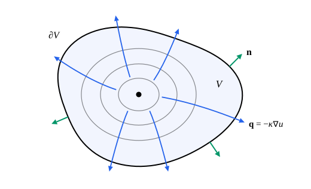

## 这一节要回答的问题

一块金属里各处冷热不均，热量从热的地方流向冷的地方，温度慢慢变匀。温度$u(\vb r,t)$满足什么样的:term[偏微分方程]{id="math.pde.pde"}（partial differential equation）？为什么温度的变化传开一段距离，要的时间和距离的平方成正比？

## 讲解

### 傅里叶定律

铜棒一端放进沸水、一端放进冰水，热量沿棒从热端流向冷端，温度降得越陡，每秒流过的热量越多（热学[热传导与扩散](lesson:physics.thermal-physics.heat-conduction-diffusion#def-fourier)一节的$q=-\kappa\dv Tz$）。三维的物体里，热流还有方向。

::anchor{id="def-fourier-law"}
设$\vb n$是单位向量，每秒穿过垂直于$\vb n$的单位面积、沿$\vb n$方向流过的热量是$\vb q\cdot\vb n$，这个向量场（vector field）$\vb q$叫作热流密度（heat flux density）。实验表明，各个方向导热一样的材料里$\vb q=-\kappa\nabla u$，这叫作:term[傅里叶定律]{id="math.pde.fouriers-law"}（Fourier's law）；比例系数$\kappa>0$叫作:term[热导率]{id="math.pde.thermal-conductivity"}（thermal conductivity），也叫导热系数，单位是$\mathrm{W/(m\cdot K)}$。

为什么这样定义：$-\nabla u$和梯度（gradient）方向相反，温度沿它下降最快，热就沿它流；$\vb n$取$z$轴正方向，就回到一维的$-\kappa u_z$。边界情况：气体稀薄到:term[平均自由程]{id="physics.thermal-physics.mean-free-path"}（mean free path）和物体的大小差不多时，傅里叶定律不再成立；热辐射（thermal radiation）也不归它管。

::anchor{id="def-fick"}
物质的扩散也一样：某种分子的密度是$\rho_1$，每秒穿过垂直于$\vb n$的单位面积、沿$\vb n$方向流过的这种分子的质量是$\vb J\cdot\vb n$，实验表明$\vb J=-D_1\nabla\rho_1$（$D_1>0$），这叫作菲克定律（Fick's law）。

为什么这样定义：分子乱走，密度大处走出去的多，净流向密度小处。边界情况：风把气味整团吹过来，是空气在流动，不归它管。

### 热方程

这一节的$c$是比热容，不是波速。设比热容$c$、密度$\rho$、:term[热导率]{id="math.pde.thermal-conductivity"}$\kappa$都是常数，没有热源，$u$对位置有连续的二阶偏导数（second-order partial derivative），$u_t$也连续。任取一块固定的区域$V$，它里面的内能是$\iiint_Vc\rho u\,\dd V$加一个常数，只因穿过边界$\partial V$的热流而变：

$$
\dv{}t\iiint_Vc\rho u\,\dd V=-\oint_{\partial V}\vb q\cdot\dd\vb a ,
$$

$\dd\vb a$取外法向（outward normal）。$V$固定、$u_t$连续，左边的求导可以移进积分号（区间上的情形见[含参变量积分](lesson:math.analysis.parameter-integrals#thm-leibniz-rule)，有界区域上同理）；右边代入:term[傅里叶定律]{id="math.pde.fouriers-law"}，再用散度定理（divergence theorem），得$\iiint_V\bigl(c\rho u_t-\kappa\,\divg(\nabla u)\bigr)\dd V=0$。它对每一块$V$都成立，被积函数又连续，只能处处为零。

$\divg(\nabla u)=u_{xx}+u_{yy}+u_{zz}$就是[拉普拉斯算子](lesson:math.vector-calculus.vector-identities#def-laplacian)（Laplacian）$\nabla^2u$，这里写成$\Delta u$，于是$c\rho u_t=\kappa\Delta u$。这和[高斯公式（散度定理）](lesson:math.vector-calculus.divergence-theorem#def-continuity-equation)推连续性方程（continuity equation）是同一个办法，那一节第 7 题推的正是这个方程（那里的$k$、$T$就是$\kappa$、$u$）。

::anchor{id="def-heat-equation"}
记$D=\frac\kappa{c\rho}$。方程$u_t=D\Delta u$（$D$是正常数）叫作:term[热方程]{id="math.pde.heat-equation"}（heat equation），也叫热传导方程、扩散方程，一维时是$u_t=Du_{xx}$；$D$叫作:term[扩散系数]{id="math.pde.diffusion-coefficient"}（diffusion coefficient），也叫热扩散率（thermal diffusivity），单位是$\mathrm{m^2/s}$。

为什么这样定义：$\Delta u$量的是一点和周围平均值的差，比周围冷的地方升温，比周围热的地方降温，起伏被抹平。把菲克定律代进这种分子的质量守恒，同样得$\pdv{\rho_1}t=D_1\Delta\rho_1$，所以也叫扩散方程。边界情况：$\kappa$随温度变化时只能写成$c\rho u_t=\divg(\kappa\nabla u)$；每单位体积每秒产生热量$Q$时，方程是$u_t=D\Delta u+\frac Q{c\rho}$。

### 扩散的快慢

一维时令$x=L\tilde x$、$t=\frac{L^2}D\tilde t$，即长度以$L$、时间以$\frac{L^2}D$为单位。由一元的链式法则（chain rule），$u_t=\frac D{L^2}u_{\tilde t}$，$u_{xx}=\frac1{L^2}u_{\tilde x\tilde x}$，:term[热方程]{id="math.pde.heat-equation"}$u_t=Du_{xx}$变成$u_{\tilde t}=u_{\tilde x\tilde x}$，不含参数了：这就是[偏微分方程与分类](lesson:math.pde.pde-basics)说的换单位约掉系数。

所以长$L$的范围里的起伏，抹平要的时间和$\frac{L^2}D$成正比；反过来，$t$时间里温度的变化约传开$\sqrt{Dt}$远：距离加倍，时间变成$4$倍。热学[热传导与扩散](lesson:physics.thermal-physics.heat-conduction-diffusion)例 2 估香味扩散过房间要多久，用的正是$t\approx\frac{L^2}D$。空气的:term[扩散系数]{id="math.pde.diffusion-coefficient"}约$2\times10^{-5}\,\mathrm{m^2/s}$，一秒只传开约$4.5\,\mathrm{mm}$，难怪[绝热过程](lesson:physics.thermal-physics.adiabatic-processes)里说空气导热很差。

### 稳态与边界条件

两端分别保持$100\,^\circ\mathrm C$和$0\,^\circ\mathrm C$、侧面绝热的杆，过很久温度不再变，$u_t=0$，:term[热方程]{id="math.pde.heat-equation"}变成$u_{xx}=0$，温度沿杆均匀地从$100\,^\circ\mathrm C$降到$0\,^\circ\mathrm C$。

::anchor{id="def-steady-state"}
不随时间变化的解，即$u_t=0$的解，叫作:term[稳态]{id="math.pde.steady-state"}（steady state），也叫稳恒。没有热源时，热方程的稳态满足$\Delta u=0$，是调和函数（harmonic function）。

为什么这样定义：边界上的情况和热源都不变、表面有一部分保持恒温时，过很久温度通常不再变（这里不证），分布只由它们决定，和初温无关；$\Delta u=0$是拉普拉斯方程（Laplace's equation），见[拉普拉斯方程与调和函数](lesson:math.pde.laplace-equation)。平板上的稳态温度见复分析[调和函数](lesson:math.complex-analysis.harmonic-functions)一节，均匀产热的小球见[柱坐标与球坐标下的梯度、散度和旋度](lesson:math.vector-calculus.curvilinear-coordinates)第 7 题。边界情况：稳态的热流不一定为零，如上面的杆。受迫振动（driven oscillation）里和驱动力同频率的「稳态」，意思不同。

::anchor{id="def-ibvp"}
在有界的范围里求方程的解，既给初始条件（initial condition），又给边界条件（boundary condition），这样的问题叫作:term[初边值问题]{id="math.pde.initial-boundary-value-problem"}（initial-boundary value problem）。对热方程，就是给出$u(\vb r,0)=\varphi(\vb r)$和边界$\partial V$上的条件。

为什么这样定义：有界的物体，开始时的温度和表面怎样与外界交换热量都要知道；[偏微分方程与分类](lesson:math.pde.pde-basics#def-ivp-bvp)里的:term[初值问题]{id="math.pde.initial-value-problem"}（initial value problem）、:term[边值问题]{id="math.pde.boundary-value-problem"}（boundary value problem）各只给一种条件。边界情况：没有边界的整条直线上只给初始条件，就是初值问题。

::anchor{id="def-boundary-conditions"}
设$\vb n$是$\partial V$上的外法向。边界上给定$u$本身的值，叫作:term[狄利克雷边界条件]{id="math.pde.dirichlet-boundary-condition"}（Dirichlet boundary condition），也叫第一类边界条件；边界上给定$\nabla u\cdot\vb n$的值，叫作:term[诺伊曼边界条件]{id="math.pde.neumann-boundary-condition"}（Neumann boundary condition），也叫第二类边界条件。

为什么这样定义：恒温的表面给的是$u$；由:term[傅里叶定律]{id="math.pde.fouriers-law"}，每秒从单位面积流出的热量是$-\kappa\nabla u\cdot\vb n$，给定$\nabla u\cdot\vb n$就是给定流出的热流，绝热的表面$\nabla u\cdot\vb n=0$。杆$0<x<L$的右端$\vb n$指向$x$轴正方向，$\nabla u\cdot\vb n=u_x(L,t)$；左端是$-u_x(0,t)$。边界情况：表面向空气散热、热流和温差成正比时，条件是$u$和$\nabla u\cdot\vb n$的组合，属于罗宾边界条件（Robin boundary condition）。

## 几何图像

示意图画在平面上：闭曲线是温度的等值线（level curve），圆点处最热，越往外越冷；蓝色箭头是热流密度$\vb q=-\kappa\nabla u$，处处和等值线垂直，从热处指向冷处，穿过区域$V$的边界$\partial V$；绿色箭头是外法向$\vb n$。$V$里的内能只因穿过$\partial V$的热流而变，$\vb q\cdot\vb n>0$的地方热量流出；箭头只表示方向，长短不按比例。

## 例题

### 例 1　有热源的杆的稳态

长$L$的杆侧面绝热，$x=0$一端也绝热，$x=L$一端保持$0\,^\circ\mathrm C$，杆里每单位体积每秒均匀地产生热量$Q$（例如通电发热）。求:term[稳态]{id="math.pde.steady-state"}的温度分布，哪里最热？

**为什么想到这么做**：稳态时$u_t=0$，:term[热方程]{id="math.pde.heat-equation"}变成常微分方程（ordinary differential equation），积分两次；绝热端给:term[诺伊曼边界条件]{id="math.pde.neumann-boundary-condition"}，另一端给:term[狄利克雷边界条件]{id="math.pde.dirichlet-boundary-condition"}，正好定出两个积分常数。

**推导**：一维时$u_t=Du_{xx}+\frac Q{c\rho}$，令$u_t=0$，乘$c\rho$得$\kappa u''+Q=0$，所以$u=-\frac Q{2\kappa}x^2+C_1x+C_2$。左端绝热，$\nabla u\cdot\vb n=-u'(0)=0$，得$C_1=0$；右端$u(L)=0$，得$C_2=\frac{QL^2}{2\kappa}$。于是

$$
u(x)=\frac Q{2\kappa}\bigl(L^2-x^2\bigr),
$$

最热的是绝热端$x=0$。检验：$x$处向右的热流密度$-\kappa u'(x)=Qx$，正是$0$到$x$一段每单位截面积每秒产生的热量；稳态和$c\rho$无关，$c\rho$只管升温的快慢。

## 常见误区

- 「绝热的表面温度保持不变。」保持恒温是:term[狄利克雷边界条件]{id="math.pde.dirichlet-boundary-condition"}；绝热是:term[诺伊曼边界条件]{id="math.pde.neumann-boundary-condition"}$\nabla u\cdot\vb n=0$，只说没有热流穿过，表面的温度照样可以变，例如一端绝热、另一端保持$0\,^\circ\mathrm C$的热杆渐渐变凉时，绝热端也跟着变凉。
- 「:term[热导率]{id="math.pde.thermal-conductivity"}大的材料，温度的变化一定传得快。」传得快慢看:term[扩散系数]{id="math.pde.diffusion-coefficient"}$D=\frac\kappa{c\rho}$：只靠热传导时，水的热导率约是空气的$23$倍，单位体积升温$1\,\mathrm K$要的热量却约是空气的$3500$倍，水的$D$只有空气的约$\frac1{150}$。
