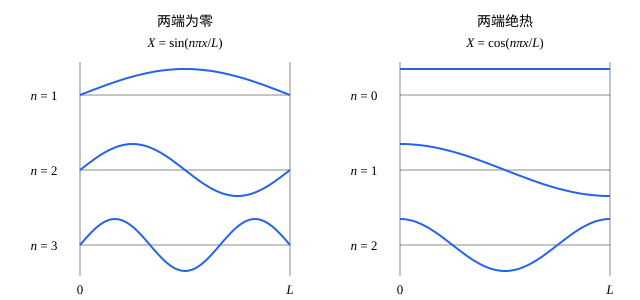

## 这一节要回答的问题

一根长$L$的杆侧面绝热，两端浸在冰水里，开始时各处冷热不均。[热方程的推导](lesson:math.pde.heat-equation)一节写出了温度满足的:term[热方程]{id="math.pde.heat-equation"}（heat equation）和条件，可解到底是什么样子？杆里的温度怎样一步步降到$0$？

## 讲解

### 乘积形式的解

要解的问题是：在$0<x<L$、$t>0$上，

$$
u_t=Du_{xx},\qquad u(0,t)=u(L,t)=0,\qquad u(x,0)=\varphi(x).
$$

这是两端为:term[狄利克雷边界条件]{id="math.pde.dirichlet-boundary-condition"}（Dirichlet boundary condition）的:term[初边值问题]{id="math.pde.initial-boundary-value-problem"}（initial-boundary value problem），$D$是:term[扩散系数]{id="math.pde.diffusion-coefficient"}（diffusion coefficient）。

先找形状不变、只按比例变高变矮的解$u=X(x)T(t)$，$X$、$T$都不恒为零。代进:term[热方程]{id="math.pde.heat-equation"}得$XT'=DX''T$，在$X$、$T$不为零的地方两边除以$DXT$：

$$
\frac{T'(t)}{DT(t)}=\frac{X''(x)}{X(x)}.
$$

固定$x$、改变$t$，右边不变，所以左边是常数，右边也等于它。

::anchor{id="def-separation-constant"}
上式两边共同等于的这个常数，叫作:term[分离常数]{id="math.pde.separation-constant"}（separation constant）；把它记作$-\lambda$，就得到$T'=-D\lambda T$和$X''+\lambda X=0$。

为什么这样定义：有了它，方程就拆成两个常微分方程（ordinary differential equation）；记作$-\lambda$，是为了下面用得上的$\lambda$都不小于零。边界情况：除以$XT$要它们不为零，所以最后得到的解要代回原方程验证。常微分方程里把$x$、$y$移到等号两边（见[可分离变量的方程](lesson:math.ode.separable)）是另一回事；分析力学里把$W$拆成几个函数的和（见[哈密顿-雅可比方程](lesson:physics.analytical-mechanics.hamilton-jacobi)），想法和这里相同，只是拆成的是和而不是乘积。

两端的条件也落到$X$上：$u(0,t)=X(0)T(t)=0$对一切$t>0$成立，$T$不恒为零，所以$X(0)=0$；同样$X(L)=0$。

### 特征值问题

$X''+\lambda X=0$的特征方程（characteristic equation）是$r^2+\lambda=0$，照[常系数齐次方程的解法](lesson:math.ode.constant-coefficients#thm-constant-coefficients)分三种情形。

- $\lambda<0$：$X=C_1e^{\sqrt{-\lambda}x}+C_2e^{-\sqrt{-\lambda}x}$。$X(0)=0$给出$C_2=-C_1$，$X(L)=0$又给出$C_1\bigl(e^{\sqrt{-\lambda}L}-e^{-\sqrt{-\lambda}L}\bigr)=0$，括号里不为零，所以$C_1=C_2=0$。
- $\lambda=0$：$X=C_1+C_2x$，两端为零同样给出$C_1=C_2=0$。
- $\lambda>0$：$X=C_1\cos\sqrt\lambda x+C_2\sin\sqrt\lambda x$。$X(0)=0$给出$C_1=0$；要$X$不恒为零，$C_2\ne0$，$X(L)=0$就要求$\sin\sqrt\lambda L=0$，即$\lambda=\bigl(\frac{n\pi}L\bigr)^2$（$n=1,2,\dots$）。

::anchor{id="def-eigen"}
设$X$在$[0,L]$上满足$-X''=\lambda X$，两端附带齐次（右边为零）的边界条件（boundary condition），如$X(0)=X(L)=0$。使这个:term[边值问题]{id="math.pde.boundary-value-problem"}（boundary value problem）有不恒为零的解的$\lambda$，叫作它的:term[特征值]{id="math.pde.eigenvalue"}（eigenvalue）；这些不恒为零的解，叫作属于$\lambda$的:term[特征函数]{id="math.pde.eigenfunction"}（eigenfunction）。

为什么这样定义：$-X''=\lambda X$和[特征值与特征向量](lesson:math.linear-algebra.eigenvalues#def-eigen)一节的$A\vb v=\lambda\vb v$是同一个样子，$-\dv{^2}{x^2}$起矩阵的作用，特征函数就是它的「特征向量」（eigenvector）。$X\equiv0$对任何$\lambda$都满足，所以要求不恒为零。边界情况：上面的$\lambda\le0$都不是特征值；边界条件变了，特征值也跟着变（见下面的两端绝热）。这里的$\lambda$是特征值，不是波长，[驻波](lesson:physics.oscillations-waves.standing-waves)一节把它写成$k_n^2$。

于是两端为零时，特征值是$\lambda_n=\bigl(\frac{n\pi}L\bigr)^2$，特征函数是$\sin\frac{n\pi x}L$的非零常数倍。时间因子由:term[分离常数]{id="math.pde.separation-constant"}定：$T'=-D\lambda_nT$给出$e^{-D\lambda_nt}$，乘积解

$$
u_n(x,t)=e^{-D(n\pi/L)^2t}\sin\frac{n\pi x}L
$$

形状不变，高度按指数衰减；$n$越大，起伏越密，衰减越快。

### 叠加成级数

初温是有限个$\sin\frac{n\pi x}L$的组合时，例如$\varphi=\sin\frac{\pi x}L+\frac13\sin\frac{3\pi x}L$，由:term[叠加原理]{id="math.pde.superposition-principle"}（superposition principle），把对应的乘积解照样组合起来，就满足方程、两端的条件和初始条件（initial condition）。一般的$\varphi$要用无穷多项：

$$
u(x,t)=\sum_{n=1}^\infty b_ne^{-D(n\pi/L)^2t}\sin\frac{n\pi x}L ,
$$

$t=0$时要$\varphi(x)=\sum_{n=1}^\infty b_n\sin\frac{n\pi x}L$（$0<x<L$）。$\varphi$只在$(0,L)$上给出，要用傅里叶级数（Fourier series），先得把它延到对称的区间上。

::anchor{id="def-extension"}
把$(0,L)$上的函数$\varphi$按$\varphi(-x)=-\varphi(x)$延到$(-L,0)$上，叫作:term[奇延拓]{id="math.pde.odd-extension"}（odd extension）；按$\varphi(-x)=\varphi(x)$延到$(-L,0)$上，叫作:term[偶延拓]{id="math.pde.even-extension"}（even extension）。

为什么这样定义：奇延拓后是奇函数，由[傅里叶级数](lesson:math.analysis.fourier-series#thm-parity)一节的定理 3，换成[周期$2L$的公式](lesson:math.analysis.fourier-series#def-fourier-series-2l)，它的傅里叶级数只含正弦项，是正弦级数（sine series），系数$b_n=\frac2L\int_0^L\varphi(x)\sin\frac{n\pi x}L\dd x$，正是上面要的；偶延拓同样给出只含余弦项和常数项的余弦级数（cosine series）。边界情况：延拓后再按周期$2L$延到整条直线上；$\varphi(0^+)\ne0$时，奇延拓在$0$处跳跃，级数在$0$处收敛到$0$。

::anchor{id="thm-heat-series"}
**定理**　设$\varphi$在$[0,L]$上分段光滑（piecewise smooth），$b_n=\frac2L\int_0^L\varphi(x)\sin\frac{n\pi x}L\dd x$。则$t>0$时上面的级数收敛，它的和$u$满足$u_t=Du_{xx}$和$u(0,t)=u(L,t)=0$；$t=0$时，级数在$0<x<L$的每一点收敛到$\frac{\varphi(x^-)+\varphi(x^+)}2$，在$\varphi$连续的点就是$\varphi(x)$。

**证明思路**：$t=0$时，级数是$\varphi$奇延拓后的傅里叶级数，延拓后仍分段光滑，由狄利克雷定理（Dirichlet's theorem，见[傅里叶级数的收敛](lesson:math.analysis.fourier-convergence#thm-dirichlet)，周期换成$2L$同理）得出。$t\ge t_0>0$时，$|b_n|\le C=\frac2L\int_0^L|\varphi|\dd x$，级数逐项对$t$求一次、对$x$求两次导数前后，各项的绝对值都不超过某个常数乘$n^2e^{-D(n\pi/L)^2t_0}$，由比值判别法（ratio test），它们的和收敛。由:term[魏尔斯特拉斯判别法]{id="math.analysis.weierstrass-m-test"}（Weierstrass M-test，见[函数项级数与魏尔斯特拉斯判别法](lesson:math.analysis.function-series#thm-weierstrass-m-test)），这几个级数都一致收敛（uniform convergence）；各项的导数都连续，可以逐项求导（[一致收敛与极限交换](lesson:math.analysis.uniform-limit-theorems#thm-derivative-interchange)的定理 3），每一项满足的方程和两端的条件，和也满足。完整的证明见第 5 题。

$b_1\ne0$时，$t$大了以后第一项远大于其余各项之和，$u\approx b_1e^{-D\pi^2t/L^2}\sin\frac{\pi x}L$：形状变成半个正弦波，整体按指数衰减，快慢由$\frac{D\pi^2}{L^2}$决定，像热水和室温的温差（[一阶线性方程与积分因子](lesson:math.ode.linear-first-order)）。两端保持不为零的温度时，先减去:term[稳态]{id="math.pde.steady-state"}（steady state），见第 4 题。

### 两端绝热

两端绝热是:term[诺伊曼边界条件]{id="math.pde.neumann-boundary-condition"}（Neumann boundary condition）$u_x(0,t)=u_x(L,t)=0$，落到$X$上是$X'(0)=X'(L)=0$。照样分三种情形：$\lambda<0$只有零解；$\lambda=0$时常数$X=1$满足条件，$0$也是:term[特征值]{id="math.pde.eigenvalue"}；$\lambda>0$时$X'(0)=0$给出$C_2=0$，$X'(L)=0$又要求$\sin\sqrt\lambda L=0$。所以特征值是$\bigl(\frac{n\pi}L\bigr)^2$，:term[特征函数]{id="math.pde.eigenfunction"}是$\cos\frac{n\pi x}L$（$n=0,1,2,\dots$）。

初值要:term[偶延拓]{id="math.pde.even-extension"}，展开成含常数项的余弦级数：

$$
u(x,t)=\frac{a_0}2+\sum_{n=1}^\infty a_ne^{-D(n\pi/L)^2t}\cos\frac{n\pi x}L,\qquad a_n=\frac2L\int_0^L\varphi(x)\cos\frac{n\pi x}L\dd x .
$$

$t\to+\infty$时$u\to\frac{a_0}2=\frac1L\int_0^L\varphi(x)\dd x$，正是初温的平均值：热量出不去，只在杆里摊匀。

### 一般的步骤

::anchor{id="def-separation-of-variables"}
像这样设解是各含一个自变量的函数的乘积，用:term[分离常数]{id="math.pde.separation-constant"}把方程化成几个常微分方程，由齐次的边界条件定出:term[特征值]{id="math.pde.eigenvalue"}和:term[特征函数]{id="math.pde.eigenfunction"}，再把乘积解叠加起来满足初始条件，这个办法叫作:term[分离变量法]{id="math.pde.separation-of-variables"}（separation of variables）。

为什么这样定义：方程和边界条件都齐次，乘积解的线性组合（linear combination）仍满足它们（:term[叠加原理]{id="math.pde.superposition-principle"}），无穷多项要像上面的定理那样另外验证。系数靠特征函数两两正交（orthogonal）来求：$m\ne n$时$\int_0^L\sin\frac{m\pi x}L\sin\frac{n\pi x}L\dd x=0$，把初值按特征函数展开，两边乘$\sin\frac{m\pi x}L$再积分，能逐项积分时就只剩$b_m$那一项。边界情况：几个空间变量时逐个分离，例如设$u=X(x)Y(y)T(t)$（第 6 题）；圆形鼓面的振动要在极坐标（polar coordinates）下这样分离，见[圆膜振动与贝塞尔函数](lesson:math.pde.bessel-functions)。

## 几何图像

左栏是两端为零时的:term[特征函数]{id="math.pde.eigenfunction"}$\sin\frac{n\pi x}L$（$n=1,2,3$），在两端取零值；右栏是两端绝热时的$\cos\frac{n\pi x}L$（$n=0,1,2$），在两端切线水平。两栏的:term[特征值]{id="math.pde.eigenvalue"}都是$\bigl(\frac{n\pi}L\bigr)^2$：$n$越大，起伏越密，对应的乘积解衰减得越快。

:::anim{component="function-plot"}
range: { x: [0, 3.1416], y: [-0.15, 1.35] }
functions:
  - expr: "4/pi * sum(k, 1, N, exp(-(2k-1)^2*s) * sin((2k-1)*x) / (2k-1))"
    label: |
      前$N$项的部分和
  - expr: "4/pi * exp(-s) * sin(x)"
    label: |
      只取第一项
sliders:
  - name: N
    min: 1
    max: 40
    step: 1
    default: 10
    label: |
      项数$N$
  - name: s
    min: 0
    max: 1.5
    step: 0.01
    default: 0
    label: |
      时间$t$（$D=1$）
:::

这幅图是例 1 取$L=\pi$、$D=1$、$u_0=1$的情形：初温处处是$1$，两端保持$0$。蓝线是级数前$N$项的部分和（partial sum），橙线只取第一项$\frac4\pi e^{-t}\sin x$。

$t=0$、$N$较大时，蓝线贴近$1$，两端旁边冲过头，是吉布斯现象（Gibbs phenomenon）。拖动时间滑块，尖角和细小的起伏很快消失（第$n$项按$e^{-n^2t}$衰减），蓝线很快和橙线重合，整体变矮；$t$在$0.93$左右时，中点降到约$\frac12$，和例 1 的估计一致。

## 例题

### 例 1　初温均匀的杆

长$L$的杆侧面绝热，初温处处是$u_0$，两端保持$0$。求$u(x,t)$，并估计杆中点的温度降到$\frac{u_0}2$要多久。

**为什么想到这么做**：常数的:term[奇延拓]{id="math.pde.odd-extension"}就是[傅里叶级数](lesson:math.analysis.fourier-series)一节例 2 的方波乘$u_0$（周期换成$2L$），系数现成；时间稍长时只有第一项要紧。

**推导**：$b_n=\frac{2u_0}L\int_0^L\sin\frac{n\pi x}L\dd x=\frac{2u_0}{n\pi}(1-\cos n\pi)$，$n$为奇数时是$\frac{4u_0}{n\pi}$，为偶数时是$0$，所以

$$
u(x,t)=\frac{4u_0}\pi\sum_{k=1}^\infty\frac1{2k-1}e^{-(2k-1)^2\pi^2Dt/L^2}\sin\frac{(2k-1)\pi x}L .
$$

在中点只取第一项，$\frac{4u_0}\pi e^{-\pi^2Dt/L^2}=\frac{u_0}2$，得$t=\frac{L^2}{\pi^2D}\ln\frac8\pi\approx0.095\,\frac{L^2}D$。这时$k=2$的项和第一项之比的绝对值是$\frac13\bigl(\frac\pi8\bigr)^8\approx2\times10^{-4}$，后面的项更小，可以不计。长$0.30\,\mathrm m$的铁棒，$D\approx2.3\times10^{-5}\,\mathrm{m^2/s}$，约要$370\,\mathrm s$。

## 常见误区

- 「:term[分离常数]{id="math.pde.separation-constant"}取什么值都行。」$\lambda$不是:term[特征值]{id="math.pde.eigenvalue"}时，$X''+\lambda X=0$满足两端条件的解只有$X\equiv0$，乘积解也就是零；只有特征值给出有用的乘积解。
- 「两端保持不为零的温度时，也可以直接把乘积解叠加。」边界条件不是齐次的：两个都满足$u(0,t)=a$（$a\ne0$）的解相加，左端变成$2a$。要先减去:term[稳态]{id="math.pde.steady-state"}，化成两端为零的问题（第 4 题）。
