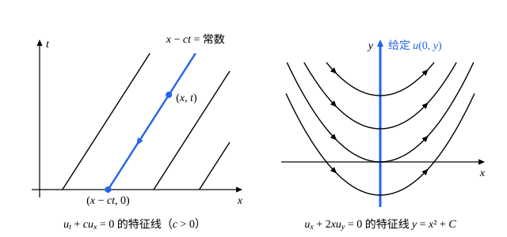

## 这一节要回答的问题

河水以速度$c$流动，一团染料随水漂走，$t$时刻$x$处的浓度$u(x,t)$满足什么方程？[多元复合函数的链式法则](lesson:math.vector-calculus.multivariable-chain-rule)第 7 题发现，$u_t+cu_x=0$的可微（differentiable）解沿每条直线$x=x_0+ct$保持不变。方程的系数随位置变化时，还有这样的线吗？怎样找出它们，又怎样用它们解方程？

## 讲解

### 输运方程

河水以速度$c$流动（$c<0$是向左），一团染料随水漂走、不散开。记$t$时刻$x$处的浓度（每单位长度河道里的染料）为$u(x,t)$，单位时间流过$x$处的染料为$J(x,t)$。染料不生不灭，一段河道里的总量只因两端的进出而变，写成方程就是[高斯公式（散度定理）](lesson:math.vector-calculus.divergence-theorem#def-continuity-equation)一节的:term[连续性方程]{id="math.vector-calculus.continuity-equation"}（continuity equation），一维时是$u_t+J_x=0$。染料跟着水走，$J=cu$，于是$u_t+cu_x=0$。

::anchor{id="def-transport"}
方程$u_t+cu_x=0$（$c$是常数）叫作:term[输运方程]{id="math.pde.transport-equation"}（transport equation），也叫平流方程（advection equation）。

为什么这样定义：它描述随流动整团带走的量，$c$是流速。热学的输运现象（transport phenomena）不算风把热空气整团吹过来（见[气体的黏性](lesson:physics.thermal-physics.viscosity)），这里说的正是整团带走，两者别混。边界情况：$c=0$时方程是$u_t=0$，整个平面上的解只依赖$x$，各处的浓度都不随时间变。

### 特征线

[多元复合函数的链式法则](lesson:math.vector-calculus.multivariable-chain-rule)第 7 题从另一面看这个方程：沿直线$x=x_0+ct$记$U(t)=u(x_0+ct,t)$，$u$可微时，由那一节的全导数（total derivative），$U'(t)=u_x\cdot c+u_t$，正是方程的左边。所以:term[输运方程]{id="math.pde.transport-equation"}的可微解沿每条这样的直线保持不变：随水漂流，看到的浓度不变。

::anchor{id="def-characteristic"}
一般地，设$a$、$b$、$\gamma$、$f$是$x$、$y$的函数，$a$、$b$在每一点不同时为$0$，考虑:term[一阶线性偏微分方程]{id="math.pde.linear-pde"}（first-order linear partial differential equation）$au_x+bu_y+\gamma u=f$。满足$\dv xs=a$、$\dv ys=b$的曲线$\bigl(x(s),y(s)\bigr)$，叫作这个方程的:term[特征线]{id="math.pde.characteristic-curve"}（characteristic curve），也叫特征曲线。

为什么这样定义：设$u$可微，记$U(s)=u\bigl(x(s),y(s)\bigr)$，由链式法则（chain rule），$U'(s)=au_x+bu_y$，方程沿特征线变成只有一个自变量的常微分方程（ordinary differential equation）$U'+\gamma U=f$。输运方程以$x$、$t$为自变量，$a=c$、$b=1$，取$t=s$，特征线就是直线$x-ct=x_0$。边界情况：[偏微分方程与分类](lesson:math.pde.pde-basics)一节的$u_x=0$，$a=1$、$b=0$，特征线是水平线$y=y_0$，整个平面上的解沿它们不变，只依赖$y$。

::anchor{id="thm-transport"}
**定理 1**　设$\varphi$在$\R$上可导。:term[输运方程]{id="math.pde.transport-equation"}在整个$(x,t)$平面上满足$u(x,0)=\varphi(x)$的可微解恰好有一个，就是$u(x,t)=\varphi(x-ct)$。

**证明思路**：$\varphi(x-ct)$可微，代入方程可以验证它是解。反过来，可微解沿每条:term[特征线]{id="math.pde.characteristic-curve"}不变，过$(x,t)$的那一条在$t=0$时经过$x-ct$，所以$u(x,t)=u(x-ct,0)=\varphi(x-ct)$。

换一组自变量看：令$\xi=x-ct$、$\tau=t$（这里的$\xi$只是新坐标的名字），记$u(x,t)=w(\xi,\tau)$，由[多个自变量的链式法则](lesson:math.vector-calculus.multivariable-chain-rule#thm-chain-rule-partial)，$u_x=w_\xi$，$u_t=-cw_\xi+w_\tau$，方程变成$w_\tau=0$，$w$只依赖$\xi$。$w_\tau$固定$\xi$，是随水漂流时看到的变化率，$u_t$固定$x$，是站在岸上看到的：偏导数（partial derivative）的值取决于另外哪个变量保持不变（[偏导数](lesson:math.vector-calculus.partial-derivatives)第 7 题）。

::anchor{id="def-traveling-wave"}
形如$\varphi(x-ct)$的函数（$\varphi$是一元函数，$c$是常数），叫作以速度$c$传播的:term[行波]{id="math.pde.traveling-wave"}（traveling wave）。

为什么这样定义：$t$时刻的图像是$t=0$时的图像平移$ct$，形状不变，像一个波形以速度$c$移动，$c>0$时向右、$c<0$时向左。由定理 1，:term[输运方程]{id="math.pde.transport-equation"}在整个平面上的可微解都是行波。边界情况：$\frac{e^{-t}}{1+(x-ct)^2}$一边平移、一边变矮，最高处从$1$降到$e^{-t}$，不是行波。

### 变系数的方程与特征线法

$u_x+2xu_y=0$的系数随$x$变。它的:term[特征线]{id="math.pde.characteristic-curve"}满足$\dv xs=1$、$\dv ys=2x$，取$x=s$，就是$\dv yx=2x$，得到抛物线$y=x^2+C$：它们正是$y'=2x$的方向场（direction field，见[微分方程与方向场](lesson:math.ode.what-is-ode#def-direction-field)）里的解曲线（solution curve）。设$u$在整个平面上可微，它沿每条抛物线不变，而每条抛物线和$y$轴只交于一点$(0,C)$，所以给定$u(0,y)=g(y)$，就得$u(x,y)=g(y-x^2)$（几何图像右图）。

::anchor{id="thm-first-order"}
**定理 2**　设$a$、$b$在平面上某个范围里连续，$\Phi(x,y)$在那里有连续的偏导数，并且$a\Phi_x+b\Phi_y=0$。那么对每个可导的一元函数$F$，$u=F(\Phi)$都是$au_x+bu_y=0$的解，并且沿每条特征线不变。

**证明思路**：由一元的链式法则，$u_x=F'(\Phi)\Phi_x$，$u_y=F'(\Phi)\Phi_y$，所以$au_x+bu_y=F'(\Phi)(a\Phi_x+b\Phi_y)=0$。沿特征线，$\Phi$的变化率是$a\Phi_x+b\Phi_y=0$，所以每条特征线都落在$\Phi$的一条等值线（level curve）上。反过来，可微解沿特征线不变，所以每条特征线都和给初值的曲线恰好交一次时，解由初值唯一定出。

怎样找$\Phi$：在$a\ne0$的地方，特征线满足$\dv yx=\frac ba$，也就是$b\dd x-a\dd y=0$。[恰当方程](lesson:math.ode.exact-equations#def-exact)一节说，这个方程恰当（exact）时，解曲线都落在势函数（potential function）的等值线上；$\Phi$就是那里的势函数$F$（这里的$F$另有用处），要乘积分因子（integrating factor）才恰当时也一样。上面的例子里$b\dd x-a\dd y=2x\dd x-\dd y$，势函数是$x^2-y$，整个平面上的可微解都是$F(x^2-y)$的样子。

方程里还有$\gamma u$和$f$时，$U$沿特征线一般不再不变，可照样解。以$u_t+cu_x+\gamma u=f(x,t)$、$u(x,0)=\varphi(x)$（$\gamma$是常数）为例，沿$x=x_0+ct$，$U(t)=u(x_0+ct,t)$满足$U'+\gamma U=f(x_0+ct,t)$、$U(0)=\varphi(x_0)$，这是[一阶线性方程与积分因子](lesson:math.ode.linear-first-order#def-integrating-factor)一节的方程，乘$e^{\gamma t}$就能解。$\gamma=0$、$f$连续时，由[牛顿-莱布尼茨公式](lesson:math.calculus.fundamental-theorem#thm-newton-leibniz)（Newton-Leibniz formula）得$U(t)=\varphi(x_0)+\int_0^tf(x_0+cs,s)\dd s$，代回$x_0=x-ct$：

$$
u(x,t)=\varphi(x-ct)+\int_0^tf\bigl(x-c(t-s),s\bigr)\dd s.
$$

$s$时刻在途中加进来的量，随水带到了$t$时刻的位置。

::anchor{id="def-method-of-characteristics"}
像这样先求出特征线，再沿特征线把:term[一阶线性偏微分方程]{id="math.pde.linear-pde"}化成常微分方程来解，这个办法叫作:term[特征线法]{id="math.pde.method-of-characteristics"}（method of characteristics）。

为什么这样定义：方程里的偏导数只以$au_x+bu_y$这一种组合出现，沿特征线它就是对$s$的导数，方程于是拆成一族常微分方程，每条特征线上一个。边界情况：特征线要和给初值的曲线相交，并且只交一次。给初值的曲线本身是一条特征线时就定不出解：对$u_t+cu_x=0$只给出直线$x=ct$上的值，别的特征线上的$u$没有着落，给的值不是常数时连解都没有。

## 几何图像

:::anim{component="function-plot"}
range: { x: [-8, 8], y: [-0.1, 1.2] }
functions:
  - expr: "1/(1 + x^2)"
    label: |
      $t=0$时的$u$
  - expr: "1/(1 + (x - c*s)^2)"
    label: |
      $t$时刻的$u$
points:
  - { x: "1 + c*s", y: "0.5" }
sliders:
  - name: c
    min: -2
    max: 2
    step: 0.5
    default: 1
    label: |
      速度$c$
  - name: s
    min: 0
    max: 3
    step: 0.05
    default: 1
    label: |
      时间$t$
:::

图上是:term[输运方程]{id="math.pde.transport-equation"}以$\frac1{1+x^2}$为初值的解$\frac1{1+(x-ct)^2}$，纵轴图上写作 y，是$u$。蓝线是开始时的形状，橙线是$t$时刻的形状；圆点从$(1,\frac12)$出发，横坐标按:term[特征线]{id="math.pde.characteristic-curve"}$x=1+ct$随时间移动，它所在处的$u$始终是$\frac12$。拖动时间滑块，橙线整个平移、形状不变；把速度拖到负值，就向左走。

左图是输运方程（$c>0$）的特征线：过$(x,t)$的那一条往下走，在$t=0$时到达$(x-ct,0)$，$u(x,t)$就等于那里的初值。右图是$u_x+2xu_y=0$的特征线，小箭头指向方向$(1,2x)$；$u$沿每条抛物线不变，给出$y$轴上的值，就定下了整个平面上的解。

## 例题

### 例 1　速度随位置变化

解$u_t+xu_x=0$，$u(x,0)=\frac1{1+x^2}$。

**为什么想到这么做**：系数随位置变，:term[特征线]{id="math.pde.characteristic-curve"}要先由常微分方程求出来；方程里没有$\gamma u$和$f$，$u$沿特征线不变。

**推导**：自变量是$x$、$t$，$a=x$、$b=1$，取$t=s$，特征线满足$\dv xt=x$。这是一阶线性方程（first-order linear equation），乘积分因子$e^{-t}$得$(e^{-t}x)'=0$，所以$x=x_0e^t$。$u$沿它等于出发处的值$\frac1{1+x_0^2}$，过$(x,t)$的那一条从$x_0=xe^{-t}$出发，所以

$$
u(x,t)=\frac1{1+x^2e^{-2t}}.
$$

代回方程可以验证。鼓包的高度不变，宽度按$e^t$增长：离原点越远走得越快，形状被拉宽，不是:term[行波]{id="math.pde.traveling-wave"}。

### 例 2　沿途加进来的量

解$u_t+u_x=x$，$u(x,0)=\sin x$。

**为什么想到这么做**：右边多了$f=x$，$u$沿:term[特征线]{id="math.pde.characteristic-curve"}不再不变，沿特征线把$U'=f$积出来。

**推导**：特征线是$x=x_0+t$。沿它$U(t)=u(x_0+t,t)$满足$U'=x_0+t$、$U(0)=\sin x_0$，所以$U(t)=\sin x_0+x_0t+\frac{t^2}2$。代入$x_0=x-t$：

$$
u(x,t)=\sin(x-t)+(x-t)t+\frac{t^2}2=\sin(x-t)+xt-\frac{t^2}2.
$$

验算：$u_t=-\cos(x-t)+x-t$，$u_x=\cos(x-t)+t$，两者相加是$x$；$t=0$时$u=\sin x$。

## 常见误区

- 「:term[特征线]{id="math.pde.characteristic-curve"}一定是直线。」系数随位置变化时一般不是：例 1 的特征线是曲线$x=x_0e^t$，讲解里$u_x+2xu_y=0$的是抛物线。
- 「$u_t$就是随水漂流的人看到的变化率。」$u_t$固定$x$，是站在岸上看到的；随水漂流看到的是全导数$u_t+cu_x$，:term[输运方程]{id="math.pde.transport-equation"}说它为$0$。
