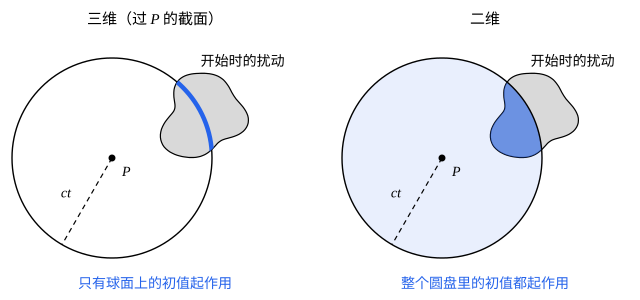

## 这一节要回答的问题

在空旷的地方拍一下手，几米外的人听到的也是短促的一声，声音过去以后就安静了。空气压强的微小变化满足三维的:term[波动方程]{id="math.pde.wave-equation"}（wave equation），声音短促是理所当然的吗？如果波只在一个平面里传，拍手声又会是什么样子？

## 讲解

### 从一点「发出」的波

三维的:term[波动方程]{id="math.pde.wave-equation"}$u_{tt}=c^2\Delta u$里，$\Delta$是[拉普拉斯算子](lesson:math.vector-calculus.vector-identities#def-laplacian)（Laplacian）$\nabla^2$；它有向外传播的:term[球面波]{id="math.pde.spherical-wave"}（spherical wave）$\frac{F(r-ct)}r$，$r=|\vb r|$。记$f(s)=F(-cs)$，它就是$\frac{f(t-r/c)}r$：$r$处$t$时刻的值，是原点在$t-\frac rc$时刻「发出」的，高低按$\frac1r$变小。平移坐标不改变方程，所以$\frac{f(t-|\vb r-\vb r'|/c)}{|\vb r-\vb r'|}$（$\vb r\ne\vb r'$）也是解，是从$\vb r'$发出的波；$f$只在很短的时间里不为零时，$\vb r$处也只在$t\approx\frac{|\vb r-\vb r'|}c$时动一下。

解:term[初值问题]{id="math.pde.initial-value-problem"}（initial value problem）时也是这样。[球面波与球对称的初值问题](lesson:math.pde.spherical-waves)例 1 里，半径为$a$的小球里有均匀的初速度，离球心$d$（$d>a$）处只在$d-a<ct<d+a$时动，之后完全静止，像球心发出的一个短信号；小球里没有初速度、只有球对称的光滑初位移时，由那一节的定理 2 也是这样。

一般的初始扰动，可以近似地看成许多这样的小球里的扰动之和。方程是线性的，由:term[叠加原理]{id="math.pde.superposition-principle"}（superposition principle），解也近似是各个小球的扰动之和。$t$时刻，$\vb r$处只收到离它约$ct$远的小球的贡献：近的已经过去，什么也没留下；远的还没到。小球越小，「约$ct$」就越接近「恰好$ct$」。

### 基尔霍夫公式

::anchor{id="def-spherical-mean"}
设$g$是空间里的连续函数，$\rho>0$。$M_g(\vb r,\rho)=\frac1{4\pi\rho^2}\oint_{|\vb r'-\vb r|=\rho}g(\vb r')\dd a'$叫作$g$在以$\vb r$为心、半径为$\rho$的球面上的球面平均（spherical mean），$\dd a'$是这个球面的面积元（area element）。

为什么这样定义：球面的面积是$4\pi\rho^2$，$M_g$就是$g$在这个球面上的平均值；电磁学[泊松方程与拉普拉斯方程](lesson:physics.electromagnetism.poisson-equation#thm-mean-value)一节的$\bar\varphi(r)$就是电势的球面平均。边界情况：$g$连续，$\rho\to0^+$时$M_g(\vb r,\rho)\to g(\vb r)$。

::anchor{id="thm-kirchhoff"}
**定理（基尔霍夫公式，Kirchhoff's formula）**　设$\varphi$有连续的三阶偏导数（third-order partial derivative），$\psi$有连续的二阶偏导数（second-order partial derivative）。三维的:term[波动方程]{id="math.pde.wave-equation"}满足$u(\vb r,0)=\varphi(\vb r)$、$u_t(\vb r,0)=\psi(\vb r)$、在$t\ge0$时二阶偏导数连续的解恰好有一个，$t>0$时就是$u(\vb r,t)=\pdv{}{t}\bigl[tM_\varphi(\vb r,ct)\bigr]+tM_\psi(\vb r,ct)$。

**证明思路**：固定$\vb r$，记$M(\rho,t)$为$u(\cdot,t)$在以$\vb r$为心、半径为$\rho$的球面上的平均。由散度定理（divergence theorem）可以证明，$\rho M$满足$(\rho M)_{tt}=c^2(\rho M)_{\rho\rho}$，$\rho\to0^+$时趋于$0$，开始时的值和速度是$\rho M_\varphi(\vb r,\rho)$、$\rho M_\psi(\vb r,\rho)$：正是[球面波与球对称的初值问题](lesson:math.pde.spherical-waves#thm-spherical-ivp)定理 2 里$w=ru$的问题。照那里用:term[达朗贝尔公式]{id="math.pde.dalembert-formula"}（d'Alembert's formula）求出$\rho M$，再令$\rho\to0^+$，$M\to u(\vb r,t)$，就得到上面的式子：解只能是它。完整的推导和验证见第 5 题；推导中要把求导移进球面上的积分，$u$的二阶偏导数连续，可以这样做（区间上的情形见[含参变量积分](lesson:math.analysis.parameter-integrals#thm-leibniz-rule)，球面上同理）。

### 惠更斯原理

::anchor{id="def-huygens"}
由基尔霍夫公式，$u(\vb r,t)$只由以$\vb r$为心、半径为$ct$的球面上的初值决定（$\varphi$还要连同它在球面上的偏导数），球面里面、外面的初值都不起作用。三维的:term[波动方程]{id="math.pde.wave-equation"}的这个性质叫作惠更斯原理（Huygens' principle）。

为什么这样定义：公式里只用到$M_\varphi$、$M_\psi$在半径$ct$附近的值，只改动离这个球面有一段距离的初值，$u(\vb r,t)$不变。设开始时的扰动只在一块有界的区域里，$\vb r$在区域外：球面还没碰到区域时$u(\vb r,t)=0$，球面把区域整个围住以后又是$0$。所以扰动只在球面扫过区域的那段时间里经过$\vb r$，有清楚的前沿，过后完全静止，不留「尾巴」：拍手声短促，靠的就是这一点。

边界情况：一维不是这样。:term[达朗贝尔公式]{id="math.pde.dalembert-formula"}里初位移只用到$x\pm ct$两点的值，初速度却要用整个$[x-ct,x+ct]$上的值：[一维波动方程与达朗贝尔公式](lesson:math.pde.wave-dalembert)例 1 里，初速度造成的扰动过后，弦被整体抬高。光学里作图用的:term[惠更斯原理]{id="physics.optics.huygens-principle"}说的是另一件事，两者的联系见第 8 题。

### 二维为什么不行

平面上的波可以看成三维里和$z$无关的波：平面上一点$\vb r'$处的初值，在三维里是过$\vb r'$、平行于$z$轴的一整条直线上的初值。$\vb r$也在平面上、和$\vb r'$相距$d$时，直线上高$z$处的点离$\vb r$是$\sqrt{d^2+z^2}$，只要$d\le ct$，半径$ct$的球面就和这条直线相交。所以二维时，$u(\vb r,t)$由以$\vb r$为心、半径为$ct$的整个圆盘里的初值决定，不只是圆周（几何图像的右图）。

直线上离$\vb r$越远的点，扰动到得越晚：前沿在$t=\frac dc$时到达，此后更远的点的贡献陆续到来，没有尽头，后面拖着一条慢慢变弱的「尾巴」（第 6 题）。电磁学[推迟势](lesson:physics.electromagnetism.retarded-potentials)一节例 1 突然接通的长直导线就是这样，前沿过后磁场并不马上变成恒定电流的磁场；那一节第 8 题也说，长直导线相当于二维的问题。

为什么三维没有尾巴、二维有？三维球对称时$\Delta u=\frac1r(ru)_{rr}$，乘上$r$就化成一维的:term[波动方程]{id="math.pde.wave-equation"}，$ru$形状不变地传。平面上只依赖到原点的距离$r$时，$\Delta u=u_{rr}+\frac1ru_r$（[向量微分恒等式与拉普拉斯算子](lesson:math.vector-calculus.vector-identities)第 8 题），乘上任何只依赖$r$的因子都化不成一维的波动方程，柱面波（cylindrical wave）没有形状不变的精确解（[平面波与球面波](lesson:physics.oscillations-waves.waves-in-3d)第 5 题）。

## 几何图像

两幅图里，浅灰色的一块是开始时的扰动，$P$是要看的点，圆的半径是$ct$，$t$越大圆越大。左图是三维情形过$P$的一个截面，圆代表以$P$为心的球面：$t$时刻$P$处的值只由加粗的那段弧（实际是球面上的一块）附近的初值决定，等圆扫过整块扰动，$P$处就静止了。右图是二维情形，整个圆盘里的初值都起作用，深色的部分正在起作用；圆盘把整块扰动盖住以后，它们仍在起作用，所以$P$处拖着尾巴。

## 例题

### 例 1　小球里的初速度

$\varphi=0$；$|\vb r'|<a$时$\psi(\vb r')=v_0$，其余$\psi=0$（$a$、$v_0$是正常数）。用基尔霍夫公式求离球心$R$（$R>a$）处的$u$。$\psi$不连续，这里照公式算，得到的是放宽了意思的解。

**为什么想到这么做**：$\varphi=0$，公式只剩$tM_\psi(\vb r,ct)$；$\psi$在小球里是$v_0$、外面是$0$，$M_\psi$就是$v_0$乘半径为$ct$的球面落在小球里的那一块所占的比例。

**推导**：记$\rho=ct$，$\vb e$是从$\vb r$指向球心的单位向量。球面上的点写成$\vb r+\vb x$（$|\vb x|=\rho$），它到球心的距离的平方是$|\vb x-R\vb e|^2=\rho^2+R^2-2R\,\vb x\cdot\vb e$，所以它在小球里，当且仅当$\vb x\cdot\vb e>\frac{\rho^2+R^2-a^2}{2R}$。这一块是被一个平面截下的球冠（spherical cap），$R-a<\rho<R+a$时它的高是$h=\rho-\frac{\rho^2+R^2-a^2}{2R}=\frac{a^2-(R-\rho)^2}{2R}$。由[参数曲面与曲面面积](lesson:math.vector-calculus.parametric-surfaces)第 7 题，球面被两个平行平面截下的部分（球冠是其中一个平面只碰到球面一点的情形），面积是$2\pi\rho$乘两平面的距离，所以

$$
u=t\cdot\frac{2\pi\rho h\,v_0}{4\pi\rho^2}=\frac{v_0\bigl[a^2-(R-ct)^2\bigr]}{4cR}\qquad(R-a<ct<R+a).
$$

$ct\le R-a$时球面还没碰到小球，$ct\ge R+a$时已经把小球整个围在里面，都有$u=0$。所以这里从$t=\frac{R-a}c$动到$t=\frac{R+a}c$，之后完全静止，和[球面波与球对称的初值问题](lesson:math.pde.spherical-waves)例 1 一致：这段时间正是球面扫过小球所用的时间。

## 常见误区

- 「二维不满足惠更斯原理，扰动就一下子传到各处。」二维时$u(\vb r,t)$由半径为$ct$的圆盘里的初值决定：开始时的扰动离$\vb r$至少$d$远，$t<\frac dc$时$\vb r$处照样不动，前沿也以$c$传开。二维缺的是另一头：前沿过后，扰动并不离开，后面拖着尾巴（第 6 题）。
