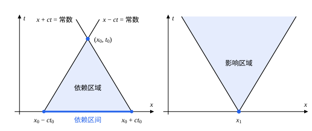

## 这一节要回答的问题

[弦的波动方程](lesson:physics.oscillations-waves.wave-equation)一节说，无限长的弦上，:term[波动方程]{id="math.pde.wave-equation"}（wave equation）的每个解都能写成两列反向:term[行波]{id="math.pde.traveling-wave"}（traveling wave）之和，要到这里才证明。知道开始时弦的形状和各点的速度，以后任何时刻的形状怎样算？一处的扰动要多久才传到别处？

## 讲解

### 特征坐标与通解

$\partial_t$表示对$t$求偏导数（partial derivative），$\partial_x$表示对$x$求偏导数。$u$的二阶偏导数（second-order partial derivative）连续时$u_{xt}=u_{tx}$，所以

$$
(\partial_t-c\partial_x)(\partial_t+c\partial_x)u=u_{tt}-c^2u_{xx}.
$$

里面一层$u_t+cu_x$是:term[输运方程]{id="math.pde.transport-equation"}（transport equation）的左边，是沿直线$x-ct=$常数的变化率；外面一层是沿直线$x+ct=$常数的变化率。所以方程$u_{tt}=c^2u_{xx}$和这两族直线分不开。

::anchor{id="def-wave-equation"}
方程$u_{tt}=c^2u_{xx}$（$c$是正常数）叫作一维的:term[波动方程]{id="math.pde.wave-equation"}，$c$叫作波速；三维的波动方程是$u_{tt}=c^2(u_{xx}+u_{yy}+u_{zz})$。

为什么这样定义：[弦的波动方程](lesson:physics.oscillations-waves.wave-equation#thm-string-equation)一节由一小段弦的受力推出，斜率很小、重力不计时，弦的横向位移满足$y_{tt}=v^2y_{xx}$，那里的$y$、$v$就是这里的$u$、$c$。按[偏微分方程与分类](lesson:math.pde.pde-basics#def-classification)，它的$B^2-AC=c^2>0$，是:term[双曲型方程]{id="math.pde.hyperbolic-equation"}（hyperbolic equation）。边界情况：弦有硬度或受阻尼时，方程要多出别的项，就不再是波动方程。

::anchor{id="def-characteristic-coordinates"}
令$\xi=x-ct$、$\eta=x+ct$（$\xi$、$\eta$只是新坐标的名字），它们叫作特征坐标（characteristic coordinates）。直线$\xi=$常数是$u_t+cu_x=0$的:term[特征线]{id="math.pde.characteristic-curve"}（characteristic curve），$\eta=$常数是$u_t-cu_x=0$的，这两族直线合起来叫作波动方程的特征线。

为什么这样定义：$x=\frac{\xi+\eta}2$，$t=\frac{\eta-\xi}{2c}$，$(x,t)$和$(\xi,\eta)$一一对应，可以当新坐标用；沿一条特征线走，只有一个特征坐标在变。边界情况：两族特征线在$(x,t)$平面上的斜率是$\pm\frac1c$，$c\to0$时都趋于竖直；$c=0$时$\xi=\eta=x$，两族并成同一族竖直线，$(x,t)$和$(\xi,\eta)$不再一一对应，所以要$c\ne0$。

::anchor{id="thm-general-solution"}
**定理 1**　设$u$在整个$(x,t)$平面上二阶偏导数连续。$u$满足:term[波动方程]{id="math.pde.wave-equation"}，当且仅当$u=F(x-ct)+G(x+ct)$，其中$F$、$G$是二阶可导（twice differentiable）的一元函数。

**证明思路**：记$u(x,t)=w(\xi,\eta)$。由[多个自变量的链式法则](lesson:math.vector-calculus.multivariable-chain-rule#thm-chain-rule-partial)（chain rule），$u_x=w_\xi+w_\eta$，$u_t=-cw_\xi+cw_\eta$；再求一次，用施瓦茨定理（Schwarz's theorem，见[偏导数](lesson:math.vector-calculus.partial-derivatives#thm-schwarz)）合并混合偏导数（mixed partial derivative），得$u_{tt}-c^2u_{xx}=-4c^2w_{\xi\eta}$。所以方程就是$w_{\xi\eta}=0$：$w_\xi$不随$\eta$变，只是$\xi$的函数；再对$\xi$积分，得$w=F(\xi)+G(\eta)$。反方向是[偏导数](lesson:math.vector-calculus.partial-derivatives)第 5 题。

$F(x-ct)$是以速度$c$向右传播的:term[行波]{id="math.pde.traveling-wave"}，$G(x+ct)$向左传播。方程是线性的，由:term[叠加原理]{id="math.pde.superposition-principle"}（superposition principle），两列反向行波之和仍是解；定理 1 说，整个平面上二阶偏导数连续的解只有这一种，通解（general solution）里是两个任意的二阶可导的一元函数。

### 达朗贝尔公式

给定开始时弦的形状$u(x,0)=\varphi(x)$和各点的速度$u_t(x,0)=\psi(x)$，求以后的$u$，这是一个:term[初值问题]{id="math.pde.initial-value-problem"}（initial value problem）。由定理 1，$t=0$时$F(x)+G(x)=\varphi(x)$，$-cF'(x)+cG'(x)=\psi(x)$。第二式从$0$到$x$积分，得$G(x)-F(x)=\frac1c\int_0^x\psi(s)\dd s+k$（$k$是常数），和第一式联立：

$$
\begin{aligned}
F(x)&=\frac{\varphi(x)}2-\frac1{2c}\int_0^x\psi(s)\dd s-\frac k2,\\
G(x)&=\frac{\varphi(x)}2+\frac1{2c}\int_0^x\psi(s)\dd s+\frac k2.
\end{aligned}
$$

把$x-ct$代进$F$、$x+ct$代进$G$再相加，$k$消掉了，两个积分合成一个从$x-ct$到$x+ct$的积分。

::anchor{id="thm-dalembert"}
**定理 2（:term[达朗贝尔公式]{id="math.pde.dalembert-formula"}，d'Alembert's formula）**　设$\varphi$有连续的二阶导数（second derivative），$\psi$有连续的导数。:term[波动方程]{id="math.pde.wave-equation"}在整个$(x,t)$平面上满足$u(x,0)=\varphi(x)$、$u_t(x,0)=\psi(x)$的二阶偏导数连续的解恰好有一个，就是$u(x,t)=\frac12\bigl[\varphi(x-ct)+\varphi(x+ct)\bigr]+\frac1{2c}\int_{x-ct}^{x+ct}\psi(s)\dd s$。

**证明思路**：上面的推导说明，这样的解只能是这个式子，所以至多有一个。反过来要验证它确实是解，对积分的上下限求导时用[微积分基本定理](lesson:math.calculus.fundamental-theorem#thm-ftc)（fundamental theorem of calculus），完整的验证见第 6 题。

为什么是这个样子：$\psi=0$时$u=\frac12\bigl[\varphi(x-ct)+\varphi(x+ct)\bigr]$，开始时的形状分成两半，高度减半，各以速度$c$向左右跑开（见几何图像）。第二项把区间$[x-ct,x+ct]$上的初速度累积起来：开始时被推动的每一小段，影响都以速度$c$向两边扩展。边界情况：$\varphi$带折角时（如三角形的脉冲），公式照样给出一个函数，可它在一些点没有二阶偏导数，只是放宽了意思的解（第 7 题）。

### 依赖区域与有限传播速度

由定理 2，$u(x_0,t_0)$只用到$\varphi$在$x_0-ct_0$、$x_0+ct_0$两点的值，和$\psi$在区间$[x_0-ct_0,x_0+ct_0]$上的值。过点$(x_0,t_0)$的两条:term[特征线]{id="math.pde.characteristic-curve"}往下走，在$t=0$时正好到达这两个端点，和$x$轴围成一个三角形（几何图像的左图）。

::anchor{id="def-domains"}
设$t_0>0$。区间$[x_0-ct_0,x_0+ct_0]$叫作点$(x_0,t_0)$的依赖区间（interval of dependence），它和点$(x_0,t_0)$围成的三角形叫作:term[依赖区域]{id="math.pde.domain-of-dependence"}（domain of dependence）。反过来，$t=0$时$x_1$处的初值只能影响满足$|x-x_1|\le ct$的点$(x,t)$（$t\ge0$），这个以$(x_1,0)$为顶点、向上张开的角形区域叫作$x_1$的:term[影响区域]{id="math.pde.domain-of-influence"}（domain of influence）。

为什么这样定义：改动依赖区间以外的初值，$u(x_0,t_0)$不变，所以依赖区域圈出了这一点「听得到」的全部初值，影响区域圈出了一处的初值「传得到」的全部点。边界情况：依赖区间的两端只用到$\varphi$，中间只用到$\psi$，所以只改$\varphi$在区间内部的值，$u(x_0,t_0)$也不变。

::anchor{id="thm-finite-speed"}
**定理 3（:term[有限传播速度]{id="math.pde.finite-propagation-speed"}，finite propagation speed）**　设$\varphi$、$\psi$满足定理 2 的条件，并且在区间$[a,b]$以外都是$0$。那么$t>0$时，定理 2 的解在$[a-ct,b+ct]$以外都是$0$：扰动传开的速度不超过$c$。

**证明思路**：$x>b+ct$时，依赖区间$[x-ct,x+ct]$整个在$b$的右边，那里$\varphi$、$\psi$都是$0$，所以$u(x,t)=0$；$x<a-ct$时同理。

过一点的两条特征线，很像狭义相对论里:term[光锥]{id="physics.special-relativity.light-cone"}（light cone）的两条光线：从这一点发出的信号，传不出它们向上夹住的范围。

## 几何图像

:::anim{component="function-plot"}
range: { x: [-8, 8], y: [-0.1, 1.1] }
functions:
  - expr: "exp(-x^2)"
    label: |
      $t=0$时的形状$\varphi$
  - expr: "(1 + m)/2*exp(-(x - s)^2) + (1 - m)/2*exp(-(x + s)^2)"
    label: |
      $t$时刻的$u$
sliders:
  - name: s
    min: 0
    max: 6
    step: 0.05
    default: 2
    label: |
      时间$t$（$c=1$）
  - name: m
    min: -1
    max: 1
    step: 0.25
    default: 0
    label: |
      初速度$\psi=-m\varphi'$的系数$m$
:::

图上是$c=1$、$\varphi(x)=e^{-x^2}$时的解，纵轴图上写作 y，是$u$。蓝线是开始时的形状，橙线是$t$时刻的弦。先让$m=0$，各点开始时都静止，拖动时间滑块：鼓包分成两个形状相同、高度减半的鼓包，各以速度$c$向左右跑开，分开以后各自保持形状，这是[弦的波动方程](lesson:physics.oscillations-waves.wave-equation)第 6 题讨论过的。再拖动$m$：开始时的形状不变，初速度改变了两半的高低，$m=1$时整个鼓包向右跑，不再分开。

左图是点$(x_0,t_0)$的:term[依赖区域]{id="math.pde.domain-of-dependence"}：过这一点的两条:term[特征线]{id="math.pde.characteristic-curve"}往下走，在$x$轴上截出依赖区间（加粗的一段），$u(x_0,t_0)$只由这一段上的初值决定。右图是$x_1$的:term[影响区域]{id="math.pde.domain-of-influence"}：从$(x_1,0)$出发的两条特征线向上张开，$x_1$处的初值只能影响夹在它们中间的点。

## 例题

### 例 1　只给初速度

$\varphi=0$，$\psi(x)=\frac1{1+x^2}$，求$u(x,t)$。很久以后，弦上每一点的位移趋于多少？

**为什么想到这么做**：$\varphi=0$，:term[达朗贝尔公式]{id="math.pde.dalembert-formula"}只剩积分那一项；$\frac1{1+s^2}$的原函数（antiderivative）是$\arctan s$。

**推导**：由定理 2，

$$
u(x,t)=\frac1{2c}\int_{x-ct}^{x+ct}\frac{\dd s}{1+s^2}=\frac{\arctan(x+ct)-\arctan(x-ct)}{2c}.
$$

固定$x$，$t\to+\infty$时$\arctan(x+ct)\to\frac\pi2$，$\arctan(x-ct)\to-\frac\pi2$，所以$u\to\frac\pi{2c}$。初速度带来的扰动走过以后，弦并不回到原来的位置，而是整体被抬高了$\frac\pi{2c}$。

### 例 2　什么时候开始动

$c=1$，$\varphi$有连续的二阶导数，在$[-1,1]$以外是$0$，$\psi=0$。$x=4$处的弦什么时候开始动？什么时候又静止下来？

**为什么想到这么做**：$\psi=0$时$u(4,t)$只用到:term[依赖区间]{id="math.pde.domain-of-dependence"}$[4-t,4+t]$两个端点处$\varphi$的值，看端点什么时候进入、什么时候离开$[-1,1]$。

**推导**：$t>0$时$4+t>1$，$\varphi(4+t)=0$，所以$u(4,t)=\frac12\varphi(4-t)$。$t\le3$时$4-t\ge1$，$u=0$；$3<t<5$时$4-t$在$(-1,1)$里，$u$可能不为$0$；$t\ge5$时$4-t\le-1$，$u$又是$0$。所以这里的弦在$t=3$以前不动，$t=5$以后又静止：向右跑的那半个鼓包宽$2$，以速度$1$经过这里，用了$2$的时间。

## 常见误区

- 「开始时的鼓包，总是分成两个一样的半高鼓包。」这是开始时各点都静止的情形。有初速度时，两半一般不一样高：开始时各点的速度是$-c\varphi'(x)$时，$u=\varphi(x-ct)$，整个鼓包向右跑，一点也不往左分（几何图像里把$m$拖到$1$）。
- 「通解里的$F$、$G$由解$u$唯一确定。」$F+k$和$G-k$（$k$是常数）给出同一个$u$；推导:term[达朗贝尔公式]{id="math.pde.dalembert-formula"}时多出的常数$k$，最后正是这样消掉的。
