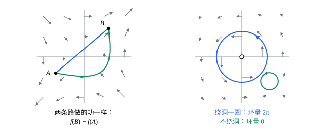

## 这一节要回答的问题

重力把物体从高处搬到低处，做的功只看高度差，不看走哪条路；可在转动的场$(-y,x)$里，走上半圆和走下半圆，做的功并不一样。什么样的:term[向量场]{id="math.vector-calculus.vector-field"}（vector field）「不看路」？怎样一眼判断，又怎样找出那个起「高度」作用的函数？

## 讲解

### 曲线积分的基本定理

::anchor{id="thm-fundamental"}
**:term[曲线积分基本定理]{id="math.vector-calculus.fundamental-theorem-line-integrals"}（fundamental theorem for line integrals）**　设$f$在区域$D$上有:term[连续]{id="math.vector-calculus.continuous"}（continuous）的:term[偏导数]{id="math.vector-calculus.partial-derivative"}（partial derivative），$C$是$D$里从$A$到$B$的:term[分段光滑]{id="math.vector-calculus.piecewise-smooth"}（piecewise smooth）曲线，则$\int_C\nabla f\cdot\dd\vb r=f(B)-f(A)$。

**证明**：设$C$是$\vb r(t)$（$a\le t\le b$）。由:term[链式法则]{id="math.vector-calculus.chain-rule"}（chain rule），$\dv{}tf\bigl(\vb r(t)\bigr)=\nabla f\cdot\vb r'(t)$，所以$\int_C\nabla f\cdot\dd\vb r=\int_a^b\dv{}tf\bigl(\vb r(t)\bigr)\dd t=f(B)-f(A)$。分段光滑时逐段相加，中间的端点两两抵消。

为什么重要：它是一元的牛顿-莱布尼茨公式（Newton–Leibniz formula）搬到曲线上：导数的积分只看两端的值。所以:term[梯度场]{id="math.vector-calculus.gradient-field"}（gradient field）沿任何路径的:term[曲线积分]{id="math.vector-calculus.line-integral"}（line integral）只由起点和终点决定，沿:term[闭曲线]{id="math.vector-calculus.closed-curve"}（closed curve）的积分是零。重力$(0,0,-mg)$是$-mgz$的:term[梯度]{id="math.vector-calculus.gradient"}（gradient），做的功只看高度差，正是这个道理。

### 保守场

::anchor{id="def-conservative"}
$\vb F$在区域$D$上:term[连续]{id="math.vector-calculus.continuous"}。如果$D$里任意两点之间，$\int_C\vb F\cdot\dd\vb r$只由起点和终点决定，和走哪条曲线无关（路径无关，path independence），就说$\vb F$是$D$上的:term[保守场]{id="math.vector-calculus.conservative-field"}（conservative field）。等价地，沿$D$里每一条:term[闭曲线]{id="math.vector-calculus.closed-curve"}的:term[环量]{id="math.vector-calculus.circulation"}（circulation）都是零（第 5 题）。

::anchor{id="thm-potential"}
设$D$是区域（任意两点能用$D$里的曲线连起来的开集（open set）），$\vb F$在$D$上连续。$\vb F$是保守场，当且仅当有函数$f$使$\vb F=\nabla f$，即$\vb F$是:term[梯度场]{id="math.vector-calculus.gradient-field"}；这样的$f$叫作$\vb F$的:term[势函数]{id="math.vector-calculus.potential-function"}（potential function），在$D$上它最多差一个常数。

**证明思路**：有势函数时，由基本定理，积分只看两端，所以是保守场。反过来，在$D$里取定一点$A$，令$f(\vb x)=\int_A^{\vb x}\vb F\cdot\dd\vb r$，沿哪条曲线都行，路径无关保证它有意义。从$\vb x$沿$x$方向再走一小段，$f\bigl(\vb x+(h,0,0)\bigr)-f(\vb x)=\int_0^hP\bigl(\vb x+(s,0,0)\bigr)\dd s$，除以$h$、令$h\to0$得$f_x=P$，另两个分量同理。

为什么叫「保守」：在保守的力场（force field）里，力做的功只由位置决定，可以定义势能（potential energy）$U=-f$，力$\vb F=-\nabla U$；物体沿闭曲线走一圈回到原处，能量不多也不少，机械能守恒。物理书习惯写$\vb F=-\nabla U$，数学书习惯写$\vb F=\nabla f$，只差一个符号。

### 怎样判断：旋度和单连通

::anchor{id="thm-curl-test"}
**必要条件**　$\vb F=\nabla f$，$f$有:term[连续]{id="math.vector-calculus.continuous"}的:term[二阶偏导数]{id="math.vector-calculus.second-partial-derivative"}（second-order partial derivative）时，$\curl\vb F=\vb 0$：:term[旋度]{id="math.vector-calculus.curl"}（curl）的第一个分量是$f_{zy}-f_{yz}$，由:term[施瓦茨定理]{id="math.vector-calculus.schwarz-theorem"}（Schwarz's theorem）为零，另两个同理。所以旋度不为零的场一定不是:term[保守场]{id="math.vector-calculus.conservative-field"}。

::anchor{id="def-simply-connected"}
区域$D$里的每一条:term[闭曲线]{id="math.vector-calculus.closed-curve"}，都能在$D$里连续地缩成一点时，说$D$是:term[单连通区域]{id="math.vector-calculus.simply-connected-region"}（simply connected region）。平面上，没有洞的区域（圆盘、矩形、半平面）是单连通的；去掉一点的平面、圆环不是，绕洞一圈的闭曲线缩不过去。空间里去掉一点仍是单连通的，去掉一条直线就不是。

::anchor{id="thm-simply-connected"}
**单连通区域上的判别法**　$D$是单连通区域，$\vb F$在$D$上有连续的:term[偏导数]{id="math.vector-calculus.partial-derivative"}。$\vb F$是保守场，当且仅当$\curl\vb F=\vb 0$；平面上就是$Q_x=P_y$。

**证明思路**：必要性见上。充分性要说明「旋度为零」能推出「沿每一条闭曲线:term[环量]{id="math.vector-calculus.circulation"}为零」：平面的情形在[格林公式](lesson:math.vector-calculus.greens-theorem)里证明，空间的情形要用斯托克斯公式（Stokes' theorem），这里不证。

为什么要单连通：例 2 的场在原点以外旋度处处为零，可绕原点一圈的环量是$2\pi$。旋度为零只说明每一小块不转；绕着洞的那一圈缩不成小圈，各处的「不转」拼不成整体的「不转」。

## 几何图像

左图的场是:term[梯度场]{id="math.vector-calculus.gradient-field"}，走哪条路都一样；右图的场在原点以外处处无旋，可原点是个洞，绕洞的那一圈:term[环量]{id="math.vector-calculus.circulation"}不为零，它不是:term[保守场]{id="math.vector-calculus.conservative-field"}。

## 例题

### 例 1　求势函数

$\vb F=(2xy+z,\ x^2+3y^2,\ x)$。判断它在整个空间上是不是:term[保守场]{id="math.vector-calculus.conservative-field"}，求出:term[势函数]{id="math.vector-calculus.potential-function"}，再求它沿任意一条从$(0,0,0)$到$(1,2,3)$的曲线的积分。

**为什么想到这么做**：整个空间是:term[单连通区域]{id="math.vector-calculus.simply-connected-region"}，只要验算:term[旋度]{id="math.vector-calculus.curl"}为零。求势函数时，先对$x$积分$P$，把「积分常数」留成$y$、$z$的函数，再用$f_y=Q$、$f_z=R$一步步定下来。

**推导**：$\curl\vb F=(0-0,\ 1-1,\ 2x-2x)=\vb 0$，所以是保守场。$f=\int(2xy+z)\dd x=x^2y+xz+g(y,z)$；$f_y=x^2+g_y=x^2+3y^2$，得$g=y^3+h(z)$；$f_z=x+h'(z)=x$，$h$是常数。取$f=x^2y+xz+y^3$，由:term[曲线积分基本定理]{id="math.vector-calculus.fundamental-theorem-line-integrals"}，积分是$f(1,2,3)-f(0,0,0)=2+3+8=13$，和曲线无关。

### 例 2　有洞的区域

$\vb G=\frac{(-y,x)}{x^2+y^2}$定义在去掉原点的平面上。说明它的:term[平面旋度]{id="math.vector-calculus.curl"}（scalar curl）处处为零，却不是这个区域上的:term[保守场]{id="math.vector-calculus.conservative-field"}；再说明在右半平面$x>0$上，它是保守场。

**为什么想到这么做**：要说明不是保守场，找一条:term[环量]{id="math.vector-calculus.circulation"}不为零的:term[闭曲线]{id="math.vector-calculus.closed-curve"}就够了；绕原点的单位圆最方便。右半平面是:term[单连通区域]{id="math.vector-calculus.simply-connected-region"}，判别法直接适用，也可以把:term[势函数]{id="math.vector-calculus.potential-function"}找出来。

**推导**：在原点以外$Q_x-P_y=\frac{y^2-x^2}{(x^2+y^2)^2}-\frac{y^2-x^2}{(x^2+y^2)^2}=0$。沿单位圆$\vb r=(\cos t,\sin t)$，$\vb G\cdot\vb r'=(-\sin t,\cos t)\cdot(-\sin t,\cos t)=1$，环量是$2\pi\ne0$，所以$\vb G$在去掉原点的平面上不是保守场。在$x>0$上，$f=\arctan\frac yx$满足$f_x=\frac{-y}{x^2+y^2}$、$f_y=\frac x{x^2+y^2}$，$\nabla f=\vb G$；$f$正是极角（polar angle），绕原点一圈它要增加$2\pi$，在整个去心平面上找不到这样的单值函数。

## 常见误区

- 「:term[旋度]{id="math.vector-calculus.curl"}处处为零，就是:term[保守场]{id="math.vector-calculus.conservative-field"}。」还要区域是单连通的；例 2 的场在去掉原点的平面上无旋，却不保守。
- 「:term[势函数]{id="math.vector-calculus.potential-function"}是唯一的。」在一个区域上可以差一个任意常数；它们的:term[梯度]{id="math.vector-calculus.gradient"}都一样。
- 「沿某一条:term[闭曲线]{id="math.vector-calculus.closed-curve"}的:term[环量]{id="math.vector-calculus.circulation"}为零，场就是保守的。」要对区域里每一条闭曲线都为零。例 2 的场沿不绕原点的圆，环量也是零，可它不保守。
- 「物理的$\vb F=-\nabla U$和这里的$\vb F=\nabla f$矛盾。」只是符号的约定不同，$U=-f$。
