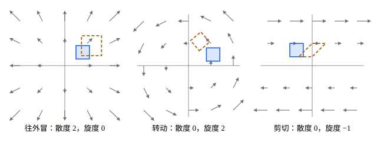

## 这一节要回答的问题

河水的速度场（velocity field）里，有的地方像泉眼一样往外冒水，有的地方像漩涡一样打转。只给出速度场的公式，怎样在每一点量出「往外冒」和「打转」各有多强？这两个量和箭头图、:term[流线]{id="math.vector-calculus.flow-line"}（flow line）又是什么关系？

## 讲解

### 散度

先看三个平面上的:term[向量场]{id="math.vector-calculus.vector-field"}（vector field），把它们都当成水的速度场：$(x,y)$处处背离原点，像每一点都在往外冒水；$(-y,x)$绕原点转，哪里都不冒也不漏；$(y,0)$一层层水平地流，上面快、下面慢。怎样用一个数量出「往外冒」？看随水流动的一小块水的面积怎样变：往外冒的地方，这块水被撑大。

::anchor{id="def-divergence"}
向量场$\vb F=(P,Q,R)$的各分量有:term[偏导数]{id="math.vector-calculus.partial-derivative"}（partial derivative）时，$\divg\vb F=\pdv Px+\pdv Qy+\pdv Rz$叫作$\vb F$的:term[散度]{id="math.vector-calculus.divergence"}（divergence）；平面上$\vb F=(P,Q)$时，$\divg\vb F=P_x+Q_y$。记号$\divg$把$\nabla=\bigl(\pdv{}x,\pdv{}y,\pdv{}z\bigr)$当成一个向量，和$\vb F$形式上作点积（dot product）。

为什么这样定义：取速度场里一个很小的矩形，四个顶点都随当地的流速移动。经过很短的时间$\Delta t$，沿$x$方向的边两端速度的$x$分量相差约$P_x\Delta x$，这条边被拉长到约$\Delta x(1+P_x\Delta t)$；沿$y$方向的边同样变成约$\Delta y(1+Q_y\Delta t)$。矩形还会歪成平行四边形，但它的面积到$\Delta t$的一次项只由这两项决定（第 5 题），所以面积的相对变化率$\frac1A\dv At$正是$P_x+Q_y$。空间里一小块的体积的相对变化率同样是$\divg\vb F$，所以散度是「源的强度」：正的地方往外冒，负的地方往里吸。

边界情况：箭头散开不等于散度为正。$\frac{(x,y)}{x^2+y^2}$的箭头处处背离原点，可在原点以外散度处处为零（第 6 题）：越往外箭头越短，一小块水被沿半径拉长多少，沿圆周方向就被压扁多少。

::anchor{id="def-divergence-free"}
散度处处为零的向量场叫作:term[无散场]{id="math.vector-calculus.divergence-free-field"}（divergence-free field）。速度场无散，说明随流动的每一小块面积（体积）都不变，流体既不被压缩也不膨胀，例如转动的场$(-y,x)$。

### 旋度

::anchor{id="def-curl"}
:term[向量场]{id="math.vector-calculus.vector-field"}$\vb F=(P,Q,R)$的:term[旋度]{id="math.vector-calculus.curl"}（curl）是向量$\curl\vb F=\bigl(\pdv Ry-\pdv Qz,\ \pdv Pz-\pdv Rx,\ \pdv Qx-\pdv Py\bigr)$，形式上是$\nabla$和$\vb F$的叉积（cross product）。平面上$\vb F=(P,Q,0)$时$\curl\vb F=(0,0,Q_x-P_y)$，只用看一个数$Q_x-P_y$，它叫作平面旋度（scalar curl）。

为什么这样定义：在水里放一个小十字，一根沿$x$方向、一根沿$y$方向，中心随水移动。沿$x$方向的那根，两端速度的$y$分量相差约$Q_x\Delta x$，它以角速度（angular velocity）$Q_x$逆时针转；沿$y$方向的那根，两端速度的$x$分量相差约$P_y\Delta y$，它以角速度$-P_y$逆时针转。两根的平均角速度是$\frac12(Q_x-P_y)$，所以旋度的$z$分量是当地小块转动角速度的两倍，量的正是「打转的强度」。

边界情况：旋度和:term[流线]{id="math.vector-calculus.flow-line"}弯不弯没有关系。$(y,0)$的流线是水平直线，可上层比下层快，小十字被搓着转，旋度是$(0,0,-1)$；$\frac{(-y,x)}{x^2+y^2}$的流线是圆，在原点以外旋度却处处为零（第 6 题）。

::anchor{id="def-irrotational"}
旋度处处为零的向量场叫作:term[无旋场]{id="math.vector-calculus.irrotational-field"}（irrotational field）。例如$(x,y)$：箭头背离原点，小十字只被拉长、不转。:term[梯度场]{id="math.vector-calculus.gradient-field"}（gradient field）都是无旋场，证明见[向量微分恒等式与拉普拉斯算子](lesson:math.vector-calculus.vector-identities)。

## 几何图像

:::anim{component="vector-field-2d"}
field: { x: "a*x + (c - b)*y", y: "(b + c)*x + a*y" }
range: { x: [-3, 3], y: [-2, 2] }
dt: 0.02
particles: 500
sliders:
  - name: a
    min: -0.5
    max: 0.5
    step: 0.1
    default: 0.2
    label: |
      $a$：散度是$2a$
  - name: b
    min: -1
    max: 1
    step: 0.25
    default: 0.5
    label: |
      $b$：旋度是$2b$
  - name: c
    min: -1
    max: 1
    step: 0.25
    default: 0
    label: |
      $c$：剪切（shear），不改变散度和旋度
:::

动画画的是$\vb F=\bigl(ax+(c-b)y,\ (b+c)x+ay\bigr)$，它的:term[散度]{id="math.vector-calculus.divergence"}处处是$2a$，:term[旋度]{id="math.vector-calculus.curl"}的$z$分量处处是$2b$。只拉$a$，点沿射线往外跑或往里收；只拉$b$，点绕原点转；只拉$c$，:term[流线]{id="math.vector-calculus.flow-line"}变成双曲线，散度、旋度都是零。三个一起拉，看哪一部分决定了流线的样子。

三种场里小方块的变化：面积变化看散度，转动看旋度；:term[剪切]{id="math.linear-algebra.shear"}的场流线是直的，旋度却不是零。

## 例题

### 例 1　逐个求偏导数

求$\vb F=(x^2y,\ -xy^2,\ z)$的:term[散度]{id="math.vector-calculus.divergence"}和:term[旋度]{id="math.vector-calculus.curl"}，并说明这个场哪里往外冒、哪里打转。

**为什么想到这么做**：按定义逐个求:term[偏导数]{id="math.vector-calculus.partial-derivative"}。旋度的三个分量按$x\to y\to z\to x$轮换着记：第一个分量是$R_y-Q_z$，把每个字母往后轮换一位，就得到下一个分量$P_z-R_x$。

**推导**：$P_x=2xy$，$Q_y=-2xy$，$R_z=1$，所以$\divg\vb F=1$：处处以同样的强度往外冒。$R_y-Q_z=0$，$P_z-R_x=0$，$Q_x-P_y=-y^2-x^2$，所以$\curl\vb F=\bigl(0,0,-(x^2+y^2)\bigr)$。从$z$轴正向往下看，水绕着$z$轴顺时针打转，离轴越远转得越猛；轴上不转。

### 例 2　刚体转动的速度场

刚体（rigid body）绕过原点的轴转动，角速度向量是$\boldsymbol\omega=(\omega_1,\omega_2,\omega_3)$，点$\vb r=(x,y,z)$的速度是$\vb v=\boldsymbol\omega\times\vb r$。求$\divg\vb v$和$\curl\vb v$。

**为什么想到这么做**：先把叉积按分量写出来，再套定义；结果应当和讲解里「小十字的平均角速度」对得上。

**推导**：$\vb v=(\omega_2z-\omega_3y,\ \omega_3x-\omega_1z,\ \omega_1y-\omega_2x)$。每个分量都不含对应的变量，所以$\divg\vb v=0$：刚体转动时体积不变。:term[旋度]{id="math.vector-calculus.curl"}的第一个分量是$\pdv{}y(\omega_1y-\omega_2x)-\pdv{}z(\omega_3x-\omega_1z)=2\omega_1$，轮换得$\curl\vb v=2\boldsymbol\omega$：旋度正好是角速度的两倍，每一小块都以同一个角速度$\boldsymbol\omega$转。

## 常见误区

- 「:term[流线]{id="math.vector-calculus.flow-line"}是弯的就有:term[旋度]{id="math.vector-calculus.curl"}，直的就没有。」$(y,0)$的流线是直线，旋度却不为零；$\frac{(-y,x)}{x^2+y^2}$的流线是圆，在原点以外却是:term[无旋场]{id="math.vector-calculus.irrotational-field"}（第 6 题）。旋度看的是一点附近的小块转不转，不看流线的形状。
- 「箭头散开的地方，:term[散度]{id="math.vector-calculus.divergence"}一定为正。」散度还要算上箭头长短的变化，$\frac{(x,y)}{x^2+y^2}$在原点以外就是:term[无散场]{id="math.vector-calculus.divergence-free-field"}。
- 「平面场的旋度是一个数。」旋度是向量$(0,0,Q_x-P_y)$，只是前两个分量为零；平面旋度指的是它的$z$分量，正号表示逆时针转。
