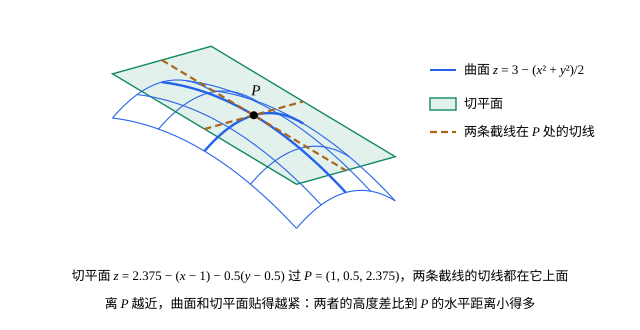

## 这一节要回答的问题

一元函数在$a$处可导，就是$f(a+h)\approx f(a)+f'(a)h$，误差比$h$小得多，图像在那里有切线。:term[二元函数]{id="math.vector-calculus.multivariable-function"}（function of two variables）的图像什么时候有:term[切平面]{id="math.vector-calculus.tangent-plane"}（tangent plane），使$f(a+h,b+k)\approx f(a,b)+f_xh+f_yk$？上一节第 8 题说明，光有两个:term[偏导数]{id="math.vector-calculus.partial-derivative"}（partial derivative）还不够。该怎样定义、怎样判断，又怎样用它做近似计算？

## 讲解

### 可微

::anchor{id="def-differentiable"}
设:term[二元函数]{id="math.vector-calculus.multivariable-function"}$f$在$(a,b)$附近有定义。如果存在常数$A$、$B$，使$f(a+h,b+k)=f(a,b)+Ah+Bk+r(h,k)$，并且$(h,k)\to(0,0)$时$\frac{r(h,k)}{\sqrt{h^2+k^2}}\to0$，就说$f$在$(a,b)$处:term[可微]{id="math.vector-calculus.differentiable"}（differentiable）。

为什么这样定义：一元时$f(a+h)=f(a)+Ah+r(h)$、$\frac{r(h)}h\to0$，就是可导。平面上的位移$(h,k)$不能做除数，就把$Ah$换成平面上的一次函数$Ah+Bk$，把「误差比$h$小得多」换成「误差比位移的长度$\sqrt{h^2+k^2}$小得多」。$n$元函数同样定义，一次函数是$A_1h_1+\dots+A_nh_n$。

::anchor{id="thm-differentiable-necessary"}
**可微的必要条件**　$f$在$(a,b)$处:term[可微]{id="math.vector-calculus.differentiable"}，则$f$在$(a,b)$处:term[连续]{id="math.vector-calculus.continuous"}（continuous），两个:term[偏导数]{id="math.vector-calculus.partial-derivative"}都存在，并且$A=f_x(a,b)$、$B=f_y(a,b)$。

**证明思路**：$(h,k)\to(0,0)$时$Ah+Bk+r\to0$，所以连续。取$k=0$，$\frac{f(a+h,b)-f(a,b)}{h}=A+\frac{r(h,0)}{h}$，而$\left|\frac{r(h,0)}h\right|=\frac{|r(h,0)|}{\sqrt{h^2}}\to0$，所以$f_x(a,b)=A$；$B$同理。

边界情况：反过来不对。$f(x,y)=\sqrt{|xy|}$在原点连续，$f(h,0)=f(0,k)=0$，两个偏导数都是$0$；如果可微，就只能$A=B=0$、$r=f$，可沿$h=k=t$，$\frac{r}{\sqrt{h^2+k^2}}=\frac{|t|}{\sqrt2|t|}=\frac1{\sqrt2}$，不趋于$0$。所以它在原点不可微。

### 全微分

::anchor{id="def-total-differential"}
$f$在$(a,b)$处:term[可微]{id="math.vector-calculus.differentiable"}时，一次函数$f_x(a,b)\dd x+f_y(a,b)\dd y$叫作$f$在$(a,b)$处的:term[全微分]{id="math.vector-calculus.total-differential"}（total differential），记作$\dd f$或$\dd z$，其中$\dd x$、$\dd y$是自变量的改变量$h$、$k$。$n$元函数的全微分是$\dd f=\pdv{f}{x_1}\dd x_1+\dots+\pdv{f}{x_n}\dd x_n$。

为什么这样定义：由可微的定义，函数的改变量$\Delta z=f(a+\Delta x,b+\Delta y)-f(a,b)=\dd z+r$，误差$r$比位移的长度小得多，所以$\Delta z\approx\dd z$：每个自变量各自的影响，按:term[偏导数]{id="math.vector-calculus.partial-derivative"}的大小线性地加起来。物理里说的「无穷小改变的一阶近似」就是全微分。例如点在曲面$g(x,y,z)=0$上移动，$g$的值不变，一阶近似下改变量满足$\dd g=g_x\dd x+g_y\dd y+g_z\dd z=0$（第 7 题）。

### 偏导数连续则可微

::anchor{id="thm-continuous-partials"}
**:term[可微]{id="math.vector-calculus.differentiable"}的充分条件**　设$f_x$、$f_y$在$(a,b)$附近存在，并且在$(a,b)$处:term[连续]{id="math.vector-calculus.continuous"}，则$f$在$(a,b)$处:term[可微]{id="math.vector-calculus.differentiable"}。

**证明思路**：把改变量拆成两步，先动$x$、再动$y$：$f(a+h,b+k)-f(a,b)=[f(a+h,b+k)-f(a,b+k)]+[f(a,b+k)-f(a,b)]$。两个方括号各用一次微分中值定理（mean value theorem，见[微分中值定理](lesson:math.calculus.mean-value-theorem)），等于$f_x(a+\theta_1h,b+k)h+f_y(a,b+\theta_2k)k$，$0<\theta_1,\theta_2<1$。由连续性，$f_x(a+\theta_1h,b+k)=f_x(a,b)+\varepsilon_1$、$f_y(a,b+\theta_2k)=f_y(a,b)+\varepsilon_2$，$\varepsilon_1,\varepsilon_2\to0$，所以误差$r=\varepsilon_1h+\varepsilon_2k$满足$|r|\le(|\varepsilon_1|+|\varepsilon_2|)\sqrt{h^2+k^2}$，比位移的长度小得多。

所以多项式、$e^x$、$\sin x$、$\ln x$这些函数经四则运算和复合得到的:term[多元函数]{id="math.vector-calculus.multivariable-function"}（function of several variables），在定义域里:term[偏导数]{id="math.vector-calculus.partial-derivative"}连续的地方都可微。这个条件只是充分的：可微的函数，偏导数也可能不连续（第 6 题）。

### 切平面

::anchor{id="def-tangent-plane"}
$f$在$(a,b)$处:term[可微]{id="math.vector-calculus.differentiable"}时，平面$z=f(a,b)+f_x(a,b)(x-a)+f_y(a,b)(y-b)$叫作曲面$z=f(x,y)$在点$(a,b,f(a,b))$处的:term[切平面]{id="math.vector-calculus.tangent-plane"}。

为什么这样定义：切平面就是一次近似$f(a,b)+\dd z$的图像，在切点附近，曲面和它的高度差比到切点的水平距离小得多。两条截线$z=f(x,b)$、$z=f(a,y)$在切点处的切线斜率分别是$f_x$、$f_y$，它们都在切平面上。边界情况：不可微的点没有切平面，例如圆锥面$z=\sqrt{x^2+y^2}$的顶点，那里两个:term[偏导数]{id="math.vector-calculus.partial-derivative"}都不存在。

## 几何图像

图里$f(x,y)=3-\frac{x^2+y^2}2$，在$P$处$f_x=-x=-1$、$f_y=-y=-0.5$，:term[切平面]{id="math.vector-calculus.tangent-plane"}是$z=2.375-(x-1)-0.5(y-0.5)$。曲面在切平面下方，两者在$P$处相切：沿任何方向离开$P$一段距离$\rho$，高度差是$\frac{(x-1)^2+(y-0.5)^2}2=\frac{\rho^2}2$，比$\rho$小得多。

## 例题

### 例 1　用全微分估计改变量

圆柱的底面半径$r$从$2$增加到$2.02$，高$h$从$5$减少到$4.95$。用:term[全微分]{id="math.vector-calculus.total-differential"}估计体积的改变量，并和实际改变量比较。

**为什么想到这么做**：体积$V=\pi r^2h$是$r$、$h$的:term[二元函数]{id="math.vector-calculus.multivariable-function"}，:term[偏导数]{id="math.vector-calculus.partial-derivative"}处处:term[连续]{id="math.vector-calculus.continuous"}，所以:term[可微]{id="math.vector-calculus.differentiable"}；改变量都很小，$\Delta V\approx\dd V$。

**推导**：$V_r=2\pi rh$，$V_h=\pi r^2$，在$(2,5)$处分别是$20\pi$、$4\pi$。$\dd r=0.02$，$\dd h=-0.05$，$\dd V=20\pi\cdot0.02+4\pi\cdot(-0.05)=0.4\pi-0.2\pi=0.2\pi\approx0.628$。实际改变量$\Delta V=\pi(2.02^2\cdot4.95-2^2\cdot5)=\pi(20.19798-20)\approx0.622$，相差约$0.006$，比两个改变量都小得多。

### 例 2　切平面和线性近似

求曲面$z=xe^y$在点$(2,0,2)$处的:term[切平面]{id="math.vector-calculus.tangent-plane"}，并用它估计$f(2.1,-0.1)$。

**为什么想到这么做**：$f_x=e^y$、$f_y=xe^y$处处:term[连续]{id="math.vector-calculus.continuous"}，所以$f$:term[可微]{id="math.vector-calculus.differentiable"}，切平面存在；切平面的高度就是线性近似（linear approximation）。

**推导**：在$(2,0)$处$f=2$，$f_x=e^0=1$，$f_y=2e^0=2$，切平面是$z=2+(x-2)+2y$，即$z=x+2y$。代入$(2.1,-0.1)$得$2.1-0.2=1.9$。实际值$2.1e^{-0.1}\approx1.9002$，误差约$0.0002$，比位移的长度$\sqrt{0.1^2+0.1^2}\approx0.14$小得多。

## 常见误区

- 「两个:term[偏导数]{id="math.vector-calculus.partial-derivative"}都存在，函数就:term[可微]{id="math.vector-calculus.differentiable"}。」$\sqrt{|xy|}$在原点两个偏导数都是$0$，却不可微。
- 「可微的函数，偏导数一定:term[连续]{id="math.vector-calculus.continuous"}。」偏导数连续只是可微的充分条件，第 6 题的函数在原点可微，偏导数却不连续。
- 「:term[全微分]{id="math.vector-calculus.total-differential"}$\dd z$就是改变量$\Delta z$。」$\dd z$只是$\Delta z$里的一次部分，两者相差一个比位移小得多的量；例 1 里$\dd V\approx0.628$，$\Delta V\approx0.622$。
- 「有了切点和两个偏导数，就能写出:term[切平面]{id="math.vector-calculus.tangent-plane"}。」写出的平面要真正贴近曲面，函数得可微；$\sqrt{|xy|}$在原点照公式写出平面$z=0$，可沿$y=x$曲面是$z=|x|$，离开这个平面的高度和位移的长度成正比。
