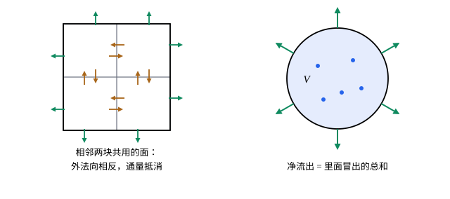

## 这一节要回答的问题

一个:term[闭曲面]{id="math.vector-calculus.closed-surface"}（closed surface）包住一块空间，每秒从里面净流出去多少？这个量和里面每一点「往外冒」的强度，也就是:term[散度]{id="math.vector-calculus.divergence"}（divergence），是什么关系？一个守恒的量（质量、电荷、能量）为什么在每一点都满足同一种方程？

## 讲解

### 散度定理

::anchor{id="thm-divergence"}
**:term[散度定理]{id="math.vector-calculus.divergence-theorem"}（divergence theorem）**　$V$是空间里的有界区域，边界$\partial V$是:term[分片光滑]{id="math.vector-calculus.piecewise-smooth-surface"}（piecewise smooth）的:term[闭曲面]{id="math.vector-calculus.closed-surface"}，取:term[外法向]{id="math.vector-calculus.outward-normal"}（outward normal）；$\vb F$在$V$和它的边界上有:term[连续]{id="math.vector-calculus.continuous"}（continuous）的:term[偏导数]{id="math.vector-calculus.partial-derivative"}（partial derivative），则$\oint_{\partial V}\vb F\cdot\dd\vb a=\iiint_V\divg\vb F\,\dd V$。它也叫高斯公式（Gauss's theorem）。

**证明思路**：先看长方体$[a_1,b_1]\times[a_2,b_2]\times[a_3,b_3]$和$\vb F=(0,0,R)$。$\iiint R_z\,\dd V$先对$z$积分，得$\iint\bigl[R(x,y,b_3)-R(x,y,a_3)\bigr]\dd x\dd y$：正好是穿过顶面（外法向朝上）和底面（外法向朝下）的:term[通量]{id="math.vector-calculus.flux"}（flux），四个侧面上$\vb F$和外法向垂直，没有贡献。$P$、$Q$两个分量同理，三部分相加就是长方体的情形（第 5 题）。一般的区域切成很多小长方体：相邻两块共用的面上，两块的外法向正好相反，通量抵消，加起来只剩外面的边界。

为什么是这个式子：:term[散度]{id="math.vector-calculus.divergence"}是一点处往外冒的强度，$\divg\vb F\,\Delta V$是一小块每秒冒出的量。闭曲面上的通量是每秒净流出去的量，它只能来自里面各处冒出的量之和，内部小块之间的交换都相互抵消。平面上类似的结论是[格林公式](lesson:math.vector-calculus.greens-theorem)的通量形式。

边界情况：$\vb F$在$V$里某一点没有定义，公式就可能不成立。$\frac{\vb r}{r^3}$在原点以外散度为零，可穿过以原点为球心的球面的通量是$4\pi$；以后会用:term[三维$\delta$函数]{id="math.vector-calculus.delta-3d"}（three-dimensional delta function）把原点处的「源」写出来（见[三维 δ 函数与点源](lesson:math.vector-calculus.delta-3d)）。

### 散度是单位体积的通量

由:term[散度定理]{id="math.vector-calculus.divergence-theorem"}，在点$\vb p$周围取很小的球$B_\varepsilon$，$\oint_{\partial B_\varepsilon}\vb F\cdot\dd\vb a=\iiint_{B_\varepsilon}\divg\vb F\,\dd V\approx\divg\vb F(\vb p)\cdot\frac43\pi\varepsilon^3$。所以$\divg\vb F(\vb p)=\lim_{\varepsilon\to0}\frac1{\frac43\pi\varepsilon^3}\oint_{\partial B_\varepsilon}\vb F\cdot\dd\vb a$（第 8 题）：:term[散度]{id="math.vector-calculus.divergence"}是单位体积往外流出的:term[通量]{id="math.vector-calculus.flux"}。这个说法不用坐标，换一个坐标系散度也不变。

### 守恒律与连续性方程

::anchor{id="def-continuity-equation"}
设某个量（例如流体的质量）在空间里的密度是$\rho(\vb r,t)$，它的流动用:term[向量场]{id="math.vector-calculus.vector-field"}（vector field）$\vb J$描述：$\vb J\cdot\vb n\,\Delta a$是每秒穿过一小块面积往$\vb n$方向流过去的量。这个量既不产生也不消失，并且$\rho$、$\pdv\rho t$:term[连续]{id="math.vector-calculus.continuous"}，$\vb J$有连续的:term[偏导数]{id="math.vector-calculus.partial-derivative"}时，$\pdv\rho t+\divg\vb J=0$处处成立，这叫作连续性方程（continuity equation）。

**证明思路**：任取一块固定的区域$V$，里面的总量$\iiint_V\rho\,\dd V$只因穿过边界的流动而变：$\dv{}t\iiint_V\rho\,\dd V=-\oint_{\partial V}\vb J\cdot\dd\vb a$。$V$固定、$\pdv\rho t$连续，左边的求导可以移进积分号（区间上的情形见[含参变量积分](lesson:math.analysis.parameter-integrals#thm-leibniz-rule)，有界区域上同理）；右边用:term[散度定理]{id="math.vector-calculus.divergence-theorem"}，得$\iiint_V\bigl(\pdv\rho t+\divg\vb J\bigr)\dd V=0$。它对每一块$V$都成立，被积函数又连续，所以处处为零：哪一点为正，在那一点附近取一个小球，积分就会是正的。

为什么重要：守恒的量，总量的变化只能来自边界上的进出；连续性方程把这句话写成了每一点的等式。流体的质量、电荷都满足它，以后讲热的传导时还会再用这个办法推出方程。

## 几何图像

左图是证明的道理：小块的:term[通量]{id="math.vector-calculus.flux"}加起来，内部的面都抵消，只剩外面的边界，而每一小块的通量约是:term[散度]{id="math.vector-calculus.divergence"}乘体积。右图是它的意思：:term[闭曲面]{id="math.vector-calculus.closed-surface"}上净流出的量，等于里面各处冒出的量之和。

## 例题

### 例 1　验算散度定理

$\vb F=(x,y,z)$，$V$是半径为$a$、以原点为球心的球。分别算$\oint_{\partial V}\vb F\cdot\dd\vb a$和$\iiint_V\divg\vb F\,\dd V$。

**为什么想到这么做**：球面上的:term[外法向]{id="math.vector-calculus.outward-normal"}是$\frac{\vb r}a$，左边在[曲面积分与通量](lesson:math.vector-calculus.surface-integrals)里算过；右边的:term[散度]{id="math.vector-calculus.divergence"}是常数。

**推导**：在球面上$\vb F\cdot\vb n=a$，左边$=a\cdot4\pi a^2=4\pi a^3$。$\divg\vb F=1+1+1=3$，右边$=3\cdot\frac43\pi a^3=4\pi a^3$，两边相等。

### 例 2　用体积分算通量

求$\vb F=(x^3,y^3,z^3)$穿过半径为$a$、以原点为球心的球面的:term[通量]{id="math.vector-calculus.flux"}（:term[外法向]{id="math.vector-calculus.outward-normal"}）。

**为什么想到这么做**：直接在球面上积分要算$\sin\theta$、$\cos\varphi$的高次幂，麻烦；$\divg\vb F=3(x^2+y^2+z^2)$只和到原点的距离有关，用:term[散度定理]{id="math.vector-calculus.divergence-theorem"}化成体积分，再用:term[球坐标]{id="math.vector-calculus.spherical-coordinates"}（spherical coordinates）。

**推导**：$\divg\vb F=3x^2+3y^2+3z^2=3r^2$。通量$=\iiint_V3r^2\,\dd V=\int_0^{2\pi}\int_0^\pi\int_0^a3r^2\cdot r^2\sin\theta\,\dd r\dd\theta\dd\varphi=4\pi\cdot\frac{3a^5}5=\frac{12\pi a^5}5$。

## 常见误区

- 「:term[散度定理]{id="math.vector-calculus.divergence-theorem"}对任何曲面都能用。」只对包住一块区域的:term[闭曲面]{id="math.vector-calculus.closed-surface"}成立；开口的曲面要先补上一块盖子，再减去盖子上的:term[通量]{id="math.vector-calculus.flux"}（第 4 题）。
- 「场在区域里有一个点没定义，公式照样成立。」$\frac{\vb r}{r^3}$绕原点的球面就是反例：左边是$4\pi$，右边按原点以外的:term[散度]{id="math.vector-calculus.divergence"}算是$0$。
- 「散度处处为零，穿过任何曲面的通量都是零。」只有闭曲面（而且场在它包住的区域里处处有定义）才是这样；穿过一张开口的曲面，通量可以不为零，例如均匀的水流穿过一块平板。
- 「:term[外法向]{id="math.vector-calculus.outward-normal"}、内法向随便取。」散度定理里闭曲面一律取外法向；取反了，通量就差一个负号。
