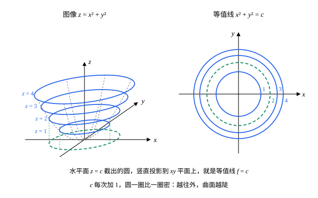

## 这一节要回答的问题

一块铁板上各处的温度不同，温度由位置的两个坐标决定；地图上每一点的海拔，也由两个坐标决定。一元函数可以画成平面上的一条曲线，依赖两个、三个变量的量该怎样描述，又怎样画出来？地图为什么用一圈圈的等高线（contour line）表示山的起伏？

## 讲解

### 多元函数

::anchor{id="def-multivariable-function"}
设$D$是$\R^2$的一个子集。如果对$D$中每个点$(x,y)$，都按某个规则对应唯一一个实数$z$，就说这个规则是$D$上的一个二元函数（function of two variables），记作$z=f(x,y)$，$D$叫作它的定义域（domain）。同样，对$\R^n$中的点$\vb x=(x_1,\dots,x_n)$可以定义$n$元函数$f(\vb x)=f(x_1,\dots,x_n)$；$n\ge2$时统称:term[多元函数]{id="math.vector-calculus.multivariable-function"}（function of several variables）。

为什么这样定义：长方体的体积$V=xyz$由长、宽、高三个数决定，铁板上的温度$T(x,y)$由两个坐标决定。把几个自变量合起来看成一个点，「一个数对应一个数」就推广成了「一个点对应一个数」。边界情况：只写式子、不写定义域时，默认定义域是使式子有意义的全体点，例如$f(x,y)=\sqrt{1-x^2-y^2}$的定义域是圆盘$x^2+y^2\le1$。$n=1$时就是熟悉的一元函数。

### 图像

::anchor{id="def-graph"}
:term[二元函数]{id="math.vector-calculus.multivariable-function"}$f$的图像（graph）是$\R^3$中的点集$\{(x,y,z):(x,y)\in D,\ z=f(x,y)\}$：在定义域的每个点$(x,y)$处，竖直方向上高为$f(x,y)$的那个点都画上。

为什么这样定义：和一元函数一样，图像把函数值画成高度，这些点合起来一般是一张曲面。例如$z=x^2+y^2$的图像是开口向上的旋转抛物面（paraboloid of revolution），$z=\sqrt{1-x^2-y^2}$的图像是单位球面的上半个。边界情况：每条竖直线和图像至多有一个交点，所以整个球面不是任何一个二元函数的图像，要拆成上下两半。

### 等值线

::anchor{id="def-level-curve"}
设$c$是常数。定义域中使$f(x,y)=c$的点组成的集合$\{(x,y)\in D:f(x,y)=c\}$叫作$f$的一条:term[等值线]{id="math.vector-calculus.level-curve"}（level curve）；地图上的等高线就是海拔这个:term[二元函数]{id="math.vector-calculus.multivariable-function"}的等值线。

为什么这样定义：用水平面$z=c$去截图像，截出的曲线竖直投影到$xy$平面上，就是等值线$f=c$；取一组等间隔的$c$画出等值线，曲面的起伏就画在了平面上。等值线挤在一起的地方，函数值变化得快，图像陡；稀疏的地方平缓。边界情况：$c$不是$f$取得到的值时，等值线是空集；$f$在一片区域上取常数$c$时，$f=c$是一整块区域，不是曲线。不同的$c$对应的等值线没有公共点，因为一个点只有一个函数值。

### 三元函数与等值面

:term[三元函数]{id="math.vector-calculus.multivariable-function"}（function of three variables）$u=f(x,y,z)$的图像在四维空间里，没法画出来。办法是看它取同一个值的点在空间里组成的曲面。

::anchor{id="def-level-surface"}
设$f$是三元函数，$c$是常数。$\R^3$中使$f(x,y,z)=c$的点组成的集合叫作$f$的:term[等值面]{id="math.vector-calculus.level-surface"}（level surface）。

为什么这样定义：一层套一层的等值面，像洋葱皮一样，告诉我们$f$的值在空间里怎样分布。例如$f(x,y,z)=x^2+y^2+z^2$的等值面$f=c$（$c>0$）是半径为$\sqrt c$的球面；房间里温度相同的点组成的面也是等值面。边界情况：$c=0$时这个等值面只有原点一个点，$c<0$时是空集。

## 几何图像

左图是:term[二元函数]{id="math.vector-calculus.multivariable-function"}$f(x,y)=x^2+y^2$的图像，右图是它的:term[等值线]{id="math.vector-calculus.level-curve"}。等值线$f=c$是半径为$\sqrt c$的圆，$c$取$1,2,3,4$时半径依次约为$1$、$1.41$、$1.73$、$2$，相邻两圈的间距越来越小。这说明离原点越远，函数值增加得越快，对应左图里曲面越往外越陡。

## 例题

### 例 1　半球面的等值线

求$f(x,y)=\sqrt{9-x^2-y^2}$的定义域和取值范围，并画出$c=0,1,2,3$的:term[等值线]{id="math.vector-calculus.level-curve"}。

**为什么想到这么做**：根号里不能为负，定义域就出来了；等值线$f=c$两边平方，化成圆的方程，但要记得$f\ge0$。

**推导**：定义域是$9-x^2-y^2\ge0$，即圆盘$x^2+y^2\le9$；在圆盘上$f$从边界上的$0$变到原点处的$3$，取值范围是$[0,3]$。$c\ge0$时，$f=c$等价于$x^2+y^2=9-c^2$。$c=0,1,2,3$分别给出半径为$3$、$2\sqrt2\approx2.83$、$\sqrt5\approx2.24$、$0$的圆，最后一个只是原点。$c$是等间隔的，外面几圈却挤在一起：图像是半径为$3$的上半球面，越靠近边缘越陡。

### 例 2　三元函数的等值面

$f(x,y,z)=x^2+y^2-z^2$。描述:term[等值面]{id="math.vector-calculus.level-surface"}$f=1$、$f=0$、$f=-1$的形状。

**为什么想到这么做**：等值面在空间里，不好直接想象；用水平面$z=t$一层层去截，每层截出的是平面上的曲线，再把它们叠起来。

**推导**：在高度$z=t$处，$f=c$化成$x^2+y^2=c+t^2$。$c=1$时每一层都是圆，半径$\sqrt{1+t^2}$在$t=0$处最小、往上往下都变大，叠起来是一张连成一片、中间细的曲面，即单叶双曲面（hyperboloid of one sheet）。$c=0$时半径是$|t|$，叠起来是顶点都在原点、上下对接的两个圆锥面。$c=-1$时要$t^2\ge1$才有点，$|t|<1$的那些层都是空集，曲面分成上下两片，即双叶双曲面（hyperboloid of two sheets）。

## 常见误区

- 「:term[等值线]{id="math.vector-calculus.level-curve"}就是图像在$xy$平面上的投影。」整个图像竖直投影下去是定义域；等值线是水平面$z=c$截出的曲线的投影，每个$c$一条。
- 「等值线稀疏的地方函数值小。」疏密说的是函数值变化的快慢，不是大小：例 1 里最外圈$c=0$处的函数值最小，那里的等值线却最密。
- 「两条等值线可以相交。」一个点只有一个函数值，不同$c$的等值线没有公共点；地图上陡崖处的等高线画得几乎重合，原因见第 7 题。
- 「:term[三元函数]{id="math.vector-calculus.multivariable-function"}的图像是一张曲面。」它的图像在四维空间里；我们画的曲面是它的:term[等值面]{id="math.vector-calculus.level-surface"}。
