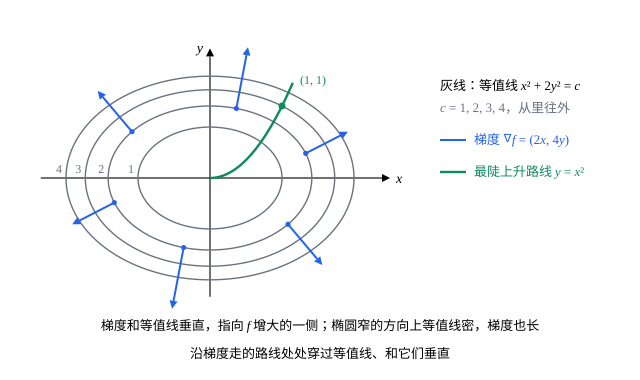

## 这一节要回答的问题

站在山坡上，海拔是$z=f(x,y)$。朝不同的方向迈步，坡度不一样：沿任意一个方向，海拔变化得多快？朝哪个方向最陡，最陡的方向和等高线（contour line）有什么关系？两个:term[偏导数]{id="math.vector-calculus.partial-derivative"}（partial derivative）只给出了沿两个坐标方向的变化率，能不能由它们算出别的方向？

## 讲解

### 方向导数

::anchor{id="def-directional-derivative"}
设$\vb u=(u_1,u_2)$是单位向量（unit vector）。如果极限$\lim_{t\to0}\frac{f(a+tu_1,b+tu_2)-f(a,b)}{t}$存在，就把它叫作$f$在$(a,b)$处沿$\vb u$的:term[方向导数]{id="math.vector-calculus.directional-derivative"}（directional derivative），记作$D_{\vb u}f(a,b)$。

为什么这样定义：$(a+tu_1,b+tu_2)$是从$(a,b)$出发、沿$\vb u$走了距离$|t|$的点，所以方向导数是沿这个方向每走单位距离函数的变化，也就是过$(a,b)$、沿$\vb u$的竖直平面截图像所得曲线的斜率。$\vb u=(1,0)$、$(0,1)$时，它就是$f_x$、$f_y$。边界情况：$\vb u$要取单位向量，否则$t$就不再是走过的距离；反方向的方向导数变号，$D_{-\vb u}f=-D_{\vb u}f$。

### 梯度

::anchor{id="def-gradient"}
$f$在$(a,b)$处两个:term[偏导数]{id="math.vector-calculus.partial-derivative"}都存在时，向量$\nabla f(a,b)=\bigl(f_x(a,b),f_y(a,b)\bigr)$叫作$f$在$(a,b)$处的:term[梯度]{id="math.vector-calculus.gradient"}（gradient），也记作$\operatorname{grad}f$，$\nabla$读作 nabla。$n$元函数的梯度是$\nabla f=\Bigl(\pdv{f}{x_1},\dots,\pdv{f}{x_n}\Bigr)$。

::anchor{id="thm-directional-gradient"}
**:term[方向导数]{id="math.vector-calculus.directional-derivative"}和梯度**　$f$在$(a,b)$处:term[可微]{id="math.vector-calculus.differentiable"}（differentiable），则沿任意单位向量$\vb u$的:term[方向导数]{id="math.vector-calculus.directional-derivative"}都存在，并且$D_{\vb u}f(a,b)=\nabla f(a,b)\cdot\vb u$。更一般地，沿可导的曲线$\vb r(t)$，$\dv{}{t}f\bigl(\vb r(t)\bigr)=\nabla f\bigl(\vb r(t)\bigr)\cdot\vb r'(t)$。

**证明思路**：令$\vb r(t)=(a+tu_1,b+tu_2)$，由:term[链式法则]{id="math.vector-calculus.chain-rule"}（chain rule），$\dv{}{t}f\bigl(\vb r(t)\bigr)=f_xu_1+f_yu_2=\nabla f\cdot\vb u$，在$t=0$处就是方向导数。一般的曲线也是链式法则$f_xx'+f_yy'$，写成点积（dot product）的样子就是$\nabla f\cdot\vb r'$。

所以沿一条曲线，函数的变化率只依赖于这一刻的速度$\vb r'(t)$，和曲线以前、以后怎么走无关。:term[全微分]{id="math.vector-calculus.total-differential"}（total differential）也可以写成$\dd f=\nabla f\cdot\dd\vb r$，其中$\dd\vb r=(\dd x,\dd y)$是位移。

### 梯度的方向

::anchor{id="thm-gradient-direction"}
**:term[梯度]{id="math.vector-calculus.gradient"}的方向**　设$f$在$(a,b)$处:term[可微]{id="math.vector-calculus.differentiable"}，$\nabla f(a,b)\ne\vb 0$。(1) 沿$\nabla f$的方向，:term[方向导数]{id="math.vector-calculus.directional-derivative"}最大，等于$|\nabla f|$；沿$-\nabla f$最小，等于$-|\nabla f|$；沿和$\nabla f$垂直的方向为$0$。(2) $\nabla f(a,b)$垂直于过$(a,b)$的:term[等值线]{id="math.vector-calculus.level-curve"}（level curve）：沿等值线走的任何可导曲线，在$(a,b)$处的速度都和$\nabla f(a,b)$垂直；$\nabla f$指向$f$增大的一侧。

**证明思路**：(1) 设$\vb u$和$\nabla f$的夹角为$\theta$，由[点积、长度与夹角](lesson:math.linear-algebra.dot-product)，$D_{\vb u}f=|\nabla f||\vb u|\cos\theta=|\nabla f|\cos\theta$，$\theta=0$时最大，$\theta=\pi$时最小，$\theta=\frac\pi2$时为$0$。(2) 设$\vb r(t)$是沿等值线$f=c$走的可导曲线，$\vb r(0)=(a,b)$。对$f\bigl(\vb r(t)\bigr)=c$求导得$\nabla f\cdot\vb r'(0)=0$；沿$\nabla f$走，方向导数$|\nabla f|>0$，$f$增大。$\nabla f\ne\vb0$时，过$(a,b)$的等值线在这一点附近确实是一条:term[光滑曲线]{id="math.vector-calculus.smooth-curve"}（smooth curve），这要用到[反函数定理与隐函数定理](lesson:math.vector-calculus.inverse-implicit)，这里不证。

:term[三元函数]{id="math.vector-calculus.multivariable-function"}（function of three variables）也一样：$\nabla F$垂直于$F$的:term[等值面]{id="math.vector-calculus.level-surface"}（level surface），等值面$F=c$在点$P$处的:term[切平面]{id="math.vector-calculus.tangent-plane"}（tangent plane）是$\nabla F(P)\cdot(\vb x-P)=0$（例 2）。

梯度为零的点，就是各个:term[一阶偏导数]{id="math.vector-calculus.partial-derivative"}（first-order partial derivative）都为零的:term[驻点]{id="math.vector-calculus.stationary-point"}（stationary point），那里沿每个方向的方向导数都是$0$，一阶近似下往哪边走函数都不变。驻点附近是碗底、山顶还是马鞍，要看:term[二阶偏导数]{id="math.vector-calculus.second-partial-derivative"}（second-order partial derivative），见[多元泰勒公式与黑塞矩阵](lesson:math.vector-calculus.taylor-multivariable)。

## 几何图像

图里$f(x,y)=x^2+2y^2$，:term[梯度]{id="math.vector-calculus.gradient"}$\nabla f=(2x,4y)$。每个箭头都垂直于它所在的:term[等值线]{id="math.vector-calculus.level-curve"}，指向外侧$f$增大的方向；椭圆在$y$方向窄，等值线挤在一起，那里的梯度也长。绿色曲线$y=x^2$是从原点出发、每一点都沿梯度方向走的路线（第 5 题），它和每条等值线都垂直相交。

:::anim{component="vector-field-2d"}
field: { x: "-2*x", y: "-2*k*y" }
range: { x: [-3, 3], y: [-2, 2] }
dt: 0.01
particles: 300
sliders:
  - name: k
    min: 0.25
    max: 4
    step: 0.25
    default: 2
    label: |
      $f(x,y)=x^2+ky^2$里的$k$
:::

动画画的是$-\nabla f=(-2x,-2ky)$，$f=x^2+ky^2$，默认$k=2$就是上图的函数。小粒子沿$-\nabla f$移动，好比沿最陡的下坡往碗底走，路线处处和椭圆形的等值线垂直。拖动$k$：$k=1$时等值线是圆，路线都是指向原点的直线；$k$离$1$越远，路线弯得越厉害，先沿等值线密的方向迅速下降，再沿平缓的方向慢慢靠近原点。

## 例题

### 例 1　方向导数和最大变化率

$f(x,y)=x^2y+y^3$。求$f$在$(1,2)$处朝点$(4,6)$方向的:term[方向导数]{id="math.vector-calculus.directional-derivative"}，以及这一点处最大的变化率和它的方向。

**为什么想到这么做**：$f$的:term[偏导数]{id="math.vector-calculus.partial-derivative"}处处:term[连续]{id="math.vector-calculus.continuous"}（continuous），所以:term[可微]{id="math.vector-calculus.differentiable"}，方向导数等于:term[梯度]{id="math.vector-calculus.gradient"}和这个方向的单位向量的点积；最大变化率是梯度的长度。

**推导**：$\nabla f=(2xy,\ x^2+3y^2)$，在$(1,2)$处是$(4,13)$。从$(1,2)$指向$(4,6)$的向量是$(3,4)$，长度为$5$，单位向量$\vb u=\bigl(\frac35,\frac45\bigr)$。$D_{\vb u}f=4\cdot\frac35+13\cdot\frac45=\frac{64}5=12.8$。最大变化率是$|\nabla f|=\sqrt{4^2+13^2}=\sqrt{185}\approx13.6$，方向是$\frac{(4,13)}{\sqrt{185}}$。

### 例 2　等值面的切平面

求椭球面（ellipsoid）$x^2+2y^2+3z^2=6$在点$(1,1,1)$处的:term[切平面]{id="math.vector-calculus.tangent-plane"}。

**为什么想到这么做**：椭球面是$F(x,y,z)=x^2+2y^2+3z^2$的:term[等值面]{id="math.vector-calculus.level-surface"}$F=6$，$\nabla F$垂直于它，正好当切平面的法向量（normal vector）。

**推导**：$\nabla F=(2x,4y,6z)$，在$(1,1,1)$处是$(2,4,6)$。切平面是$2(x-1)+4(y-1)+6(z-1)=0$，即$x+2y+3z=6$。验算：$(1,1,1)$满足这个方程；沿切平面上的方向$(2,-1,0)$离开切点，$F$的:term[方向导数]{id="math.vector-calculus.directional-derivative"}是$(2,4,6)\cdot(2,-1,0)$除以长度，等于$0$。

## 常见误区

- 「:term[梯度]{id="math.vector-calculus.gradient"}是一个数。」梯度是一个向量，它的长度$|\nabla f|$才是最大的变化率。
- 「沿向量$(3,4)$的:term[方向导数]{id="math.vector-calculus.directional-derivative"}是$\nabla f\cdot(3,4)$。」要先化成单位向量$\bigl(\frac35,\frac45\bigr)$，否则结果是正确值的$5$倍。
- 「梯度沿着:term[等值线]{id="math.vector-calculus.level-curve"}的方向。」梯度和等值线垂直；沿等值线走，函数不变，方向导数为$0$。
- 「:term[偏导数]{id="math.vector-calculus.partial-derivative"}存在，就能用$\nabla f\cdot\vb u$算方向导数。」要$f$:term[可微]{id="math.vector-calculus.differentiable"}。$f(x,y)=\frac{x^2y}{x^2+y^2}$、$f(0,0)=0$在原点$\nabla f=\vb 0$，沿$(\cos\alpha,\sin\alpha)$的方向导数却是$\cos^2\alpha\sin\alpha$。
