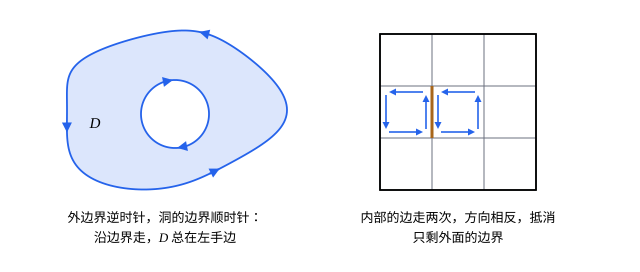

## 这一节要回答的问题

在平面上沿一条:term[闭曲线]{id="math.vector-calculus.closed-curve"}（closed curve）走一圈，场的:term[环量]{id="math.vector-calculus.circulation"}（circulation）和曲线围住的区域里各点的:term[旋度]{id="math.vector-calculus.curl"}（curl）有什么关系？反过来，穿过这条曲线往外流的量，和区域里的:term[散度]{id="math.vector-calculus.divergence"}（divergence）又有什么关系？能不能只沿边界走一圈，就量出区域的面积？

## 讲解

### 边界的正向

::anchor{id="def-positive-orientation"}
自己不相交的:term[闭曲线]{id="math.vector-calculus.closed-curve"}叫作:term[简单闭曲线]{id="math.vector-calculus.simple-closed-curve"}（simple closed curve），例如圆、三角形的边界；「8」字形不是。设区域$D$的边界由有限条:term[分段光滑]{id="math.vector-calculus.piecewise-smooth"}（piecewise smooth）的简单闭曲线组成，规定边界的正向（positive orientation）是：沿着边界走，$D$总在左手边。这样的有向边界记作$\partial D$：外边界逆时针，洞的边界顺时针。

### 格林公式

::anchor{id="thm-green"}
**:term[格林公式]{id="math.vector-calculus.greens-theorem"}（Green's theorem）**　$D$是平面上的有界区域，边界$\partial D$取正向，$P$、$Q$在$D$和它的边界上有:term[连续]{id="math.vector-calculus.continuous"}（continuous）的:term[偏导数]{id="math.vector-calculus.partial-derivative"}（partial derivative），则$\oint_{\partial D}P\,\dd x+Q\,\dd y=\iint_D\bigl(Q_x-P_y\bigr)\dd A$。

**证明思路**：先看$D=\{a\le x\le b,\ g_1(x)\le y\le g_2(x)\}$这样的区域。$\iint_D P_y\,\dd A=\int_a^b\bigl[P(x,g_2(x))-P(x,g_1(x))\bigr]\dd x$；而沿正向的边界，$\oint P\,\dd x$在下边界从左往右走、上边界从右往左走，竖边上$\dd x=0$，所以正好是$-\iint_DP_y\,\dd A$。区域也能写成$\{c\le y\le d,\ h_1(y)\le x\le h_2(y)\}$时，同理$\oint Q\,\dd y=\iint_DQ_x\,\dd A$；一般的区域切成这样的几块，切口上的两条边方向相反，:term[曲线积分]{id="math.vector-calculus.line-integral"}（line integral）抵消（第 5 题是矩形的情形）。

为什么是这个式子：$Q_x-P_y$是平面上的:term[旋度]{id="math.vector-calculus.curl"}，量的是当地小块转得多快。把$D$切成小方块，每个小方块的:term[环量]{id="math.vector-calculus.circulation"}约是$(Q_x-P_y)\Delta A$；相邻两块共用的边被走了两次、方向相反，加起来只剩外面的边界。所以「沿边界的环量」等于「区域里各处的旋度加起来」；这也说明平面旋度（scalar curl）正是单位面积上的环量（第 7 题）。

边界情况：$P$、$Q$在$D$里某一点没有定义，公式就可能不成立。$\frac{(-y,x)}{x^2+y^2}$在原点以外旋度为零，可沿单位圆的环量是$2\pi$：单位圆围住的区域含原点，那里场没有定义，格林公式用不上。

### 通量形式

::anchor{id="thm-green-flux"}
**通量形式**　条件同上，$\oint_{\partial D}\bigl(P\,\dd y-Q\,\dd x\bigr)=\iint_D\bigl(P_x+Q_y\bigr)\dd A$。左边是$\oint_{\partial D}\vb F\cdot\vb n\,\dd s$，$\vb n$是指向区域外面的单位法向量（unit normal vector）；它量的是单位时间穿过边界往外流的量，也就是$\vb F$穿过$\partial D$的:term[通量]{id="math.vector-calculus.flux"}（flux）。

**证明**：对$(-Q,P)$用:term[格林公式]{id="math.vector-calculus.greens-theorem"}：$\oint-Q\,\dd x+P\,\dd y=\iint\bigl(P_x-(-Q_y)\bigr)\dd A$，就是上式。沿正向走，:term[单位切向量]{id="math.vector-calculus.unit-tangent-vector"}（unit tangent vector）是$\vb T=\frac{(\dd x,\dd y)}{\dd s}$，把它顺时针转$90°$得到朝外的$\vb n=\frac{(\dd y,-\dd x)}{\dd s}$，所以$\vb F\cdot\vb n\,\dd s=P\,\dd y-Q\,\dd x$。

为什么重要：$P_x+Q_y$是:term[散度]{id="math.vector-calculus.divergence"}，是当地往外冒的强度。通量形式说：从边界流出的总量，等于区域里各处冒出的量之和；没有源的地方，流进多少就流出多少。一元的分部积分（integration by parts）把导数从一个因子挪到另一个因子上，平面上靠的正是这个形式：取$P=fg_1$、$Q=fg_2$，按一元的乘积求导法则展开$P_x+Q_y$，边界上$f=0$时得$\iint_D(f_xg_1+f_yg_2)\dd A=-\iint_Df\bigl((g_1)_x+(g_2)_y\bigr)\dd A$。

### 用边界算面积

取$P=0$、$Q=x$，$Q_x-P_y=1$，得$D$的面积$=\oint_{\partial D}x\,\dd y$；同样也等于$-\oint_{\partial D}y\,\dd x$和$\frac12\oint_{\partial D}(x\,\dd y-y\,\dd x)$。所以只沿边界走一圈，就能量出围住的面积；沿正向的:term[闭曲线]{id="math.vector-calculus.closed-curve"}，$\oint x\,\dd x$和$\oint y\,\dd y$都是零（它们是:term[梯度场]{id="math.vector-calculus.gradient-field"}（gradient field）的:term[曲线积分]{id="math.vector-calculus.line-integral"}）。

### 平面上的保守场判别法

这里补上[保守场与路径无关](lesson:math.vector-calculus.conservative-fields)里留下的证明。$D$是平面上的:term[单连通区域]{id="math.vector-calculus.simply-connected-region"}（simply connected region），$Q_x=P_y$处处成立；$C$是$D$里的一条:term[简单闭曲线]{id="math.vector-calculus.simple-closed-curve"}。$D$没有洞，$C$围住的区域$S$整个在$D$里，对$S$用:term[格林公式]{id="math.vector-calculus.greens-theorem"}，$\oint_C\vb F\cdot\dd\vb r=\pm\iint_S0\,\dd A=0$（正负号看$C$的方向）。一般的:term[闭曲线]{id="math.vector-calculus.closed-curve"}可以拆成有限条简单闭曲线（这里不证），所以沿每一条闭曲线:term[环量]{id="math.vector-calculus.circulation"}都为零，$\vb F$是:term[保守场]{id="math.vector-calculus.conservative-field"}（conservative field）。

## 几何图像

左图是边界的正向：洞的边界要顺时针走。右图是证明的道理：小方块的:term[环量]{id="math.vector-calculus.circulation"}加起来，内部的边都抵消，只剩外面的边界，而每个小方块的环量约是:term[旋度]{id="math.vector-calculus.curl"}乘面积。

## 例题

### 例 1　验算格林公式，再算椭圆的面积

先对$\vb F=(-y,x)$和单位圆盘验算:term[格林公式]{id="math.vector-calculus.greens-theorem"}；再用$\frac12\oint(x\,\dd y-y\,\dd x)$求椭圆$\frac{x^2}{a^2}+\frac{y^2}{b^2}\le1$的面积。

**为什么想到这么做**：$(-y,x)$沿单位圆的:term[环量]{id="math.vector-calculus.circulation"}在[曲线积分](lesson:math.vector-calculus.line-integrals)里算过，是$2\pi$。椭圆的边界用$x=a\cos t$、$y=b\sin t$逆时针走一圈，代进面积公式。

**推导**：$Q_x-P_y=1-(-1)=2$，$\iint_D2\,\dd A=2\pi$，和环量一致。椭圆：$x\,\dd y-y\,\dd x=(a\cos t\cdot b\cos t+b\sin t\cdot a\sin t)\dd t=ab\,\dd t$，面积$=\frac12\int_0^{2\pi}ab\,\dd t=\pi ab$。$a=b$时是圆的面积$\pi a^2$。

### 例 2　把曲线积分化成二重积分

求$\oint_C(x^2-y^3)\dd x+(x^3+y^2)\dd y$，$C$是单位圆，逆时针。

**为什么想到这么做**：直接代参数要积$\sin^4t$、$\cos^4t$，麻烦；$Q_x-P_y=3x^2+3y^2$只和到原点的距离有关，化成:term[二重积分]{id="math.vector-calculus.double-integral"}（double integral）以后换极坐标（polar coordinates）就很简单。

**推导**：由:term[格林公式]{id="math.vector-calculus.greens-theorem"}，积分$=\iint_D(3x^2+3y^2)\dd A=\int_0^{2\pi}\int_0^13r^2\cdot r\,\dd r\dd\theta=2\pi\cdot\frac34=\frac{3\pi}2$。被积式里的$x^2\dd x$、$y^2\dd y$是:term[梯度场]{id="math.vector-calculus.gradient-field"}的部分，沿:term[闭曲线]{id="math.vector-calculus.closed-curve"}的积分为零，对结果没有贡献。

## 常见误区

- 「有洞的区域，每条边界都逆时针走。」正向是让区域在左手边：外边界逆时针，洞的边界顺时针。
- 「场在区域里有一个点没定义，:term[格林公式]{id="math.vector-calculus.greens-theorem"}照样能用。」$\frac{(-y,x)}{x^2+y^2}$绕原点的单位圆就是反例：等式左边是$2\pi$，右边按原点以外的:term[旋度]{id="math.vector-calculus.curl"}算是$0$。
- 「通量形式是$\oint(Q\,\dd x-P\,\dd y)$。」符号反了：朝外的法向量是:term[单位切向量]{id="math.vector-calculus.unit-tangent-vector"}顺时针转$90°$，$\vb F\cdot\vb n\,\dd s=P\,\dd y-Q\,\dd x$。
- 「$\oint x\,\dd y$和$\oint y\,\dd x$都等于面积。」$\oint_{\partial D}y\,\dd x$等于面积的相反数；它们差一个负号，平均起来才是$\frac12\oint(x\,\dd y-y\,\dd x)$。
