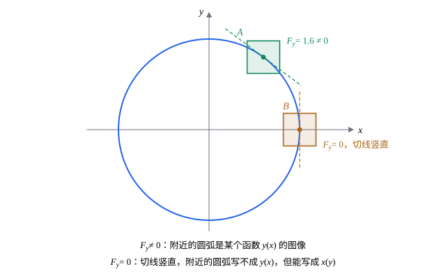

## 这一节要回答的问题

一元函数在$a$处导数不为零，就在$a$附近单调，有反函数（inverse function），$(f^{-1})'=\frac1{f'}$。平面到平面的映射，例如$(u,v)\mapsto(e^u\cos v,e^u\sin v)$，什么时候在一点附近能反过来，把$(u,v)$解成$(x,y)$的函数？另一个问题：方程$F(x,y)=0$画出一条曲线，什么时候在一点附近能把它写成$y=y(x)$，$y'$又怎样求？

## 讲解

### 反函数定理

::anchor{id="thm-inverse-function"}
**:term[反函数定理]{id="math.vector-calculus.inverse-function-theorem"}（inverse function theorem）**　设$\vb f$把$\R^n$里的一块区域映到$\R^n$，各分量有:term[连续]{id="math.vector-calculus.continuous"}（continuous）的:term[偏导数]{id="math.vector-calculus.partial-derivative"}（partial derivative），并且$\vb f$在$\vb a$处的:term[雅可比矩阵]{id="math.vector-calculus.jacobian-matrix"}（Jacobian matrix）的行列式不为$0$。则$\vb a$附近和$\vb f(\vb a)$附近各有一小块区域，$\vb f$在这两块之间一一对应，反过来的映射$\vb f^{-1}$也有连续的偏导数，并且$J_{\vb f^{-1}}\bigl(\vb f(\vb x)\bigr)=\bigl(J_{\vb f}(\vb x)\bigr)^{-1}$。这时说$\vb f$在$\vb a$附近局部可逆（locally invertible）。

**证明思路**：由:term[局部线性近似]{id="math.vector-calculus.local-linear-approximation"}（local linear approximation），$\vb f(\vb a+\vb h)\approx\vb f(\vb a)+J\vb h$，$J$可逆，所以解$\vb f(\vb x)=\vb y$近似于解线性方程组（system of linear equations）$J\vb h=\vb y-\vb f(\vb a)$，有唯一解；再说明线性近似的误差足够小，用逐次逼近（successive approximation）修正出真正的解，严格的证明这里不证。导数的公式由:term[链式法则]{id="math.vector-calculus.chain-rule"}（chain rule）得到：$\vb f^{-1}\circ\vb f$是恒等映射（identity map），雅可比矩阵是单位矩阵（identity matrix），所以$J_{\vb f^{-1}}J_{\vb f}=I$（见[雅可比矩阵](lesson:math.vector-calculus.jacobian)第 5 题）。

为什么看行列式：$J$可逆当且仅当$\det J\ne0$（见[行列式的计算与性质](lesson:math.linear-algebra.determinant-properties)），这个行列式以后在[重积分的换元](lesson:math.vector-calculus.change-of-variables)里叫作:term[雅可比行列式]{id="math.vector-calculus.jacobian-determinant"}（Jacobian determinant）。边界情况：结论只管一点附近。$(u,v)\mapsto(e^u\cos v,e^u\sin v)$的雅可比矩阵的行列式处处是$e^{2u}\ne0$，每一点附近都可逆，可$v$和$v+2\pi$映到同一点，整体并不一一对应（例 1）。

### 隐函数定理

::anchor{id="thm-implicit-function"}
**:term[隐函数定理]{id="math.vector-calculus.implicit-function-theorem"}（implicit function theorem）**　设$F(x,y)$在$(a,b)$附近有:term[连续]{id="math.vector-calculus.continuous"}的:term[偏导数]{id="math.vector-calculus.partial-derivative"}，$F(a,b)=0$，$F_y(a,b)\ne0$。则$a$附近有唯一一个有连续导数的函数$y=\varphi(x)$，使$\varphi(a)=b$、$F\bigl(x,\varphi(x)\bigr)=0$，并且$\varphi'(x)=-\frac{F_x}{F_y}$（在$\bigl(x,\varphi(x)\bigr)$处取值）。三个变量时，$F(a,b,c)=0$、$F_z\ne0$，就能在附近解出$z=\varphi(x,y)$，$\varphi_x=-\frac{F_x}{F_z}$，$\varphi_y=-\frac{F_y}{F_z}$。

**证明思路**：令$G(x,y)=\bigl(x,F(x,y)\bigr)$，它的:term[雅可比矩阵]{id="math.vector-calculus.jacobian-matrix"}（Jacobian matrix）$\begin{pmatrix}1&0\\F_x&F_y\end{pmatrix}$的行列式是$F_y\ne0$，由:term[反函数定理]{id="math.vector-calculus.inverse-function-theorem"}，$G$在$(a,b)$附近可逆。曲线$F=0$上的点被$G$映成$(x,0)$，反过来$G^{-1}(x,0)$的第二个坐标就是要找的$\varphi(x)$。对$F\bigl(x,\varphi(x)\bigr)=0$求导，由:term[链式法则]{id="math.vector-calculus.chain-rule"}得$F_x+F_y\varphi'=0$。

为什么要$F_y\ne0$：$F_y=0$的地方，曲线在那里的切线往往是竖直的，$y$没法写成$x$的可导函数（differentiable function），例如圆$x^2+y^2=1$在$(\pm1,0)$处。由它还得到：$F(a,b)=c$、$(F_x,F_y)\ne\vb0$时，:term[等值线]{id="math.vector-calculus.level-curve"}（level curve）$F=c$在$(a,b)$附近是一条:term[光滑曲线]{id="math.vector-calculus.smooth-curve"}（smooth curve）（$F_y\ne0$时写成$y(x)$，$F_x\ne0$时写成$x(y)$），这正是[方向导数与梯度](lesson:math.vector-calculus.gradient)里留下没证的那一步。边界情况：条件只是充分的，$F=y^3-x$在原点$F_y=0$，却仍能解出$y=\sqrt[3]x$，只是它在$0$处不可导。

## 几何图像

图里$F(x,y)=x^2+y^2-1$。在$A$点，$F_y=2y=1.6\ne0$，方框里的圆弧是$y=\sqrt{1-x^2}$的图像，斜率$-\frac{F_x}{F_y}=-\frac{1.2}{1.6}=-0.75$。在$B$点$F_y=0$，不管方框取多小，同一个$x$都对应上下两个点，写不成$y(x)$；可那里$F_x=2\ne0$，换个角度看，它能写成$x=\sqrt{1-y^2}$。

## 例题

### 例 1　局部可逆、整体不可逆

$\vb f(u,v)=(e^u\cos v,e^u\sin v)$。说明它在每一点附近都可逆，并求它的反过来的映射在点$(0,1)$处的:term[雅可比矩阵]{id="math.vector-calculus.jacobian-matrix"}。

**为什么想到这么做**：算出雅可比矩阵的行列式，看它是不是处处不为零；反过来的映射的雅可比矩阵，不必解出反函数，用:term[反函数定理]{id="math.vector-calculus.inverse-function-theorem"}里的公式$J_{\vb f^{-1}}=J_{\vb f}^{-1}$。$(0,1)=\vb f\bigl(0,\frac\pi2\bigr)$。

**推导**：$J_{\vb f}=\begin{pmatrix}e^u\cos v&-e^u\sin v\\e^u\sin v&e^u\cos v\end{pmatrix}$，行列式$e^{2u}\ne0$，所以每一点附近都可逆。在$\bigl(0,\frac\pi2\bigr)$处$J_{\vb f}=\begin{pmatrix}0&-1\\1&0\end{pmatrix}$，它的逆矩阵（inverse matrix）是$\begin{pmatrix}0&1\\-1&0\end{pmatrix}$，这就是$\vb f^{-1}$在$(0,1)$处的雅可比矩阵：$\pdv ux=0$，$\pdv uy=1$，$\pdv vx=-1$，$\pdv vy=0$。验算：$u=\ln\sqrt{x^2+y^2}$，$\pdv uy=\frac y{x^2+y^2}=1$；整体上$\vb f(u,v)=\vb f(u,v+2\pi)$，不是一一对应。

### 例 2　笛卡儿叶形线上的切线

曲线$x^3+y^3-3xy=0$（笛卡儿叶形线，folium of Descartes）过点$\bigl(\frac32,\frac32\bigr)$。说明它在这一点附近是某个函数$y(x)$的图像，并求$y'$。原点也在曲线上，那里能用:term[隐函数定理]{id="math.vector-calculus.implicit-function-theorem"}吗？

**为什么想到这么做**：令$F=x^3+y^3-3xy$，检查$F_y$在这一点是否为零；不为零，就用$y'=-\frac{F_x}{F_y}$，不必解出$y(x)$。

**推导**：$F_x=3x^2-3y$，$F_y=3y^2-3x$。在$\bigl(\frac32,\frac32\bigr)$处$F_x=F_y=\frac{27}4-\frac92=\frac94$，$F_y\ne0$，所以附近曲线是某个$y(x)$的图像，$y'=-\frac{9/4}{9/4}=-1$。原点处$F_x=F_y=0$，定理用不上；曲线在原点自己和自己相交，附近写不成一个函数。

## 常见误区

- 「:term[雅可比矩阵]{id="math.vector-calculus.jacobian-matrix"}的行列式处处不为零，映射就整体可逆。」:term[反函数定理]{id="math.vector-calculus.inverse-function-theorem"}只说每一点附近可逆；例 1 的映射处处满足条件，整体却不是一一对应。
- 「$F_y=0$的点，曲线一定写不成$y(x)$。」条件只是充分的：$y^3-x=0$在原点$F_y=0$，仍有$y=\sqrt[3]x$，只是不可导。
- 「求隐函数（implicit function）的导数，要先把$y$解出来。」直接用$y'=-\frac{F_x}{F_y}$，例 2 的叶形线根本解不出简单的$y(x)$。
- 「反函数的:term[偏导数]{id="math.vector-calculus.partial-derivative"}是原来偏导数的倒数。」是整个雅可比矩阵求逆，不是每个元素取倒数：例 1 在$(0,1)$处$\pdv ux=0$，而对应的点$\bigl(0,\frac\pi2\bigr)$处$\pdv xu=e^u\cos v$也是$0$，$0$没有倒数。
