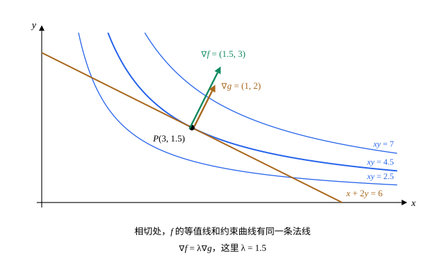

## 这一节要回答的问题

周长固定的矩形，面积最大是多少；某个平面上离原点最近的点在哪里？这类问题要在一个约束条件（constraint）$g=c$下求$f$的极值（extremum）。能从约束里解出一个变量代进去时，就变成普通的极值问题；可约束常常解不出来，或者解出来很麻烦。有没有不解约束、直接列方程的办法？

## 讲解

### 条件极值

::anchor{id="def-constrained-extremum"}
设点$P$在曲线$g(x,y)=c$上。如果曲线上$P$附近的点$Q$都满足$f(Q)\le f(P)$，就说$f$在约束$g=c$下于$P$取条件极大值；都满足$f(Q)\ge f(P)$时取条件极小值，两者统称条件极值（constrained extremum）。$f$叫作目标函数（objective function），$g=c$叫作约束条件（constraint）。

为什么这样定义：只和约束曲线上的点比，不和曲线外的点比。$f=xy$在整个平面上没有极大值，限制在直线$x+2y=6$上却有（例 1）。边界情况：$P$可以不是$f$的:term[驻点]{id="math.vector-calculus.stationary-point"}（stationary point）：例 1 的极大点处$\nabla f\ne\vb0$，沿约束曲线走不动它的值，离开曲线才能变大。

### 拉格朗日乘数法

::anchor{id="thm-lagrange"}
**:term[拉格朗日乘数法]{id="math.vector-calculus.lagrange-multipliers"}（method of Lagrange multipliers）**　设$f$、$g$有:term[连续]{id="math.vector-calculus.continuous"}（continuous）的:term[偏导数]{id="math.vector-calculus.partial-derivative"}（partial derivative），$f$在约束$g=c$下于$P$取条件极值，并且$\nabla g(P)\ne\vb0$。则有一个数$\lambda$，使$\nabla f(P)=\lambda\nabla g(P)$，$\lambda$叫作拉格朗日乘子（Lagrange multiplier）。所以候选点从方程组$f_x=\lambda g_x$、$f_y=\lambda g_y$、$g=c$里解出来：三个方程，三个未知数$x$、$y$、$\lambda$。

**证明思路**：$\nabla g(P)\ne\vb0$，由:term[隐函数定理]{id="math.vector-calculus.implicit-function-theorem"}（implicit function theorem），$P$附近的约束曲线是一条光滑曲线$\vb r(t)$，$\vb r(0)=P$，速度$\vb r'(0)\ne\vb0$（见[反函数定理与隐函数定理](lesson:math.vector-calculus.inverse-implicit)第 5 题）。$f\bigl(\vb r(t)\bigr)$在$t=0$取极值，导数为零，由:term[链式法则]{id="math.vector-calculus.chain-rule"}（chain rule）得$\nabla f\cdot\vb r'(0)=0$；$g\bigl(\vb r(t)\bigr)=c$是常数，同样$\nabla g\cdot\vb r'(0)=0$。平面上和同一个非零向量$\vb r'(0)$垂直的两个向量互相平行，而$\nabla g\ne\vb0$，所以$\nabla f=\lambda\nabla g$。

为什么是「两个:term[梯度]{id="math.vector-calculus.gradient"}（gradient）平行」：梯度和:term[等值线]{id="math.vector-calculus.level-curve"}（level curve）垂直。沿约束曲线走，$f$的值只要还能增大，约束曲线就斜着穿过$f$的等值线；走到极值点，约束曲线恰好和$f$的一条等值线相切，两者的法向一致，就是两个梯度平行。边界情况：$\nabla g(P)=\vb0$的点不满足定理的条件，可能是极值点却解不出来，要单独检查（第 7 题）。

### 几个约束

::anchor{id="thm-lagrange-several"}
**几个约束**　:term[三元函数]{id="math.vector-calculus.multivariable-function"}（function of three variables）$f(x,y,z)$在两个约束$g_1=c_1$、$g_2=c_2$下于$P$取条件极值，$f$、$g_1$、$g_2$有:term[连续]{id="math.vector-calculus.continuous"}的:term[偏导数]{id="math.vector-calculus.partial-derivative"}，并且$\nabla g_1(P)$、$\nabla g_2(P)$不平行（都不为零）。则有两个数$\lambda_1$、$\lambda_2$，使$\nabla f(P)=\lambda_1\nabla g_1(P)+\lambda_2\nabla g_2(P)$。一般地，$n$个变量、$m$个约束时，只要这一点上没有哪个约束的:term[梯度]{id="math.vector-calculus.gradient"}是其余几个梯度的线性组合（linear combination），每个约束就配一个乘子：$\nabla f=\sum_k\lambda_k\nabla g_k$。

**证明思路**：两张曲面$g_1=c_1$、$g_2=c_2$在$P$附近交成一条光滑曲线（这要用到方程组形式的:term[隐函数定理]{id="math.vector-calculus.implicit-function-theorem"}，这里不证），它的速度$\vb r'(0)$和$\nabla g_1$、$\nabla g_2$都垂直。和上面一样，$\nabla f\cdot\vb r'(0)=0$。和一个非零向量垂直的向量组成一个平面，$\nabla g_1$、$\nabla g_2$不平行，平面里的向量都能写成它们的组合，所以$\nabla f=\lambda_1\nabla g_1+\lambda_2\nabla g_2$。

为什么要这样推广：力学里质点同时受几个:term[约束]{id="physics.analytical-mechanics.constraint"}，每个约束配一个乘子，乘子给出相应的:term[约束力]{id="physics.analytical-mechanics.constraint-force"}（constraint force），见[拉格朗日乘子与约束力](lesson:physics.analytical-mechanics.constraint-forces)。约束本身是一个积分时，变分法里同样配一个乘子，见[等周问题](lesson:math.calculus-of-variations.isoperimetric-problems)。

## 几何图像

:::anim{component="function-plot"}
range: { x: [0, 6.5], y: [0, 3.6] }
functions:
  - expr: "3 - x/2"
    label: |
      约束$x+2y=6$
  - expr: "c / x"
    label: |
      等值线$xy=c$
points:
  - { x: "3", y: "1.5" }
sliders:
  - name: c
    min: 1
    max: 7
    step: 0.25
    default: 2.5
    label: |
      等值线$xy=c$里的$c$
:::

动画是例 1：直线是约束$x+2y=6$，曲线是$f=xy$的一条:term[等值线]{id="math.vector-calculus.level-curve"}$xy=c$。$c$较小时，等值线和直线交于两点，沿直线还能把$f$加大；$c$加大，两个交点靠拢，$c=4.5$时等值线和直线相切于$(3,1.5)$；$c$再大，两者不再相交，约束上取不到这么大的值。所以条件极大值是$4.5$，取在相切的地方。

图里两支箭头都垂直于直线和等值线的公切线，方向一致，长度之比$1.5$正是乘子$\lambda$。

## 例题

### 例 1　直线上的最大乘积

在约束$x+2y=6$（$x\ge0$、$y\ge0$）下，求$f=xy$的最大值。

**为什么想到这么做**：用:term[拉格朗日乘数法]{id="math.vector-calculus.lagrange-multipliers"}列方程：$\nabla f=(y,x)$，$\nabla g=(1,2)$，$\nabla g$处处不为零。约束是一条线段，端点处$f=0$，最大值一定在中间取到。

**推导**：$y=\lambda$，$x=2\lambda$，代入约束得$2\lambda+2\lambda=6$，$\lambda=\frac32$，所以$x=3$、$y=\frac32$，$f=\frac92=4.5$。和端点的$f=0$比较，最大值是$4.5$，在$(3,1.5)$取到。验算：代入$x=6-2y$，$f=(6-2y)y$，在$y=1.5$取最大值$4.5$。

### 例 2　平面上离原点最近的点

求平面$x+2y+3z=14$上离原点最近的点和最近距离。

**为什么想到这么做**：距离最小等价于距离的平方$f=x^2+y^2+z^2$最小，约束$g=x+2y+3z=14$，$\nabla g=(1,2,3)$处处不为零。三个变量、一个约束：四个方程，四个未知数。

**推导**：$(2x,2y,2z)=\lambda(1,2,3)$，所以$(x,y,z)=\frac\lambda2(1,2,3)$。代入约束：$\frac\lambda2(1+4+9)=7\lambda=14$，$\lambda=2$，点是$(1,2,3)$，最近距离$\sqrt{1+4+9}=\sqrt{14}$。几何上，最近点到原点的连线和平面垂直，正是平面的法向量（normal vector）$(1,2,3)$的方向。

## 常见误区

- 「:term[乘数法]{id="math.vector-calculus.lagrange-multipliers"}解出来的点都是极值点。」它们只是候选点，要再比较函数值，或者另外说明最值（global extremum）存在（例 1 比较了端点）。
- 「$\lambda$只是辅助未知数，求出点就可以扔掉。」$\lambda$有意义：约束的值$c$变化时，条件极值随$c$变化的速率就是$\lambda$（第 8 题）。
- 「约束的:term[梯度]{id="math.vector-calculus.gradient"}为零的点，也满足$\nabla f=\lambda\nabla g$。」定理要求$\nabla g\ne\vb0$；这样的点可能是极值点，却不满足方程组，要单独检查（第 7 题）。
- 「有两个约束，也只配一个乘子。」每个约束各配一个乘子：$\nabla f=\lambda_1\nabla g_1+\lambda_2\nabla g_2$。
