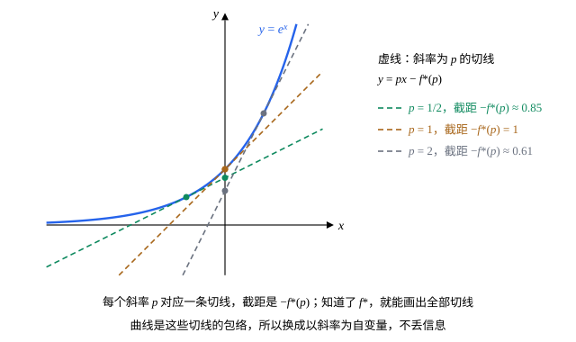

## 这一节要回答的问题

一条向上弯的曲线$y=f(x)$，可以用每个$x$处的高度来描述，也可以用它的切线来描述：每个斜率$p$对应一条切线，记下这条切线在$y$轴上的截距就行。能不能把自变量从$x$换成斜率$p=f'(x)$，又不丢失任何信息？分析力学里由:term[拉格朗日量]{id="physics.analytical-mechanics.lagrangian"}（Lagrangian）得到:term[哈密顿量]{id="physics.analytical-mechanics.hamiltonian"}（Hamiltonian），热学里由内能得到自由能（free energy），做的都是这样的变换。

## 讲解

### 勒让德变换

设$f$在区间$I$上二阶可导，并且$f''>0$，于是$f$严格凸（strictly convex），图像向上弯（见[凹凸性与拐点](lesson:math.calculus.concavity)）。这时$f'$严格单调增加，对$f'$取得到的每个值$p$，方程$f'(x)=p$恰好有一个解，记作$x(p)$。

::anchor{id="def-legendre-transform"}
函数$f^*(p)=p\,x(p)-f\bigl(x(p)\bigr)$叫作$f$的:term[勒让德变换]{id="math.vector-calculus.legendre-transform"}（Legendre transform），它的自变量$p$取遍$f'$的值。

为什么这样定义：斜率为$p$的切线过点$\bigl(x(p),f(x(p))\bigr)$，方程是$y=f\bigl(x(p)\bigr)+p\bigl(x-x(p)\bigr)=px-f^*(p)$，所以$-f^*(p)$正是这条切线的截距。另一种看法：$px-f(x)$对$x$的导数是$p-f'(x)$，在$x(p)$处由正变负，所以$f^*(p)=\max_x\bigl(px-f(x)\bigr)$，是直线$y=px$高出曲线最多的那个量。例如$f(x)=\frac{x^2}2$时$x(p)=p$，$f^*(p)=\frac{p^2}2$；$f(x)=e^x$时$x(p)=\ln p$，$f^*(p)=p\ln p-p$（$p>0$）。边界情况：$f$是一次函数时$f'$是常数，解不出$x(p)$，变换做不了；物理和化学的书里常用差一个负号的$f-px$，例如自由能（见[热力学势](lesson:physics.thermal-physics.thermodynamic-potentials)）。

### 变换后的导数

::anchor{id="thm-legendre-derivative"}
**:term[勒让德变换]{id="math.vector-calculus.legendre-transform"}的导数**　$f^*$在每一点都可导，并且$(f^*)'(p)=x(p)$：变换后的函数对新变量的导数，正是原来的自变量。

**证明思路**：对任意$p$、$q$，$f^*(q)$是$qx-f(x)$的最大值，不小于它在$x(p)$处的值，所以$f^*(q)\ge qx(p)-f\bigl(x(p)\bigr)=f^*(p)+(q-p)x(p)$；交换$p$、$q$得$f^*(p)\ge f^*(q)+(p-q)x(q)$。两式合起来，$q>p$时$x(p)\le\frac{f^*(q)-f^*(p)}{q-p}\le x(q)$。$x(p)$是严格增加的:term[连续]{id="math.vector-calculus.continuous"}（continuous）函数$f'$的反函数，随$p$连续变化，令$q\to p$，由夹逼得$(f^*)'(p)=x(p)$；$q<p$同理。

所以$p=f'(x)$和$x=(f^*)'(p)$是一对互逆的关系：两个函数互相用对方的导数当自变量。$x(p)$严格增加，$f^*$也严格凸；进一步还有$(f^*)''(p)=\frac{1}{f''(x(p))}$（第 6 题）。

### 变换两次回到原来的函数

::anchor{id="thm-legendre-involution"}
**对合性**　对$f^*$再做一次:term[勒让德变换]{id="math.vector-calculus.legendre-transform"}，得到原来的函数：$(f^*)^*=f$。

**证明思路**：$f^*$严格凸，导数是$x(p)$。对$f^*$做变换时，要由$(f^*)'(p)=x$解出$p$，也就是$x(p)=x$，解是$p=f'(x)$。所以$(f^*)^*(x)=x\,f'(x)-f^*\bigl(f'(x)\bigr)=xf'(x)-\bigl(f'(x)\,x-f(x)\bigr)=f(x)$。

这说明换自变量没有丢掉信息：知道了$f^*$，就能把$f$完全变回来。几何上，曲线是它全部切线的包络（envelope），$f^*$记下了每个斜率的切线截距，切线族就确定了曲线。对称地写，$p=f'(x)$时$f(x)+f^*(p)=px$。

### 多个变量

$n$元函数$f(x_1,\dots,x_n)$，如果由$p_i=\pdv{f}{x_i}$（$i=1,\dots,n$）能唯一地解出$x_1,\dots,x_n$，并且解出的$x_j$是$p$的:term[可微]{id="math.vector-calculus.differentiable"}（differentiable）函数，就同样定义$f^*(p_1,\dots,p_n)=\sum_jp_jx_j-f$，其中$x_j$都用$p$表示。这时$\pdv{f^*}{p_i}=x_i$：由:term[链式法则]{id="math.vector-calculus.chain-rule"}（chain rule），$\pdv{f^*}{p_i}=x_i+\sum_jp_j\pdv{x_j}{p_i}-\sum_j\pdv{f}{x_j}\pdv{x_j}{p_i}$，而$\pdv{f}{x_j}=p_j$，后两项正好抵消。只对一部分变量做变换时，其余变量只是跟着的参数，不参加变换：分析力学里$H(q,p,t)=\sum_jp_j\dot q_j-L$只换掉:term[广义速度]{id="physics.analytical-mechanics.generalized-velocity"}（generalized velocity）$\dot q_j$，$q$、$t$不动。

## 几何图像

图里$f(x)=e^x$，$f^*(p)=p\ln p-p$。斜率为$p$的切线在$x=\ln p$处和曲线相切，截距$-f^*(p)=p-p\ln p$：$p=\frac12$时约$0.85$，$p=1$时是$1$，$p=2$时约$0.61$。:term[勒让德变换]{id="math.vector-calculus.legendre-transform"}就是这张「斜率—截距」表；把所有切线画出来，曲线就是它们的包络。

## 例题

### 例 1　$e^x$的勒让德变换

求$f(x)=e^x$的:term[勒让德变换]{id="math.vector-calculus.legendre-transform"}$f^*$，验证$(f^*)'(p)=x(p)$，并对$f^*$再变换一次，验证回到$e^x$。

**为什么想到这么做**：$f''=e^x>0$，可以变换；先由$f'(x)=p$解出$x(p)$，再代入定义。

**推导**：$e^x=p$，$x(p)=\ln p$，$p>0$。$f^*(p)=p\ln p-e^{\ln p}=p\ln p-p$。$(f^*)'(p)=\ln p+1-1=\ln p=x(p)$。再变换：由$(f^*)'(p)=\ln p=x$解出$p=e^x$，$(f^*)^*(x)=xe^x-(e^x\cdot x-e^x)=e^x$，回到了原来的函数。

### 例 2　两个变量

$f(x,y)=\frac{x^2}2+2y^2+x$。求它的:term[勒让德变换]{id="math.vector-calculus.legendre-transform"}$f^*(p,q)$，并验证$\pdv{f^*}p=x$、$\pdv{f^*}q=y$。

**为什么想到这么做**：先由$p=f_x$、$q=f_y$解出$x$、$y$，再代入$f^*=px+qy-f$。

**推导**：$p=f_x=x+1$，$q=f_y=4y$，解得$x=p-1$、$y=\frac q4$。$f^*=p(p-1)+\frac{q^2}4-\Bigl(\frac{(p-1)^2}2+\frac{q^2}8+(p-1)\Bigr)=\frac{(p-1)^2}2+\frac{q^2}8$。于是$\pdv{f^*}p=p-1=x$，$\pdv{f^*}q=\frac q4=y$。$f$里的一次项$x$让新函数的「中心」从$p=0$移到了$p=1$。

## 常见误区

- 「$f^*(p)$就是把$x$换成$p$代进$f$。」$f^*(p)=px-f(x)$，$x$要换成$x(p)$；$f=\frac{x^2}2$时碰巧$f^*(p)=\frac{p^2}2$，例 1 的$e^x$就不是这样。
- 「:term[勒让德变换]{id="math.vector-calculus.legendre-transform"}就是求$f'$的反函数。」$f'$的反函数$x(p)$是$f^*$的导数，不是$f^*$本身。
- 「任何函数都能做勒让德变换。」要能由$p=f'(x)$唯一解出$x$：一次函数的$f'$是常数，做不了；不是凸的函数，同一个$p$对应好几个$x$（第 8 题）。
- 「$f$和$f+C$的变换一样，常数项的信息丢了。」$(f+C)^*=f^*-C$，常数项变成了截距的平移，并没有丢。
