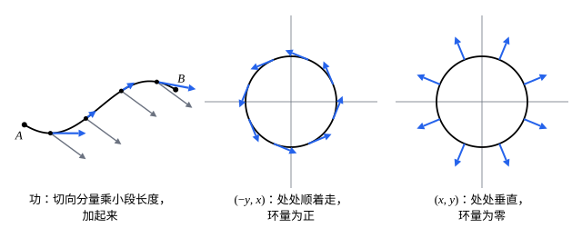

## 这一节要回答的问题

一根弯曲的铁丝，各处粗细不一样，它的质量怎样算？一个物体在力场（force field）里沿一条弯路从一点挪到另一点，力一共做了多少功（work）？两个问题都要沿着曲线，把一小段一小段的贡献加起来。

## 讲解

### 对弧长的曲线积分

::anchor{id="def-arc-length-integral"}
设$C$是:term[光滑曲线]{id="math.vector-calculus.smooth-curve"}（smooth curve）$\vb r(t)$（$a\le t\le b$），$f$在$C$上:term[连续]{id="math.vector-calculus.continuous"}（continuous）。把$C$分成小段，第$k$段的弧长（arc length）是$\Delta s_k$，在上面任取一点$\vb r_k^*$；和$\sum f(\vb r_k^*)\Delta s_k$在小段越分越细时的极限，叫作$f$沿$C$的:term[对弧长的曲线积分]{id="math.vector-calculus.arc-length-line-integral"}（line integral with respect to arc length），记作$\int_Cf\,\dd s$。用参数算：$\int_Cf\,\dd s=\int_a^bf\bigl(\vb r(t)\bigr)|\vb r'(t)|\dd t$。

为什么这样定义：$f$是铁丝的线密度（linear density）时，$f(\vb r_k^*)\Delta s_k$是一小段的质量，极限就是总质量；$f\equiv1$时得到弧长。用参数算时$\Delta s_k\approx|\vb r'(t_k)|\Delta t_k$，所以$\dd s=|\vb r'(t)|\dd t$。它只看每一小段有多长，和参数的取法、走的方向都无关。

一个常用的估计：$C$的弧长是$L$，在$C$上$|f|\le M$时，$\bigl|\int_Cf\,\dd s\bigr|\le ML$。积分算不出来时，用它可以说明积分有多小。

### 向量场的曲线积分

::anchor{id="def-line-integral"}
$C$是从$A$到$B$的:term[光滑曲线]{id="math.vector-calculus.smooth-curve"}$\vb r(t)$（$a\le t\le b$，$\vb r(a)=A$，$\vb r(b)=B$），:term[向量场]{id="math.vector-calculus.vector-field"}（vector field）$\vb F$在$C$上:term[连续]{id="math.vector-calculus.continuous"}。$\int_C\vb F\cdot\dd\vb r=\int_a^b\vb F\bigl(\vb r(t)\bigr)\cdot\vb r'(t)\dd t$叫作$\vb F$沿$C$的:term[曲线积分]{id="math.vector-calculus.line-integral"}（line integral）；$\vb F$是力时，它就是力沿$C$做的功。分量写法是$\int_CP\,\dd x+Q\,\dd y+R\,\dd z$，物理书常把$\dd\vb r$写成$\dd\vb l$。

为什么这样定义：一小段位移$\Delta\vb r$上力做的功是$\vb F\cdot\Delta\vb r$，只有沿位移方向的分力做功。$\vb F\cdot\vb r'\dd t=(\vb F\cdot\vb T)\dd s$，$\vb T$是:term[单位切向量]{id="math.vector-calculus.unit-tangent-vector"}（unit tangent vector），所以它也是切向分量$\vb F\cdot\vb T$的:term[对弧长的曲线积分]{id="math.vector-calculus.arc-length-line-integral"}。走的方向反过来，每一段位移变号，积分也变号；方向不变时换一种参数，结果不变（第 5 题）。

::anchor{id="def-oriented-curve"}
规定了走向（从哪一端走到哪一端）的曲线叫作:term[有向曲线]{id="math.vector-calculus.oriented-curve"}（oriented curve）。$-C$表示同一条曲线反着走，$\int_{-C}\vb F\cdot\dd\vb r=-\int_C\vb F\cdot\dd\vb r$；:term[分段光滑]{id="math.vector-calculus.piecewise-smooth"}（piecewise smooth）的曲线，积分按段相加。

### 环量

::anchor{id="def-circulation"}
起点和终点重合的曲线叫作:term[闭曲线]{id="math.vector-calculus.closed-curve"}（closed curve）。:term[向量场]{id="math.vector-calculus.vector-field"}$\vb F$沿有向闭曲线$C$的:term[曲线积分]{id="math.vector-calculus.line-integral"}记作$\oint_C\vb F\cdot\dd\vb r$，叫作$\vb F$沿$C$的:term[环量]{id="math.vector-calculus.circulation"}（circulation）。

为什么这样定义：速度场（velocity field）沿一圈的环量，量的是水沿着这一圈总体上转了多少；绕原点转动的场$(-y,x)$沿逆时针的圆，环量为正（例 2）。它和:term[旋度]{id="math.vector-calculus.curl"}（curl）的关系，到[格林公式](lesson:math.vector-calculus.greens-theorem)里会看得清楚。边界情况：环量为零不说明场为零，也不说明场处处和曲线垂直；常向量场$(1,0)$沿单位圆，环量就是零。

## 几何图像

左图里，只有蓝色的切向分量做功，和曲线垂直的那部分不做功。中、右两图是同样的圆，场不同，:term[环量]{id="math.vector-calculus.circulation"}一个是正的、一个是零。

## 例题

### 例 1　半圆形铁丝的质量

铁丝弯成半圆$x^2+y^2=1$，$y\ge0$，线密度是$\rho=y$（越往上越粗）。求铁丝的质量。

**为什么想到这么做**：质量是线密度的:term[对弧长的曲线积分]{id="math.vector-calculus.arc-length-line-integral"}。半圆用角度作参数最方便，$\dd s$就是$|\vb r'(t)|\dd t$。

**推导**：$\vb r(t)=(\cos t,\sin t)$，$0\le t\le\pi$，$|\vb r'(t)|=1$，所以$\dd s=\dd t$。质量$\int_C y\,\dd s=\int_0^\pi\sin t\dd t=2$。验算：线密度最大是$1$，弧长是$\pi$，质量不超过$\pi$，和估计相符。

### 例 2　同一个场，两条路

$\vb F=(-y,x)$。求它沿单位圆逆时针一圈的:term[环量]{id="math.vector-calculus.circulation"}；再求从$(1,0)$到$(-1,0)$，分别沿上半圆和下半圆的:term[曲线积分]{id="math.vector-calculus.line-integral"}。

**为什么想到这么做**：每条路都用角度作参数，算$\vb F\bigl(\vb r(t)\bigr)\cdot\vb r'(t)$再积分。下半圆要从$(1,0)$走到$(-1,0)$，参数要取成$(\cos t,-\sin t)$，$t$从$0$到$\pi$。

**推导**：逆时针一圈：$\vb r=(\cos t,\sin t)$，$\vb F\cdot\vb r'=(-\sin t,\cos t)\cdot(-\sin t,\cos t)=1$，环量是$\int_0^{2\pi}1\dd t=2\pi$。上半圆就是这一圈的前一半，积分是$\pi$。下半圆：$\vb F=(\sin t,\cos t)$，$\vb r'=(-\sin t,-\cos t)$，$\vb F\cdot\vb r'=-1$，积分是$-\pi$；两条路起点、终点相同，结果却不同，差正好是一圈的环量$2\pi$。

## 常见误区

- 「:term[对弧长的曲线积分]{id="math.vector-calculus.arc-length-line-integral"}反着走也要变号。」$\dd s$是长度，总是正的，它不变号；变号的是:term[向量场]{id="math.vector-calculus.vector-field"}的:term[曲线积分]{id="math.vector-calculus.line-integral"}，因为位移反了。
- 「换一种参数，$\int_C\vb F\cdot\dd\vb r$就变了。」只要走向不变，结果和参数无关（第 5 题）；走向反了才变号。
- 「$\int_Cf\,\dd s=\int_a^bf\bigl(\vb r(t)\bigr)\dd t$。」漏了$|\vb r'(t)|$：$\dd t$是参数的增量，不是长度。
- 「:term[环量]{id="math.vector-calculus.circulation"}为零，场就处处和曲线垂直。」环量是各段贡献的总和，正负可以抵消；常向量场$(1,0)$沿单位圆，上半圈和下半圈正好抵消。
