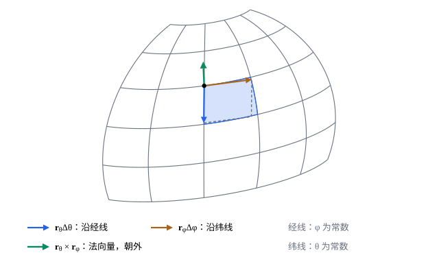

## 这一节要回答的问题

球面、圆柱面、游泳圈的表面，怎样用公式写出来？给一块弯曲的曲面，例如地球上两条纬线之间的一圈，它的面积怎样算？平面区域的面积有:term[二重积分]{id="math.vector-calculus.double-integral"}（double integral），弯曲的曲面上又该把什么积起来？

## 讲解

### 参数曲面

::anchor{id="def-parametric-surface"}
两个参数$(u,v)$在平面区域$D$里变化时，$\vb r(u,v)=\bigl(x(u,v),y(u,v),z(u,v)\bigr)$描出空间的一张曲面，叫作:term[参数曲面]{id="math.vector-calculus.parametric-surface"}（parametric surface），$\vb r$是它的参数方程（parametric equation）。固定$v$、只让$u$变，得到曲面上的一条$u$曲线；固定$u$得到$v$曲线，两族曲线在曲面上织成一张网。

常见的例子：半径为$a$的球面用:term[球坐标]{id="math.vector-calculus.spherical-coordinates"}（spherical coordinates）的两个角，$\vb r(\theta,\varphi)=(a\sin\theta\cos\varphi,\ a\sin\theta\sin\varphi,\ a\cos\theta)$；圆柱面用$\vb r(\varphi,z)=(a\cos\varphi,\ a\sin\varphi,\ z)$；函数$f(x,y)$的图像用$x$、$y$本身作参数，$\vb r(x,y)=\bigl(x,y,f(x,y)\bigr)$。为什么要用参数：很多曲面不是一个函数的图像（球面就要上下两块拼），参数方程一次写完整张曲面，还能说出曲面上「沿哪个方向走」。

### 切向量与法向量

::anchor{id="def-smooth-surface"}
$\vb r_u=\pdv{\vb r}u$、$\vb r_v=\pdv{\vb r}v$是$u$曲线、$v$曲线的:term[切向量]{id="math.vector-calculus.tangent-vector"}（tangent vector）。$\vb r_u$、$\vb r_v$:term[连续]{id="math.vector-calculus.continuous"}（continuous），并且$\vb r_u\times\vb r_v\ne\vb 0$（两个切向量不平行）时，说这张曲面是:term[光滑曲面]{id="math.vector-calculus.smooth-surface"}（smooth surface）；由有限块光滑曲面拼成的曲面（例如立方体的表面）叫作:term[分片光滑]{id="math.vector-calculus.piecewise-smooth-surface"}（piecewise smooth）的曲面。

为什么这样定义：两个切向量不平行时，它们张成（span）曲面在这一点的:term[切平面]{id="math.vector-calculus.tangent-plane"}（tangent plane），叉积（cross product）$\vb r_u\times\vb r_v$和两者都垂直，是切平面的法向量（normal vector）。函数图像$\vb r=(x,y,f)$时，$\vb r_x=(1,0,f_x)$，$\vb r_y=(0,1,f_y)$，$\vb r_x\times\vb r_y=(-f_x,-f_y,1)$，和以前求的切平面一致。边界情况：球面在两极处$\vb r_\theta\times\vb r_\varphi=\vb 0$，是参数取得不好（所有经线挤到一点），不是球面本身有毛病，换一组参数就光滑了。

### 曲面面积

::anchor{id="thm-surface-area"}
**曲面面积**　:term[光滑曲面]{id="math.vector-calculus.smooth-surface"}$\vb r(u,v)$（$(u,v)\in D$）的面积是$A=\iint_D|\vb r_u\times\vb r_v|\,\dd u\dd v$；记$\dd a=|\vb r_u\times\vb r_v|\,\dd u\dd v$，它是曲面上的:term[面积元]{id="math.vector-calculus.area-element"}（area element）。

为什么是这个式子：参数平面上的小矩形$[u,u+\Delta u]\times[v,v+\Delta v]$，被$\vb r$变成曲面上一小块，它近似以$\vb r_u\Delta u$、$\vb r_v\Delta v$为边的平行四边形。平行四边形的面积是叉积的长度$|\vb r_u\times\vb r_v|\Delta u\Delta v$，把这些小块加起来、越分越细，就得到上面的:term[二重积分]{id="math.vector-calculus.double-integral"}。这和[重积分的换元与雅可比行列式](lesson:math.vector-calculus.change-of-variables)里的道理一样：那里小矩形被变成平面上的平行四边形，这里变成空间里的。

函数$z=f(x,y)$的图像，面积元是$\dd a=\sqrt{1+f_x^2+f_y^2}\,\dd x\dd y$（第 5 题）：曲面越陡，同样大的投影上面积越大。面积和参数的取法无关：换一组参数，叉积多出的因子正好是:term[换元公式]{id="math.vector-calculus.change-of-variables-formula"}（change of variables formula）里的:term[雅可比行列式]{id="math.vector-calculus.jacobian-determinant"}（Jacobian determinant）（第 8 题）。

## 几何图像

蓝色的一小格近似虚线画的平行四边形，面积约$|\vb r_\theta\times\vb r_\varphi|\Delta\theta\Delta\varphi$；绿色的叉积和:term[切平面]{id="math.vector-calculus.tangent-plane"}垂直，从球心朝外。

## 例题

### 例 1　球面的面积

求半径为$a$的球面的面积。

**为什么想到这么做**：用:term[球坐标]{id="math.vector-calculus.spherical-coordinates"}的两个角作参数，$\theta$从$0$到$\pi$，$\varphi$从$0$到$2\pi$，算出$|\vb r_\theta\times\vb r_\varphi|$再积分。

**推导**：$\vb r_\theta=(a\cos\theta\cos\varphi,\ a\cos\theta\sin\varphi,\ -a\sin\theta)$，$\vb r_\varphi=(-a\sin\theta\sin\varphi,\ a\sin\theta\cos\varphi,\ 0)$。叉积是$a^2\sin\theta\,(\sin\theta\cos\varphi,\ \sin\theta\sin\varphi,\ \cos\theta)=a\sin\theta\,\vb r$，长度$a^2\sin\theta$（$0\le\theta\le\pi$时$\sin\theta\ge0$）。面积$\int_0^{2\pi}\int_0^\pi a^2\sin\theta\,\dd\theta\dd\varphi=4\pi a^2$；这里的$a^2\sin\theta$，正是[柱坐标与球坐标下的三重积分](lesson:math.vector-calculus.cylindrical-spherical)里:term[体积元]{id="math.vector-calculus.volume-element"}（volume element）的$r^2\sin\theta$在$r=a$时的值。

### 例 2　抛物面的面积

求抛物面$z=x^2+y^2$在$z\le1$的那一部分的面积。

**为什么想到这么做**：它是函数$f=x^2+y^2$的图像，用图像的:term[面积元]{id="math.vector-calculus.area-element"}$\sqrt{1+f_x^2+f_y^2}\,\dd x\dd y$；投影是单位圆盘，被积函数只和$x^2+y^2$有关，换成极坐标（polar coordinates）。

**推导**：$f_x=2x$，$f_y=2y$，$\dd a=\sqrt{1+4(x^2+y^2)}\,\dd x\dd y$。在极坐标下，面积$\int_0^{2\pi}\int_0^1\sqrt{1+4r^2}\,r\,\dd r\dd\theta=2\pi\cdot\frac1{12}(1+4r^2)^{3/2}\Big|_0^1=\frac\pi6\bigl(5\sqrt5-1\bigr)\approx5.33$。验算：投影圆盘的面积是$\pi\approx3.14$，曲面越往外越陡，面积比投影大，合理。

## 常见误区

- 「曲面的面积就是$\iint_D\dd u\dd v$。」那是参数区域$D$的面积；要乘上$|\vb r_u\times\vb r_v|$，它量的是参数平面上的小块被拉大了多少。
- 「:term[面积元]{id="math.vector-calculus.area-element"}是$|\vb r_u|\,|\vb r_v|\,\dd u\dd v$。」只有两个:term[切向量]{id="math.vector-calculus.tangent-vector"}垂直时才对，一般要用叉积的长度，它等于$|\vb r_u|\,|\vb r_v|$乘夹角的正弦。
- 「$\vb r_u\times\vb r_v=\vb 0$的点，曲面在那里一定有尖角。」可能只是参数取得不好，例如球面的两极；这样的点只有有限个、或者落在几条曲线上时，不影响面积。
