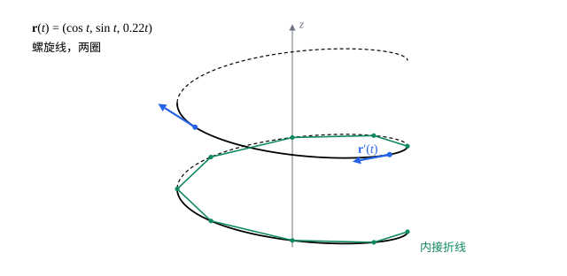

## 这一节要回答的问题

一个小球沿着螺旋形的滑道往下滚，它在空间里的位置随时间变化，记作$\vb r(t)$。它在每一刻往哪个方向走、走得多快？从起点到终点，它一共走了多远？

## 讲解

### 空间曲线和它的导数

参数$t$在一个区间里变化时，$\vb r(t)=\bigl(x(t),y(t),z(t)\bigr)$描出一条空间曲线，例如$\vb r(t)=(\cos t,\sin t,0.2t)$是绕$z$轴盘旋上升的螺旋线（helix）。这种自变量只有一个的:term[向量值函数]{id="math.vector-calculus.vector-valued-function"}（vector-valued function）就是曲线的参数方程（parametric equation）；平面上的参数曲线（parametric curve）是$z$分量为零的情形。

::anchor{id="def-velocity-vector"}
$\vb r'(t)=\lim_{h\to0}\frac{\vb r(t+h)-\vb r(t)}h=\bigl(x'(t),y'(t),z'(t)\bigr)$叫作$\vb r$在$t$处的导数。$t$是时间时，$\vb r'(t)$叫作:term[速度向量]{id="math.vector-calculus.velocity-vector"}（velocity vector），它的长度$|\vb r'(t)|$叫作速率（speed）。

为什么这样定义：$\vb r(t+h)-\vb r(t)$是一小段时间里的位移，除以$h$是这一段的平均速度；$h\to0$时，它的方向趋于曲线在这一点的走向，长度趋于这一刻走得多快。极限按分量取，所以求导就是对三个分量分别求导。边界情况：$\vb r'(t)=\vb 0$时这一刻停住了，曲线在这里可以有尖角（第 7 题）。

::anchor{id="def-tangent-vector"}
$\vb r'(t)\ne\vb 0$时，它叫作曲线在这一点的:term[切向量]{id="math.vector-calculus.tangent-vector"}（tangent vector），$\vb T=\frac{\vb r'(t)}{|\vb r'(t)|}$叫作:term[单位切向量]{id="math.vector-calculus.unit-tangent-vector"}（unit tangent vector）。$\vb r'$连续（continuous）且处处不为零的曲线叫作:term[光滑曲线]{id="math.vector-calculus.smooth-curve"}（smooth curve）；由有限段光滑曲线首尾相接组成的曲线叫作:term[分段光滑]{id="math.vector-calculus.piecewise-smooth"}（piecewise smooth）的，例如三角形的边界。

### 求导法则

::anchor{id="thm-derivative-rules"}
**求导法则**　$\vb u$、$\vb v$是可导的:term[向量值函数]{id="math.vector-calculus.vector-valued-function"}，$f$是可导的一元函数，则$(\vb u+\vb v)'=\vb u'+\vb v'$，$(f\vb u)'=f'\vb u+f\vb u'$，$(\vb u\cdot\vb v)'=\vb u'\cdot\vb v+\vb u\cdot\vb v'$。

**证明思路**：按分量写开，用一元的乘积求导法则。例如$\vb u\cdot\vb v=u_1v_1+u_2v_2+u_3v_3$，逐项求导，$(u_kv_k)'=u_k'v_k+u_kv_k'$，前一部分加起来是$\vb u'\cdot\vb v$，后一部分是$\vb u\cdot\vb v'$。

为什么有用：$|\vb r(t)|^2=\vb r\cdot\vb r$，求导得$2\vb r\cdot\vb r'$，这样就能求到原点的距离怎样变化。距离保持不变时，:term[速度向量]{id="math.vector-calculus.velocity-vector"}处处和位置向量（position vector）垂直（例 2）：在球面上运动，速度总是贴着球面。

### 弧长

::anchor{id="def-arc-length"}
曲线$\vb r(t)$从$t=a$到$t=b$的弧长（arc length）是$L=\int_a^b|\vb r'(t)|\dd t=\int_a^b\sqrt{x'(t)^2+y'(t)^2+z'(t)^2}\dd t$，也就是速率对时间的积分。

为什么这样定义：在曲线上取分点$t_0<t_1<\dots<t_n$，相邻两点连成折线，第$k$段的长度约是$|\vb r'(t_k)|\Delta t_k$；分点越来越密，折线的长度趋于这个积分。平面上它就是参数曲线的弧长公式，只多了一项$z'^2$。边界情况：同一段路走两遍，积分也算两遍，例如让$t$从$0$走到$4\pi$绕两圈的圆；只要每一点只走一遍、不往回走，弧长和参数的取法无关（第 5 题）。

### 按弧长取参数

::anchor{id="def-arc-length-parameter"}
从$t_0$开始量，$s(t)=\int_{t_0}^t|\vb r'(u)|\dd u$是走到$t$时的路程。在:term[光滑曲线]{id="math.vector-calculus.smooth-curve"}上$s'(t)=|\vb r'(t)|>0$，$s$随$t$严格增大，可以反过来用$s$作参数，这叫作按弧长取参数（arc-length parametrization）；这时$\bigl|\dv{\vb r}s\bigr|=1$，$\dv{\vb r}s$正是:term[单位切向量]{id="math.vector-calculus.unit-tangent-vector"}。

为什么有用：按弧长取参数时，曲线以速率$1$走，弯得多厉害、怎样扭，只由曲线本身的形状决定，和走得快慢无关；以后在微分几何里研究曲线的弯曲，就从这里出发。实际算起来，$s(t)$常常积不出来，或者反解不出$t$，所以多数时候还是用原来的参数（第 6 题是能算出来的例子）。

## 几何图像

蓝色箭头是:term[速度向量]{id="math.vector-calculus.velocity-vector"}，每一点都贴着曲线的走向；绿色折线的长度比螺旋线短一点，分点越密越接近弧长。这条螺旋线的速率处处一样，箭头一样长。

## 例题

### 例 1　螺旋线

$\vb r(t)=(a\cos t,\ a\sin t,\ bt)$，$a>0$，$b\ne0$。求它的:term[速度向量]{id="math.vector-calculus.velocity-vector"}、速率、:term[单位切向量]{id="math.vector-calculus.unit-tangent-vector"}和$z$轴的夹角，以及绕一圈的弧长。

**为什么想到这么做**：对三个分量分别求导得到速度向量，速率是它的长度；单位切向量和$z$轴的夹角，用它和$(0,0,1)$的点积（dot product）求。

**推导**：$\vb r'(t)=(-a\sin t,\ a\cos t,\ b)$，速率$|\vb r'(t)|=\sqrt{a^2\sin^2t+a^2\cos^2t+b^2}=\sqrt{a^2+b^2}$，是常数。$\vb T\cdot(0,0,1)=\frac b{\sqrt{a^2+b^2}}$，所以单位切向量和$z$轴的夹角处处一样。绕一圈是$t$从$0$到$2\pi$，弧长$\int_0^{2\pi}\sqrt{a^2+b^2}\dd t=2\pi\sqrt{a^2+b^2}$。验算：把圆柱面沿一条竖线剪开、铺平，一圈螺旋线变成直角边是$2\pi a$和$2\pi b$的直角三角形的斜边，长度正好是这个数。

### 例 2　长度不变的向量

设$\vb r(t)$可导，$|\vb r(t)|$是常数。证明$\vb r(t)\cdot\vb r'(t)=0$，并说明它的几何意义。

**为什么想到这么做**：长度不好直接求导，长度的平方是$\vb r\cdot\vb r$，可以用点积的求导法则。

**推导**：$|\vb r|^2=\vb r\cdot\vb r$是常数，求导得$\vb r'\cdot\vb r+\vb r\cdot\vb r'=2\,\vb r\cdot\vb r'=0$。所以在以原点为球心的球面上运动时，:term[速度向量]{id="math.vector-calculus.velocity-vector"}处处和位置向量垂直，贴着球面；匀速圆周运动的速度和半径垂直，是它的特殊情形。反过来，$\vb r\cdot\vb r'$处处为零，$|\vb r|^2$的导数就处处为零，长度保持不变。

## 常见误区

- 「速率是:term[速度向量]{id="math.vector-calculus.velocity-vector"}的导数。」速率是速度向量的长度$|\vb r'(t)|$；速度向量的导数$\vb r''(t)$是加速度（acceleration）。
- 「到原点的距离的变化率就是速率。」$\frac{\dd}{\dd t}|\vb r|=\frac{\vb r\cdot\vb r'}{|\vb r|}$，只是速度在半径方向上的分量（第 4 题）；匀速圆周运动里距离不变，速率却不为零。
- 「换一种参数，弧长就变了。」只要每一点只走一遍、不往回走，弧长和参数的取法无关（第 5 题）；同一段走两遍，才会算成两倍。
- 「$\vb r'(t)$处处存在，曲线就没有尖角。」$\vb r(t)=(t^3,t^2,0)$处处可导，可$t=0$时速度为零，曲线在原点有尖角（第 7 题）；所以:term[光滑曲线]{id="math.vector-calculus.smooth-curve"}要求$\vb r'$处处不为零。
