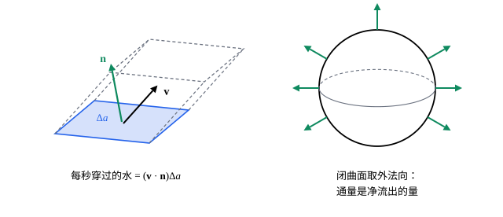

## 这一节要回答的问题

一张弯曲的薄膜各处厚薄不同，它的质量怎样算？河里拦一张渔网，每秒有多少水穿过它？一个封闭的气球表面，每秒净流出去的空气又有多少？

## 讲解

### 对面积的曲面积分

::anchor{id="def-surface-integral-area"}
$S$是:term[光滑曲面]{id="math.vector-calculus.smooth-surface"}（smooth surface）$\vb r(u,v)$，$(u,v)\in D$，$f$在$S$上:term[连续]{id="math.vector-calculus.continuous"}（continuous）。把$S$分成小块，第$k$块的面积是$\Delta a_k$，在上面任取一点$\vb r_k^*$；和$\sum f(\vb r_k^*)\Delta a_k$在小块越分越细时的极限，叫作$f$在$S$上的:term[对面积的曲面积分]{id="math.vector-calculus.surface-integral-area"}（surface integral with respect to area），记作$\iint_Sf\,\dd a$。用参数算：$\iint_Sf\,\dd a=\iint_Df\bigl(\vb r(u,v)\bigr)|\vb r_u\times\vb r_v|\,\dd u\dd v$。

为什么这样定义：$f$是薄膜的面密度（surface density，单位面积的质量）时，$f(\vb r_k^*)\Delta a_k$是一小块的质量，极限就是总质量；$f\equiv1$时得到曲面的面积。用参数算时，每一小块的面积约是$|\vb r_u\times\vb r_v|\Delta u\Delta v$，这正是[参数曲面与曲面面积](lesson:math.vector-calculus.parametric-surfaces)里的:term[面积元]{id="math.vector-calculus.area-element"}（area element）$\dd a$。它只看每一小块的面积，和参数怎样取、法向量（normal vector）朝哪边都无关。

### 有向曲面

::anchor{id="def-oriented-surface"}
在曲面$S$上处处选定一个单位法向量$\vb n$，并且让它随点:term[连续]{id="math.vector-calculus.continuous"}地变化，这样的曲面叫作:term[有向曲面]{id="math.vector-calculus.oriented-surface"}（oriented surface）。包住一块空间的曲面叫作:term[闭曲面]{id="math.vector-calculus.closed-surface"}（closed surface），例如球面、立方体的表面；闭曲面上约定$\vb n$指向外面，叫作:term[外法向]{id="math.vector-calculus.outward-normal"}（outward normal）。

为什么要这样定义：穿过一张网的水，从这一面流到那一面算正、反过来算负，得先说好哪一面是「正面」。:term[参数曲面]{id="math.vector-calculus.parametric-surface"}（parametric surface）自带一个方向：$\vb n=\frac{\vb r_u\times\vb r_v}{|\vb r_u\times\vb r_v|}$；交换$u$、$v$的次序，方向就反过来。边界情况：莫比乌斯带（Möbius strip）只有一面，沿中线绕一圈回来，法向量变成了原来的反方向，所以它不能取成有向曲面（第 7 题）。

::anchor{id="def-vector-area-element"}
有向曲面上的$\dd\vb a=\vb n\,\dd a$叫作:term[有向面积元]{id="math.vector-calculus.vector-area-element"}（vector area element）：方向是法向量，长度是一小块的面积。用参数算时，$\vb r_u\times\vb r_v$和$\vb n$同向的话，$\dd\vb a=(\vb r_u\times\vb r_v)\dd u\dd v$；反向就差一个负号。

### 通量

::anchor{id="def-flux"}
:term[向量场]{id="math.vector-calculus.vector-field"}（vector field）$\vb F$在:term[有向曲面]{id="math.vector-calculus.oriented-surface"}$S$上:term[连续]{id="math.vector-calculus.continuous"}，$\iint_S\vb F\cdot\vb n\,\dd a=\iint_S\vb F\cdot\dd\vb a$叫作$\vb F$穿过$S$的:term[通量]{id="math.vector-calculus.flux"}（flux）。用参数算（$\vb r_u\times\vb r_v$和$\vb n$同向）：$\iint_S\vb F\cdot\dd\vb a=\iint_D\vb F\bigl(\vb r(u,v)\bigr)\cdot(\vb r_u\times\vb r_v)\,\dd u\dd v$；$S$是:term[闭曲面]{id="math.vector-calculus.closed-surface"}、取:term[外法向]{id="math.vector-calculus.outward-normal"}时记作$\oint_S\vb F\cdot\dd\vb a$。

为什么这样定义：$\vb F$是水的速度场（velocity field）时，在很短的时间$\Delta t$里穿过一小块$\Delta a$的水，填满一个斜着的柱体：底面积$\Delta a$，沿法向的高是$(\vb F\cdot\vb n)\Delta t$。所以每秒穿过这一小块的水是$(\vb F\cdot\vb n)\Delta a$，只有沿法向的分量起作用，贴着曲面流的部分不穿过它。把各小块加起来就是通量；闭曲面取外法向时，通量是每秒净流出去的水，流进来的算负。

边界情况：通量为零，不等于没有水穿过。均匀流过一个球面的水，从一侧流进、另一侧流出，一样多，净通量是零（第 8 题）。

## 几何图像

左图里，速度和法向量的夹角越大，斜柱体越扁，穿过的水越少；速度贴着曲面时一点也不穿过。右图的:term[外法向]{id="math.vector-calculus.outward-normal"}是:term[闭曲面]{id="math.vector-calculus.closed-surface"}的默认方向，往外流出的算正。

## 例题

### 例 1　半球壳的质量

半径为$a$的上半球面$x^2+y^2+z^2=a^2$（$z\ge0$），面密度是$\rho=z$（越往上越厚）。求它的质量。

**为什么想到这么做**：质量是面密度的:term[对面积的曲面积分]{id="math.vector-calculus.surface-integral-area"}。用:term[球坐标]{id="math.vector-calculus.spherical-coordinates"}（spherical coordinates）的两个角作参数，$\dd a=a^2\sin\theta\,\dd\theta\dd\varphi$，上半球是$0\le\theta\le\frac\pi2$。

**推导**：$z=a\cos\theta$，质量$=\int_0^{2\pi}\int_0^{\pi/2}a\cos\theta\cdot a^2\sin\theta\,\dd\theta\dd\varphi=2\pi a^3\cdot\frac12=\pi a^3$。验算：面密度最大是$a$，上半球面的面积是$2\pi a^2$，质量不超过$2\pi a^3$，合理。

### 例 2　沿半径向外的场穿过球面

求$\vb F=(x,y,z)$穿过半径为$a$、以原点为球心的球面的:term[通量]{id="math.vector-calculus.flux"}（取:term[外法向]{id="math.vector-calculus.outward-normal"}）。

**为什么想到这么做**：球面上的外法向就是$\frac{\vb r}a$，$\vb F$也沿半径，点积（dot product）很好算，不必用参数硬算。

**推导**：在球面上$\vb n=\frac{(x,y,z)}a$，$\vb F\cdot\vb n=\frac{x^2+y^2+z^2}a=a$，是常数。通量$=\oint_S a\,\dd a=a\cdot4\pi a^2=4\pi a^3$。用参数验算：$\vb r_\theta\times\vb r_\varphi=a\sin\theta\,\vb r$，和外法向同向，$\vb F\cdot(\vb r_\theta\times\vb r_\varphi)=a^3\sin\theta$，积分同样是$4\pi a^3$。

## 常见误区

- 「:term[通量]{id="math.vector-calculus.flux"}是$\iint_S|\vb F|\,\dd a$。」只有沿法向的分量$\vb F\cdot\vb n$穿过曲面；贴着曲面的部分不算，流进来的还要算负。
- 「换一组参数，通量不变。」参数换了以后$\vb r_u\times\vb r_v$可能反向，通量就差一个负号；要先看它和选定的$\vb n$是不是同向。
- 「$\iint_Sf\,\dd a=\iint_Df\,\dd u\dd v$。」漏了$|\vb r_u\times\vb r_v|$：$\dd u\dd v$是参数区域的面积，不是曲面上的面积。
- 「每张曲面都能分出正面和反面。」莫比乌斯带只有一面，不能取成:term[有向曲面]{id="math.vector-calculus.oriented-surface"}，在它上面谈不上通量。
