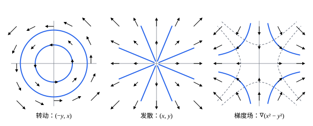

## 这一节要回答的问题

天气图上，每个地点画一支箭头表示那里的风向和风速；一个质点周围，每一点都受到一个指向它的引力。这种「每个点配一个向量」的对象怎样描述、怎样画？一片落叶被风带着走，它画出的曲线和风的箭头是什么关系？

## 讲解

### 向量场

::anchor{id="def-vector-field"}
在平面区域$D$上，给每一点$(x,y)$配一个向量$\vb F(x,y)=\bigl(P(x,y),Q(x,y)\bigr)$，这样的对应叫作$D$上的:term[向量场]{id="math.vector-calculus.vector-field"}（vector field），$P$、$Q$是它的两个分量。空间里同样有$\vb F(x,y,z)=(P,Q,R)$。

为什么这样定义：流体里每一点有一个速度，合起来是速度场（velocity field）；每一点上一个物体受的力，合起来是力场（force field）。画向量场时，在一些格点上画出$\vb F$的箭头，箭头通常按同一个比例缩短，只看方向和相对的长短。边界情况：$\vb F=\vb0$的点没有方向，速度场里那里的流体静止。

常见的几个例子：$\vb F=(-y,x)$在每一点和$(x,y)$垂直，长度等于到原点的距离，是绕原点逆时针转动的速度场；$\vb F=(x,y)$处处背离原点；$\vb F=-\frac{(x,y)}{(x^2+y^2)^{3/2}}$处处指向原点，大小和距离的平方成反比，形状正是质点的引力场。

### 梯度场

::anchor{id="def-gradient-field"}
如果:term[向量场]{id="math.vector-calculus.vector-field"}$\vb F$是某个函数$f$的:term[梯度]{id="math.vector-calculus.gradient"}（gradient），$\vb F=\nabla f$，就说$\vb F$是:term[梯度场]{id="math.vector-calculus.gradient-field"}（gradient field）。

为什么单独拿出来：梯度场的箭头处处和$f$的:term[等值线]{id="math.vector-calculus.level-curve"}（level curve）垂直，指向$f$增大的一侧，画出等值线就大致知道场的样子。物理里许多力场是梯度场，力等于势能的梯度取负号，例如重力。边界情况：不是每个向量场都是梯度场，$(-y,x)$就不是（第 8 题）；怎样判断、怎样找出$f$，以后在[保守场与路径无关](lesson:math.vector-calculus.conservative-fields)里讲。

### 流线

::anchor{id="def-flow-line"}
如果曲线$\vb r(t)$在每一刻的速度都等于场在那一点的值，即$\vb r'(t)=\vb F\bigl(\vb r(t)\bigr)$，就说$\vb r(t)$是$\vb F$的一条:term[流线]{id="math.vector-calculus.flow-line"}（flow line）。

为什么这样定义：速度场里放一片落叶，它每一刻都以当地的流速移动，走出的正是流线；流线处处和箭头相切。力场、电场里只关心方向时，处处和场相切的曲线叫场线（field line），电磁学的:term[电场线]{id="physics.electromagnetism.field-line"}（electric field line）就是电场的场线。$\vb F$的:term[偏导数]{id="math.vector-calculus.partial-derivative"}（partial derivative）:term[连续]{id="math.vector-calculus.continuous"}（continuous）时，在$\vb F\ne\vb0$的地方过每一点恰有一条流线，两条流线不会相交（这是:term[常微分方程]{id="math.ode.ode"}（ordinary differential equation）解的唯一性，见[解的存在唯一性](lesson:math.ode.existence-uniqueness)，这里不证）。

怎样求流线：先猜一条曲线，再验证$\vb r'(t)=\vb F\bigl(\vb r(t)\bigr)$。:term[梯度场]{id="math.vector-calculus.gradient-field"}的流线和:term[等值线]{id="math.vector-calculus.level-curve"}处处垂直；沿流线$f$的变化率是$\nabla f\cdot\vb r'=|\nabla f|^2$，所以流线一直往$f$增大的方向走（第 5 题）。

## 几何图像

:::anim{component="vector-field-2d"}
field: { x: "a*x - y", y: "x + a*y" }
range: { x: [-3, 3], y: [-2, 2] }
dt: 0.02
particles: 500
sliders:
  - name: a
    min: -0.5
    max: 0.5
    step: 0.1
    default: 0
    label: |
      $\vb F=(ax-y,\ x+ay)$里的$a$
:::

动画画的是$\vb F=(ax-y,\ x+ay)$：灰色箭头是场，蓝色的点被场带着走，拖出的轨迹就是:term[流线]{id="math.vector-calculus.flow-line"}。$a=0$时它是例 1 的转动，流线是同心圆；$a>0$时多了一份背离原点的分量，流线变成向外张开的螺线；$a<0$时变成向里收拢的螺线。

三种场：转动的场流线闭合；发散的场流线是射线；:term[梯度场]{id="math.vector-calculus.gradient-field"}的流线和:term[等值线]{id="math.vector-calculus.level-curve"}处处垂直（例 2）。

## 例题

### 例 1　绕原点转动的速度场

求$\vb F=(-y,x)$过点$(R,0)$（$R>0$）的:term[流线]{id="math.vector-calculus.flow-line"}，并说明沿这条流线运动一圈要多长时间。

**为什么想到这么做**：箭头和$(x,y)$垂直，猜流线是绕原点的圆$\vb r(t)=(R\cos t,R\sin t)$，再验证它的速度等于场。

**推导**：$\vb r'(t)=(-R\sin t,R\cos t)$，而$\vb F\bigl(\vb r(t)\bigr)=(-R\sin t,R\cos t)$，两者相等，$\vb r(0)=(R,0)$，所以过$(R,0)$的流线是半径$R$的圆。转一圈要$t$从$0$走到$2\pi$，和$R$无关：外圈的速度$|\vb F|=R$也大，正好补上更长的路程，整个平面像刚体（rigid body）一样匀速转动。

### 例 2　梯度场的流线

求$f=x^2-y^2$的:term[梯度场]{id="math.vector-calculus.gradient-field"}$\vb F=\nabla f$过点$(1,1)$的:term[流线]{id="math.vector-calculus.flow-line"}，并说明它和$f$的:term[等值线]{id="math.vector-calculus.level-curve"}垂直。

**为什么想到这么做**：$\vb F=(2x,-2y)$，流线满足$x'=2x$、$y'=-2y$，两个方程各管一个坐标，分别猜指数函数。

**推导**：$x=e^{2t}$、$y=e^{-2t}$满足$x'=2x$、$y'=-2y$，$t=0$时过$(1,1)$，所以流线是$\vb r(t)=(e^{2t},e^{-2t})$，也就是双曲线$xy=1$在第一象限的一支。它和等值线$x^2-y^2=c$垂直：流线的速度就是$\nabla f$，而:term[梯度]{id="math.vector-calculus.gradient"}和等值线垂直。几何上，$xy=1$和$x^2-y^2=c$是两族互相垂直的双曲线。

## 常见误区

- 「力场的场线就是质点的运动轨迹。」力决定的是加速度，不是速度；绕地球做圆周运动的卫星，引力的场线是指向地心的射线，轨道却是圆（第 7 题）。速度场的:term[流线]{id="math.vector-calculus.flow-line"}才是被带着走的轨迹。
- 「图上箭头的长度就是向量的真实长度。」箭头通常按同一个比例缩短，只看方向和相对的长短。
- 「两条流线可以在一点交叉。」$\vb F$的:term[偏导数]{id="math.vector-calculus.partial-derivative"}:term[连续]{id="math.vector-calculus.continuous"}时，过$\vb F\ne\vb0$的点的流线只有一条；流线只可能向$\vb F=\vb0$的点汇聚。
- 「每个:term[向量场]{id="math.vector-calculus.vector-field"}都是某个函数的:term[梯度]{id="math.vector-calculus.gradient"}。」$(-y,x)$就不是：若$f_x=-y$、$f_y=x$，则$f_{xy}=-1$、$f_{yx}=1$，和:term[施瓦茨定理]{id="math.vector-calculus.schwarz-theorem"}（Schwarz's theorem）矛盾（第 8 题用另一种办法说明）。
