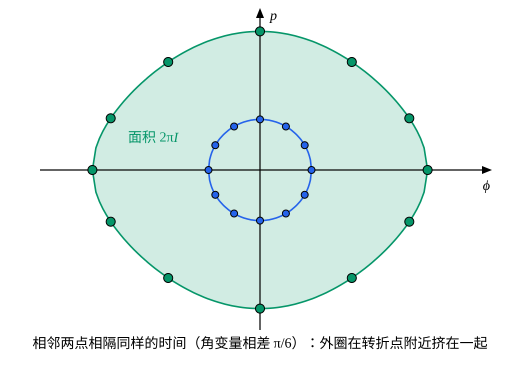

## 这一节要回答的问题

很多周期运动只关心频率，不关心每一时刻在哪里。单摆的振幅变大，周期是变长还是变短？能不能不解出运动，只算一个积分就得到频率？上一节的:term[哈密顿特征函数]{id="physics.analytical-mechanics.characteristic-function"}（Hamilton's characteristic function）$W$每走完一个来回就增加$\oint p\,\dd q$，正是:term[相轨道]{id="physics.analytical-mechanics.phase-trajectory"}（phase trajectory）围成的面积：这个面积和频率有什么关系？

## 讲解

### 作用量变量

先看例子。谐振子$H=\frac{p^2}{2m}+\frac12m\omega^2q^2$能量为$E$的:term[相轨道]{id="physics.analytical-mechanics.phase-trajectory"}是椭圆，两个半轴是$\sqrt{2E/(m\omega^2)}$和$\sqrt{2mE}$，围成的面积是$\frac{2\pi E}{\omega}$。把它除以$2\pi$，记作$I=\frac{E}{\omega}$，:term[哈密顿量]{id="physics.analytical-mechanics.hamiltonian"}（Hamiltonian）就写成$H=\omega I$，而$\dv{H}{I}=\omega$正是振动的角频率。下面会看到，这不是巧合。

::anchor{id="def-action-variable"}
一个:term[自由度]{id="physics.analytical-mechanics.degrees-of-freedom"}（degrees of freedom）、$H(q,p)$不显含时间的系统做周期运动，能量为$E$的相轨道是闭合的，$I(E)=\frac{1}{2\pi}\oint p\,\dd q$叫作:term[作用量变量]{id="physics.analytical-mechanics.action-variable"}（action variable），积分沿这条相轨道走一圈。来回运动时它等于相轨道围成的面积除以$2\pi$；单摆绕悬点转圈时，积分沿摆角从$0$走到$2\pi$。

为什么这样定义：$I$只依赖$E$，反过来$E$也只依赖$I$，所以$H$可以写成$I$的函数。一个自由度时:term[正则变换]{id="physics.analytical-mechanics.canonical-transformation"}（canonical transformation）保持面积，所以$I$和用哪组正则变量无关，是相轨道本身的属性。名字来自量纲：$\oint p\,\dd q$和:term[作用量]{id="physics.analytical-mechanics.action"}（action）的量纲相同，它就是:term[特征函数]{id="physics.analytical-mechanics.characteristic-function"}$W=\int p\,\dd q$走一圈的增量。边界情况：质点跑向无穷远时相轨道不闭合，没有$I$；单摆的分界线上运动永远走不完一圈，周期是无穷大。

### 频率

::anchor{id="thm-period"}
定理：周期运动的周期$T=2\pi\dv{I}{E}$，也就是:term[相轨道]{id="physics.analytical-mechanics.phase-trajectory"}围成的面积对能量的导数。

证明：在$(q,p)$平面上看能量为$E$和$E+\dd E$的两条相轨道，它们之间夹着一条窄带，面积是$\dd A$（$A=2\pi I$）。$H$沿垂直于相轨道的方向变化最快，变化率是$|\nabla H|$，所以窄带在某处的宽度是$\frac{\dd E}{|\nabla H|}$，$\dd A=\dd E\oint\frac{\dd s}{|\nabla H|}$，其中$\dd s$是沿相轨道的弧长。相点的速度$\bigl(\frac{\partial H}{\partial p},-\frac{\partial H}{\partial q}\bigr)$的大小正好是$|\nabla H|$，所以$\frac{\dd s}{|\nabla H|}$就是走过这段弧长用的时间$\dd t$。于是$\dv{A}{E}=\oint\dd t=T$。

这里要求相轨道上没有平衡点，$|\nabla H|$处处不为零。谐振子$A=\frac{2\pi E}{\omega}$，$T=\frac{2\pi}{\omega}$，和振幅无关；一般的势能里，$I(E)$不是正比于$E$，周期就随能量变。

### 角变量

既然$E$只依赖$I$，就用$I$作新动量造一个:term[正则变换]{id="physics.analytical-mechanics.canonical-transformation"}。:term[生成函数]{id="physics.analytical-mechanics.generating-function"}（generating function）取$F_2$型的$W(q,I)=\int^qp\bigl(q',E(I)\bigr)\dd q'$，也就是上一节的:term[特征函数]{id="physics.analytical-mechanics.characteristic-function"}，只是把常数$E$换成了$I$。它不显含时间，新的:term[哈密顿量]{id="physics.analytical-mechanics.hamiltonian"}是$K=E(I)$，不含新坐标。

::anchor{id="def-angle-variable"}
新坐标$\theta=\frac{\partial W}{\partial I}$叫作:term[角变量]{id="physics.analytical-mechanics.angle-variable"}（angle variable）。:term[正则方程]{id="physics.analytical-mechanics.hamiltons-equations"}（Hamilton's canonical equations）给出$\dot I=-\frac{\partial K}{\partial\theta}=0$，$\dot\theta=\frac{\partial K}{\partial I}=\omega(I)$，其中$\omega(I)=\dv{H}{I}$，所以$I$守恒，$\theta=\omega t+\theta_0$均匀增加。

由上面的定理，$\omega=\dv{E}{I}=\frac{2\pi}{T}$，所以$\theta$每过一个周期正好增加$2\pi$：它像一个角度，转一圈系统回到原来的状态。$\omega$就是运动的角频率，只要求出$I(E)$，求一次导数就得到频率，不用解出$q(t)$。

为什么这样定义：$I$不变、$\theta$匀速转，是周期运动最简单的描述，所有的复杂性都藏进了换元$q(\theta,I)$里。边界情况：$\theta$不是几何上的角，单摆振幅大时，$\theta$均匀增加，摆角却在转折点附近走得很慢（几何图像）。几个互不耦合的:term[自由度]{id="physics.analytical-mechanics.degrees-of-freedom"}，$H=H_1(q_1,p_1)+H_2(q_2,p_2)+\cdots$，每个自由度各有自己的:term[作用量变量]{id="physics.analytical-mechanics.action-variable"}和角变量，频率是$\omega_k=\frac{\partial H}{\partial I_k}$（p6）。

## 几何图像

为了和:term[角变量]{id="physics.analytical-mechanics.angle-variable"}区分，这里把摆角记作$\phi$，取$m=l=g=1$，$H=\frac{p^2}{2}-\cos\phi$。每条:term[相轨道]{id="physics.analytical-mechanics.phase-trajectory"}上的 12 个点相隔同样的时间，也就是角变量相差$\frac{\pi}{6}$。内圈振幅小，几乎是椭圆，点分布得很匀；外圈振幅$120^\circ$，点在转折点附近挤在一起，绿色区域的面积是$2\pi I$。

:::anim{component="phase-portrait"}
system: { phi: "p", p: "-k*sin(phi)" }
range: { phi: [-3.3, 3.3], p: [-3.6, 3.6] }
dt: 0.01
initial:
  - [0.3, 0]
  - [1.2, 0]
  - [2.0, 0]
  - [2.8, 0]
sliders:
  - name: k
    min: 0.5
    max: 3
    step: 0.1
    default: 1
    label: |
      $g/l$
:::

四个点同时从静止出发，横轴是摆角$\phi$（图上写作 phi）。振幅越大，:term[作用量变量]{id="physics.analytical-mechanics.action-variable"}$I$越大，转一圈用的时间越长，外圈的点慢慢落在后面：单摆的$\omega=\dv{H}{I}$随$I$增大而减小。拖动$g/l$，所有频率一起按$\sqrt{g/l}$的比例变。

## 例题

### 例 1　盒子里的粒子

质量$m$的粒子在长$L$的盒子里来回运动，碰到两壁时速度反向、大小不变，盒子里不受力。求:term[作用量变量]{id="physics.analytical-mechanics.action-variable"}$I(E)$和运动的角频率。

**为什么想到这么做**：动量的大小$\sqrt{2mE}$在盒子里不变，只在碰壁时变号，:term[相轨道]{id="physics.analytical-mechanics.phase-trajectory"}是一个矩形，面积一眼就能算出来。频率再由$\omega=\dv{E}{I}$得到。

**推导**：相轨道是$0\le q\le L$、$p=\pm\sqrt{2mE}$围成的矩形，面积是$2L\sqrt{2mE}$，所以$I=\frac{L}{\pi}\sqrt{2mE}$，反过来$E=\frac{\pi^2I^2}{2mL^2}$。于是

$$
\omega=\dv{E}{I}=\frac{\pi^2I}{mL^2}=\frac{\pi}{L}\sqrt{\frac{2E}{m}}=\frac{\pi v}{L},\qquad T=\frac{2\pi}{\omega}=\frac{2L}{v} ,
$$

$v$是粒子的速率。$2L/v$正是来回一趟的时间；和谐振子不同，这里能量越大，频率越高。

### 例 2　弹跳的小球

质量$m$的小球在水平地面上竖直地弹跳，每次落地都以原速率弹起，空中只受重力。用:term[作用量变量]{id="physics.analytical-mechanics.action-variable"}求弹跳的周期和它怎样随能量变化。

**为什么想到这么做**：小球在$0\le q\le\frac{E}{mg}$之间来回，$p=\pm\sqrt{2m(E-mgq)}$，:term[相轨道]{id="physics.analytical-mechanics.phase-trajectory"}是两段抛物线围成的区域，面积可以直接积分。再由$T=2\pi\dv{I}{E}$得到周期。

**推导**：

$$
I=\frac{1}{2\pi}\cdot2\int_0^{E/(mg)}\sqrt{2m(E-mgq)}\,\dd q=\frac{1}{\pi}\cdot\frac{\sqrt{2m}}{mg}\cdot\frac23E^{3/2}=\frac{2\sqrt{2m}}{3\pi mg}E^{3/2} .
$$

所以

$$
T=2\pi\dv{I}{E}=\frac{2\sqrt{2m}}{mg}E^{1/2}=\frac{2v_0}{g},\qquad v_0=\sqrt{\frac{2E}{m}} ,
$$

正是以速率$v_0$竖直上抛、再落回地面的时间。能量越大，周期越长，频率$\omega=\frac{\pi g}{v_0}$越低。

## 常见误区

- 「:term[作用量变量]{id="physics.analytical-mechanics.action-variable"}就是:term[作用量]{id="physics.analytical-mechanics.action"}$S=\int L\,\dd t$。」$S$沿运动一直在变，$I$是守恒量，它是:term[特征函数]{id="physics.analytical-mechanics.characteristic-function"}$W$每走一圈的增量除以$2\pi$。
- 「:term[角变量]{id="physics.analytical-mechanics.angle-variable"}就是几何上的角度。」角变量随时间均匀增加；单摆的摆角、$(q,p)$平面上的极角都不是这样。
- 「能量越大，周期一定越长。」单摆是这样；谐振子的周期不变；盒子里的粒子能量越大，周期越短（例 1）。决定它的是$I(E)$。
- 「只要运动有界，就能用作用量-角变量。」一个:term[自由度]{id="physics.analytical-mechanics.degrees-of-freedom"}时还要求:term[相轨道]{id="physics.analytical-mechanics.phase-trajectory"}闭合、不经过平衡点；几个自由度时要有$n$个互相独立、彼此:term[泊松括号]{id="physics.analytical-mechanics.poisson-bracket"}（Poisson bracket）为零的守恒量，能分离变量时就有；混沌运动就没有这样的变量。
