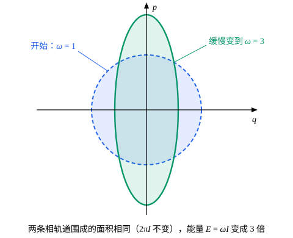

## 这一节要回答的问题

单摆的绳从悬点处的小孔里被极慢地往上拉，摆长变短，摆得越来越快，摆动的能量也在增加。:term[哈密顿量]{id="physics.analytical-mechanics.hamiltonian"}（Hamiltonian）显含时间，能量不守恒，那有没有一个量几乎不变？弹簧慢慢变硬、盒子的墙慢慢移动时，是不是同一个量？「慢慢」又要慢到什么程度？

## 讲解

### 浸渐不变量

先看例子。谐振子$H=\frac{p^2}{2m}+\frac12m\omega^2q^2$的角频率$\omega$缓慢地从$\omega_0$增加到$3\omega_0$，比如弹簧在缓慢变硬。数值计算（几何图像里的动画）显示，能量变成了原来的约$3$倍，$\frac{E}{\omega}$却几乎不变，正是上一节的:term[作用量变量]{id="physics.analytical-mechanics.action-variable"}（action variable）$I$。变得越慢，$\frac{E}{\omega}$的变化越小；变得快了，它就明显地变，而且变多少取决于变化开始时振子在哪个相位上。

::anchor{id="def-adiabatic-invariant"}
设:term[哈密顿量]{id="physics.analytical-mechanics.hamiltonian"}含一个参数$\lambda$，$H(q,p;\lambda)$，让$\lambda$按$\lambda=\Lambda(\varepsilon t)$随时间变化，$\varepsilon$越小变得越慢，整个过程持续大约$\frac{1}{\varepsilon}$的时间，$\lambda$在这段时间里变化很大（比如变成几倍）。如果某个量在整个过程中的改变量随$\varepsilon\to0$趋于零，它就叫作:term[浸渐不变量]{id="physics.analytical-mechanics.adiabatic-invariant"}（adiabatic invariant）。

为什么这样定义：$H$显含时间，能量不守恒，$\dv{E}{t}=\frac{\partial H}{\partial t}=\frac{\partial H}{\partial\lambda}\dot\lambda$，变化率是$\varepsilon$的量级，可要持续$\frac1\varepsilon$那么久，累积起来的改变不小。浸渐不变量是另一种量：变化越慢，它的总改变越小。反例：能量本身就不是，弹簧变硬以后能量变成了约$3$倍；参数突然改变时，$I$也会变（p6）。

### 作用量变量是浸渐不变量

::anchor{id="thm-adiabatic"}
定理：一个:term[自由度]{id="physics.analytical-mechanics.degrees-of-freedom"}（degrees of freedom）的周期运动，参数缓慢变化时，:term[作用量变量]{id="physics.analytical-mechanics.action-variable"}$I=\frac{1}{2\pi}\oint p\,\dd q$是:term[浸渐不变量]{id="physics.analytical-mechanics.adiabatic-invariant"}。这里要求变化过程中运动一直是周期的，而且$\lambda$在一个周期里的相对变化很小。

证明思路：把$I$看成$E$和$\lambda$的函数，$I(E,\lambda)=\frac{1}{2\pi}\oint p(q,E,\lambda)\,\dd q$，积分沿参数固定为$\lambda$时能量为$E$的那条:term[相轨道]{id="physics.analytical-mechanics.phase-trajectory"}（phase trajectory）。沿着运动

$$
\dv{I}{t}=\frac{\partial I}{\partial E}\dv{E}{t}+\frac{\partial I}{\partial\lambda}\dot\lambda,\qquad \dv{E}{t}=\frac{\partial H}{\partial\lambda}\dot\lambda .
$$

上一节证明过$\frac{\partial I}{\partial E}=\frac{T}{2\pi}$。同样看两条相轨道之间的窄带（这次是同一个$E$、参数差$\dd\lambda$），可以得到$\frac{\partial I}{\partial\lambda}=-\frac{1}{2\pi}\oint\frac{\partial H}{\partial\lambda}\dd t=-\frac{T}{2\pi}\bigl\langle\frac{\partial H}{\partial\lambda}\bigr\rangle$，其中$\langle\ \rangle$是沿相轨道走一圈的时间平均。代进去：

$$
\dv{I}{t}=\frac{T}{2\pi}\dot\lambda\Bigl(\frac{\partial H}{\partial\lambda}-\Bigl\langle\frac{\partial H}{\partial\lambda}\Bigr\rangle\Bigr).
$$

括号里是$\frac{\partial H}{\partial\lambda}$偏离它的周期平均的部分，在一个周期里有正有负，平均为零。$\dot\lambda$本来就是$\varepsilon$的量级，在一个周期里又几乎不变，所以每走一圈$I$的净改变比$\varepsilon$还高一阶，持续$\frac1\varepsilon$个周期，总改变仍随$\varepsilon\to0$趋于零。严格的证明要估计每一圈的误差，并说明它们不会一圈一圈地累积起来，这里不展开。

这也说明了「缓慢」的标准：要和周期比。参数在一个周期里的相对变化$\frac{|\dot\lambda|T}{\lambda}$必须很小；周期很长的运动（例如单摆接近分界线时）就很难满足，那里$I$不再近似不变（p8）。

## 几何图像

取$m=1$，谐振子的角频率从$1$缓慢变到$3$：开始时:term[相轨道]{id="physics.analytical-mechanics.phase-trajectory"}是半径$1$的圆，最后是瘦高的椭圆，$q$方向的半轴缩成$\frac{1}{\sqrt3}$，$p$方向的半轴伸长到$\sqrt3$。两者围成的面积都是$\pi$：$2\pi I$不变，能量$E=\omega I$却变成了$3$倍。

:::anim{component="phase-portrait"}
system: { q: "p", p: "-(3 - 2*exp(-s*t))^2*q" }
range: { q: [-1.3, 1.3], p: [-2.7, 2.7] }
dt: 0.005
initial:
  - [1, 0]
  - [0, 1]
sliders:
  - name: s
    min: 0.02
    max: 3
    step: 0.02
    default: 0.1
    label: |
      变化的快慢$\varepsilon$
:::

这里$\omega(t)=3-2e^{-\varepsilon t}$从$1$增加到$3$，两条轨迹的初始能量相同，相位差四分之一周期。$\varepsilon$小时（默认$0.1$），两条轨迹最后几乎落在同一个瘦高的椭圆上，和上图一样，$\varepsilon$越小越接近；把$\varepsilon$拖到$2$以上再看，变化太快，两条轨迹最后落在不同的椭圆上，面积也不再是$\pi$：$I$只在变化缓慢时才不变。速度调到$4\times$看得快一些。

## 例题

### 例 1　摆长缓慢变短的单摆

单摆的绳从悬点处的小孔里被缓慢地往上拉，摆长从$l_0$变到$l$，摆角一直很小。摆动的能量（相对于当时的最低点）和振幅怎样变？摆长变成$\frac{l_0}{4}$时各变成几倍？

**为什么想到这么做**：摆长是缓慢变化的参数。小振幅时单摆是谐振子，:term[作用量变量]{id="physics.analytical-mechanics.action-variable"}是$I=\frac{E_{\mathrm{osc}}}{\omega}$，它是:term[浸渐不变量]{id="physics.analytical-mechanics.adiabatic-invariant"}；只要再把$\omega$和振幅用摆长表示出来。

**推导**：摆长为$l(t)$时，摆角的:term[哈密顿量]{id="physics.analytical-mechanics.hamiltonian"}是$H=\frac{p^2}{2ml^2}-mgl\cos\phi\approx\frac{p^2}{2ml^2}+\frac12mgl\phi^2-mgl$（为了和上一节的:term[角变量]{id="physics.analytical-mechanics.angle-variable"}（angle variable）区分，摆角记作$\phi$）。最后一项只依赖时间，不改变:term[相轨道]{id="physics.analytical-mechanics.phase-trajectory"}的形状；前两项是质量为$ml^2$、劲度系数为$mgl$的谐振子，角频率$\omega=\sqrt{\frac{mgl}{ml^2}}=\sqrt{\frac gl}$，摆动的能量是$E_{\mathrm{osc}}=\frac12mgl\phi_0^2$，$\phi_0$是振幅。由$I=\frac{E_{\mathrm{osc}}}{\omega}$不变：

$$
E_{\mathrm{osc}}\propto\omega\propto l^{-1/2},\qquad \phi_0^2=\frac{2E_{\mathrm{osc}}}{mgl}\propto l^{-3/2},\qquad \phi_0\propto l^{-3/4} .
$$

摆长变成$\frac{l_0}{4}$时，$\omega$变成$2$倍，摆动的能量也变成$2$倍，振幅变成$4^{3/4}=2\sqrt2\approx2.83$倍。拉绳的人做的功，一部分把摆球提高，另一部分增加了摆动的能量；整个过程没有解一次运动方程。

### 例 2　墙缓慢移动的盒子

质量$m$的粒子在长$L$的盒子里来回弹，一面墙以很小的速度$u$向里推，$L$缓慢变小。粒子的速率怎样随$L$变？再直接用碰撞验证。

**为什么想到这么做**：上一节算过盒子里粒子的$I=\frac{L}{\pi}\sqrt{2mE}=\frac{mvL}{\pi}$，$L$是缓慢变化的参数，$I$不变就给出答案。墙的速度$u$远小于粒子的速率$v$时，变化是缓慢的。

**推导**：$I=\frac{mvL}{\pi}$不变，所以$vL$不变：盒子压缩一半，速率加倍，能量$E\propto L^{-2}$变成$4$倍。直接验证：粒子碰到以速度$u$迎面而来的墙，弹回时速率增加$2u$；它每隔$\frac{2L}{v}$碰一次这面墙，所以$\dv{v}{t}=2u\cdot\frac{v}{2L}=\frac{uv}{L}$。而$\dv{L}{t}=-u$，两式相除得$\frac{\dd v}{v}=-\frac{\dd L}{L}$，即$vL$不变，和:term[浸渐不变量]{id="physics.analytical-mechanics.adiabatic-invariant"}给出的一样。

## 常见误区

- 「:term[浸渐不变量]{id="physics.analytical-mechanics.adiabatic-invariant"}是守恒量。」它只是近似不变：变化越慢越准，参数变化有限快时总有小的改变。
- 「参数变得慢，能量也就几乎不变。」能量会变，而且变化不小：弹簧变硬到频率的$3$倍时，能量变成约$3$倍。
- 「只要变化慢就行，慢多少都无所谓。」要和周期比：参数在一个周期里的相对变化必须很小；单摆接近分界线时周期很长，就很难算「慢」。
- 「参数突然改变时，:term[作用量变量]{id="physics.analytical-mechanics.action-variable"}也不变。」突然改变时位置和动量来不及变，$I$按新的$H$重新计算，一般会变，变多少还取决于当时的相位（p6）。
