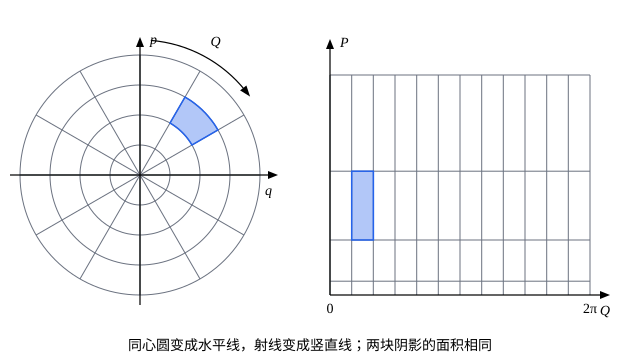

## 这一节要回答的问题

拉格朗日力学里，换一组:term[广义坐标]{id="physics.analytical-mechanics.generalized-coordinates"}（generalized coordinates）不改变:term[拉格朗日方程]{id="physics.analytical-mechanics.lagrange-equations"}（Lagrange's equations）的形式。哈密顿力学把$q$和$p$放在平等的地位上，可以把它们混在一起，换成新变量$(Q,P)$。什么样的换法能保住:term[正则方程]{id="physics.analytical-mechanics.hamiltons-equations"}（Hamilton's canonical equations）的形式？能不能挑一组新变量，让新的:term[哈密顿量]{id="physics.analytical-mechanics.hamiltonian"}（Hamiltonian）里根本不出现$Q$，运动一下子就解出来？

## 讲解

### 正则变换

先看例子。谐振子（harmonic oscillator）$H=\frac12(p^2+\omega^2q^2)$（取$m=1$），换成新变量$(Q,P)$：

$$
q=\sqrt{\frac{2P}{\omega}}\sin Q,\qquad p=\sqrt{2\omega P}\cos Q .
$$

代进去，$H=\omega P\cos^2Q+\omega P\sin^2Q=\omega P$。如果新变量也满足以$K=\omega P$为:term[哈密顿量]{id="physics.analytical-mechanics.hamiltonian"}的:term[正则方程]{id="physics.analytical-mechanics.hamiltons-equations"}，就有$\dot P=-\frac{\partial K}{\partial Q}=0$、$\dot Q=\frac{\partial K}{\partial P}=\omega$，于是$P$是常数，$Q=\omega t+\beta$，$q=\sqrt{2P/\omega}\,\sin(\omega t+\beta)$。直接求导可以验证这确实是谐振子的运动：$\dot q=\sqrt{2\omega P}\cos(\omega t+\beta)=p$，$\dot p=-\omega^2q$。

不是每种换法都行。取$Q=q$、$P=2p$，把$H$改写成新变量是$\frac12\bigl(\frac{P^2}{4}+\omega^2Q^2\bigr)$，可$\dot Q=\dot q=p=\frac{P}{2}$，而$\frac{\partial H}{\partial P}=\frac{P}{4}$：拿它当新的哈密顿量，正则方程不成立。两者的差别在:term[泊松括号]{id="physics.analytical-mechanics.poisson-bracket"}（Poisson bracket）上：后一个换法$\pb{Q}{P}=\pb{q}{2p}=2$；前一个换法有$P=\frac{p^2+\omega^2q^2}{2\omega}$、$\tan Q=\frac{\omega q}{p}$，算出来

$$
\pb{Q}{P}=\frac{\partial Q}{\partial q}\frac{\partial P}{\partial p}-\frac{\partial Q}{\partial p}\frac{\partial P}{\partial q}=\frac{\omega p}{p^2+\omega^2q^2}\cdot\frac{p}{\omega}+\frac{\omega q}{p^2+\omega^2q^2}\cdot\omega q=1 .
$$

::anchor{id="def-canonical-transformation"}
不显含时间的可逆换元$(q,p)\to(Q,P)$，如果新变量之间的泊松括号（按旧变量算）满足:term[基本泊松括号]{id="physics.analytical-mechanics.fundamental-poisson-brackets"}（fundamental Poisson brackets）的关系$\pb{Q_i}{Q_j}=0$、$\pb{P_i}{P_j}=0$、$\pb{Q_i}{P_j}=\delta_{ij}$，就叫作:term[正则变换]{id="physics.analytical-mechanics.canonical-transformation"}（canonical transformation）。

::anchor{id="thm-canonical-invariance"}
定理：正则变换下，任何两个函数的泊松括号用新变量算和用旧变量算都相同；所以新变量满足以$K(Q,P)=H\bigl(q(Q,P),p(Q,P)\bigr)$为哈密顿量的正则方程。

证明：把$f$、$g$看成$(Q,P)$的函数，由链式法则$\frac{\partial f}{\partial q_i}=\sum_k\bigl(\frac{\partial f}{\partial Q_k}\frac{\partial Q_k}{\partial q_i}+\frac{\partial f}{\partial P_k}\frac{\partial P_k}{\partial q_i}\bigr)$，对$p_i$、对$g$也一样。代进按旧变量算的括号，按$\frac{\partial f}{\partial Q_k}\frac{\partial g}{\partial P_l}$这样的乘积整理，系数正好是新变量之间的括号：

$$
\pb{f}{g}=\sum_{k,l}\Bigl(\frac{\partial f}{\partial Q_k}\frac{\partial g}{\partial Q_l}\pb{Q_k}{Q_l}+\frac{\partial f}{\partial Q_k}\frac{\partial g}{\partial P_l}\pb{Q_k}{P_l}+\frac{\partial f}{\partial P_k}\frac{\partial g}{\partial Q_l}\pb{P_k}{Q_l}+\frac{\partial f}{\partial P_k}\frac{\partial g}{\partial P_l}\pb{P_k}{P_l}\Bigr).
$$

代入基本括号的关系，只剩$\sum_k\bigl(\frac{\partial f}{\partial Q_k}\frac{\partial g}{\partial P_k}-\frac{\partial f}{\partial P_k}\frac{\partial g}{\partial Q_k}\bigr)$，正是用新变量算的括号。于是$\dot Q_k=\pb{Q_k}{H}$按新变量算等于$\frac{\partial K}{\partial P_k}$，同样$\dot P_k=\pb{P_k}{H}=-\frac{\partial K}{\partial Q_k}$。

为什么这样定义：正则方程可以写成$\dot q_j=\pb{q_j}{H}$、$\dot p_j=\pb{p_j}{H}$，括号一保住，对任何$H$方程都保住，所以这种换元对所有系统都能用。条件里$Q$、$P$可以是$q$、$p$的任意混合：$Q=p$、$P=-q$满足$\pb{Q}{P}=\pb{p}{-q}=1$，把坐标和动量对调（带一个负号）也是正则变换。反例：$Q=p$、$P=q$给出$\pb{Q}{P}=-1$，不是正则变换。

一个:term[自由度]{id="physics.analytical-mechanics.degrees-of-freedom"}（degrees of freedom）时，$\pb{Q}{P}$还有几何意义。$(q,p)$平面上边长为$\delta q$、$\delta p$的小矩形，被换元映成两条边是$\bigl(\frac{\partial Q}{\partial q}\delta q,\ \frac{\partial P}{\partial q}\delta q\bigr)$和$\bigl(\frac{\partial Q}{\partial p}\delta p,\ \frac{\partial P}{\partial p}\delta p\bigr)$的小平行四边形，两条边的叉积（垂直于平面的那个分量）是$\pb{Q}{P}\,\delta q\,\delta p$：它的绝对值是面积，它的正负说明图形有没有被翻面。所以一个自由度时，正则变换就是保持面积、而且不把图形翻面的换元；$Q=p$、$P=q$面积不变，却把图形翻了面，$\pb{Q}{P}=-1$（几何图像）。

### 生成函数

检查括号能判断一个换元正则不正则，却没告诉我们怎样造出:term[正则变换]{id="physics.analytical-mechanics.canonical-transformation"}，显含时间的换元也还没有着落。办法是回到:term[哈密顿原理]{id="physics.analytical-mechanics.hamiltons-principle"}（Hamilton's principle）。把$2n$个变量$q$、$p$都当作未知函数，以$\sum_jp_j\dot q_j-H(q,p,t)$为「:term[拉格朗日量]{id="physics.analytical-mechanics.lagrangian"}（Lagrangian）」写欧拉-拉格朗日方程（Euler–Lagrange equations）：对$p_j$，它不含$\dot p_j$，方程是$0-\bigl(\dot q_j-\frac{\partial H}{\partial p_j}\bigr)=0$；对$q_j$，方程是$\dot p_j+\frac{\partial H}{\partial q_j}=0$。这正是:term[正则方程]{id="physics.analytical-mechanics.hamiltons-equations"}，所以真实运动让$\int\bigl(\sum_jp_j\dot q_j-H\bigr)\dd t$在两端固定的$(q,p)$路径中取驻值。

设新旧变量之间有一个（可以显含时间的）换元，又有函数$K(Q,P,t)$和$F$，使得沿任何路径都有

$$
\sum_jp_j\dot q_j-H=\sum_jP_j\dot Q_j-K+\dv{F}{t}.
$$

讲哈密顿原理时证明过两件事：给拉格朗日量加一个全导数，方程不变；换一组变量，方程仍是欧拉-拉格朗日方程的形式。所以左边给出的运动，用新变量写出来，也满足右边去掉$\dv{F}{t}$以后的欧拉-拉格朗日方程，即$\dot Q_j=\frac{\partial K}{\partial P_j}$、$\dot P_j=-\frac{\partial K}{\partial Q_j}$：新变量满足以$K$为:term[哈密顿量]{id="physics.analytical-mechanics.hamiltonian"}的正则方程。

要满足上式，最方便的是让$F$依赖一半旧变量、一半新变量。取$F=F_1(q,Q,t)$，$\dv{F_1}{t}=\sum_j\bigl(\frac{\partial F_1}{\partial q_j}\dot q_j+\frac{\partial F_1}{\partial Q_j}\dot Q_j\bigr)+\frac{\partial F_1}{\partial t}$。把$q$、$Q$当作可以各自随意变化的变量，比较两边$\dot q_j$、$\dot Q_j$的系数和剩下的项：

$$
p_j=\frac{\partial F_1}{\partial q_j},\qquad P_j=-\frac{\partial F_1}{\partial Q_j},\qquad K=H+\frac{\partial F_1}{\partial t}.
$$

取$F=F_2(q,P,t)-\sum_jQ_jP_j$，上式变成$\sum_jp_j\dot q_j-H=-\sum_jQ_j\dot P_j-K+\dv{F_2}{t}$，同样比较$\dot q_j$、$\dot P_j$的系数：

$$
p_j=\frac{\partial F_2}{\partial q_j},\qquad Q_j=\frac{\partial F_2}{\partial P_j},\qquad K=H+\frac{\partial F_2}{\partial t}.
$$

::anchor{id="def-generating-function"}
上面的$F_1(q,Q,t)$或$F_2(q,P,t)$叫作这个正则变换的:term[生成函数]{id="physics.analytical-mechanics.generating-function"}（generating function）：给出一个函数，由上面的式子就定出整个换元和新的哈密顿量$K$。显含时间的换元也叫正则变换，只要它能由生成函数给出。

为什么这样定义：$2n$个新变量要满足一大堆括号关系，直接凑很难；生成函数只是一个函数，几乎可以随便取，造出来的换元自动保持正则方程。取$F_2=\sum_jq_jP_j$得到恒等变换；取$F_2=\sum_jf_j(q,t)P_j$得到$Q_j=f_j(q,t)$，正是拉格朗日力学里的换坐标，动量跟着换，$K=H+\frac{\partial F_2}{\partial t}$。边界情况：$F_1(q,Q,t)$要求$q$和$Q$能各自随意变化，恒等变换$Q=q$里两者绑在一起，没有$F_1$型的生成函数，只能用$F_2$。

两种说法是一致的：生成函数不显含时间时$K=H$，而且上面的论证对任何$H$都成立。取$H$为函数$P_j(q,p)$，新方程给出$\dot Q_i=\frac{\partial P_j}{\partial P_i}=\delta_{ij}$，按旧变量又有$\dot Q_i=\pb{Q_i}{P_j}$，所以$\pb{Q_i}{P_j}=\delta_{ij}$；取$H$为$Q_j$或$P_j$，同理得到其余的:term[基本括号]{id="physics.analytical-mechanics.fundamental-poisson-brackets"}。

## 几何图像

左边是$(q,p)$平面，右边是$(Q,P)$平面（取$m=\omega=1$）。例 1 的:term[正则变换]{id="physics.analytical-mechanics.canonical-transformation"}把以原点为中心的圆（$H$的等值线）变成水平线$P=$常数，把从原点出发的射线变成竖直线$Q=$常数。左边圆环上的一块对应右边的矩形，面积都是$\frac{\pi}{6}\times0.625\approx0.327$：一个:term[自由度]{id="physics.analytical-mechanics.degrees-of-freedom"}时，正则变换保持面积。

## 例题

### 例 1　谐振子的生成函数

用:term[生成函数]{id="physics.analytical-mechanics.generating-function"}$F_1(q,Q)=\frac12m\omega q^2\cot Q$造一个换元，求$q$、$p$用$Q$、$P$的表示和新的:term[哈密顿量]{id="physics.analytical-mechanics.hamiltonian"}，再解出谐振子$H=\frac{p^2}{2m}+\frac12m\omega^2q^2$的运动。

**为什么想到这么做**：想让新的哈密顿量只含$P$，这样$Q$就是:term[循环坐标]{id="physics.analytical-mechanics.cyclic-coordinate"}（cyclic coordinate），$P$守恒。$H$的等值线是椭圆，自然的新变量是「沿椭圆转了多少角度」和「在哪个椭圆上」；$F_1$里的$\cot Q$正是为此挑的，这里先验证它管用。

**推导**：由$F_1$，

$$
p=\frac{\partial F_1}{\partial q}=m\omega q\cot Q,\qquad P=-\frac{\partial F_1}{\partial Q}=\frac{m\omega q^2}{2\sin^2Q}.
$$

由第二式$q=\sqrt{\frac{2P}{m\omega}}\sin Q$，代进第一式得$p=\sqrt{2m\omega P}\cos Q$。$F_1$不显含时间，$K=H$：

$$
K=\frac{2m\omega P\cos^2Q}{2m}+\frac12m\omega^2\cdot\frac{2P}{m\omega}\sin^2Q=\omega P .
$$

$Q$不出现在$K$里，$\dot P=0$，$P$等于常数$\frac{E}{\omega}$；$\dot Q=\frac{\partial K}{\partial P}=\omega$，$Q=\omega t+\beta$。所以$q=\sqrt{\frac{2E}{m\omega^2}}\sin(\omega t+\beta)$，振幅由能量定出，角频率是$\omega$，和振幅无关。

### 例 2　匀速运动的参考系

质点在势能$V(q)$里做一维运动，$H=\frac{p^2}{2m}+V(q)$。改用以速度$v$匀速运动的参考系里的位置$Q=q-vt$。用:term[生成函数]{id="physics.analytical-mechanics.generating-function"}$F_2(q,P,t)=(q-vt)(P+mv)$，求$p$和$P$的关系，以及新的:term[哈密顿量]{id="physics.analytical-mechanics.hamiltonian"}$K$。

**为什么想到这么做**：换元显含时间，旧的$H$直接改写成新变量是不够的，要加上$\frac{\partial F_2}{\partial t}$。$F_2$里的$(q-vt)$给出$Q$，$(P+mv)$是为了让动量换得对：运动参考系里的动量应当是$m(\dot q-v)$。

**推导**：$Q=\frac{\partial F_2}{\partial P}=q-vt$，$p=\frac{\partial F_2}{\partial q}=P+mv$，即$P=p-mv$。$\frac{\partial F_2}{\partial t}=-v(P+mv)$，所以

$$
K=\frac{(P+mv)^2}{2m}+V(Q+vt)-v(P+mv)=\frac{P^2}{2m}+V(Q+vt)-\frac12mv^2 .
$$

最后一项是常数，不影响方程。新的:term[正则方程]{id="physics.analytical-mechanics.hamiltons-equations"}是$\dot Q=\frac{P}{m}$、$\dot P=-V'(Q+vt)$：在运动参考系里，质点的动量是$m\dot Q=m(\dot q-v)$，受的力不变，只是势能「跟着时间往回走」。

## 常见误区

- 「任何一一对应的换元都保持:term[正则方程]{id="physics.analytical-mechanics.hamiltons-equations"}。」要保持:term[基本泊松括号]{id="physics.analytical-mechanics.fundamental-poisson-brackets"}，才能拿改写成新变量的$H$当新的:term[哈密顿量]{id="physics.analytical-mechanics.hamiltonian"}；$Q=q$、$P=2p$就不行（把$H$乘$2$倒能凑出正则方程，那只是换了单位，见 p8）。
- 「:term[正则变换]{id="physics.analytical-mechanics.canonical-transformation"}只能把坐标换成坐标、动量换成动量。」$Q=p$、$P=-q$也是正则变换，哈密顿力学里坐标和动量的地位是平等的。
- 「新的哈密顿量总是把旧的改写成新变量。」只在换元不显含时间时如此；显含时间时要加上$\frac{\partial F}{\partial t}$（例 2）。
- 「:term[生成函数]{id="physics.analytical-mechanics.generating-function"}里的变量可以随便选。」$F_1(q,Q,t)$要求$q$、$Q$能当作独立的变量；恒等变换就没有$F_1$型的生成函数，要用$F_2$。
