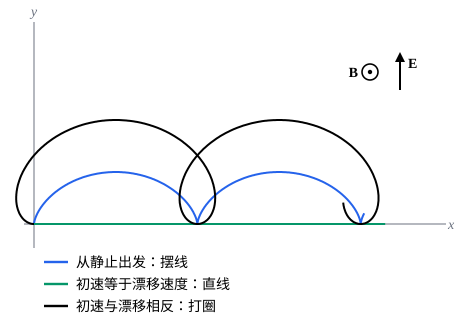

## 这一节要回答的问题

到目前为止，:term[拉格朗日量]{id="physics.analytical-mechanics.lagrangian"}（Lagrangian）都是$T-V$，力是势能的负梯度（gradient）。洛伦兹力（Lorentz force）$q(\vb{E}+\vb{v}\times\vb{B})$的磁场部分和速度有关，而且永远垂直于速度，它不是任何$V(\vb{r})$的负梯度。这样的力能放进拉格朗日表述吗？如果能，拉格朗日量、:term[广义动量]{id="physics.analytical-mechanics.generalized-momentum"}（generalized momentum）和:term[哈密顿量]{id="physics.analytical-mechanics.hamiltonian"}（Hamiltonian）各是什么？

## 讲解

### 拉格朗日量与洛伦兹力

电磁场用电磁势（electromagnetic potentials）表示：$\vb{E}=-\nabla\varphi-\partial_t\vb{A}$，$\vb{B}=\nabla\times\vb{A}$，$\varphi$是标势（scalar potential），$\vb{A}$是矢势（vector potential），见[电磁势与规范变换](lesson:physics.electromagnetism.gauge-potentials)。下面的定理说，在:term[拉格朗日量]{id="physics.analytical-mechanics.lagrangian"}里加上速度的一次项$q\dot{\vb{r}}\cdot\vb{A}$，正好产生磁力。

::anchor{id="thm-charged-lagrangian"}
定理：质量$m$、电荷$q$的粒子在电磁场中，取拉格朗日量

$$
L=\frac12m|\dot{\vb{r}}|^2-q\varphi(\vb{r},t)+q\dot{\vb{r}}\cdot\vb{A}(\vb{r},t),
$$

则以直角坐标（Cartesian coordinates）为:term[广义坐标]{id="physics.analytical-mechanics.generalized-coordinates"}（generalized coordinates）的:term[拉格朗日方程]{id="physics.analytical-mechanics.lagrange-equations"}（Lagrange's equations）就是$m\ddot{\vb{r}}=q(\vb{E}+\dot{\vb{r}}\times\vb{B})$。

证明：记$\vb{r}=(x_1,x_2,x_3)$，$\partial_j=\frac{\partial}{\partial x_j}$。$\frac{\partial L}{\partial\dot x_j}=m\dot x_j+qA_j$，沿运动对时间求导时，$\vb{A}$通过$\vb{r}(t)$和$t$两条途径变化：$\frac{\dd}{\dd t}\frac{\partial L}{\partial\dot x_j}=m\ddot x_j+q\partial_tA_j+q\sum_k\dot x_k\partial_kA_j$。又$\frac{\partial L}{\partial x_j}=-q\partial_j\varphi+q\sum_k\dot x_k\partial_jA_k$，所以拉格朗日方程给出

$$
m\ddot x_j=q\bigl(-\partial_j\varphi-\partial_tA_j\bigr)+q\sum_k\dot x_k\bigl(\partial_jA_k-\partial_kA_j\bigr).
$$

第一个括号是$E_j$。由分量公式$\bigl[\vb{v}\times(\nabla\times\vb{A})\bigr]_j=\sum_kv_k(\partial_jA_k-\partial_kA_j)$（$\vb{v}$看作常矢量），第二项是$q(\dot{\vb{r}}\times\vb{B})_j$。

::anchor{id="def-generalized-potential"}
若:term[广义力]{id="physics.analytical-mechanics.generalized-force"}（generalized force）能写成$Q_j=-\frac{\partial U}{\partial q_j}+\frac{\dd}{\dd t}\frac{\partial U}{\partial\dot q_j}$，函数$U(q,\dot q,t)$叫作:term[广义势]{id="physics.analytical-mechanics.generalized-potential"}（generalized potential）。这时$\frac{\dd}{\dd t}\frac{\partial T}{\partial\dot q_j}-\frac{\partial T}{\partial q_j}=Q_j$移项，就是$L=T-U$的拉格朗日方程。带电粒子的广义势是$U=q\varphi-q\dot{\vb{r}}\cdot\vb{A}$。

为什么这样定义：$U$只依赖位置时第二项为零，$U$就是势能，回到保守力（conservative force）；允许$U$依赖速度，才能容纳洛伦兹力这样和速度有关的力。边界情况：并不是和速度有关的力都有广义势，摩擦力$-b\dot{\vb{r}}$就没有（p8）。把上面证明里的$q\vb{A}$换成任意的$-\vb{C}(\vb{r},t)$，可以看出$U$里速度的一次项给出的力，和速度有关的部分是$\dot{\vb{r}}\times(\nabla\times\vb{C})$这样的形式，总垂直于速度，不做功，带电粒子的磁力正是这样。

### 正则动量与哈密顿量

::anchor{id="thm-charged-hamiltonian"}
定理：带电粒子对直角坐标的:term[广义动量]{id="physics.analytical-mechanics.generalized-momentum"}是$\vb{p}=m\dot{\vb{r}}+q\vb{A}$，通常叫作正则动量（canonical momentum）；:term[哈密顿量]{id="physics.analytical-mechanics.hamiltonian"}是

$$
H(\vb{r},\vb{p},t)=\frac{|\vb{p}-q\vb{A}|^2}{2m}+q\varphi ,
$$

它的值等于$\frac12m|\dot{\vb{r}}|^2+q\varphi$。

证明：$\vb{p}=\frac{\partial L}{\partial\dot{\vb{r}}}$直接算出。$H=\vb{p}\cdot\dot{\vb{r}}-L=(m\dot{\vb{r}}+q\vb{A})\cdot\dot{\vb{r}}-\frac12m|\dot{\vb{r}}|^2+q\varphi-q\dot{\vb{r}}\cdot\vb{A}=\frac12m|\dot{\vb{r}}|^2+q\varphi$；再用$\dot{\vb{r}}=(\vb{p}-q\vb{A})/m$换成$\vb{r},\vb{p}$的函数。

磁场不做功，所以能量$\frac12m|\dot{\vb{r}}|^2+q\varphi$里没有$\vb{A}$；可是写成$\vb{p}$的函数时，$\vb{A}$藏在$\vb{p}-q\vb{A}$里，:term[哈密顿正则方程]{id="physics.analytical-mechanics.hamiltons-equations"}（Hamilton's equations）给出的仍是洛伦兹力（p5）。

::anchor{id="def-minimal-coupling"}
$m\dot{\vb{r}}$叫作机械动量（mechanical momentum），它和正则动量差$q\vb{A}$：$\vb{p}-q\vb{A}=m\dot{\vb{r}}$。从自由粒子（free particle）的$\frac{|\vb{p}|^2}{2m}$出发，把$\vb{p}$换成$\vb{p}-q\vb{A}$、再加上$q\varphi$，就得到带电粒子的$H$，这种引入电磁场的办法叫作最小耦合（minimal coupling）。

为什么这样定义：电磁场只通过「正则动量换成机械动量」和势能$q\varphi$两处进入，不另加别的相互作用项，是最简单的办法；量子力学（quantum mechanics）里也这样把电磁场放进薛定谔方程（Schrödinger equation）。边界情况：粒子本身还有磁矩（magnetic moment）时，磁矩和磁场的相互作用要另加一项，不包含在最小耦合里。

### 规范变换

电磁势不唯一：任取函数$\chi(\vb{r},t)$，$\varphi'=\varphi-\partial_t\chi$、$\vb{A}'=\vb{A}+\nabla\chi$给出同样的$\vb{E}$、$\vb{B}$（规范变换，gauge transformation）。:term[拉格朗日量]{id="physics.analytical-mechanics.lagrangian"}变成$L'=L+q(\partial_t\chi+\dot{\vb{r}}\cdot\nabla\chi)=L+q\frac{\dd\chi}{\dd t}$，多了一个对时间的全导数（total derivative）。

::anchor{id="thm-total-derivative"}
定理：设$F(q,t)$有连续的二阶偏导数（partial derivative），$L'=L+\frac{\dd F}{\dd t}$和$L$给出同样的:term[拉格朗日方程]{id="physics.analytical-mechanics.lagrange-equations"}。

证明：$\frac{\dd F}{\dd t}=\sum_k\frac{\partial F}{\partial q_k}\dot q_k+\frac{\partial F}{\partial t}$。它对$\dot q_j$的偏导数是$\frac{\partial F}{\partial q_j}$，沿运动再对时间求导得$\sum_k\frac{\partial^2F}{\partial q_k\partial q_j}\dot q_k+\frac{\partial^2F}{\partial t\partial q_j}$；它对$q_j$的偏导数是$\sum_k\frac{\partial^2F}{\partial q_j\partial q_k}\dot q_k+\frac{\partial^2F}{\partial q_j\partial t}$。混合偏导数相等，两者相减为零，拉格朗日方程里多出的项正好抵消。

所以规范变换不改变运动，这和$\vb{E}$、$\vb{B}$不变相符。可是正则动量变成$\vb{p}'=\vb{p}+q\nabla\chi$，它依赖规范，机械动量$m\dot{\vb{r}}$才和规范无关。哪个坐标是:term[循环坐标]{id="physics.analytical-mechanics.cyclic-coordinate"}（cyclic coordinate）也和规范的选取有关，例 2 就是这样。

## 几何图像

电场沿$+y$、磁场垂直纸面向外，单位取$\omega_c=qB/m=1$、$E/B=1$，三条轨迹都从原点出发，初速沿$x$轴，分别是$0$、$E/B$、$-E/B$。它们平均起来都以$E/B$沿$+x$漂移（drift）（例 1），只是叠加在漂移上的回旋（gyration）不同：从静止出发是摆线（cycloid），速度在尖点处为零；初速恰好等于漂移速度时电力和磁力抵消，走直线；初速反向时轨迹打圈。

:::anim{component="phase-portrait"}
system: { vx: "w*vy", vy: "w*(u - vx)" }
range: { vx: [-2, 3], vy: [-2.5, 2.5] }
dt: 0.01
initial:
  - [0, 0]
  - [1, 0]
sliders:
  - name: u
    min: 0
    max: 1.5
    step: 0.05
    default: 1
    label: |
      漂移速度$E/B=u$
  - name: w
    min: 0.5
    max: 2
    step: 0.1
    default: 1
    label: |
      回旋角频率$qB/m=w$
:::

这是速度平面上的相图（phase portrait），横轴$v_x$，纵轴$v_y$，方程是$m\dot{\vb{v}}=q(\vb{E}+\vb{v}\times\vb{B})$。速度绕点$(E/B,0)$以角频率（angular frequency）$qB/m$顺时针转圈，从静止出发的那一圈经过原点。拖动$u$，圆心跟着移动：粒子的速度就是漂移速度加上一个匀速转动的部分；改变$w$只改变转得快慢，圈的大小不变。

## 例题

### 例 1　交叉的电场和磁场

匀强电场$\vb{E}=E\uv{y}$和匀强磁场$\vb{B}=B\uv{z}$互相垂直，质量$m$、电荷$q>0$的粒子从原点由静止出发。用:term[拉格朗日量]{id="physics.analytical-mechanics.lagrangian"}求它的运动。

**为什么想到这么做**：选一组电磁势，让某个坐标不出现在拉格朗日量里。取$\varphi=-Ey$、$\vb{A}=(-By,0,0)$：$-\nabla\varphi=E\uv{y}$，$\nabla\times\vb{A}=B\uv{z}$，而$x$只以$\dot x$的形式出现。

**推导**：$L=\frac12m(\dot x^2+\dot y^2+\dot z^2)+qEy-qB\dot xy$。$x$是:term[循环坐标]{id="physics.analytical-mechanics.cyclic-coordinate"}，$p_x=m\dot x-qBy$守恒；起初$\dot x=0$、$y=0$，$p_x=0$，所以$\dot x=\omega_cy$，$\omega_c=\frac{qB}{m}$。$y$的:term[拉格朗日方程]{id="physics.analytical-mechanics.lagrange-equations"}是$m\ddot y=qE-qB\dot x$，即$\ddot y=\omega_c\frac EB-\omega_c^2y$，满足$y(0)=\dot y(0)=0$的解是

$$
y=\frac{E}{B\omega_c}\bigl(1-\cos\omega_ct\bigr),\qquad x=\frac EB\Bigl(t-\frac{\sin\omega_ct}{\omega_c}\Bigr).
$$

粒子沿摆线运动，平均速度是$\frac EB$，沿$\vb{E}\times\vb{B}$的方向，和$q$、$m$都无关；$z$方向不受力，$\dot z=0$。

### 例 2　两种规范下的循环坐标

匀强磁场$\vb{B}=B\uv{z}$可以取矢势$\vb{A}_1=(-By,0,0)$，也可以取对称的$\vb{A}_2=\frac B2(-y,x,0)$。分别找出守恒的正则动量分量，并说明它们为什么不同。

**为什么想到这么做**：哪个坐标是:term[循环坐标]{id="physics.analytical-mechanics.cyclic-coordinate"}，取决于:term[拉格朗日量]{id="physics.analytical-mechanics.lagrangian"}里出现哪些坐标，而拉格朗日量和规范有关。$\vb{A}_2$绕$z$轴转动对称，适合用柱坐标（cylindrical coordinates）$(\rho,\theta,z)$。

**推导**：用$\vb{A}_1$，$L=\frac12m|\dot{\vb{r}}|^2-qB\dot xy$，$x$是循环坐标，$p_x=m\dot x-qBy$守恒。用$\vb{A}_2$，$\vb{A}_2=\frac B2\rho\,\uv{\theta}$，$\dot{\vb{r}}\cdot\vb{A}_2=\frac B2\rho^2\dot\theta$，$L=\frac12m(\dot\rho^2+\rho^2\dot\theta^2+\dot z^2)+\frac{qB}{2}\rho^2\dot\theta$，$\theta$是循环坐标，$p_\theta=m\rho^2\dot\theta+\frac{qB}{2}\rho^2$守恒。

$\vb{A}_2-\vb{A}_1=\frac B2(y,x,0)=\nabla\bigl(\frac B2xy\bigr)$，两者差一个规范变换，运动完全一样。$m\dot x-qBy$和$m\rho^2\dot\theta+\frac{qB}2\rho^2$作为位置和速度的函数其实都守恒，规范只决定哪一个恰好是某个循环坐标的正则动量（p6 给出$p_\theta$的几何意义）。

## 常见误区

- 「磁力不做功，所以:term[拉格朗日量]{id="physics.analytical-mechanics.lagrangian"}里用不着$\vb{A}$。」磁力和速度有关，必须由$q\dot{\vb{r}}\cdot\vb{A}$产生；不做功体现在能量$\frac12m|\dot{\vb{r}}|^2+q\varphi$里没有$\vb{A}$。
- 「正则动量就是$m\vb{v}$。」正则动量是$m\vb{v}+q\vb{A}$，它依赖规范；守恒定律（conservation law）、量子力学里的动量算符（momentum operator）说的都是它。
- 「电磁势的选法会改变粒子的运动。」规范变换只给拉格朗日量加上$q\frac{\dd\chi}{\dd t}$，运动方程不变。
- 「带电粒子的能量是$T+U=\frac12m|\dot{\vb{r}}|^2+q\varphi-q\dot{\vb{r}}\cdot\vb{A}$。」能量是$H=\vb{p}\cdot\dot{\vb{r}}-L=\frac12m|\dot{\vb{r}}|^2+q\varphi$，:term[广义势]{id="physics.analytical-mechanics.generalized-potential"}里速度的一次项不进入能量。
