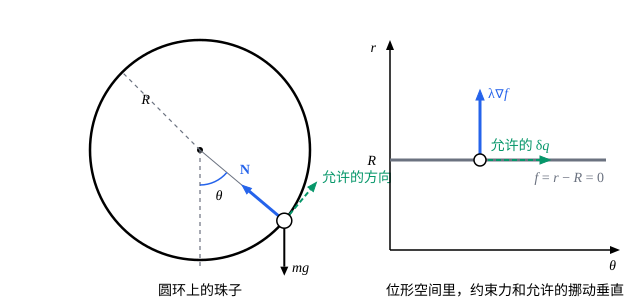

## 这一节要回答的问题

:term[拉格朗日方程]{id="physics.analytical-mechanics.lagrange-equations"}（Lagrange's equations）把:term[约束力]{id="physics.analytical-mechanics.constraint-force"}（constraint force）赶出了方程，这是它的好处。可有时候我们恰恰想知道约束力：绳子会不会断，珠子压在圆环上有多大的力，物体在什么位置离开曲面。能不能在拉格朗日方法里把约束力请回来，又不必回到牛顿定律去逐个分析？

## 讲解

### 多留一个坐标

单摆只用摆角$\theta$一个:term[广义坐标]{id="physics.analytical-mechanics.generalized-coordinates"}（generalized coordinates）时，绳子的拉力不会出现。换个做法：用极坐标$(r,\theta)$两个数描述摆球，「$r=l$」这个:term[约束]{id="physics.analytical-mechanics.constraint"}（constraint）不代进去，而是单独留着。这样沿$r$方向的拉力就有了出场的位置。

一般地，设系统用$m$个坐标$q_1,\dots,q_m$描述，它们已经满足其余的约束，只剩一个:term[完整约束]{id="physics.analytical-mechanics.holonomic-constraint"}（holonomic constraint）$f(q_1,\dots,q_m,t)=0$没有用掉，所以$m$比:term[自由度]{id="physics.analytical-mechanics.degrees-of-freedom"}（degrees of freedom）多一。:term[拉格朗日量]{id="physics.analytical-mechanics.lagrangian"}（Lagrangian）$L=T-V$照常用这$m$个坐标写出，不代入约束。记

$$
E_j=\dv{}{t}\frac{\partial L}{\partial\dot q_j}-\frac{\partial L}{\partial q_j},\qquad j=1,\dots,m .
$$

上一节从:term[达朗贝尔原理]{id="physics.analytical-mechanics.dalembert-principle"}（d'Alembert's principle）出发的推导，每一步都不要求坐标彼此独立，所以照样得到$\sum_jE_j\,\delta q_j=0$。只有最后一步「$\delta q_j$可以任意取，所以每个$E_j$为零」不再成立：:term[虚位移]{id="physics.analytical-mechanics.virtual-displacement"}（virtual displacement）要和约束相容，冻结时间后$\delta f=\sum_j\frac{\partial f}{\partial q_j}\delta q_j=0$。

### 乘子与约束力

把$E=(E_1,\dots,E_m)$和$a=\bigl(\frac{\partial f}{\partial q_1},\dots,\frac{\partial f}{\partial q_m}\bigr)$看成$m$维向量，设$a\ne0$。上面的条件是说：凡是和$a$垂直的$\delta q$，都和$E$垂直。取$\lambda=\frac{E\cdot a}{a\cdot a}$、$w=E-\lambda a$，则$w\cdot a=0$，所以$w$本身是一个允许的$\delta q$，于是$E\cdot w=0$；再由$a\cdot w=0$得$w\cdot w=(E-\lambda a)\cdot w=0$，即$w=0$。所以$E=\lambda a$。

::anchor{id="def-multiplier-equations"}
用$m$个坐标描述系统、保留一个:term[完整约束]{id="physics.analytical-mechanics.holonomic-constraint"}$f(q,t)=0$时，运动满足:term[带乘子的拉格朗日方程]{id="physics.analytical-mechanics.lagrange-equations-with-multipliers"}（Lagrange's equations with multipliers）：$\dv{}{t}\frac{\partial L}{\partial\dot q_j}-\frac{\partial L}{\partial q_j}=\lambda\frac{\partial f}{\partial q_j}$（$j=1,\dots,m$），再加上$f=0$。其中$\lambda(t)$叫作拉格朗日乘子（Lagrange multiplier），是和坐标一起要解的未知函数。

这是$m+1$个方程，解$q_1(t),\dots,q_m(t)$和$\lambda(t)$这$m+1$个未知函数。它和多变量微积分里的拉格朗日乘数法（method of Lagrange multipliers）是同一个道理：那里极值点处$\nabla F$和:term[约束]{id="physics.analytical-mechanics.constraint"}的梯度平行，这里$E$和$\nabla f$平行。

$\lambda$的意义要换个角度看。把约束$f=0$拿掉，换成它的:term[约束力]{id="physics.analytical-mechanics.constraint-force"}$\vb{R}_i$，当作:term[主动力]{id="physics.analytical-mechanics.applied-force"}（applied force）。这时系统多了一个:term[自由度]{id="physics.analytical-mechanics.degrees-of-freedom"}，$m$个坐标彼此独立，带:term[广义力]{id="physics.analytical-mechanics.generalized-force"}（generalized force）的:term[拉格朗日方程]{id="physics.analytical-mechanics.lagrange-equations"}是$E_j=\sum_i\vb{R}_i\cdot\frac{\partial\vb{r}_i}{\partial q_j}$。两种写法描述的是同一个运动，比较右边就知道约束力的广义力是多少。

::anchor{id="def-generalized-constraint-force"}
约束力的广义力$Q_j^{\mathrm{c}}=\sum_i\vb{R}_i\cdot\frac{\partial\vb{r}_i}{\partial q_j}$叫作:term[广义约束力]{id="physics.analytical-mechanics.generalized-constraint-force"}（generalized constraint force）。由上面的比较，$Q_j^{\mathrm{c}}=\lambda\frac{\partial f}{\partial q_j}$：解出乘子，约束力就知道了。

为什么约束力能这样写：:term[理想约束]{id="physics.analytical-mechanics.ideal-constraint"}（ideal constraint）的约束力不做:term[虚功]{id="physics.analytical-mechanics.virtual-work"}（virtual work），在:term[位形空间]{id="physics.analytical-mechanics.configuration-space"}（configuration space）里它和所有允许的挪动垂直，所以只能沿着$\nabla f$，未知的只是大小$\lambda$。约束的写法会改变$\lambda$而不改变力：把$f$换成$2f$，$\lambda$减半，$\lambda\frac{\partial f}{\partial q_j}$不变。反例：把$r=l$写成$(r-l)^2=0$，梯度在约束上处处为零，乘子项表示不了任何力，方法失效，所以$\nabla f$在约束上不能为零。

回到单摆。摆球在$(r\sin\theta,\,-r\cos\theta)$，$T=\frac12m(\dot r^2+r^2\dot\theta^2)$，$V=-mgr\cos\theta$，约束$f=r-l$。两个方程是

$$
m\ddot r-mr\dot\theta^2-mg\cos\theta=\lambda,\qquad \dv{}{t}\bigl(mr^2\dot\theta\bigr)+mgr\sin\theta=0 .
$$

代入$r=l$，第二式就是熟悉的单摆方程，第一式给出$\lambda=-ml\dot\theta^2-mg\cos\theta$。而$Q_r^{\mathrm{c}}=\vb{R}\cdot\frac{\partial\vb{r}}{\partial r}$是拉力沿$r$增大方向的分量，所以绳子向里拉，拉力是$-\lambda=ml\dot\theta^2+mg\cos\theta$。

### 几个约束与速度约束

保留$s$个:term[完整约束]{id="physics.analytical-mechanics.holonomic-constraint"}$f_1=\dots=f_s=0$时，方程是$E_j=\sum_k\lambda_k\frac{\partial f_k}{\partial q_j}$，每个:term[约束]{id="physics.analytical-mechanics.constraint"}一个乘子。证明和上面一样：设各约束的梯度$a^{(1)},\dots,a^{(s)}$线性无关，把$E$分解成$\sum_k\lambda_ka^{(k)}$加上和所有$a^{(k)}$都垂直的$w$；$w$是允许的$\delta q$，所以$E\cdot w=0$，从而$w\cdot w=0$。第$k$个乘子给出第$k$个约束的:term[约束力]{id="physics.analytical-mechanics.constraint-force"}。

乘子还能处理速度之间的约束。若约束是$\sum_ja_j(q,t)\,\dot q_j+a_0(q,t)=0$，冻结时间后允许的:term[虚位移]{id="physics.analytical-mechanics.virtual-displacement"}满足$\sum_ja_j\delta q_j=0$，同样的论证给出$E_j=\lambda a_j$。冰刀的约束积不成坐标之间的等式，没法靠选:term[广义坐标]{id="physics.analytical-mechanics.generalized-coordinates"}消掉，却可以这样处理：乘子就是冰面横着推冰刀的力。

## 几何图像

左图是竖直圆环上的珠子：允许的运动沿切线，光滑圆环的:term[约束力]{id="physics.analytical-mechanics.constraint-force"}沿半径，两者垂直。右图是同一件事在$(\theta,r)$平面里的样子：:term[约束]{id="physics.analytical-mechanics.constraint"}$f=r-R=0$是一条水平线，允许的$\delta q$沿着这条线，:term[广义约束力]{id="physics.analytical-mechanics.generalized-constraint-force"}$\lambda\nabla f$垂直于它，乘子$\lambda$只决定箭头有多长、朝哪边。

:::anim{component="function-plot"}
range: { x: [-3.2, 3.2], y: [-3.2, 5.4] }
functions:
  - expr: "3*cos(x) - 2*cos(a)"
    label: |
      $N/(mg)$
points:
  - { x: "a", y: "cos(a)" }
  - { x: "-a", y: "cos(a)" }
  - { x: "acos(2*cos(a)/3)", y: "0" }
  - { x: "-acos(2*cos(a)/3)", y: "0" }
sliders:
  - name: a
    min: 0.2
    max: 3.1
    step: 0.05
    default: 2.5
    label: |
      释放角$\theta_0$
:::

这是例 1 的结果：珠子从$\theta_0$处由静止释放，圆环对它的力指向圆心的分量$N=mg(3\cos\theta-2\cos\theta_0)$随位置$\theta$（横轴）的变化。珠子只在两个端点$\pm\theta_0$之间来回，只有这一段曲线会真的走到；另外两个点是$N=0$的位置。拖动$\theta_0$：释放角超过$\frac{\pi}{2}$后，$N=0$的点落进运动范围，珠子在高处时圆环要往外推它。

## 例题

### 例 1　圆环上的珠子

质量$m$的珠子套在半径$R$的光滑竖直圆环上，从和最低点成$\theta_0$角的位置由静止释放。求珠子在$\theta$处时圆环对它的力，以及这个力在哪里变向。

**为什么想到这么做**：要求的正是:term[约束力]{id="physics.analytical-mechanics.constraint-force"}，所以不用一个坐标，而用极坐标$(r,\theta)$，把$f=r-R=0$留下来，配一个乘子。$f$对$r$的梯度是$1$，乘子直接就是约束力沿半径向外的分量。

**推导**：原点取在圆心，珠子在$(r\sin\theta,\,-r\cos\theta)$，$L=\frac12m(\dot r^2+r^2\dot\theta^2)+mgr\cos\theta$。:term[带乘子的拉格朗日方程]{id="physics.analytical-mechanics.lagrange-equations-with-multipliers"}是

$$
m\ddot r-mr\dot\theta^2-mg\cos\theta=\lambda,\qquad mr^2\ddot\theta+2mr\dot r\dot\theta+mgr\sin\theta=0 .
$$

代入$r=R$：第二式成为$R\ddot\theta=-g\sin\theta$，乘以$\dot\theta$后对时间积分，得$\frac12R\dot\theta^2-g\cos\theta=-g\cos\theta_0$，即$R\dot\theta^2=2g(\cos\theta-\cos\theta_0)$。第一式给出

$$
\lambda=-mR\dot\theta^2-mg\cos\theta=-mg(3\cos\theta-2\cos\theta_0).
$$

$\lambda$是沿半径向外的分量，所以圆环对珠子的力指向圆心的分量是$N=-\lambda=mg(3\cos\theta-2\cos\theta_0)$。在最低点$N=mg(3-2\cos\theta_0)$，从顶点附近出发时接近$5mg$。$N$在$\cos\theta=\frac23\cos\theta_0$处变号；释放角$\theta_0>\frac{\pi}{2}$时这个位置在运动范围内，珠子在比它更高的地方时，圆环要往外推它。

### 例 2　从光滑半球顶上滑下的质点

质点从固定的光滑半球（半径$R$）的顶点附近由静止滑下。它在哪里离开球面？

**为什么想到这么做**：球面只能往外推，不能往里拉，这是不等式:term[约束]{id="physics.analytical-mechanics.constraint"}$r\ge R$。先当作$r=R$配一个乘子，解出:term[约束力]{id="physics.analytical-mechanics.constraint-force"}；只要它是往外推的，质点就留在球面上，它变成零的那一刻就是离开的位置。

**推导**：取球心为原点，$\theta$从竖直向上的方向量起，质点在$(r\sin\theta,\ r\cos\theta)$，$L=\frac12m(\dot r^2+r^2\dot\theta^2)-mgr\cos\theta$，$f=r-R$。$r$的方程是$m\ddot r-mr\dot\theta^2+mg\cos\theta=\lambda$，在球面上$\lambda=mg\cos\theta-mR\dot\theta^2$。$\theta$的方程在$r=R$时是$R\ddot\theta=g\sin\theta$，同样乘以$\dot\theta$积分，从顶点静止出发得$R\dot\theta^2=2g(1-\cos\theta)$。于是

$$
\lambda=mg(3\cos\theta-2).
$$

$\lambda$是球面沿半径向外推质点的力，$\cos\theta>\frac23$时为正；到$\cos\theta=\frac23$（$\theta\approx48.2^\circ$）时变成零，再往下就要求球面往里拉，这做不到，所以质点在这里离开球面，以后约束不再起作用。

## 常见误区

- 「乘子$\lambda$就是:term[约束力]{id="physics.analytical-mechanics.constraint-force"}的大小。」$\lambda\frac{\partial f}{\partial q_j}$才是:term[广义约束力]{id="physics.analytical-mechanics.generalized-constraint-force"}；把$f$换成$2f$，$\lambda$减半，力不变。只有像$f=r-R$对$r$这样梯度为$1$的写法，$\lambda$才直接是力的分量。
- 「:term[约束]{id="physics.analytical-mechanics.constraint"}$r=R$也可以写成$(r-R)^2=0$。」这样$\nabla f$在约束上处处为零，乘子项表示不了任何力，方法失效。
- 「用了乘子还要把约束代进$L$里。」不代：$L$用全部$m$个坐标写，:term[约束]{id="physics.analytical-mechanics.constraint"}只出现在乘子项和$f=0$这个方程里，解方程时才用$f=0$化简。
- 「不等式约束不能用乘子。」可以：先当作等式解，看$\lambda$的符号；$\lambda$变号的地方，就是物体离开约束面的地方。
