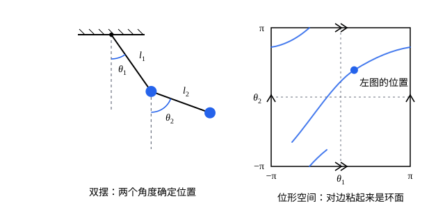

## 这一节要回答的问题

用牛顿定律算单摆，要写摆球的两个坐标$x$、$y$，还要带上大小未知的绳子拉力。可摆球明明只能沿着圆弧走，一个摆角$\theta$就说清了它在哪里。一般的系统里，物体被绳、杆、轨道互相牵制，到底要几个数才能确定它的位置？这几个数又该怎么挑，才能让那些大小未知的力不再出现在方程里？

## 讲解

### 约束：事先规定好的条件

先看几个例子。单摆的摆球拴在长$l$的轻绳上，在竖直平面里运动，取悬点为原点，它的坐标时刻满足$x^2+y^2=l^2$。斜面上的滑块贴着斜面走，坐标满足$y=x\tan\alpha$。刚体里任意两个质点之间的距离不变：$|\vb{r}_i-\vb{r}_j|=c_{ij}$。

::anchor{id="def-constraint"}
系统里各质点的位置（有时还有速度）事先必须满足的条件，叫作:term[约束]{id="physics.analytical-mechanics.constraint"}（constraint）。维持约束的力叫作:term[约束力]{id="physics.analytical-mechanics.constraint-force"}（constraint force），例如绳子的拉力、斜面的支持力、刚体内部质点之间的作用力。

为什么这样定义：约束力事先不知道大小，要等运动解出来才算得出，在受力分析里它总是多出来的未知数。可它产生的效果事先是知道的：不管绳子的拉力多大，摆球总在圆周上。用事先知道的条件代替事先不知道的力，是这一节的出发点。

### 完整约束与非完整约束

:term[约束]{id="physics.analytical-mechanics.constraint"}不一定是位置之间的等式。圆柱在水平直线上纯滚动（接触点不打滑）时，圆柱中心前进的距离等于边缘转过的弧长，写成速度之间的关系是$\dot x=R\dot\varphi$，其中$\varphi$是圆柱转过的角度。这个关系能积分：两边对时间积分得$x-R\varphi=C$，又变回了坐标之间的等式。冰刀在冰面上只能沿刀刃的方向滑，不能横着走：设刀的中点在$(x,y)$、刀刃和$x$轴的夹角是$\theta$，条件是$\dot x\sin\theta-\dot y\cos\theta=0$，例 2 会说明它怎么也积不成坐标之间的等式。

::anchor{id="def-holonomic"}
能写成各质点坐标和时间之间的等式$f(\vb{r}_1,\dots,\vb{r}_N,t)=0$的约束，叫作:term[完整约束]{id="physics.analytical-mechanics.holonomic-constraint"}（holonomic constraint）；不能写成这种形式的，叫作:term[非完整约束]{id="physics.analytical-mechanics.nonholonomic-constraint"}（nonholonomic constraint）。单摆、斜面、刚体和直线上的纯滚动都是完整约束，冰刀的约束是非完整约束。

为什么这样分：每个完整约束都能用来解出一个坐标，要描述的量就少一个；非完整约束只限制速度的方向，不能用来减少坐标。不等式也不是等式：放在光滑球面外侧的质点只能保证$r\ge R$，这也是非完整约束。它在质点离开球面之前可以当作$r=R$处理，离开以后就不起作用了。

### 定常约束与非定常约束

把一颗珠子套在光滑的直铁丝上，铁丝在水平面内绕它的一端以角速度$\omega$匀速转动。取转轴为原点，珠子的坐标满足$y=x\tan\omega t$，:term[约束]{id="physics.analytical-mechanics.constraint"}本身在随时间变化。悬点上下振动的单摆也是这样：悬点在$(0,\,a\cos\Omega t)$时，摆球满足$x^2+(y-a\cos\Omega t)^2=l^2$。

::anchor{id="def-scleronomic"}
约束的等式里不显含时间的，叫作:term[定常约束]{id="physics.analytical-mechanics.scleronomic-constraint"}（scleronomic constraint）；显含时间的，叫作:term[非定常约束]{id="physics.analytical-mechanics.rheonomic-constraint"}（rheonomic constraint）。

为什么要区分：光滑的定常约束面不动，质点的速度沿着约束面，:term[约束力]{id="physics.analytical-mechanics.constraint-force"}垂直于约束面，所以不做功。转动的铁丝却一直推着珠子转，铁丝对珠子的力和珠子的速度不垂直，会做功；讨论能量守恒时，这个区别会变得要紧。这两种分法互不相干：转动铁丝的约束是:term[完整约束]{id="physics.analytical-mechanics.holonomic-constraint"}，同时是非定常约束。

### 自由度

平面单摆的摆球有两个坐标$x$、$y$，一个:term[约束]{id="physics.analytical-mechanics.constraint"}$x^2+y^2=l^2$把它们捆在一起，只剩一个能独立变化的量。再看三维空间里的刚体：先取不在一条直线上的三个质点$A$、$B$、$C$，它们的 9 个坐标受 3 个距离约束，剩下 6 个能独立变化的量。刚体里别的质点$P$有 3 个坐标，又要满足到$A$、$B$、$C$的 3 个距离约束，这 3 个距离已经把$P$定死了（只差关于平面$ABC$的镜像，而刚体连续运动时$P$不会跳到镜像的位置去）。所以每多一个质点，坐标和约束都多 3 个，能独立变化的量始终是 6 个。

::anchor{id="def-dof"}
由$N$个质点组成、受$k$个相互独立的:term[完整约束]{id="physics.analytical-mechanics.holonomic-constraint"}的系统，:term[自由度]{id="physics.analytical-mechanics.degrees-of-freedom"}（degrees of freedom）是$n=3N-k$，也就是确定系统的位置所需的独立坐标的个数。所有质点都在同一个平面内运动时，把$3N$换成$2N$。

为什么强调「相互独立」：能由别的约束推出来的约束，不能再减一次。平面上四个质点连成刚性的正方形，四条边和两条对角线一共 6 个距离约束，但四条边加一条对角线已经把形状定死，第二条对角线的长度是推出来的。所以它的自由度是$2\times4-5=3$（平移两个方向，再转一个角度），而不是$8-6=2$。

:term[非完整约束]{id="physics.analytical-mechanics.nonholonomic-constraint"}不在这个式子里：它不能用来解出任何一个坐标。冰刀受了约束，确定它的位置仍要$x$、$y$、$\theta$三个数。

### 广义坐标

单摆用摆角$\theta$（从竖直向下的方向量起），取$y$轴竖直向上，摆球在$x=l\sin\theta$、$y=-l\cos\theta$；双摆用两个摆角$\theta_1$、$\theta_2$。转动铁丝上的珠子用它到转轴的距离$s$：$x=s\cos\omega t$，$y=s\sin\omega t$。这几种写法有个共同点：不管$\theta$或$s$取什么值，:term[约束]{id="physics.analytical-mechanics.constraint"}都自动满足。

::anchor{id="def-generalized-coordinates"}
能唯一确定系统的位置、彼此独立、个数等于:term[自由度]{id="physics.analytical-mechanics.degrees-of-freedom"}$n$的一组数$q_1,\dots,q_n$，叫作:term[广义坐标]{id="physics.analytical-mechanics.generalized-coordinates"}（generalized coordinates）。每个质点的位置都写成它们和时间的函数$\vb{r}_i=\vb{r}_i(q_1,\dots,q_n,t)$，并且对任意的$q_1,\dots,q_n$，约束都自动成立。

为什么这样定义：用了广义坐标，约束就被「吃掉」了，每个$q_j$都能随意变化而不破坏约束，后面推导运动方程全靠这一点。广义坐标不必是长度，角度、甚至几个角度的组合都可以；有:term[非定常约束]{id="physics.analytical-mechanics.rheonomic-constraint"}时$\vb{r}_i$显含$t$，比如转动铁丝上的珠子。反例：单摆只用$x$不行，同一个$x$对应圆周上$y=\pm\sqrt{l^2-x^2}$上下两个位置；用$\theta$和$x$两个数也不行，它们不独立。

::anchor{id="def-configuration-space"}
广义坐标所有可能取值组成的空间，叫作:term[位形空间]{id="physics.analytical-mechanics.configuration-space"}（configuration space）。系统的每一个位置是位形空间里的一个点，系统的运动是位形空间里的一条曲线。

单摆的位形空间是一个圆：$\theta$和$\theta+2\pi$是同一个位置。双摆的位形空间要用两个摆角，下面的几何图像画出了它的样子。

## 几何图像

左边是双摆，两个摆角$\theta_1$、$\theta_2$确定了两个摆球的位置。右边是它的:term[位形空间]{id="physics.analytical-mechanics.configuration-space"}：横轴是$\theta_1$、纵轴是$\theta_2$，都从$-\pi$到$\pi$，左图的位置就是右图里的那个点。$\theta=-\pi$和$\theta=\pi$是同一个角度，所以正方形左右两边要粘在一起，上下两边也要粘在一起（箭头一样的两条边粘起来），粘出来是一个环面：右图的曲线从右边出去，又从左边进来。

## 例题

### 例 1　滑块下面挂着的摆

质量$M$的滑块在光滑的水平导轨上滑动，下面用长$l$的轻杆挂着质量$m$的摆球，摆在竖直平面内摆动。数出这个系统的:term[自由度]{id="physics.analytical-mechanics.degrees-of-freedom"}，选好:term[广义坐标]{id="physics.analytical-mechanics.generalized-coordinates"}，写出滑块和摆球的位置。

**为什么想到这么做**：先数坐标、再数:term[约束]{id="physics.analytical-mechanics.constraint"}。滑块和摆球都在一个竖直平面里，各有 2 个坐标，导轨和轻杆各给一个约束，剩下 2 个独立的量。最自然的选择是滑块的位置和摆的角度：它们一定，别的坐标就跟着定了。

**推导**：取导轨为$x$轴，$y$轴竖直向上。滑块的坐标$(x_1,y_1)$和摆球的坐标$(x_2,y_2)$一共 4 个，满足两个相互独立的约束

$$
y_1=0,\qquad (x_2-x_1)^2+(y_2-y_1)^2=l^2 ,
$$

所以自由度是$2\times2-2=2$。取滑块的位置$x$和摆杆偏离竖直向下方向的角度$\theta$为广义坐标，则

$$
\vb{r}_1=(x,\ 0),\qquad \vb{r}_2=(x+l\sin\theta,\ -l\cos\theta).
$$

代回去检验：对任意的$x$和$\theta$，$y_1=0$成立，$(x_2-x_1)^2+(y_2-y_1)^2=l^2\sin^2\theta+l^2\cos^2\theta=l^2$也成立。

### 例 2　冰刀的约束积不出来

冰刀在冰面上滑行，用刀的中点$(x,y)$和刀刃与$x$轴的夹角$\theta$描述它的位置，刀刃只能沿着自己的方向走：

$$
\dot x\sin\theta-\dot y\cos\theta=0 .
$$

说明这是:term[非完整约束]{id="physics.analytical-mechanics.nonholonomic-constraint"}：找不到不是常数的函数$f(x,y,\theta)$，使冰刀按这个条件怎么滑，$f$都保持不变。

**为什么想到这么做**：如果:term[约束]{id="physics.analytical-mechanics.constraint"}能写成坐标之间的等式$f(x,y,\theta)=C$，冰刀就只能待在$(x,y,\theta)$空间里的一张曲面上，到不了曲面外面的位置。所以只要找到一种滑法，能从任意位置到达任意位置，这样的曲面就不存在。滑冰的人都知道怎么做：原地转身，顺着刀刃直滑，再转身。

**推导**：设冰刀从$(x_0,y_0,\theta_0)$出发，要到$(x_1,y_1,\theta_1)$。第一步原地转到正对点$(x_1,y_1)$的方向$\theta^*$，这时$\dot x=\dot y=0$，约束成立。第二步顺着$\theta^*$方向直滑到$(x_1,y_1)$，速度$(\dot x,\dot y)$平行于$(\cos\theta^*,\sin\theta^*)$，代进去得$\dot x\sin\theta^*-\dot y\cos\theta^*=0$，约束也成立。第三步原地转到$\theta_1$。

于是任意两个位置之间都有满足约束的运动。如果有函数$f(x,y,\theta)$沿所有满足约束的运动都不变，它在所有位置上就取同一个值，只能是常数。所以冰刀的约束不能写成坐标之间的等式：它只限制了速度的方向，没有减少确定位置所需的坐标。

## 常见误区

- 「:term[约束]{id="physics.analytical-mechanics.constraint"}越多，:term[自由度]{id="physics.analytical-mechanics.degrees-of-freedom"}越少。」只有相互独立的约束才各减一个自由度，刚性正方形的第二条对角线就是多余的。
- 「弹簧也是约束。」弹簧的长度会变，它给的是随位置变化的已知的力，不是事先规定好的条件；连上弹簧不改变自由度。
- 「速度之间的约束都是:term[非完整约束]{id="physics.analytical-mechanics.nonholonomic-constraint"}。」要看能不能积分：直线上的纯滚动$\dot x=R\dot\varphi$能积成$x-R\varphi=C$，是:term[完整约束]{id="physics.analytical-mechanics.holonomic-constraint"}。
- 「有了:term[广义坐标]{id="physics.analytical-mechanics.generalized-coordinates"}，质点的位置就不显含时间。」有:term[非定常约束]{id="physics.analytical-mechanics.rheonomic-constraint"}时$\vb{r}_i$显含$t$，例如转动铁丝上的珠子$x=s\cos\omega t$。
