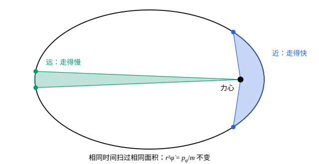

## 这一节要回答的问题

在讲:term[拉格朗日方程]{id="physics.analytical-mechanics.lagrange-equations"}（Lagrange's equations）时的例 1 里，光滑地面上的斜面和滑块，$L$不含斜面的位置$X$，$X$的方程直接告诉我们$(M+m)\dot X+m\cos\alpha\,\dot s$不随时间变。这不是巧合。:term[拉格朗日量]{id="physics.analytical-mechanics.lagrangian"}（Lagrangian）里缺了哪个坐标，就白送一个守恒量：这个量是什么，怎么用它把问题化简？

## 讲解

### 广义动量

先看两个例子。自由质点用直角坐标，$L=\frac12m(\dot x^2+\dot y^2+\dot z^2)$，$\frac{\partial L}{\partial\dot x}=m\dot x$，正是动量的$x$分量。平面上的质点用极坐标，$L=\frac12m(\dot r^2+r^2\dot\varphi^2)-V(r)$，$\frac{\partial L}{\partial\dot\varphi}=mr^2\dot\varphi$；由$x=r\cos\varphi$、$y=r\sin\varphi$可以验证$m(x\dot y-y\dot x)=mr^2\dot\varphi$，这是角动量的$z$分量。

::anchor{id="def-generalized-momentum"}
:term[拉格朗日量]{id="physics.analytical-mechanics.lagrangian"}对:term[广义速度]{id="physics.analytical-mechanics.generalized-velocity"}（generalized velocity）的偏导数$p_j=\frac{\partial L}{\partial\dot q_j}$，叫作和:term[广义坐标]{id="physics.analytical-mechanics.generalized-coordinates"}（generalized coordinates）$q_j$对应的:term[广义动量]{id="physics.analytical-mechanics.generalized-momentum"}（generalized momentum），也叫和$q_j$共轭的动量。

为什么这样定义：有了它，:term[拉格朗日方程]{id="physics.analytical-mechanics.lagrange-equations"}写成$\dot p_j=\frac{\partial L}{\partial q_j}$，和牛顿定律「动量的变化率等于力」一个样子，$\frac{\partial L}{\partial q_j}$扮演力的角色。可广义动量不一定是质量乘速度：坐标是角度时它是角动量，坐标互相耦合时还会混进别的速度，斜面例子里$p_X=(M+m)\dot X+m\cos\alpha\,\dot s$。它的量纲随坐标而变，和$q_j$相乘总是能量乘时间的量纲。

### 循环坐标

::anchor{id="def-cyclic-coordinate"}
:term[拉格朗日量]{id="physics.analytical-mechanics.lagrangian"}不显含某个:term[广义坐标]{id="physics.analytical-mechanics.generalized-coordinates"}$q_j$（只含它的:term[广义速度]{id="physics.analytical-mechanics.generalized-velocity"}$\dot q_j$）时，$q_j$叫作:term[循环坐标]{id="physics.analytical-mechanics.cyclic-coordinate"}（cyclic coordinate），也叫可遗坐标（ignorable coordinate）。

定理：$q_j$是循环坐标，则$p_j$守恒。证明只要一行：$\frac{\partial L}{\partial q_j}=0$，所以:term[拉格朗日方程]{id="physics.analytical-mechanics.lagrange-equations"}给出$\dot p_j=0$。斜面例子里$X$是循环坐标，守恒的$p_X=M\dot X+m(\dot X+\dot s\cos\alpha)$正是两个物体水平方向的总动量：光滑地面不给水平方向的外力。

为什么叫「循环」：最典型的例子是转角$\varphi$，它转一圈回到原处，$L$里却只出现$\dot\varphi$。要注意，判断的是$L$整个不含$q_j$：极坐标里的$r$虽然可能不在势能里，却在动能$\frac12mr^2\dot\varphi^2$里，所以不是循环坐标。而且一个坐标是不是循环坐标，取决于坐标怎么选：自由质点用直角坐标时$x$、$y$都是循环坐标，换成极坐标就只剩$\varphi$了（例 2 还有一个反过来的例子）。

### 有心力：守恒的角动量与降阶

质点在有心力场里运动，势能$V(r)$只和到力心的距离有关。轨道在一个平面内，用极坐标，

$$
L=\frac12m\bigl(\dot r^2+r^2\dot\varphi^2\bigr)-V(r).
$$

$\varphi$是:term[循环坐标]{id="physics.analytical-mechanics.cyclic-coordinate"}，所以$p_\varphi=mr^2\dot\varphi$守恒，这就是角动量守恒。它还有一个几何意义：质点和力心的连线在$\dd t$时间里扫过的面积是$\frac12r^2\dot\varphi\,\dd t$，所以单位时间扫过的面积$\frac{p_\varphi}{2m}$不变，这正是开普勒第二定律（Kepler's second law）。

守恒量还能把两个:term[自由度]{id="physics.analytical-mechanics.degrees-of-freedom"}（degrees of freedom）的问题降成一个。$r$的方程是$m\ddot r-mr\dot\varphi^2+V'(r)=0$，把$\dot\varphi=\frac{p_\varphi}{mr^2}$代进去：

$$
m\ddot r=-V'(r)+\frac{p_\varphi^2}{mr^3}=-\dv{}{r}\Bigl[V(r)+\frac{p_\varphi^2}{2mr^2}\Bigr].
$$

$r$就像一个一维运动的质点，势能换成了有效势（effective potential）$V(r)+\frac{p_\varphi^2}{2mr^2}$。多出来的一项随$r$减小而急剧增大，像一堵墙：只要$p_\varphi\ne0$，而且$V$在$r\to0$时比$\frac{1}{r^2}$平缓（引力就是这样），质点就到不了力心。解出$r(t)$以后，再由$\dot\varphi=\frac{p_\varphi}{mr^2}$积分得到$\varphi(t)$。

注意要把$\dot\varphi$代进运动方程，不能先代进$L$再求导。若把$\dot\varphi=\frac{p_\varphi}{mr^2}$代进$L$，得到$\frac12m\dot r^2+\frac{p_\varphi^2}{2mr^2}-V$，对它写方程会得到$m\ddot r=-V'-\frac{p_\varphi^2}{mr^3}$，第二项的符号错了。原因是$\frac{\partial L}{\partial r}$是在$\dot\varphi$不变时求的，而代入以后变成了在$p_\varphi$不变时求。

## 几何图像

图里是平方反比引力下的一条椭圆轨道，力心在一个焦点上。两块阴影是质点在相同时间里扫过的面积：近处那块又短又宽，远处那块又长又窄，面积相等。这就是$\varphi$为:term[循环坐标]{id="physics.analytical-mechanics.cyclic-coordinate"}带来的守恒量$p_\varphi=mr^2\dot\varphi$：离得近就转得快，离得远就转得慢。

:::anim{component="function-plot"}
range: { x: [0, 5], y: [-2, 1.6] }
functions:
  - expr: "-1/x"
    label: |
      $V=-\frac{k}{r}$
  - expr: "p^2/(2*x^2)"
    label: |
      $\frac{p_\varphi^2}{2mr^2}$
  - expr: "-1/x + p^2/(2*x^2)"
    label: |
      有效势
sliders:
  - name: p
    min: 0
    max: 1.6
    step: 0.05
    default: 0.8
    label: |
      $p_\varphi$
:::

第二张图是降阶以后$r$感受到的有效势，取引力势能$V=-\frac{k}{r}$，单位取成$m=k=1$，横轴是$r$。拖动$p_\varphi$：它越大，靠近力心处的「墙」越高，有效势的最低点（圆轨道的半径）越往外；$p_\varphi=0$时墙消失，质点会直直落向力心。

## 例题

### 例 1　圆锥摆

球面摆的摆球在以悬点为中心、半径$l$的球面上运动。它能不能以恒定的摆角$\theta_0$绕竖直轴转圈？如果能，角速度是多少？

**为什么想到这么做**：球面摆绕竖直轴转动对称，方位角$\varphi$应当是:term[循环坐标]{id="physics.analytical-mechanics.cyclic-coordinate"}，对应的:term[广义动量]{id="physics.analytical-mechanics.generalized-momentum"}守恒。用它从$\theta$的方程里消去$\dot\varphi$，剩下一个只含$\theta$的方程，再找$\theta$不变的解。

**推导**：取悬点为原点、$z$轴竖直向上，摆球在$(l\sin\theta\cos\varphi,\ l\sin\theta\sin\varphi,\ -l\cos\theta)$，速度的平方是$l^2(\dot\theta^2+\sin^2\theta\,\dot\varphi^2)$，所以

$$
L=\frac12ml^2\bigl(\dot\theta^2+\sin^2\theta\,\dot\varphi^2\bigr)+mgl\cos\theta .
$$

$\varphi$是循环坐标，$p_\varphi=ml^2\sin^2\theta\,\dot\varphi$守恒，它是绕竖直轴的角动量。$\theta$的方程是$ml^2\ddot\theta-ml^2\sin\theta\cos\theta\,\dot\varphi^2+mgl\sin\theta=0$。令$\theta\equiv\theta_0$（$0<\theta_0<\frac{\pi}{2}$），$\ddot\theta=0$，得

$$
\dot\varphi^2=\frac{g}{l\cos\theta_0}.
$$

所以能，角速度$\dot\varphi=\sqrt{g/(l\cos\theta_0)}$，而$p_\varphi$守恒保证$\dot\varphi$确实不变。$\theta_0\to0$时它趋于$\sqrt{g/l}$，正是小角度单摆的角频率。

### 例 2　换一组坐标，循环坐标才露出来

光滑地面上的斜面（质量$M$、倾角$\alpha$）和滑块（质量$m$），这次用滑块的水平坐标$x$和斜面的位置$X$作:term[广义坐标]{id="physics.analytical-mechanics.generalized-coordinates"}。说明这时两个坐标都不是:term[循环坐标]{id="physics.analytical-mechanics.cyclic-coordinate"}，再找一组坐标让循环坐标露出来。

**为什么想到这么做**：守恒的水平总动量不会因为换坐标而消失，消失的只是「循环」这个标志。两个物体一起水平平移，滑块相对斜面的位置不变，势能也不变；所以应当让一个坐标专门描述「一起平移」，另一个描述相对位置。

**推导**：滑块在斜面上，比斜面顶端低$(x-X)\tan\alpha$，速度是$\bigl(\dot x,\ -(\dot x-\dot X)\tan\alpha\bigr)$，所以

$$
L=\frac12M\dot X^2+\frac12m\bigl[\dot x^2+(\dot x-\dot X)^2\tan^2\alpha\bigr]+mg(x-X)\tan\alpha .
$$

$x$和$X$都在势能里出现，都不是循环坐标。改用相对坐标$u=x-X$和水平方向的质心坐标$X_{\mathrm{c}}=\frac{MX+mx}{M+m}$，则$\dot X=\dot X_{\mathrm{c}}-\frac{m}{M+m}\dot u$，$\dot x=\dot X_{\mathrm{c}}+\frac{M}{M+m}\dot u$，代进去交叉项相消：

$$
L=\frac12(M+m)\dot X_{\mathrm{c}}^2+\frac12\Bigl(\frac{Mm}{M+m}+m\tan^2\alpha\Bigr)\dot u^2+mgu\tan\alpha .
$$

$X_{\mathrm{c}}$是循环坐标，$p_{X_{\mathrm{c}}}=(M+m)\dot X_{\mathrm{c}}=M\dot X+m\dot x$守恒，还是水平方向的总动量。

## 常见误区

- 「:term[广义动量]{id="physics.analytical-mechanics.generalized-momentum"}就是$m\dot q$。」坐标是角度时它是角动量；坐标耦合时还混进别的速度，如斜面例子的$p_X=(M+m)\dot X+m\cos\alpha\,\dot s$。
- 「势能里不含$q_j$，$q_j$就是:term[循环坐标]{id="physics.analytical-mechanics.cyclic-coordinate"}。」要整个$L$不含$q_j$；极坐标的$r$在动能$\frac12mr^2\dot\varphi^2$里。
- 「把守恒量代进$L$，就得到少一个坐标的:term[拉格朗日量]{id="physics.analytical-mechanics.lagrangian"}。」直接代入会把有效势里那一项的符号弄反，要代进运动方程。
- 「找不到循环坐标，就没有守恒量。」循环坐标依赖坐标的选择，换一组坐标可能就有了（例 2）；能量守恒也不是从循环坐标来的，讲:term[能量函数]{id="physics.analytical-mechanics.energy-function"}（energy function）的那一节专门讲它。
