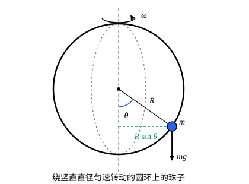

## 这一节要回答的问题

上一节的守恒量来自:term[拉格朗日量]{id="physics.analytical-mechanics.lagrangian"}（Lagrangian）里缺了某个坐标。最常用的守恒量是能量，它又来自哪里？转动铁丝上的珠子越甩越快，动能一直在增加，这时还有没有什么量守恒？在拉格朗日力学里，什么时候可以放心地用「动能加势能不变」？

## 讲解

### 能量函数

沿着一个运动，算一算:term[拉格朗日量]{id="physics.analytical-mechanics.lagrangian"}$L(q,\dot q,t)$随时间怎么变。由链式法则

$$
\dv{L}{t}=\sum_j\Bigl(\frac{\partial L}{\partial q_j}\dot q_j+\frac{\partial L}{\partial\dot q_j}\ddot q_j\Bigr)+\frac{\partial L}{\partial t}.
$$

记:term[广义动量]{id="physics.analytical-mechanics.generalized-momentum"}（generalized momentum）$p_j=\frac{\partial L}{\partial\dot q_j}$，:term[拉格朗日方程]{id="physics.analytical-mechanics.lagrange-equations"}（Lagrange's equations）说$\frac{\partial L}{\partial q_j}=\dot p_j$，于是括号里是$\dot p_j\dot q_j+p_j\ddot q_j=\dv{}{t}(p_j\dot q_j)$。移项得

$$
\dv{}{t}\Bigl(\sum_j p_j\dot q_j-L\Bigr)=-\frac{\partial L}{\partial t}.
$$

::anchor{id="def-energy-function"}
$h(q,\dot q,t)=\sum_j p_j\dot q_j-L=\sum_j\dot q_j\frac{\partial L}{\partial\dot q_j}-L$叫作系统的:term[能量函数]{id="physics.analytical-mechanics.energy-function"}（energy function）。沿着运动$\dv{h}{t}=-\frac{\partial L}{\partial t}$，所以$L$不显含时间时，$h$守恒。

为什么这样定义：$h$是专门配合「时间」的量，正像$p_j$配合$q_j$：$L$不含$q_j$，$p_j$就守恒；$L$不显含$t$，$h$就守恒。注意$\frac{\partial L}{\partial t}$只管$L$里明写的$t$，沿运动通过$q(t)$、$\dot q(t)$带来的变化不算。有不保守的:term[主动力]{id="physics.analytical-mechanics.applied-force"}（applied force）时，把它们的:term[广义力]{id="physics.analytical-mechanics.generalized-force"}（generalized force）$Q_j'$放在拉格朗日方程右边，同样的推导给出$\dv{h}{t}=\sum_jQ_j'\dot q_j-\frac{\partial L}{\partial t}$，第一项是这些力的功率。

### 什么时候 h 等于机械能

先把动能按:term[广义速度]{id="physics.analytical-mechanics.generalized-velocity"}（generalized velocity）的次数分开。质点的速度是$\dot{\vb{r}}_i=\sum_k\frac{\partial\vb{r}_i}{\partial q_k}\dot q_k+\frac{\partial\vb{r}_i}{\partial t}$，平方以后

$$
T=\underbrace{\frac12\sum_{j,k}a_{jk}\dot q_j\dot q_k}_{T_2}+\underbrace{\sum_jb_j\dot q_j}_{T_1}+\underbrace{\frac12\sum_im_i\Bigl|\frac{\partial\vb{r}_i}{\partial t}\Bigr|^2}_{T_0},
$$

其中$a_{jk}=\sum_im_i\frac{\partial\vb{r}_i}{\partial q_j}\cdot\frac{\partial\vb{r}_i}{\partial q_k}=a_{kj}$，$b_j=\sum_im_i\frac{\partial\vb{r}_i}{\partial q_j}\cdot\frac{\partial\vb{r}_i}{\partial t}$，它们只含$q$和$t$。

$T_2$、$T_1$、$T_0$分别是$\dot q$的二次、一次、零次式，直接计算：$\frac{\partial T_2}{\partial\dot q_j}=\sum_ka_{jk}\dot q_k$（用了$a_{jk}=a_{kj}$），所以$\sum_j\dot q_j\frac{\partial T_2}{\partial\dot q_j}=2T_2$；同理$\sum_j\dot q_j\frac{\partial T_1}{\partial\dot q_j}=T_1$，而$T_0$不含$\dot q$。势能$V$不含速度时，代进$h$的定义：

$$
h=(2T_2+T_1)-(T_2+T_1+T_0-V)=T_2-T_0+V .
$$

如果:term[约束]{id="physics.analytical-mechanics.constraint"}（constraint）都是:term[定常约束]{id="physics.analytical-mechanics.scleronomic-constraint"}（scleronomic constraint），可以选$\vb{r}_i$不显含$t$的:term[广义坐标]{id="physics.analytical-mechanics.generalized-coordinates"}（generalized coordinates），这时$\frac{\partial\vb{r}_i}{\partial t}=0$，$T_1=T_0=0$，$T=T_2$，于是$h=T+V=E$，正是机械能。

所以「$h$守恒吗」和「$h$等于机械能吗」是两个独立的问题。前一个只看$L$显不显含$t$；后一个看$\vb{r}_i(q,t)$显不显含$t$（约束定常时总能把坐标选得不显含）、势能是不是只依赖位置。两个条件都满足，就有熟悉的机械能守恒；只满足前一个时，$h$守恒，但一般不是机械能，机械能一般也不守恒，例外见 p5：自由质点用转动坐标写，$h$守恒、不等于机械能，而机械能本身也守恒。

以转动铁丝上的珠子为例，$L=\frac12m(\dot s^2+s^2\omega^2)$不显含$t$，所以

$$
h=\dot s\frac{\partial L}{\partial\dot s}-L=\frac12m\dot s^2-\frac12ms^2\omega^2
$$

守恒，它正是$T_2-T_0$。机械能$E=T=h+ms^2\omega^2$却随着珠子被甩远而增加：:term[非定常约束]{id="physics.analytical-mechanics.rheonomic-constraint"}（rheonomic constraint）推着珠子转，一直在做功。

## 几何图像

竖直的光滑圆环绕竖直直径以恒定的角速度$\omega$转动，珠子套在环上，$\theta$从最低点量起。这是例 1 的系统：:term[约束]{id="physics.analytical-mechanics.constraint"}在转，机械能不守恒，但$L$不显含时间，:term[能量函数]{id="physics.analytical-mechanics.energy-function"}$h$守恒。

:::anim{component="phase-portrait"}
system: { theta: "v", v: "sin(theta)*(w^2*cos(theta) - 1)" }
range: { theta: [-3.2, 3.2], v: [-2.5, 2.5] }
dt: 0.01
initial:
  - [0.3, 0]
  - [1.4, 0]
  - [2.6, 0]
  - [-0.6, 0]
sliders:
  - name: w
    min: 0
    max: 2.5
    step: 0.05
    default: 1.5
    label: |
      $\omega/\sqrt{g/R}$
:::

这是例 1 推出的方程的解，时间以$\sqrt{R/g}$为单位，横轴是$\theta$（图上写作 theta），纵轴是$\dot\theta$（写作 v）。每条轨迹都是一条$h$等于常数的曲线。拖动$\omega$：$\omega<\sqrt{g/R}$时轨迹围着最低点转；$\omega>\sqrt{g/R}$时最低点变成鞍点（saddle point），轨迹改为围着两侧的$\cos\theta=\frac{g}{R\omega^2}$转，珠子被甩到一边。

## 例题

### 例 1　转动圆环上的珠子

质量$m$的珠子套在半径$R$的光滑竖直圆环上，圆环绕竖直直径以恒定角速度$\omega$转动。写出:term[能量函数]{id="physics.analytical-mechanics.energy-function"}，判断它守不守恒、等不等于机械能，并求珠子能相对圆环静止的位置。

**为什么想到这么做**：系统只有一个:term[自由度]{id="physics.analytical-mechanics.degrees-of-freedom"}（degrees of freedom）$\theta$。圆环转动是:term[非定常约束]{id="physics.analytical-mechanics.rheonomic-constraint"}，但转速恒定，所以$L$里应当不显含$t$；按上面的分解，$h=T_2-T_0+V$不是机械能。相对静止的位置可以从$\theta$的方程里找$\ddot\theta=0$、$\dot\theta=0$的点。

**推导**：取圆心为原点、$z$轴竖直向上，珠子在$(R\sin\theta\cos\omega t,\ R\sin\theta\sin\omega t,\ -R\cos\theta)$，速度的平方是$R^2\dot\theta^2+R^2\omega^2\sin^2\theta$，所以

$$
L=\frac12mR^2\dot\theta^2+\frac12mR^2\omega^2\sin^2\theta+mgR\cos\theta .
$$

$L$不显含$t$，$h$守恒：

$$
h=\dot\theta\frac{\partial L}{\partial\dot\theta}-L=\frac12mR^2\dot\theta^2-\frac12mR^2\omega^2\sin^2\theta-mgR\cos\theta .
$$

机械能是$E=\frac12mR^2\dot\theta^2+\frac12mR^2\omega^2\sin^2\theta-mgR\cos\theta=h+mR^2\omega^2\sin^2\theta$，珠子离转轴越远，$\sin^2\theta$越大，$E$也越大，多出来的能量是带动圆环的电机做的功。$\theta$的方程是$mR^2\ddot\theta=mR^2\omega^2\sin\theta\cos\theta-mgR\sin\theta$，令右边为零：

$$
\sin\theta\,\bigl(R\omega^2\cos\theta-g\bigr)=0 .
$$

所以$\theta=0$、$\theta=\pi$总是相对静止的位置；$\omega^2>\frac{g}{R}$时还有一对$\cos\theta=\frac{g}{R\omega^2}$，珠子停在环的两侧。

### 例 2　四个系统，分别判断

判断下面四个系统的:term[能量函数]{id="physics.analytical-mechanics.energy-function"}$h$守不守恒、等不等于机械能：单摆；例 1 的转动圆环；劲度系数随时间变化（$k(t)$）的弹簧振子；悬点按$a\cos\Omega t$上下振动的单摆。

**为什么想到这么做**：两个问题分开问。$h$守不守恒只看$L$显不显含$t$；$h$等不等于机械能，看$\vb{r}_i$显不显含$t$（:term[约束]{id="physics.analytical-mechanics.constraint"}定常时可以选不显含$t$的坐标）和势能是否只依赖位置。

**推导**：单摆的$L=\frac12ml^2\dot\theta^2+mgl\cos\theta$不显含$t$，摆球的位置$(l\sin\theta,\,-l\cos\theta)$也不显含$t$，$h=E$且守恒。转动圆环的$L$不显含$t$，但珠子的位置显含$t$（约束在转），$h$守恒而不等于$E$（例 1）。$k(t)$振子的约束是定常的（只有一个坐标$x$，$\vb{r}$不显含$t$），所以$h=\frac12m\dot x^2+\frac12k(t)x^2=E$；但$L$显含$t$，$\dv{h}{t}=\frac12\dot k\,x^2$，不守恒，那是改变弹簧的外界在做功。振动悬点的单摆，$\vb{r}$和$L$都显含$t$，$h$既不守恒，也不等于$E$。

| 系统 | $L$显含$t$？ | $\vb{r}$不显含$t$？ | $h$守恒？ | $h=E$？ |
| --- | --- | --- | --- | --- |
| 单摆 | 否 | 是 | 是 | 是 |
| 转动圆环上的珠子 | 否 | 否 | 是 | 否 |
| $k(t)$振子 | 是 | 是 | 否 | 是 |
| 振动悬点的单摆 | 是 | 否 | 否 | 否 |

## 常见误区

- 「:term[能量函数]{id="physics.analytical-mechanics.energy-function"}守恒就是机械能守恒。」只有各质点的位置$\vb{r}_i(q,t)$不显含时间（:term[约束]{id="physics.analytical-mechanics.constraint"}定常、坐标也选得不随时间变）、势能只依赖位置时$h=E$；转动圆环上$h$守恒，机械能却在变。
- 「$L$不显含时间，就说明约束不随时间变。」转动圆环的约束在转，可$L$里没有$t$：圆环的转动对称，「此刻转到哪里」不影响运动。
- 「机械能不守恒，就没有守恒量了。」$L$不显含$t$时总有$h$守恒；它在随圆环转动的参考系里可以理解成一种「能量」（见 p7）。
- 「$h$和坐标的选择无关。」$h$依赖坐标：同一个系统用惯性系的坐标和用转动的坐标写，得到的$h$可以不同（见 p5），而机械能$E$是惯性系里的量，不依赖坐标。
