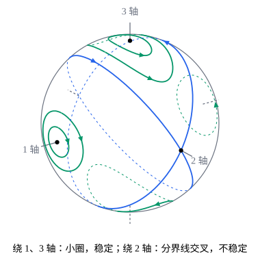

## 这一节要回答的问题

把一本书抛起来，让刚体（rigid body）绕不同的:term[惯量主轴]{id="physics.analytical-mechanics.principal-axes"}（principal axes of inertia）转：绕平行于最长棱的轴、或者垂直于封面的轴，书转得很稳；绕平行于中间那条棱的轴，书几乎总要翻个面。空中只有重力，它对质心（center of mass）没有力矩（torque），角动量（angular momentum）守恒，为什么:term[角速度]{id="physics.analytical-mechanics.angular-velocity"}（angular velocity）还会变，甚至翻过来？刚体绕固定点或质心转动时，角速度满足什么方程？

## 讲解

### 欧拉方程

刚体绕固定点$O$转动，或者取$O$为质心，角动量定理（angular momentum theorem）都给出$\dot{\vb{L}}=\boldsymbol{\tau}$，$\boldsymbol{\tau}$是外力对$O$的力矩。$\vb{L}=I\boldsymbol{\omega}$在空间坐标轴（space axes）下写，:term[惯性张量]{id="physics.analytical-mechanics.inertia-tensor"}（inertia tensor）随刚体转动而变；在体坐标轴（body axes）下写，惯性张量是常数，可是坐标轴本身在转。把$\dot{\vb{L}}=\boldsymbol{\tau}$换成体分量，就得到下面的方程。

记$L'=R\T\vb{L}$、$\omega'=R\T\boldsymbol{\omega}$、$\tau'=R\T\boldsymbol{\tau}$为体分量，$R$是:term[转动矩阵]{id="physics.analytical-mechanics.rotation-matrix"}（rotation matrix）。由$\vb{L}=RL'$和$\dot R=\Omega R$（$\Omega\vb{r}=\boldsymbol{\omega}\times\vb{r}$），$\dot{\vb{L}}=\dot RL'+R\dot L'=\boldsymbol{\omega}\times\vb{L}+R\dot L'$。两边左乘$R\T$，转动矩阵保持叉积（cross product），得到$\dot L'+\omega'\times L'=\tau'$。这和[转动参考系：离心力与科里奥利力](lesson:physics.newtonian-mechanics.rotating-frames)里矢量在惯性系（inertial frame）、转动系（rotating frame）里的变化率相差$\boldsymbol{\omega}\times\vb{A}$是一回事，这里的转动系固连在刚体上。

::anchor{id="thm-euler-equations"}
定理：取:term[惯量主轴]{id="physics.analytical-mechanics.principal-axes"}为体坐标轴，主转动惯量（principal moments of inertia）为$I_1,I_2,I_3$，并把体分量$\omega'_k$、$\tau'_k$简写成$\omega_k$、$\tau_k$，则刚体的转动满足:term[欧拉方程]{id="physics.analytical-mechanics.euler-equations"}（Euler's equations）：

$$
\begin{aligned}
I_1\dot\omega_1-(I_2-I_3)\,\omega_2\omega_3&=\tau_1,\\
I_2\dot\omega_2-(I_3-I_1)\,\omega_3\omega_1&=\tau_2,\\
I_3\dot\omega_3-(I_1-I_2)\,\omega_1\omega_2&=\tau_3 .
\end{aligned}
$$

证明：主轴坐标下$L'=(I_1\omega_1,I_2\omega_2,I_3\omega_3)\T$，$I_k$是常数，$\dot L'_1=I_1\dot\omega_1$；$(\omega'\times L')_1=\omega_2\cdot I_3\omega_3-\omega_3\cdot I_2\omega_2=(I_3-I_2)\omega_2\omega_3$。代进$\dot L'+\omega'\times L'=\tau'$的第一个分量，就是第一个方程；另外两个把下标按$1\to2\to3\to1$轮换得到。

欧拉方程是$\omega_1,\omega_2,\omega_3$的一阶方程组（first-order system），不含取向：力矩只依赖:term[角速度]{id="physics.analytical-mechanics.angular-velocity"}时（例如没有力矩），可以先解出角速度，再由$\dot R=\Omega R$求取向。$\omega_2\omega_3$这类项来自坐标轴本身的转动；刚体绕一根主轴匀速转动时，另外两个分量为零，这些项都消失，没有力矩也能一直这样转。角速度不沿主轴时，即使没有力矩，$\dot\omega_k$一般也不为零。

### 自由刚体的两个守恒量

没有外力矩的自由刚体（free rigid body），例如抛在空中的书（重力对质心没有力矩），$\vb{L}$在空间里守恒。于是体分量的长度$|L'|^2=I_1^2\omega_1^2+I_2^2\omega_2^2+I_3^2\omega_3^2$不变；动能$T=\frac12(I_1\omega_1^2+I_2\omega_2^2+I_3\omega_3^2)$也不变，因为没有力做功。这两件事也可以直接从:term[欧拉方程]{id="physics.analytical-mechanics.euler-equations"}看出来。

::anchor{id="thm-free-body-invariants"}
定理：$\boldsymbol{\tau}=0$时，$|L'|^2$和$T$都不随时间变。

证明：由欧拉方程，$\frac{\dd}{\dd t}\frac12\sum_kI_k^2\omega_k^2=\sum_kI_k\omega_k\cdot I_k\dot\omega_k=\omega_1\omega_2\omega_3\bigl[I_1(I_2-I_3)+I_2(I_3-I_1)+I_3(I_1-I_2)\bigr]=0$。同样，$\frac{\dd T}{\dd t}=\sum_kI_k\omega_k\dot\omega_k=\omega_1\omega_2\omega_3\bigl[(I_2-I_3)+(I_3-I_1)+(I_1-I_2)\bigr]=0$。

以$L_k=I_k\omega_k$为坐标，第一个守恒量（conserved quantity）说$L'$在球面$L_1^2+L_2^2+L_3^2=|\vb{L}|^2$上，第二个说它在椭球面（ellipsoid）$\frac{L_1^2}{I_1}+\frac{L_2^2}{I_2}+\frac{L_3^2}{I_3}=2T$上，所以$L'$只能沿两者的交线运动。设$I_1<I_2<I_3$，交线在三根:term[主轴]{id="physics.analytical-mechanics.principal-axes"}附近的样子很不一样，几何图像里的图画的就是这些交线。

### 绕主轴转动的稳定性

::anchor{id="thm-intermediate-axis"}
定理（中间轴定理，intermediate axis theorem）：设自由刚体的$I_1<I_2<I_3$。绕$1$轴或$3$轴的匀速转动是稳定的：对任何$\varepsilon>0$，只要起初另外两个:term[角速度]{id="physics.analytical-mechanics.angular-velocity"}分量足够小，它们以后就一直小于$\varepsilon$。绕$2$轴的匀速转动不稳定：线性化（linearization）以后，偏离按指数增长。

证明：先看$3$轴。由两个守恒量，$|L'|^2-2TI_3=I_1(I_1-I_3)\omega_1^2+I_2(I_2-I_3)\omega_2^2$也守恒，两个系数都是负的，所以$I_1(I_3-I_1)\omega_1^2+I_2(I_3-I_2)\omega_2^2$一直等于它的初值。初值小，以后$\omega_1^2$、$\omega_2^2$都不超过这个初值除以$I_1(I_3-I_1)$、$I_2(I_3-I_2)$中较小的那个，可以任意小。$1$轴同理，用$|L'|^2-2TI_1=I_2(I_2-I_1)\omega_2^2+I_3(I_3-I_1)\omega_3^2$，两个系数都是正的。

对$2$轴，$|L'|^2-2TI_2=I_1(I_1-I_2)\omega_1^2+I_3(I_3-I_2)\omega_3^2$的两个系数一负一正，守恒量管不住偏离。线性化：设$\omega_2\approx\Omega$，$\omega_1$、$\omega_3$很小，略去它们的乘积，:term[欧拉方程]{id="physics.analytical-mechanics.euler-equations"}给出$\dot\omega_2\approx0$，$I_1\dot\omega_1=(I_2-I_3)\Omega\omega_3$，$I_3\dot\omega_3=(I_1-I_2)\Omega\omega_1$。再求一次导数，$\ddot\omega_1=\lambda^2\omega_1$，其中$\lambda^2=\frac{(I_2-I_1)(I_3-I_2)}{I_1I_3}\Omega^2>0$。

令$u=\dot\omega_1+\lambda\omega_1$，则$\dot u=\lambda u$，$\frac{\dd}{\dd t}\bigl(ue^{-\lambda t}\bigr)=0$，所以$u=u(0)e^{\lambda t}$：只要$u(0)\ne0$，偏离就按$e^{\lambda t}$增长。同样的计算用在$1$轴、$3$轴上：绕第$k$根:term[主轴]{id="physics.analytical-mechanics.principal-axes"}以$\Omega$转动时，$\ddot\omega_i=-\frac{(I_k-I_i)(I_k-I_j)}{I_iI_j}\Omega^2\omega_i$（$i,j$是另外两根），$I_k$最大或最小时右边的系数是负的，偏离做简谐运动（simple harmonic motion），和前面的结论一致。

### 自由对称陀螺

::anchor{id="def-symmetric-top"}
$I_1=I_2\ne I_3$的刚体叫作:term[对称陀螺]{id="physics.analytical-mechanics.symmetric-top"}（symmetric top），$3$轴叫作它的对称轴（symmetry axis）。

为什么这样定义：有一根$n$次对称轴（$n\ge3$）的刚体，例如圆盘、陀螺和近似看作扁球（oblate spheroid）的地球，都满足$I_1=I_2$（见[惯性张量与惯量主轴](lesson:physics.analytical-mechanics.inertia-tensor)的 p6）；这时$1'2'$平面里任何方向都是:term[主轴]{id="physics.analytical-mechanics.principal-axes"}，只有对称轴特殊，运动比一般刚体简单得多。「陀螺」只是名字，不要求有固定点，也不要求在转。边界情况：$I_1=I_2=I_3$时每个方向都是主轴，自由转动时$\boldsymbol{\omega}$根本不变；$I_1=I_2$是中间轴定理里$I_1<I_2<I_3$的边界，这时没有「中间」的主轴，下面的定理取而代之。

::anchor{id="thm-free-symmetric-top"}
定理：自由对称陀螺的$\omega_3$不变；在体坐标系里，$(\omega_1,\omega_2)$以:term[角速度]{id="physics.analytical-mechanics.angular-velocity"}$\Omega_b=\frac{I_3-I_1}{I_1}\omega_3$绕对称轴匀速转动。在空间里，$\vb{L}$不变，对称轴和$\boldsymbol{\omega}$都以角速度$|\vb{L}|/I_1$绕$\vb{L}$转动，三者始终在同一个平面里。

证明：$I_1=I_2$时第三个:term[欧拉方程]{id="physics.analytical-mechanics.euler-equations"}是$I_3\dot\omega_3=0$，$\omega_3$不变。前两个是$\dot\omega_1=-\Omega_b\omega_2$、$\dot\omega_2=\Omega_b\omega_1$，所以$\ddot\omega_1=-\Omega_b^2\omega_1$；由简谐运动的结论，$\omega_1=A\cos(\Omega_bt+\alpha)$，于是$\omega_2=-\dot\omega_1/\Omega_b=A\sin(\Omega_bt+\alpha)$，正是匀速转动（$\Omega_b=0$时两个分量都不变）。

在空间里，$\vb{L}=I_1(\omega_1\vb{e}'_1+\omega_2\vb{e}'_2)+I_3\omega_3\vb{e}'_3=I_1\boldsymbol{\omega}+(I_3-I_1)\omega_3\vb{e}'_3$，所以$\vb{L}$、$\boldsymbol{\omega}$、$\vb{e}'_3$共面。对称轴$\vb{e}'_3$固连在刚体上，$\dot{\vb{e}}'_3=\boldsymbol{\omega}\times\vb{e}'_3=\frac{\vb{L}}{I_1}\times\vb{e}'_3$（因为$\vb{e}'_3\times\vb{e}'_3=0$），而$\vb{L}$不变，所以$\vb{e}'_3$以角速度$\vb{L}/I_1$绕$\vb{L}$转；$\boldsymbol{\omega}=\frac{1}{I_1}\bigl(\vb{L}-(I_3-I_1)\omega_3\vb{e}'_3\bigr)$跟着一起转。

取空间的$z$轴沿$\vb{L}$，对称轴和$z$轴的夹角不变，方位角以$|\vb{L}|/I_1$匀速增加，这正是[刚体的角速度与欧拉角](lesson:physics.analytical-mechanics.rigid-body-kinematics)例 1 的规则进动（regular precession），三个欧拉角的变化率见 p5。

## 几何图像

图里$I_1=1$、$I_2=2$、$I_3=3$。球面是$|L'|=1$，曲线是它和不同能量的椭球面的交线，也就是$L'$实际走的路径，由:term[欧拉方程]{id="physics.analytical-mechanics.euler-equations"}数值积分画出，球背面的部分是虚线。$1$轴、$3$轴附近的交线是绕着它们的小圈：起初离轴近，以后一直近，转动稳定。蓝色的两个大圆是$2T=|\vb{L}|^2/I_2$的分界线（separatrix），在$2$轴处交叉：从$2$轴附近出发，$L'$沿分界线附近走到对面$-2$轴附近，再走回来，这就是书一次次翻面。

:::anim{component="phase-portrait"}
system: { w2: "(3 - a)*w3/2", w3: "(a - 2)*w2/3" }
range: { w2: [-1, 1], w3: [-1, 1] }
dt: 0.01
initial:
  - [0.5, 0]
  - [0, 0.4]
  - [0.2, 0.1]
sliders:
  - name: a
    min: 1
    max: 5
    step: 0.1
    default: 2.5
    label: |
      绕它转的那根主轴的转动惯量$I_1=a$
:::

刚体绕$1$轴以$\Omega=1$转动，另外两根:term[主轴]{id="physics.analytical-mechanics.principal-axes"}的转动惯量是$I_2=2$、$I_3=3$；图里是另外两个:term[角速度]{id="physics.analytical-mechanics.angular-velocity"}分量的线性化方程$\dot\omega_2=\frac{3-a}{2}\omega_3$、$\dot\omega_3=\frac{a-2}{3}\omega_2$的相图（phase portrait），横轴$\omega_2$，纵轴$\omega_3$。$a<2$（$1$轴的转动惯量最小）或$a>3$（最大）时轨迹是闭合的椭圆，偏离始终有界；$a$越接近$2$或$3$，振动越慢，椭圆也越扁长。$2<a<3$（$1$轴成了中间主轴）时原点是鞍点（saddle point），轨迹很快跑出画面。

## 例题

### 例 1　抛起的书

一本书近似看作均匀长方体，三条棱长$a=24\,\mathrm{cm}$、$b=17\,\mathrm{cm}$、$c=2\,\mathrm{cm}$。分别让它绕过质心、平行于三条棱的:term[主轴]{id="physics.analytical-mechanics.principal-axes"}以$\Omega$转动，求小偏离振动的角频率（angular frequency）或增长率$\lambda$，用$\Omega$表示。

**为什么想到这么做**：长方体关于三个过质心、平行于表面的平面都镜面对称（mirror symmetric），三根平行于棱的轴就是主轴。代进讲解里线性化的结果，比较三根轴的转动惯量谁最大、谁最小。

**推导**：由三重积分（triple integral），绕平行于棱$a$的轴的转动惯量是$\frac{M}{12}(b^2+c^2)$，另外两个类推。以$\frac{M}{12}\,\mathrm{cm^2}$为单位，$I_1=17^2+2^2=293$（平行于$a$），$I_2=24^2+2^2=580$（平行于$b$），$I_3=24^2+17^2=865$（垂直于封面），正好$I_1<I_2<I_3$。

绕$1$轴：$\lambda^2=\frac{(I_2-I_1)(I_3-I_1)}{I_2I_3}\Omega^2=\frac{287\times572}{580\times865}\Omega^2$，$\lambda\approx0.572\,\Omega$，小幅振动。绕$3$轴：$\lambda^2=\frac{(I_3-I_1)(I_3-I_2)}{I_1I_2}\Omega^2$，$\lambda\approx0.979\,\Omega$，小幅振动。绕$2$轴：$\lambda^2=\frac{(I_2-I_1)(I_3-I_2)}{I_1I_3}\Omega^2$，$\lambda\approx0.568\,\Omega$，偏离按$e^{\lambda t}$增长。

书每秒转两圈时$\Omega\approx12.6\,\mathrm{rad/s}$，$\lambda\approx7.1\,\mathrm{s^{-1}}$，起初$1\%$的偏离长到和$\Omega$同一量级只要$\frac{\ln100}{7.1}\approx0.65\,\mathrm{s}$。抛一次书的工夫足够它翻面，这就是为什么手再稳也很难让它绕中间那根轴老实转。

### 例 2　地球的自由进动

地球近似是:term[对称陀螺]{id="physics.analytical-mechanics.symmetric-top"}，$\frac{I_3-I_1}{I_1}\approx\frac{1}{305}$，绕对称轴大约每天转一圈。如果自转轴（$\boldsymbol{\omega}$的方向）和对称轴稍有偏离，在地面上看，自转轴绕对称轴转一圈要多久？

**为什么想到这么做**：地面固连在地球上，看到的是体坐标系里的运动，正是定理里$(\omega_1,\omega_2)$绕对称轴的转动，:term[角速度]{id="physics.analytical-mechanics.angular-velocity"}是$\Omega_b$。地球受到太阳、月亮的力矩很小，先当作自由刚体。

**推导**：$\Omega_b=\frac{I_3-I_1}{I_1}\omega_3\approx\frac{\omega_3}{305}$，周期是自转周期的$305$倍，约$305$天。欧拉在十八世纪就做了这个预言；1891 年钱德勒（S. C. Chandler）从各地纬度的周期变化里找到了这个摆动，叫作钱德勒摆动（Chandler wobble），周期却约为$433$天。差别来自地球不是刚体：地幔（mantle）有弹性，海洋会流动；摆动的幅度只有零点几角秒（arcsecond），在地面上相当于几米。

## 常见误区

- 「没有外力矩，:term[角速度]{id="physics.analytical-mechanics.angular-velocity"}就不变。」守恒的是$\vb{L}$；只有角速度沿:term[惯量主轴]{id="physics.analytical-mechanics.principal-axes"}时它才不变，自由:term[对称陀螺]{id="physics.analytical-mechanics.symmetric-top"}的$\boldsymbol{\omega}$就绕对称轴转。
- 「刚体的转动方程是$I\dot{\boldsymbol{\omega}}=\boldsymbol{\tau}$，和$m\vb{a}=\vb{F}$一样。」$\boldsymbol{\tau}=\dot{\vb{L}}$，体分量里还有$\omega'\times L'$这一项；少了它，就得不出绕中间主轴不稳定。
- 「绕中间主轴转不稳，是空气阻力或者抛的手法造成的。」这是:term[欧拉方程]{id="physics.analytical-mechanics.euler-equations"}本身的性质，太空里没有空气也一样（p8）。
- 「绕最大主轴和最小主轴转同样稳定，用哪个都行。」对严格的刚体是这样；有能量耗散（energy dissipation）的物体，$|\vb{L}|$不变而动能慢慢减小，最后只能绕最大主轴转（p7）。
