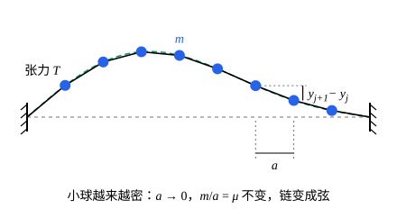

## 这一节要回答的问题

:term[拉格朗日方程]{id="physics.analytical-mechanics.lagrange-equations"}（Lagrange's equations）处理的是有限个:term[自由度]{id="physics.analytical-mechanics.degrees-of-freedom"}（degrees of freedom）。一根振动的弦（string），每一点都在动，自由度有无穷多个，电磁场也是这样。[一维链与连续极限](lesson:physics.oscillations-waves.beaded-string)从小球链（beaded string）的运动方程取极限，得到了波动方程（wave equation）。能不能在:term[拉格朗日量]{id="physics.analytical-mechanics.lagrangian"}（Lagrangian）和:term[作用量]{id="physics.analytical-mechanics.action"}（action）的层面上取这个极限，直接用:term[哈密顿原理]{id="physics.analytical-mechanics.hamiltons-principle"}（Hamilton's principle）写出弦的运动方程？

## 讲解

### 拉格朗日密度

先看一维链：$N$个质量$m$的小球，间距$a$，两端固定，绳上张力（tension）$T$，小球只做横向的小位移$y_1,\dots,y_N$，记$y_0=y_{N+1}=0$。相邻两球间的一段绳长$\sqrt{a^2+(y_{j+1}-y_j)^2}\approx a+\frac{(y_{j+1}-y_j)^2}{2a}$，伸长量乘张力就是这一段的势能，所以

$$
L=\sum_{j=1}^{N}\frac12m\dot y_j^2-\sum_{j=0}^{N}\frac{T}{2a}(y_{j+1}-y_j)^2=\sum_ja\Bigl[\frac12\frac ma\dot y_j^2\Bigr]-\sum_ja\Bigl[\frac12T\Bigl(\frac{y_{j+1}-y_j}{a}\Bigr)^2\Bigr].
$$

让$a\to0$、$N\to\infty$，保持线密度（linear density）$\mu=m/a$和弦长$\ell=(N+1)a$不变，$y_j(t)$变成$y(x,t)$，$\frac{y_{j+1}-y_j}{a}$变成$\frac{\partial y}{\partial x}$，两个和变成积分：

$$
L=\int_0^\ell\Bigl(\frac12\mu y_t^2-\frac12Ty_x^2\Bigr)\dd x ,
$$

这里$y_t$、$y_x$是偏导数（partial derivative）。下标$j$换成了连续变化的$x$：弦上每一点的位移都是一个:term[广义坐标]{id="physics.analytical-mechanics.generalized-coordinates"}（generalized coordinates）。

::anchor{id="def-lagrangian-density"}
随位置和时间变化的量，例如弦的位移$y(x,t)$，叫作场（field）。若:term[拉格朗日量]{id="physics.analytical-mechanics.lagrangian"}能写成$L=\int\mathcal L\bigl(y,y_t,y_x,x,t\bigr)\,\dd x$，被积函数$\mathcal L$叫作:term[拉格朗日密度]{id="physics.analytical-mechanics.lagrangian-density"}（Lagrangian density），:term[作用量]{id="physics.analytical-mechanics.action"}是$S=\int_{t_1}^{t_2}\!\int\mathcal L\,\dd x\,\dd t$。弦的拉格朗日密度是$\mathcal L=\frac12\mu y_t^2-\frac12Ty_x^2$，动能密度减去势能密度。

为什么这样定义：弦上每一小段只和相邻的部分相互作用，拉格朗日量是各处局部贡献之和，取连续极限就成了一个密度的积分，而这个密度只依赖$y$和它在同一点的导数。$\mathcal L$不唯一：加上$\partial_tF+\partial_xG$（$F$、$G$只依赖$y,x,t$），由格林公式（Green's theorem），作用量只多出区域边界上的积分，而那里的位移是给定的，运动方程不变（p6）。边界情况：链的间距$a$不为零时，波长（wavelength）和$a$可比的运动和弦很不一样，连续的$\mathcal L$只描述波长远大于$a$的运动（几何图像里的动画）。

### 场的欧拉-拉格朗日方程

::anchor{id="thm-field-euler-lagrange"}
定理（场的欧拉-拉格朗日方程，field Euler–Lagrange equation）：设$\mathcal L$有连续的二阶偏导数，$y(x,t)$在两端$x=0,\ell$的位移和$t_1,t_2$两个时刻的位移都给定的条件下使:term[作用量]{id="physics.analytical-mechanics.action"}取驻值（stationary value），则

$$
\frac{\partial\mathcal L}{\partial y}-\frac{\partial}{\partial t}\frac{\partial\mathcal L}{\partial y_t}-\frac{\partial}{\partial x}\frac{\partial\mathcal L}{\partial y_x}=0 .
$$

证明：取$y+\varepsilon\eta$，$\eta$在矩形$[0,\ell]\times[t_1,t_2]$的边界上为零。$\frac{\dd S}{\dd\varepsilon}\big|_{\varepsilon=0}=\iint\Bigl(\frac{\partial\mathcal L}{\partial y}\eta+\frac{\partial\mathcal L}{\partial y_t}\eta_t+\frac{\partial\mathcal L}{\partial y_x}\eta_x\Bigr)\dd x\,\dd t$，后两项分别对$t$、$x$分部积分（integration by parts），边界项因$\eta=0$而消失。于是$\iint\Bigl(\frac{\partial\mathcal L}{\partial y}-\partial_t\frac{\partial\mathcal L}{\partial y_t}-\partial_x\frac{\partial\mathcal L}{\partial y_x}\Bigr)\eta\,\dd x\,\dd t=0$对所有这样的$\eta$成立，由[多元函数的变分问题](lesson:math.calculus-of-variations.multivariable-functionals)里的基本引理（fundamental lemma），括号里处处为零。

这正是那一节的欧拉-拉格朗日方程，自变量是$x$和$t$。弦的$\frac{\partial\mathcal L}{\partial y}=0$，$\frac{\partial\mathcal L}{\partial y_t}=\mu y_t$，$\frac{\partial\mathcal L}{\partial y_x}=-Ty_x$，方程是$\mu y_{tt}-Ty_{xx}=0$，即波动方程$y_{tt}=v^2y_{xx}$，$v=\sqrt{T/\mu}$，和直接对小球链的运动方程取极限得到的一样。

### 能量密度与能流

::anchor{id="def-hamiltonian-density"}
记$\pi=\frac{\partial\mathcal L}{\partial y_t}$，叫作动量密度（momentum density）；$\mathcal H=\pi y_t-\mathcal L$叫作:term[哈密顿密度]{id="physics.analytical-mechanics.hamiltonian-density"}（Hamiltonian density）。弦的$\pi=\mu y_t$，$\mathcal H=\frac12\mu y_t^2+\frac12Ty_x^2$，正是动能密度加势能密度。

为什么这样定义：有限:term[自由度]{id="physics.analytical-mechanics.degrees-of-freedom"}时动量是$\frac{\partial L}{\partial\dot q}$；场的每一点是一个坐标，对应的动量按单位长度计，就是$\pi$。$\mathcal H$这样构造，对弦正好给出能量密度（energy density），而且满足下面的连续性方程（continuity equation），所以它描述能量在弦上的分布和流动。边界情况：$\mathcal L$显含时间时（例如张力随时间变），$\int\mathcal H\,\dd x$不再守恒，下面的证明里会多出$\partial_t\mathcal L$一项。

::anchor{id="thm-energy-continuity"}
定理：弦的运动满足波动方程时，$\frac{\partial\mathcal H}{\partial t}+\frac{\partial j}{\partial x}=0$，其中$j=-Ty_xy_t$是能流（energy flux）。

证明：$\partial_t\mathcal H=\mu y_ty_{tt}+Ty_xy_{xt}=Ty_ty_{xx}+Ty_xy_{xt}=\partial_x(Ty_xy_t)$，第二步用了波动方程$\mu y_{tt}=Ty_{xx}$。

它说一段弦$[x_1,x_2]$上的能量$\int_{x_1}^{x_2}\mathcal H\,\dd x$的变化率等于$j(x_1)-j(x_2)$，即左端流进来的减去右端流出去的。$j$也有直接的意思：左边的弦对右边的弦的横向拉力是$-Ty_x$，乘横向速度$y_t$，就是它对右边做功的功率。两端固定时那里$y_t=0$、$j=0$，总能量守恒。

## 几何图像

小球间距$a$，相邻两球间的一段绳伸长约$\frac{(y_{j+1}-y_j)^2}{2a}$，张力乘伸长是这一段的势能。$a\to0$、$m/a=\mu$不变时，折线变成绿色虚线的连续弦，势能变成$\int\frac12Ty_x^2\,\dd x$。

:::anim{component="oscillator"}
masses: [1, 1, 1, 1, 1, 1, 1, 1]
springs: [1, 1, 1, 1, 1, 1, 1, 1, 1]
initial: ["sin(n*pi/9)", "sin(2*n*pi/9)", "sin(3*n*pi/9)", "sin(4*n*pi/9)", "sin(5*n*pi/9)", "sin(6*n*pi/9)", "sin(7*n*pi/9)", "sin(8*n*pi/9)"]
dt: 0.01
sliders:
  - name: n
    min: 1
    max: 8
    step: 1
    default: 1
    label: |
      简正模的序号$n$
:::

动画用$8$个物块、$9$根相同的弹簧代替$8$个小球的链：物块沿链的方向振动，方程和小球的横向振动（transverse vibration）形式完全一样，劲度系数（spring constant）$k$对应$T/a$。初始位移取$\sin\frac{n\pi j}{9}$（$j=1,\dots,8$），这是链的第$n$个简正模（normal mode），所有物块以同一个频率振动，形状不变。$n$小时，频率$2\sqrt{k/m}\sin\frac{n\pi}{18}$接近连续弦的$\frac{n\pi v}{\ell}=\frac{n\pi}{9}\sqrt{k/m}$；$n$接近$8$时两者差得很远，这时波长和间距差不多，连续的:term[拉格朗日密度]{id="physics.analytical-mechanics.lagrangian-density"}不再适用。

## 例题

### 例 1　弹性基底上的弦

弦下面垫着一层弹性基底（elastic foundation），每单位长度受到$-\kappa y$的回复力（restoring force）。写出:term[拉格朗日密度]{id="physics.analytical-mechanics.lagrangian-density"}和运动方程，并求两端固定、长$\ell$的弦的简正频率（normal frequency）。

**为什么想到这么做**：基底的作用相当于每一小段弦各挂着一根弹簧，势能密度多出$\frac12\kappa y^2$，它依赖$y$本身而不是导数，会出现在$\frac{\partial\mathcal L}{\partial y}$里。

**推导**：$\mathcal L=\frac12\mu y_t^2-\frac12Ty_x^2-\frac12\kappa y^2$，$\frac{\partial\mathcal L}{\partial y}=-\kappa y$，场的欧拉-拉格朗日方程给出$\mu y_{tt}-Ty_{xx}+\kappa y=0$。试$y=\sin\frac{n\pi x}{\ell}\cos\omega t$，它在两端为零；代入得$-\mu\omega^2+T\bigl(\frac{n\pi}{\ell}\bigr)^2+\kappa=0$，所以

$$
\omega_n=\sqrt{\frac T\mu\Bigl(\frac{n\pi}{\ell}\Bigr)^2+\frac\kappa\mu}\,.
$$

和没有基底时相比，每个频率都抬高了，而且都不低于$\sqrt{\kappa/\mu}$：波长很长时，弦几乎不弯，回复力主要来自基底。

### 例 2　行波的能量

弦上一个形状任意的脉冲以波速（wave speed）$v=\sqrt{T/\mu}$向右传播，$y=f(x-vt)$。证明能量密度处处等于$Tf'^2$，能流等于$v$乘能量密度。

**为什么想到这么做**：把$y_t=-vf'$、$y_x=f'$直接代进$\mathcal H$和$j$。

**推导**：$\mathcal H=\frac12\mu v^2f'^2+\frac12Tf'^2=Tf'^2$，用了$\mu v^2=T$，动能密度和势能密度相等。$j=-Ty_xy_t=Tvf'^2=v\mathcal H$：能量和波形一起，以速度$v$向右移动。

## 常见误区

- 「场的运动方程和有限:term[自由度]{id="physics.analytical-mechanics.degrees-of-freedom"}时的:term[拉格朗日方程]{id="physics.analytical-mechanics.lagrange-equations"}一样，只是坐标多了几个。」坐标的个数变成了连续无穷，求和变成积分，方程里多出对$x$求导的项$\partial_x\frac{\partial\mathcal L}{\partial y_x}$，结果是偏微分方程（partial differential equation）。
- 「$\mathcal L$就是:term[拉格朗日量]{id="physics.analytical-mechanics.lagrangian"}。」$\mathcal L$是密度，要对$x$积分才是拉格朗日量，两者的量纲差一个长度。
- 「连续的弦和小球链完全等价。」只有波长远大于小球间距时才近似相同；短波长时链的频率比弦低得多（动画里$n$大的时候）。
- 「能流$j=-Ty_xy_t$总是正的，能量总往一个方向流。」$j$的符号表示流动的方向；驻波（standing wave）里能量在波节（node）和波腹（antinode）之间来回流动，一个周期的平均能流为零。
