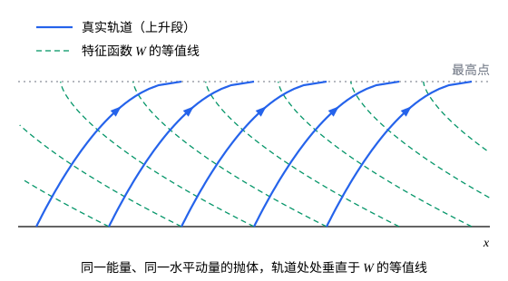

## 这一节要回答的问题

上一节用一个:term[生成函数]{id="physics.analytical-mechanics.generating-function"}（generating function）把谐振子的:term[哈密顿量]{id="physics.analytical-mechanics.hamiltonian"}（Hamiltonian）变成只含$P$，运动立刻就解出来了。能不能更彻底：找一个:term[正则变换]{id="physics.analytical-mechanics.canonical-transformation"}（canonical transformation），让新的哈密顿量干脆为零，新变量全成了常数？这样的生成函数要满足什么方程，又怎样把它解出来？

## 讲解

### 哈密顿-雅可比方程

先看最简单的例子。自由质点$H=\frac{p^2}{2m}$，取$F_2$型的:term[生成函数]{id="physics.analytical-mechanics.generating-function"}$S(q,\alpha,t)=\alpha q-\frac{\alpha^2t}{2m}$，新动量记作$\alpha$。新的:term[哈密顿量]{id="physics.analytical-mechanics.hamiltonian"}是$K=H+\frac{\partial S}{\partial t}=\frac{1}{2m}\bigl(\frac{\partial S}{\partial q}\bigr)^2+\frac{\partial S}{\partial t}=\frac{\alpha^2}{2m}-\frac{\alpha^2}{2m}=0$。于是新坐标$\beta=\frac{\partial S}{\partial\alpha}=q-\frac{\alpha t}{m}$和新动量$\alpha$都不随时间变，倒过来就是$q=\beta+\frac{\alpha}{m}t$、$p=\frac{\partial S}{\partial q}=\alpha$：匀速直线运动，没有解任何微分方程。

一般地，取$F_2$型的生成函数$S(q,P,t)$，新的哈密顿量是$K=H\bigl(q,\frac{\partial S}{\partial q},t\bigr)+\frac{\partial S}{\partial t}$。要$K=0$，$S$就要满足下面的方程；那时$\dot Q_j=\dot P_j=0$，新变量都是常数，记$P_j=\alpha_j$、$Q_j=\beta_j$。

::anchor{id="def-hamilton-jacobi"}
函数$S(q,t)$满足的偏微分方程$H\bigl(q_1,\dots,q_n,\frac{\partial S}{\partial q_1},\dots,\frac{\partial S}{\partial q_n},t\bigr)+\frac{\partial S}{\partial t}=0$叫作:term[哈密顿-雅可比方程]{id="physics.analytical-mechanics.hamilton-jacobi-equation"}（Hamilton–Jacobi equation）。含$n$个独立常数$\alpha_1,\dots,\alpha_n$（不算加在$S$上的常数）的解$S(q,\alpha,t)$叫作它的:term[完全积分]{id="physics.analytical-mechanics.complete-integral"}（complete integral），用作生成函数时也叫:term[哈密顿主函数]{id="physics.analytical-mechanics.principal-function"}（Hamilton's principal function）。

有了完全积分，运动就只要代数运算：由$n$个式子$\beta_j=\frac{\partial S}{\partial\alpha_j}(q,\alpha,t)$解出$q(t)$，再由$p_j=\frac{\partial S}{\partial q_j}$得到动量，$2n$个常数$\alpha$、$\beta$由初始条件定出。「独立」的意思是能从这$n$个式子解出$q$，和上一节$F_1$要求$q$、$Q$独立是同一回事。

为什么这样定义：把常微分方程组换成一个偏微分方程，看起来是倒退，可这个偏微分方程常常能分离变量，把问题化成几个一元函数的积分（例 1、例 2）。$S$还有物理意义：沿着真实运动$\dv{S}{t}=\sum_j\frac{\partial S}{\partial q_j}\dot q_j+\frac{\partial S}{\partial t}=\sum_jp_j\dot q_j-H=L$，所以$S$就是沿运动的:term[作用量]{id="physics.analytical-mechanics.action"}（action），只差一个常数。边界情况：完全积分不唯一，给$S$加一个常数，或者把$\alpha$换成它的函数，都还是完全积分，运动不变，变的只是常数的意思。

### 不显含时间：特征函数与分离变量

$H$不显含时间时，能量$E$守恒，可以把$E$取作其中一个常数，令$S(q,\alpha,t)=W(q,\alpha)-Et$。代进:term[哈密顿-雅可比方程]{id="physics.analytical-mechanics.hamilton-jacobi-equation"}，时间消掉了：

$$
H\Bigl(q_1,\dots,q_n,\frac{\partial W}{\partial q_1},\dots,\frac{\partial W}{\partial q_n}\Bigr)=E .
$$

::anchor{id="def-characteristic-function"}
这个方程含$n$个常数（其中一个是$E$）的解$W(q,\alpha)$叫作:term[哈密顿特征函数]{id="physics.analytical-mechanics.characteristic-function"}（Hamilton's characteristic function）。由$\beta_E=\frac{\partial S}{\partial E}=\frac{\partial W}{\partial E}-t$定出$q$怎样随时间变，由其余的$\beta_j=\frac{\partial W}{\partial\alpha_j}$定出轨道的形状。

为什么这样定义：沿着运动$\dv{W}{t}=\sum_j\frac{\partial W}{\partial q_j}\dot q_j=\sum_jp_j\dot q_j$，$W=\int\sum_jp_j\,\dd q_j$只和走过的路径有关，和走得多快无关，所以只有$E$对应的那个常数管时间。边界情况：来回运动时$q$回到原处，$W$却多了$\oint p\,\dd q$，它是多值的；这个增量下一节要用（p8）。

::anchor{id="def-separation"}
解这个方程最常用的办法是分离变量（separation of variables）。如果某个坐标$q_1$和$\frac{\partial W}{\partial q_1}$只以一个组合$f\bigl(q_1,\frac{\partial W}{\partial q_1}\bigr)$出现在方程里，就设$W=W_1(q_1)+W'(q_2,\dots,q_n)$。方程里只有$f$依赖$q_1$，其余部分都不依赖$q_1$，所以$f$必须等于常数$\alpha_1$，得到一个只含$q_1$的常微分方程。:term[循环坐标]{id="physics.analytical-mechanics.cyclic-coordinate"}（cyclic coordinate）是最简单的情形：$H$里不出现$q_k$，$p_k=\alpha_k$守恒，$W$里就是$\alpha_kq_k$这一项。

一个:term[自由度]{id="physics.analytical-mechanics.degrees-of-freedom"}（degrees of freedom）时，$\frac{1}{2m}\bigl(\frac{\dd W}{\dd q}\bigr)^2+V(q)=E$直接给出$W=\int\sqrt{2m(E-V)}\,\dd q$。再由$\beta=\frac{\partial W}{\partial E}-t$，在积分号下对$E$求导，得到$t+\beta=\int\frac{m\,\dd q}{\sqrt{2m(E-V)}}$，正是用能量守恒求运动时的那个积分。这里根号取正，对应$q$增大的那一段运动；$q$减小时取负号。

## 几何图像

取$m=g=1$，实线是水平动量都是$1$、能量都是$2.5$、从地面不同位置抛出的一族轨道（只画上升的一段），虚线是:term[哈密顿特征函数]{id="physics.analytical-mechanics.characteristic-function"}$W(x,y)=x+\frac13\bigl[8-(4-2y)^{3/2}\bigr]$的等值线。沿等值线走一小步$(\dd x,\dd y)$，$W$不变：$p_x\,\dd x+p_y\,\dd y=0$，即这一小步和动量$(p_x,p_y)$垂直。所以轨道处处垂直于$W$的等值线，就像光线处处垂直于波面。

## 例题

### 例 1　谐振子

用:term[哈密顿-雅可比方程]{id="physics.analytical-mechanics.hamilton-jacobi-equation"}求谐振子$H=\frac{p^2}{2m}+\frac12m\omega^2q^2$的运动。

**为什么想到这么做**：$H$不显含时间，只有一个:term[自由度]{id="physics.analytical-mechanics.degrees-of-freedom"}，$W$可以直接积出来；运动怎样随时间变，由$\beta=\frac{\partial W}{\partial E}-t$读出来。上一节要先猜对:term[生成函数]{id="physics.analytical-mechanics.generating-function"}，这里生成函数是从方程里解出来的。

**推导**：$W=\int\sqrt{2mE-m^2\omega^2q^2}\,\dd q$。记$a=\sqrt{\frac{2E}{m\omega^2}}$，在积分号下对$E$求导：

$$
\beta=\frac{\partial W}{\partial E}-t=\int\frac{m\,\dd q}{\sqrt{2mE-m^2\omega^2q^2}}-t=\frac1\omega\int\frac{\dd q}{\sqrt{a^2-q^2}}-t=\frac1\omega\arcsin\frac{q}{a}-t .
$$

所以$q=a\sin\bigl(\omega(t+\beta)\bigr)=\sqrt{\frac{2E}{m\omega^2}}\sin\bigl(\omega(t+\beta)\bigr)$，动量$p=\frac{\partial W}{\partial q}=\sqrt{2mE-m^2\omega^2q^2}=\sqrt{2mE}\cos\bigl(\omega(t+\beta)\bigr)$。两个常数$E$、$\beta$由初始的位置和动量定出，结果和上一节一样。

### 例 2　有心力与开普勒轨道

质点在平面上受有心力，势能是$V(r)$。用极坐标分离变量，写出:term[特征函数]{id="physics.analytical-mechanics.characteristic-function"}，得到轨道方程和$r$随时间的关系；再对引力$V=-\frac{k}{r}$算出轨道。

**为什么想到这么做**：讲:term[正则方程]{id="physics.analytical-mechanics.hamiltons-equations"}（Hamilton's canonical equations）时求过$H=\frac{p_r^2}{2m}+\frac{p_\varphi^2}{2mr^2}+V(r)$，其中$\varphi$是:term[循环坐标]{id="physics.analytical-mechanics.cyclic-coordinate"}，所以$W$里有一项$\alpha_\varphi\varphi$，剩下的只含$r$。$\alpha_\varphi$就是守恒的角动量，$E$是能量。

**推导**：设$W=\alpha_\varphi\varphi+W_r(r)$，:term[哈密顿-雅可比方程]{id="physics.analytical-mechanics.hamilton-jacobi-equation"}变成$\frac{1}{2m}\bigl(\frac{\dd W_r}{\dd r}\bigr)^2+\frac{\alpha_\varphi^2}{2mr^2}+V(r)=E$，所以

$$
W=\alpha_\varphi\varphi+\int\sqrt{2m(E-V)-\frac{\alpha_\varphi^2}{r^2}}\,\dd r .
$$

根号里是$2m$乘能量减有效势（effective potential）。对两个常数求导：

$$
\varphi-\beta_\varphi=\int\frac{\alpha_\varphi\,\dd r}{r^2\sqrt{2m(E-V)-\alpha_\varphi^2/r^2}},\qquad t+\beta_E=\int\frac{m\,\dd r}{\sqrt{2m(E-V)-\alpha_\varphi^2/r^2}} .
$$

第一式是轨道方程，第二式给出$r(t)$，任何$V(r)$都化成了两个一元积分。对$V=-\frac{k}{r}$，在第一式里令$u=\frac1r$，$\frac{\dd r}{r^2}=-\dd u$，根号里配方：$2mE+2mku-\alpha_\varphi^2u^2=\alpha_\varphi^2\bigl[C^2-(u-u_0)^2\bigr]$，其中$u_0=\frac{mk}{\alpha_\varphi^2}$，$C=u_0e$，$e=\sqrt{1+\frac{2E\alpha_\varphi^2}{mk^2}}$。于是

$$
\varphi-\beta_\varphi=-\int\frac{\dd u}{\sqrt{C^2-(u-u_0)^2}}=\arccos\frac{u-u_0}{C},\qquad r=\frac{\alpha_\varphi^2/(mk)}{1+e\cos(\varphi-\beta_\varphi)} .
$$

这是焦点在力心的圆锥曲线，偏心率是$e$：$E<0$时$e<1$，是椭圆，和开普勒定律的结果一致。

## 常见误区

- 「:term[哈密顿-雅可比方程]{id="physics.analytical-mechanics.hamilton-jacobi-equation"}是偏微分方程，比:term[正则方程]{id="physics.analytical-mechanics.hamiltons-equations"}难，没什么用。」它常常能分离变量，化成一元积分（例 2）；它还把力学和波联系起来（几何图像）。
- 「:term[完全积分]{id="physics.analytical-mechanics.complete-integral"}里的常数越多越好。」要恰好$n$个独立常数（不算加在$S$上的常数），才能由$\beta_j=\frac{\partial S}{\partial\alpha_j}$解出$q$。
- 「$\beta_j$是新引进的、和初始条件无关的量。」$\beta_j$是新坐标，运动中不变，它和$\alpha_j$一起由初始的位置和动量定出。
- 「换什么坐标都能分离变量。」能不能分离取决于$H$，也取决于坐标：有心力问题在极坐标里能分离，换成直角坐标一般就不行（各向同性振子是例外）；三体问题一般找不到能分离变量的坐标。
