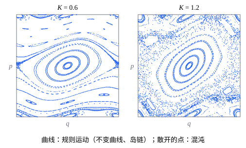

## 这一节要回答的问题

前面几节的系统都能「解」：用:term[作用量变量]{id="physics.analytical-mechanics.action-variable"}（action variable）和:term[角变量]{id="physics.analytical-mechanics.angle-variable"}（angle variable）写出来，作用量变量不变，角变量匀速转动。双摆（double pendulum）、三体问题（three-body problem）、受周期驱动的摆却解不出来，数值算出的轨道杂乱无章，初值差一点，结果就差很多。保守的哈密顿系统也会混沌（chaos）吗？它和[混沌初步](lesson:math.ode.chaos)里有吸引子（attractor）的耗散系统（dissipative system）有什么不同，怎样一眼分辨规则运动和混沌运动？

## 讲解

### 可积系统与不变环面

::anchor{id="def-integrable-system"}
设$n$个:term[自由度]{id="physics.analytical-mechanics.degrees-of-freedom"}（degrees of freedom）的:term[哈密顿量]{id="physics.analytical-mechanics.hamiltonian"}（Hamiltonian）$H(q,p)$不显含时间。若有$n$个守恒量（conserved quantity）$F_1=H,F_2,\dots,F_n$，它们两两的:term[泊松括号]{id="physics.analytical-mechanics.poisson-bracket"}（Poisson bracket）为零，$\pb{F_i}{F_j}=0$，而且梯度（gradient）在每一点线性无关，这个系统叫作:term[可积系统]{id="physics.analytical-mechanics.integrable-system"}（integrable system）。

::anchor{id="thm-liouville-arnold"}
定理（刘维尔-阿诺德定理，Liouville–Arnold theorem）：可积系统中，若$F_1=c_1,\dots,F_n=c_n$确定的集合有界、连通，它就是一个$n$维环面（torus）；在它附近可以取:term[作用量变量]{id="physics.analytical-mechanics.action-variable"}$I_1,\dots,I_n$和:term[角变量]{id="physics.analytical-mechanics.angle-variable"}$\theta_1,\dots,\theta_n$，使$H=H(I)$，$\dot I_k=0$，$\dot\theta_k=\omega_k(I)=\frac{\partial H}{\partial I_k}$。

证明的思路：每个$F_k$当作哈密顿量，都生成一个:term[相流]{id="physics.analytical-mechanics.phase-flow"}（phase flow），泊松括号为零说明这些相流彼此可以交换次序，而且都不离开$F=c$的集合。$n$个可交换的相流作用在一个$n$维、有界、连通的集合上，这个集合只能是环面，相流在上面就是各个角度的平移。作用量变量取环面上$n$个独立回路（loop）上的$\frac{1}{2\pi}\oint\vb{p}\cdot\dd\vb{q}$，和一个自由度时一样。

::anchor{id="def-invariant-torus"}
定理里的环面，也就是$I_1,\dots,I_n$取定值的集合，叫作:term[不变环面]{id="physics.analytical-mechanics.invariant-torus"}（invariant torus）：轨道从它上面出发，就永远留在上面，角变量在上面匀速转动。

为什么这样定义：一个自由度、$H$不显含时间时，$H$本身就是守恒量，系统总是可积的；运动有界、又不在分界线（separatrix）上时，:term[相轨道]{id="physics.analytical-mechanics.phase-trajectory"}（phase trajectory）是闭合曲线，也就是一维的环面。几个互不耦合的振子（oscillator）也可积，运动有界时环面是几个圆的乘积；泊松括号为零保证这些守恒量能同时取定值、共同确定一个环面。边界情况：可积系统的运动不一定有界，自由粒子（free particle）、越过势垒（potential barrier）跑走的粒子都可积，轨道却不在环面上；守恒量少一个时，比如两个自由度只有能量守恒，轨道就不一定被限制在二维的面上，可以在三维的能量面（energy surface）里到处走，混沌就可能出现。

::anchor{id="def-quasi-periodic"}
两个自由度时环面是二维的，像甜甜圈的表面，轨道在上面以$\omega_1$、$\omega_2$绕两个方向转。$\frac{\omega_1}{\omega_2}$是有理数时，轨道转若干圈后闭合，是周期运动；是无理数时，轨道永不闭合，越来越密地布满整个环面，这样的运动叫作准周期运动（quasi-periodic motion）。每绕一圈，另一个角度增加$2\pi\frac{\omega_1}{\omega_2}$，无理数倍的转动在圆上留下的点是稠密（dense）的（p5），这是「布满」的原因。

为什么这样定义：准周期运动的坐标是两个频率不可公约的周期函数的组合，每个角变量单独看都是周期的，合起来却永不重复，名字由此而来。边界情况：频率之比是有理数时，它退化成周期运动；频率之比很接近某个有理数时，要转很多圈才看得出轨道不闭合。

### 庞加莱截面

两个:term[自由度]{id="physics.analytical-mechanics.degrees-of-freedom"}时:term[相空间]{id="physics.analytical-mechanics.phase-space"}（phase space）是四维的，能量守恒把轨道限制在三维的能量面上，直接画不出来。在能量面里取一个截面，例如$q_2=0$、$p_2>0$，只记下轨道每次穿过它时的$(q_1,p_1)$，三维的连续运动就变成平面上的一串点。

::anchor{id="def-poincare-section"}
这样的截面叫作:term[庞加莱截面]{id="physics.analytical-mechanics.poincare-section"}（Poincaré section），从一次穿过到下一次穿过的对应$P$叫作庞加莱映射（Poincaré map）。一个自由度、$H$随时间周期变化（周期$\tau$）的系统，每隔$\tau$记下一次$(q,p)$，也是庞加莱截面，这时$P$就是时间$\tau$的:term[相流]{id="physics.analytical-mechanics.phase-flow"}。

为什么这样定义：运动有界时，:term[可积系统]{id="physics.analytical-mechanics.integrable-system"}的轨道在:term[不变环面]{id="physics.analytical-mechanics.invariant-torus"}上，环面和截面的交线是闭合曲线，所以规则运动在截面上的点排成光滑的曲线，频率之比是有理数时只有有限个点；混沌的轨道不在任何环面上，点散成一片面积。看截面上的点是线还是面，就能区分规则运动和混沌，这比盯着轨道本身清楚得多。边界情况：截面要取得让轨道反复穿过它；轨道如果从某时起不再穿过截面（比如跑到无穷远），截面上只留下有限个点，什么也说明不了。

::anchor{id="thm-area-preserving"}
定理：周期驱动的一个自由度系统，庞加莱映射保持面积。

证明的思路：$P$是时间$\tau$的相流，由[相空间与刘维尔定理](lesson:physics.analytical-mechanics.phase-space-liouville)里的:term[刘维尔定理]{id="physics.analytical-mechanics.liouville-theorem"}（Liouville's theorem），相流把相空间里的区域变成面积相等的区域。两个自由度的庞加莱映射也在截面上保持面积，证明要用到相空间更多的结构，这里从略。

保持面积有一个直接的后果：截面上不可能有吸引子，一片面积不会缩成一个点或一条线。耗散系统的混沌发生在面积不断收缩的奇怪吸引子（strange attractor）上；哈密顿系统的混沌则是相空间里的一片「混沌海」（chaotic sea），其中夹着规则运动的「岛」（island）。

### 标准映射

转子（rotor）每隔单位时间受一次冲击（kick），冲击的强度和角度有关：$H=\frac{p^2}{2}+K\cos q\sum_n\delta(t-n)$。两次冲击之间转子匀速转动，冲击使$p$突然改变$K\sin q$，所以每过一个周期，

$$
p_{n+1}=p_n+K\sin q_n,\qquad q_{n+1}=q_n+p_{n+1}.
$$

::anchor{id="def-standard-map"}
$q$、$p$都取模$2\pi$的上面这个映射叫作:term[标准映射]{id="physics.analytical-mechanics.standard-map"}（standard map），$K$是参数。

为什么这样定义：它是周期驱动系统最简单的庞加莱映射，只有一个参数，却有一般情形的全部现象，很多系统在共振（resonance）附近都可以近似成它。$q$每次增加$p$，$p$加$2\pi$不改变$q$的变化，所以$p$也可以取模$2\pi$。边界情况：$K=0$时$p$不变，每条水平线$p=$常数都是不变曲线，系统可积；$K$不是小量时，它就不再是:term[可积系统]{id="physics.analytical-mechanics.integrable-system"}的小扰动（perturbation），混沌占满大部分区域。

::anchor{id="thm-standard-map-area"}
定理：标准映射保持面积。

证明：雅可比矩阵（Jacobian matrix）是$\frac{\partial(q_{n+1},p_{n+1})}{\partial(q_n,p_n)}=\begin{pmatrix}1+K\cos q_n&1\\K\cos q_n&1\end{pmatrix}$，行列式（determinant）$(1+K\cos q_n)-K\cos q_n=1$。

::anchor{id="def-elliptic-hyperbolic"}
保持面积的映射在不动点（fixed point）处的雅可比矩阵，行列式是$1$，两个特征值（eigenvalue）满足$\lambda_1\lambda_2=1$。迹（trace）的绝对值小于$2$时，特征值是单位圆上的一对共轭复数，附近的点绕着不动点转，这样的不动点叫作椭圆不动点（elliptic fixed point）；迹的绝对值大于$2$时，特征值是互为倒数的实数，附近的点沿一个方向被拉开，叫作双曲不动点（hyperbolic fixed point）。

为什么这样定义：线性化（linearization）以后，椭圆不动点附近的点沿着小椭圆转，双曲不动点附近的点沿着双曲线走，名字由此而来；行列式是$1$时，除了下面的边界情况，特征值只有这两种情形。边界情况：迹恰好等于$2$或$-2$时，两个特征值都等于$1$或都等于$-1$，线性化判断不了，要看更高阶的项。标准映射在$(0,0)$、$(\pi,0)$两个不动点处的迹是$2+K\cos q$，所以$(0,0)$在$K>0$时是双曲的；$(\pi,0)$在$K$较小时是椭圆的，$K$超过某个值以后变成双曲的（p3），它们对应摆的倒立位置和最低位置。

### KAM 定理

::anchor{id="thm-kam"}
定理（:term[KAM 定理]{id="physics.analytical-mechanics.kam-theorem"}，Kolmogorov–Arnold–Moser theorem，KAM）：设$H=H_0(I)+\varepsilon H_1(\theta,I)$，$H_0$可积，频率$\omega(I)=\frac{\partial H_0}{\partial I}$随$I$的变化不退化（$\det\frac{\partial^2H_0}{\partial I^2}\ne0$），$H_1$足够光滑。给定$\gamma>0$、$\tau>n-1$，只要$\varepsilon$足够小，频率满足$|\vb{k}\cdot\omega|\ge\frac{\gamma}{|\vb{k}|^\tau}$（对所有非零整数向量$\vb{k}$）的:term[不变环面]{id="physics.analytical-mechanics.invariant-torus"}都保留下来，只是稍微变形；被破坏的环面所占的比例随$\varepsilon\to0$趋于零。

证明的思路：想用:term[正则变换]{id="physics.analytical-mechanics.canonical-transformation"}（canonical transformation）把$\varepsilon H_1$里依赖$\theta$的部分消掉，:term[生成函数]{id="physics.analytical-mechanics.generating-function"}（generating function）的傅里叶系数（Fourier coefficient）里会出现分母$\vb{k}\cdot\omega$；频率接近共振时这些小分母（small divisors）很小，级数可能发散。满足上面不等式的频率，分母不会太小；科尔莫戈罗夫（A. N. Kolmogorov，1954）用类似牛顿迭代（Newton's method）的办法，每一步把扰动从$\varepsilon$压到$\varepsilon^2$的量级，收敛得极快，压过了小分母的增长，阿诺德（V. I. Arnold）和莫泽（J. Moser）在 1962—1963 年完成了证明。共振的环面（$\vb{k}\cdot\omega=0$）无法这样处理，它们破裂成岛链（island chain）和夹在中间的混沌层（chaotic layer）。

::anchor{id="def-arnold-diffusion"}
两个:term[自由度]{id="physics.analytical-mechanics.degrees-of-freedom"}时，保留下来的二维环面在三维的能量面里像一层层的管壁，把能量面隔开，混沌的轨道只能在两层环面之间活动，:term[作用量变量]{id="physics.analytical-mechanics.action-variable"}永远偏离不远。$n\ge3$个自由度时，$n$维的环面在$2n-1$维的能量面里不再能把它隔开，混沌轨道可以沿着共振的网络缓慢地漂到远处，这种运动叫作阿诺德扩散（Arnold diffusion）。

为什么这样定义：阿诺德在 1964 年构造了第一个这样的例子，说明 KAM 定理保留下来的环面挡不住三个以上自由度的混沌轨道，名字由此而来。边界情况：两个自由度时不会发生，环面把能量面隔开了；扰动越小，扩散越慢，通常慢得在很长时间里都看不出来。

::anchor{id="def-lyapunov-exponent"}
在混沌区里，相邻两点的距离大致按$e^{\lambda n}$增长，增长率$\lambda>0$叫作李雅普诺夫指数（Lyapunov exponent）；在不变曲线上，相邻两点只因频率略有不同而线性地分开，$\lambda=0$。$\lambda>0$正是[混沌初步](lesson:math.ode.chaos)里说的对初值的敏感依赖：初值的误差每过$\frac1\lambda$次迭代放大$e$倍。

为什么这样定义：两点的距离很快就长到和整个混沌区一样大，不再增长，只有开始那一段指数增长的快慢是轨道本身的性质，所以取增长率；严格的定义要让初始距离趋于零、迭代次数趋于无穷。边界情况：规则运动的$\lambda=0$，误差只线性地增长，很长时间以后仍能预测。

## 几何图像

横轴是$q\in[0,2\pi)$，纵轴是$p\in[-\pi,\pi)$，中间是$p=0$；每个起点迭代几百次，每次画一个点。左边$K=0.6$：大部分点排成曲线，中间以椭圆不动点$(\pi,0)$为中心的大岛是规则运动，上下贯穿左右的曲线是 :term[KAM 定理]{id="physics.analytical-mechanics.kam-theorem"} 保留下来的不变曲线，还有被破坏的共振:term[环面]{id="physics.analytical-mechanics.invariant-torus"}留下的岛链；双曲不动点$(0,0)$所在的左右两边附近，点散成一条细带，那是很薄的混沌层。右边$K=1.2$：贯穿左右的不变曲线已经全部破裂（最后一条在$K\approx0.97$时破裂），混沌连成一片，只剩下几个规则的岛。

## 例题

### 例 1　两个耦合振子的庞加莱截面

两个:term[自由度]{id="physics.analytical-mechanics.degrees-of-freedom"}的系统$H=\frac12(p_1^2+p_2^2)+\frac12(q_1^2+q_2^2)+\varepsilon q_1^2q_2^2$。$\varepsilon=0$时它的:term[庞加莱截面]{id="physics.analytical-mechanics.poincare-section"}（取$q_2=0$、$p_2>0$）是什么样子？$\varepsilon$变大时会怎样？

**为什么想到这么做**：$\varepsilon=0$时两个振子互不耦合，各自的能量守恒，截面可以直接写出来。$\varepsilon\ne0$时只剩总能量守恒；这个例子的两个频率都是$1$、和:term[作用量变量]{id="physics.analytical-mechanics.action-variable"}无关，不满足 :term[KAM 定理]{id="physics.analytical-mechanics.kam-theorem"} 的不退化条件，要另找办法：看有没有近似的守恒量。

**推导**：$\varepsilon=0$时$E_1=\frac12(p_1^2+q_1^2)$和$E_2$各自守恒，两者的:term[泊松括号]{id="physics.analytical-mechanics.poisson-bracket"}为零，系统可积。两个频率都是$1$，第二个振子转一圈回到截面时，第一个振子也正好转了一圈，所以庞加莱映射是恒等映射（identity map）：截面上每个点都不动，每条轨道只留下一个点。这正是 KAM 定理排除掉的退化情形：频率和作用量变量无关，而且$\vb{k}=(1,-1)$使每个:term[环面]{id="physics.analytical-mechanics.invariant-torus"}都满足$\vb{k}\cdot\omega=0$，全是共振的。

$\varepsilon>0$时$\pb{E_1}{H}=\varepsilon\pb{E_1}{q_1^2q_2^2}=-2\varepsilon q_1p_1q_2^2\ne0$，$E_1$不再守恒，能量在两个振子之间来回交换。$\varepsilon$很小时，可以把$q_1^2q_2^2$对两个振子共同的快转动（周期$2\pi$）取平均：平均值$\langle q_1^2q_2^2\rangle$只依赖两个振子的能量和相位差，它近似守恒，截面上的点每次只挪一点点，沿着它的等值线（level curve）慢慢走，排成闭合曲线。这些等值线里有一条穿过鞍点（saddle point）的分界线，鞍点对应两个振子能量相等、相位差四分之一周期的周期运动；$\varepsilon$（或总能量）变大时，混沌最先在这条分界线附近出现，再逐渐扩大。要严格说明这些闭合曲线在$\varepsilon\ne0$时确实存在，得对平均以后的系统再用 KAM 定理，这里不展开。

所以截面上排成曲线的点，标志着系统多出一个（近似的）守恒量。

### 例 2　标准映射里的扩散

$K=1.5$时，从双曲不动点$(0,0)$附近（混沌区里）出发的点，如果不把$p$取模$2\pi$，$p$会怎样变化？$K=0.6$时呢？

**为什么想到这么做**：贯穿左右的不变曲线把$p$方向隔开，混沌区里的点越不过去；看这些曲线是否还在。

**推导**：$K=0.6$时，$(0,0)$附近的混沌层上下都被贯穿左右的不变曲线挡住，点在一个有限的$p$范围里来回，$p$永远不会跑远。$K=1.5$时这些曲线已经全部破裂，混沌区在$p$方向连成一片，混沌区里的点的$p$像随机游走（random walk）一样增长，$\langle p^2\rangle$大致随迭代次数线性增加；$(\pi,0)$周围的岛还在，从岛里出发的点不会跑远。这是转子在冲击下不断吸收能量的过程，在冷原子（cold atoms）实验里观察到过；量子力学（quantum mechanics）里这种扩散反而会停下来，那是另一个故事。

## 常见误区

- 「能量守恒的系统都是可积的。」只有一个:term[自由度]{id="physics.analytical-mechanics.degrees-of-freedom"}时如此；两个以上自由度，只有能量一个守恒量时，一般不可积，可能混沌。
- 「受到扰动以后，所有:term[不变环面]{id="physics.analytical-mechanics.invariant-torus"}都会被破坏，运动立刻变得混沌。」:term[KAM 定理]{id="physics.analytical-mechanics.kam-theorem"} 说，扰动小时大多数环面只是变形，共振附近才被破坏；混沌区开始时很窄。
- 「混沌就是随机的。」哈密顿系统的运动完全由初值决定，混沌指的是对初值极其敏感、相邻轨道指数地分开，长时间无法预测。
- 「哈密顿系统的混沌和耗散系统一样，最后落到奇怪吸引子上。」:term[相流]{id="physics.analytical-mechanics.phase-flow"}保持体积，庞加莱映射保持面积，没有吸引子；混沌海和规则的岛一直共存。
