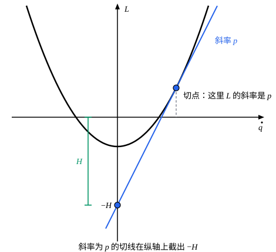

## 这一节要回答的问题

:term[拉格朗日方程]{id="physics.analytical-mechanics.lagrange-equations"}（Lagrange's equations）是$n$个二阶方程，要知道此刻的$q$和$\dot q$才能往下算。上一节的:term[能量函数]{id="physics.analytical-mechanics.energy-function"}（energy function）$h=\sum_jp_j\dot q_j-L$里，速度和:term[广义动量]{id="physics.analytical-mechanics.generalized-momentum"}（generalized momentum）同时出现。如果干脆用$q$和$p$来描述系统，$h$会变成什么样子？运动方程能不能写成$2n$个一阶方程，让坐标和动量的地位对等？

## 讲解

### 从速度换成动量

先看最简单的情形。质点做一维运动，:term[拉格朗日量]{id="physics.analytical-mechanics.lagrangian"}（Lagrangian）$L=\frac12m\dot q^2-V(q)$，:term[广义动量]{id="physics.analytical-mechanics.generalized-momentum"}$p=m\dot q$，:term[能量函数]{id="physics.analytical-mechanics.energy-function"}$h=p\dot q-L=\frac12m\dot q^2+V(q)$。把$\dot q=\frac{p}{m}$代进去，得到一个以$q$、$p$为自变量的函数

$$
H(q,p)=\frac{p^2}{2m}+V(q).
$$

它对两个自变量的偏导数恰好给出运动：$\frac{\partial H}{\partial p}=\frac{p}{m}=\dot q$；$\frac{\partial H}{\partial q}=V'(q)$，而:term[拉格朗日方程]{id="physics.analytical-mechanics.lagrange-equations"}说$\dot p=\frac{\partial L}{\partial q}=-V'(q)$，所以$\dot p=-\frac{\partial H}{\partial q}$。一个二阶方程$m\ddot q=-V'(q)$变成了两个一阶方程。

一般地，$L(q,\dot q,t)$给出$n$个广义动量$p_j=\frac{\partial L}{\partial\dot q_j}$，要把它们倒过来，把每个:term[广义速度]{id="physics.analytical-mechanics.generalized-velocity"}（generalized velocity）$\dot q_j$写成$q$、$p$、$t$的函数。$L=T-V$时，动能里的二次部分$T_2$对任何不为零的广义速度都是正的，$L$对广义速度是严格凸的，所以这样的反解存在而且唯一。$p_j$是$\dot q$的一次式，实际做时解一组一次方程就行（例 2）。

::anchor{id="def-hamiltonian"}
把能量函数里的广义速度都换成$q$、$p$、$t$的函数，得到的$H(q,p,t)=\sum_jp_j\dot q_j-L$叫作系统的:term[哈密顿量]{id="physics.analytical-mechanics.hamiltonian"}（Hamiltonian），式中的$\dot q_j$都已用$q$、$p$、$t$表示。从$L(q,\dot q,t)$到$H(q,p,t)$的这一步，是对广义速度做勒让德变换（Legendre transform）：$q$和$t$只是旁观的参数，换掉的是$\dot q$，换上来的是$L$对它的导数$p$。

为什么这样定义：勒让德变换换掉自变量而不丢信息，下面会看到$\frac{\partial H}{\partial p_j}=\dot q_j$，由$H$又能把$L$变回来。选$p$而不选$\dot q$作自变量，是因为这样运动方程里$q$和$p$的地位几乎对称，只差一个负号。$H$和$h$的值处处相同，只是自变量不同，所以$H$守恒的条件、等于机械能的条件都和$h$一样。

反例：$L=a(q)\dot q-V(q)$对$\dot q$是一次的，$p=a(q)$根本不含$\dot q$，给定$p$解不出速度，勒让德变换做不了；这样的$L$没有正的动能项，不会是$T-V$。边界情况：$H$和$h$的值相同，偏导数却可以不同，因为求偏导数时保持不变的量不同。平面上的质点用极坐标，$h=\frac12m(\dot r^2+r^2\dot\varphi^2)+V(r)$，$H=\frac{p_r^2}{2m}+\frac{p_\varphi^2}{2mr^2}+V(r)$：保持$\dot\varphi$不变时$\frac{\partial h}{\partial r}=mr\dot\varphi^2+V'(r)$，保持$p_\varphi$不变时$\frac{\partial H}{\partial r}=-mr\dot\varphi^2+V'(r)$，离心项的符号相反。

### 正则方程

::anchor{id="def-hamiltons-equations"}
设$q(t)$满足:term[拉格朗日方程]{id="physics.analytical-mechanics.lagrange-equations"}，$p_j=\frac{\partial L}{\partial\dot q_j}$是沿着运动的:term[广义动量]{id="physics.analytical-mechanics.generalized-momentum"}，那么$q(t)$、$p(t)$满足:term[哈密顿正则方程]{id="physics.analytical-mechanics.hamiltons-equations"}（Hamilton's canonical equations），简称正则方程：$\dot q_j=\frac{\partial H}{\partial p_j}$，$\dot p_j=-\frac{\partial H}{\partial q_j}$，$j=1,\dots,n$。反过来，满足正则方程的$q(t)$也满足拉格朗日方程，而$p(t)$就是它的广义动量。

证明分两步。第一步是三个恒等式，对任何$(q,p,t)$都成立，和运动无关。记反解出来的:term[广义速度]{id="physics.analytical-mechanics.generalized-velocity"}为$v_k(q,p,t)$，于是$H=\sum_kp_kv_k-L(q,v,t)$，由链式法则

$$
\frac{\partial H}{\partial p_j}=v_j+\sum_k\Bigl(p_k-\frac{\partial L}{\partial\dot q_k}\Bigr)\frac{\partial v_k}{\partial p_j}=v_j ,
$$

括号里是零，因为$v$正是让$\frac{\partial L}{\partial\dot q_k}=p_k$的速度。同样的道理给出

$$
\frac{\partial H}{\partial q_j}=-\frac{\partial L}{\partial q_j},\qquad \frac{\partial H}{\partial t}=-\frac{\partial L}{\partial t},
$$

右边是$L(q,\dot q,t)$保持$\dot q$不变的偏导数，在$\dot q=v$处取值。

第二步看运动。沿着运动$\dot q_j=v_j$，第一个恒等式就是$\dot q_j=\frac{\partial H}{\partial p_j}$；拉格朗日方程说$\dot p_j=\frac{\partial L}{\partial q_j}$，由第二个恒等式它等于$-\frac{\partial H}{\partial q_j}$。反过来，若$q(t)$、$p(t)$满足正则方程，第一组方程说$\dot q_j=v_j$，即$p_j=\frac{\partial L}{\partial\dot q_j}$是广义动量，第二组方程再由恒等式变回拉格朗日方程。

沿着运动，$\dv{H}{t}=\sum_j\bigl(\frac{\partial H}{\partial q_j}\dot q_j+\frac{\partial H}{\partial p_j}\dot p_j\bigr)+\frac{\partial H}{\partial t}$，把正则方程代进去，括号里的两项正好相消：

$$
\dv{H}{t}=\frac{\partial H}{\partial t}=-\frac{\partial L}{\partial t}.
$$

这和上一节的$\dv{h}{t}=-\frac{\partial L}{\partial t}$一致：$H$不显含时间时守恒。

### 用哈密顿量写方程

求:term[哈密顿量]{id="physics.analytical-mechanics.hamiltonian"}的步骤是：写出$L$；求出$p_j=\frac{\partial L}{\partial\dot q_j}$，解出$\dot q_j$；代进$\sum_jp_j\dot q_j-L$。各质点的位置$\vb{r}_i$不显含时间、势能只依赖位置时，$H$就是机械能$T+V$，这是上一节对$h$的结论；这时只要把动能改用动量写出来，比如把$\frac12m\dot q^2$写成$\frac{p^2}{2m}$。

:term[循环坐标]{id="physics.analytical-mechanics.cyclic-coordinate"}（cyclic coordinate）在$H$里同样不出现：由恒等式$\frac{\partial H}{\partial q_k}=-\frac{\partial L}{\partial q_k}$，$L$不含$q_k$时$H$也不含。这时:term[正则方程]{id="physics.analytical-mechanics.hamiltons-equations"}给出$\dot p_k=0$，$p_k$是常数，可以直接把这个常数代进$H$：别的变量的方程只对别的$q$、$p$求偏导数，$p_k$在其中本来就不变。讲循环坐标时说过，把守恒量代进$L$会把有效势（effective potential）的符号弄反；代进$H$却没有问题，原因正是上面说的「保持不变的量不同」（例 1）。

## 几何图像

固定$q$和$t$，:term[拉格朗日量]{id="physics.analytical-mechanics.lagrangian"}是:term[广义速度]{id="physics.analytical-mechanics.generalized-velocity"}的凸函数，图里的曲线是$L=\frac12m\dot q^2-V$（取$m=1$、$V=1$）。斜率为$p$的切线只和曲线相切于一点，切点的横坐标就是满足$\frac{\partial L}{\partial\dot q}=p$的速度；切线在纵轴上的截距是$L-p\dot q=-H$。

:::anim{component="function-plot"}
range: { x: [-3, 3.5], y: [-4.5, 3] }
functions:
  - expr: "x^2/2 - 1"
    label: |
      $L=\frac12\dot q^2-1$
  - expr: "p*x - (p^2/2 + 1)"
    label: |
      斜率为$p$的切线
points:
  - { x: "p", y: "p^2/2 - 1" }
  - { x: "0", y: "-(p^2/2 + 1)" }
sliders:
  - name: p
    min: -2.5
    max: 2.5
    step: 0.05
    default: 1.5
    label: |
      广义动量$p$
:::

横轴是广义速度$\dot q$。拖动$p$：切点跟着移到$\dot q=p$处，纵轴上的截距$-H=-\bigl(\frac{p^2}{2}+1\bigr)$随之上下移动，$H$正是动能加势能。曲线是凸的，每个斜率只对应一个切点，所以从$p$能唯一地找回$\dot q$；如果$L$对$\dot q$是一次式，曲线成了直线，只有一个斜率，勒让德变换就做不了。

## 例题

### 例 1　有心力问题的哈密顿量

质量$m$的质点在平面上受有心力，势能是$V(r)$。用极坐标写出:term[哈密顿量]{id="physics.analytical-mechanics.hamiltonian"}和:term[正则方程]{id="physics.analytical-mechanics.hamiltons-equations"}，并由它们得到$r$满足的一维问题。

**为什么想到这么做**：质点的位置$(r\cos\varphi,\ r\sin\varphi)$不显含时间，势能只依赖位置，所以$H=T+V$，只要把动能改用动量写。$\varphi$是:term[循环坐标]{id="physics.analytical-mechanics.cyclic-coordinate"}，$p_\varphi$守恒，在$H$里可以直接代入。

**推导**：$L=\frac12m(\dot r^2+r^2\dot\varphi^2)-V(r)$，$p_r=m\dot r$，$p_\varphi=mr^2\dot\varphi$，所以$\dot r=\frac{p_r}{m}$，$\dot\varphi=\frac{p_\varphi}{mr^2}$，

$$
H=\frac{p_r^2}{2m}+\frac{p_\varphi^2}{2mr^2}+V(r).
$$

正则方程是

$$
\dot r=\frac{p_r}{m},\qquad \dot\varphi=\frac{p_\varphi}{mr^2},\qquad \dot p_r=\frac{p_\varphi^2}{mr^3}-V'(r),\qquad \dot p_\varphi=0 .
$$

$p_\varphi$是常数，$r$和$p_r$的方程只含这个常数，等同于一维运动的$H_r=\frac{p_r^2}{2m}+V(r)+\frac{p_\varphi^2}{2mr^2}$，后两项之和就是有效势。$\dot p_r$里的离心项$+\frac{p_\varphi^2}{mr^3}$符号正确：把守恒量代进$H$不会出代进$L$时的那个错。

### 例 2　斜面和滑块

讲:term[拉格朗日方程]{id="physics.analytical-mechanics.lagrange-equations"}时例 1 的系统：质量$M$、倾角$\alpha$的斜面放在光滑地面上，质量$m$的滑块从光滑斜面上滑下，:term[广义坐标]{id="physics.analytical-mechanics.generalized-coordinates"}（generalized coordinates）是斜面的位置$X$和滑块沿斜面下滑的距离$s$。求:term[哈密顿量]{id="physics.analytical-mechanics.hamiltonian"}，并用:term[正则方程]{id="physics.analytical-mechanics.hamiltons-equations"}求滑块沿斜面的加速度。

**为什么想到这么做**：这里两个:term[广义动量]{id="physics.analytical-mechanics.generalized-momentum"}都混着两个速度，要解一组一次方程才能把速度换成动量。$X$是:term[循环坐标]{id="physics.analytical-mechanics.cyclic-coordinate"}，$p_X$守恒；$s$只出现在势能里，所以$\dot p_s$是常数，运动一下子就清楚了。

**推导**：由$L=\frac12(M+m)\dot X^2+m\cos\alpha\,\dot X\dot s+\frac12m\dot s^2+mgs\sin\alpha$，

$$
p_X=(M+m)\dot X+m\cos\alpha\,\dot s,\qquad p_s=m\cos\alpha\,\dot X+m\dot s .
$$

由第二式$\dot s=\frac{p_s}{m}-\cos\alpha\,\dot X$，代进第一式解出$\dot X$，记$D=M+m\sin^2\alpha$：

$$
\dot X=\frac{p_X-\cos\alpha\,p_s}{D},\qquad \dot s=\frac{(M+m)\,p_s-m\cos\alpha\,p_X}{mD}.
$$

位置不显含时间、势能只依赖位置，$H=T+V$。这时动能只有二次部分$T_2$，上一节证明过$\sum_j\dot q_j\frac{\partial T_2}{\partial\dot q_j}=2T_2$，而$p_j=\frac{\partial T}{\partial\dot q_j}$，所以$T=\frac12(p_X\dot X+p_s\dot s)$，

$$
H=\frac{m\,p_X^2-2m\cos\alpha\,p_Xp_s+(M+m)\,p_s^2}{2mD}-mgs\sin\alpha .
$$

$H$不含$X$，$\dot p_X=0$；$H$只在势能里含$s$，$\dot p_s=-\frac{\partial H}{\partial s}=mg\sin\alpha$。两个动量的变化都知道了，对上面$\dot s$的式子求导：

$$
\ddot s=\frac{(M+m)\,\dot p_s}{mD}=\frac{(M+m)\,g\sin\alpha}{M+m\sin^2\alpha},
$$

和讲拉格朗日方程时的结果一样。

## 常见误区

- 「:term[哈密顿量]{id="physics.analytical-mechanics.hamiltonian"}就是把:term[能量函数]{id="physics.analytical-mechanics.energy-function"}里的$\dot q$换成$\frac{p}{m}$。」只有$p=m\dot q$时才这么简单；一般要从$p_j=\frac{\partial L}{\partial\dot q_j}$解出速度，例 2 的两个动量都混着两个速度。
- 「$H$和$h$的值一样，所以$\frac{\partial H}{\partial q}=\frac{\partial h}{\partial q}$。」求偏导数时保持不变的量不同：$H$保持$p$不变，$h$保持$\dot q$不变；极坐标里两者的离心项符号相反。
- 「$H$总是动能加势能。」和能量函数一样，要各质点的位置不显含时间、势能只依赖位置才行；转动铁丝上的珠子，$H=\frac{p^2}{2m}-\frac12ms^2\omega^2$守恒，却不是机械能。
- 「:term[正则方程]{id="physics.analytical-mechanics.hamiltons-equations"}有$2n$个，比:term[拉格朗日方程]{id="physics.analytical-mechanics.lagrange-equations"}多，包含的信息也更多。」$n$个二阶方程和$2n$个一阶方程等价：前$n$个只是把$p$的定义倒过来写。
