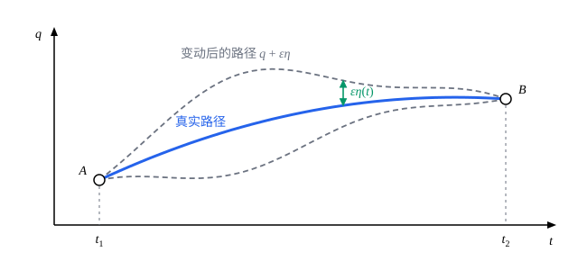

## 这一节要回答的问题

:term[拉格朗日方程]{id="physics.analytical-mechanics.lagrange-equations"}（Lagrange's equations）是微分方程，说的是每一时刻：知道此刻的位置和速度，就知道此刻的加速度。能不能换个角度，把整段运动一次看完？从$t_1$时刻的位置到$t_2$时刻的位置，有无数条路可走，系统偏偏走了其中一条：有没有一个量，让真实的那条路与众不同？

## 讲解

### 作用量

先看一个例子。自由质点在$t=0$时在$x=0$，$t=T$时到$x=d$，真实的运动是匀速的，$x=\frac{d}{T}t$。把$\int_0^T\frac12m\dot x^2\,\dd t$对几条路径算一算：匀速路径给出$\frac{md^2}{2T}$；先慢后快的路径$x=\frac{d}{T^2}t^2$给出$\int_0^T\frac12m\bigl(\frac{2dt}{T^2}\bigr)^2\dd t=\frac{2md^2}{3T}$，更大。真实路径似乎让这个积分最小。

::anchor{id="def-action"}
系统在:term[位形空间]{id="physics.analytical-mechanics.configuration-space"}（configuration space）里沿路径$q(t)$从$t_1$走到$t_2$，:term[拉格朗日量]{id="physics.analytical-mechanics.lagrangian"}（Lagrangian）沿这条路径的积分$S[q]=\int_{t_1}^{t_2}L\bigl(q(t),\dot q(t),t\bigr)\,\dd t$叫作这条路径的:term[作用量]{id="physics.analytical-mechanics.action"}（action）。

为什么这样定义：$L$只描述某一时刻，$S$把整条路径汇总成一个数，它是路径的泛函（functional），量纲是能量乘时间。$S$依赖路径的端点和起止时间，所以只在端点和时间都相同的路径之间比较才有意义：$q(t_1)=q^{(1)}$、$q(t_2)=q^{(2)}$都固定。

### 哈密顿原理

::anchor{id="def-hamiltons-principle"}
:term[哈密顿原理]{id="physics.analytical-mechanics.hamiltons-principle"}（Hamilton's principle）：系统在$t_1$时刻处于位形$q^{(1)}$、$t_2$时刻处于位形$q^{(2)}$，在两端固定的所有路径里，真实运动让:term[作用量]{id="physics.analytical-mechanics.action"}取驻值：对任何在两端为零的$\eta(t)$，$\dv{}{\varepsilon}S[q+\varepsilon\eta]\big|_{\varepsilon=0}=0$，记作$\delta S=0$。

下面证明它和:term[拉格朗日方程]{id="physics.analytical-mechanics.lagrange-equations"}等价。$q$是$n$个函数$q_1,\dots,q_n$，$\eta$也是$n$个分量。在积分号下对$\varepsilon$求导：

$$
\dv{}{\varepsilon}S[q+\varepsilon\eta]\Big|_{\varepsilon=0}=\int_{t_1}^{t_2}\sum_j\Bigl(\frac{\partial L}{\partial q_j}\eta_j+\frac{\partial L}{\partial\dot q_j}\dot\eta_j\Bigr)\dd t .
$$

第二项分部积分，$\int\frac{\partial L}{\partial\dot q_j}\dot\eta_j\,\dd t=\Bigl[\frac{\partial L}{\partial\dot q_j}\eta_j\Bigr]_{t_1}^{t_2}-\int\dv{}{t}\frac{\partial L}{\partial\dot q_j}\,\eta_j\,\dd t$，而$\eta_j(t_1)=\eta_j(t_2)=0$，方括号为零。于是

$$
\delta S=-\int_{t_1}^{t_2}\sum_j\Bigl(\dv{}{t}\frac{\partial L}{\partial\dot q_j}-\frac{\partial L}{\partial q_j}\Bigr)\eta_j\,\dd t .
$$

如果$q(t)$满足拉格朗日方程，被积函数处处为零，$\delta S=0$。反过来，如果对所有这样的$\eta$都有$\delta S=0$，就取只有第$j$个分量不为零的$\eta$，由变分法基本引理（fundamental lemma of the calculus of variations），括号里的连续函数必须恒为零。这正是把$L$当作被积函数、把$q_1,\dots,q_n$当作未知函数时的欧拉-拉格朗日方程组（Euler–Lagrange equations）。

注意最后一步要求$\eta_1,\dots,\eta_n$能各自随意取，所以$q_j$必须是彼此独立的:term[广义坐标]{id="physics.analytical-mechanics.generalized-coordinates"}（generalized coordinates）。如果保留了:term[约束]{id="physics.analytical-mechanics.constraint"}（constraint）$f(q,t)=0$，只能在满足约束的路径之间比较，$\eta$不能各自随意取，结论要改用乘子来写：每个约束配一个未知的乘子，它给出:term[约束力]{id="physics.analytical-mechanics.constraint-force"}（constraint force）的大小，做法见[拉格朗日乘子与约束力](lesson:physics.analytical-mechanics.constraint-forces)。

### 驻值，不一定是极小

:term[哈密顿原理]{id="physics.analytical-mechanics.hamiltons-principle"}常被叫作「最小:term[作用量]{id="physics.analytical-mechanics.action"}原理」，但真实路径只保证是驻值。以谐振子$L=\frac12m\dot x^2-\frac12m\omega^2x^2$为例，$L$是二次式，所以对真实路径$x$和任意变动$\eta$，展开是精确的：

$$
S[x+\varepsilon\eta]=S[x]+\varepsilon\,\delta S+\varepsilon^2\int_{t_1}^{t_2}\Bigl(\frac12m\dot\eta^2-\frac12m\omega^2\eta^2\Bigr)\dd t ,
$$

其中$\delta S=0$。记$T=t_2-t_1$，取$\eta=\sin\frac{\pi(t-t_1)}{T}$，最后的积分等于$\frac{mT}{4}\bigl(\frac{\pi^2}{T^2}-\omega^2\bigr)$。$T<\frac{\pi}{\omega}$时它是正的；$T>\frac{\pi}{\omega}$时它是负的，变动后的路径作用量更小，真实路径就不是极小了。时间间隔足够短时，真实路径确实是极小，那要用到第二变分（second variation），这里不展开。

### 哈密顿原理的好处

:term[作用量]{id="physics.analytical-mechanics.action"}是对整条路径定义的，和坐标怎么选无关：换一组:term[广义坐标]{id="physics.analytical-mechanics.generalized-coordinates"}，同一条路径的$S$不变，所以由它推出的方程在任何坐标里都具有:term[拉格朗日方程]{id="physics.analytical-mechanics.lagrange-equations"}的形式。:term[拉格朗日量]{id="physics.analytical-mechanics.lagrangian"}也不是唯一的：给$L$加上任意函数$F(q,t)$对时间的全导数，作用量只多出$F(q^{(2)},t_2)-F(q^{(1)},t_1)$，端点固定时这是常数，驻值条件不变（例 2）。:term[哈密顿原理]{id="physics.analytical-mechanics.hamiltons-principle"}还把力学和别的领域连在一起：光走时间取驻值的路径（费马原理，Fermat's principle），电磁场、相对论和量子力学也都从作用量出发。

## 几何图像

横轴是时间，纵轴是:term[广义坐标]{id="physics.analytical-mechanics.generalized-coordinates"}。实线是真实路径，虚线是两条变动后的路径$q+\varepsilon\eta$，它们和真实路径在两端$A$、$B$重合，中间偏开$\varepsilon\eta(t)$。:term[哈密顿原理]{id="physics.analytical-mechanics.hamiltons-principle"}说：偏开的幅度$\varepsilon$很小时，:term[作用量]{id="physics.analytical-mechanics.action"}的变化比$\varepsilon$高阶。

:::anim{component="function-plot"}
range: { x: [-1, 1], y: [-1.2, 2] }
functions:
  - expr: "(T/4)*((pi/T)^2 - 1)*x^2"
    label: |
      谐振子$\omega=1$
  - expr: "(T/4)*(pi/T)^2*x^2"
    label: |
      自由质点$\omega=0$
sliders:
  - name: T
    min: 0.5
    max: 6
    step: 0.05
    default: 2
    label: |
      时间间隔$T$
:::

横轴是$\varepsilon$，纵轴是$S[x+\varepsilon\eta]-S[x]$（取$m=1$、$\eta=\sin\frac{\pi(t-t_1)}{T}$）。两条曲线在$\varepsilon=0$处都是平的，这就是驻值。拖动$T$：自由质点的抛物线总是开口向上，真实路径是极小；谐振子的抛物线在$T$超过$\pi$时翻转向下，真实路径变成了这个方向上的极大。

## 例题

### 例 1　竖直上抛：在一族路径里找作用量的驻点

质量$m$的小球在$t=0$时从地面（$y=0$）抛出，$t=T$时落回地面。在路径族$y_c(t)=c\,t(T-t)$里，哪一条的:term[作用量]{id="physics.analytical-mechanics.action"}取驻值？

**为什么想到这么做**：这一族路径都满足两端的条件，$S$变成参数$c$的普通函数，「取驻值」就是$\frac{\dd S}{\dd c}=0$。如果得到的那一条正好是自由落体的真实运动，就从一个具体例子看到了:term[哈密顿原理]{id="physics.analytical-mechanics.hamiltons-principle"}在起作用。

**推导**：$L=\frac12m\dot y^2-mgy$，$\dot y_c=c(T-2t)$。逐项积分：

$$
\int_0^T\frac12mc^2(T-2t)^2\,\dd t=\frac{mc^2T^3}{6},\qquad \int_0^Tmgc\,t(T-t)\,\dd t=\frac{mgcT^3}{6},
$$

所以$S(c)=\frac{mT^3}{6}\bigl(c^2-gc\bigr)$。令$\frac{\dd S}{\dd c}=\frac{mT^3}{6}(2c-g)=0$，得$c=\frac{g}{2}$，即$y=\frac{g}{2}t(T-t)$，竖直速度$\dot y=\frac{g}{2}(T-2t)$，加速度$-g$：正是竖直上抛的真实运动。这里驻值还是最小值，$S_{\min}=-\frac{mg^2T^3}{24}$。

### 例 2　加上全导数，方程不变

证明：$L'=L+\dv{}{t}F(q,t)$和$L$给出同样的运动方程。再用竖直方向的自由落体$L=\frac12m\dot y^2-mgy$和$L'=\frac12m\dot y^2+mgt\dot y$验证。

**为什么想到这么做**：直接对$L'$写:term[拉格朗日方程]{id="physics.analytical-mechanics.lagrange-equations"}要算很多项；用:term[作用量]{id="physics.analytical-mechanics.action"}就简单了，全导数的积分只剩端点的值，而端点是固定的。

**推导**：$S'[q]=S[q]+\int_{t_1}^{t_2}\dv{F}{t}\,\dd t=S[q]+F\bigl(q^{(2)},t_2\bigr)-F\bigl(q^{(1)},t_1\bigr)$。端点固定，后两项对所有参与比较的路径都一样，所以$S'$和$S$在同一条路径上取驻值，给出同样的运动方程。

验证：$L'-L=mgy+mgt\dot y=\dv{}{t}(mgty)$，确实是全导数。对$L'$写方程：$\frac{\partial L'}{\partial\dot y}=m\dot y+mgt$，$\frac{\partial L'}{\partial y}=0$，方程是$\dv{}{t}(m\dot y+mgt)=0$，即$m\ddot y=-mg$，和由$L$得到的一样。两个:term[拉格朗日量]{id="physics.analytical-mechanics.lagrangian"}看起来很不一样，$L'$里甚至没有势能项。

## 常见误区

- 「真实运动让:term[作用量]{id="physics.analytical-mechanics.action"}最小。」只保证驻值；谐振子的时间间隔超过半个周期时，真实路径就不是极小了。
- 「:term[哈密顿原理]{id="physics.analytical-mechanics.hamiltons-principle"}里比较的路径可以有不同的端点。」比较的是端点和起止时间都相同的路径；端点也变时，分部积分留下的边界项不再为零。
- 「系统得事先知道终点，才能挑出作用量取驻值的路径。」哈密顿原理是对整段真实运动的刻画，和:term[拉格朗日方程]{id="physics.analytical-mechanics.lagrange-equations"}等价；真实路径的每一小段也都让那一小段的作用量取驻值，用它求运动时仍然是解初值问题。
- 「作用量里的被积函数可以用能量$T+V$。」用$T+V$得到的驻值条件把力的符号弄反了，必须用$L=T-V$。
