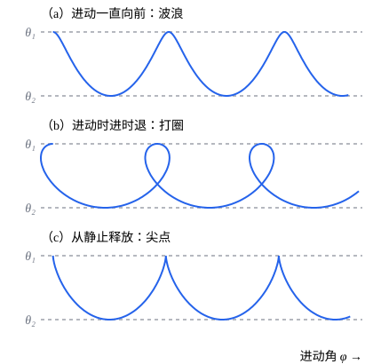

## 这一节要回答的问题

一个转得很快的陀螺（top），下端的尖端支在桌面上，对称轴（symmetry axis）倾斜着。它不倒下，而是绕竖直线慢慢转（进动，precession）；仔细看，对称轴还会上下点头。转得慢了，它晃得越来越厉害，最后倒下；转得够快，竖直的陀螺可以像睡着了一样立住不动。怎样从:term[拉格朗日量]{id="physics.analytical-mechanics.lagrangian"}（Lagrangian）出发算出这些运动，什么时候能匀速进动，要转多快才能竖直立住？

## 讲解

### 拉格朗日量和三个守恒量

设:term[对称陀螺]{id="physics.analytical-mechanics.symmetric-top"}（symmetric top）的质量是$M$，尖端$O$固定在桌面上，陀螺只能绕它转，质心（center of mass）在对称轴上、离$O$为$l$；对$O$的主转动惯量（principal moments of inertia）是$I_1=I_2$和$I_3$。取$z$轴竖直向上，用:term[欧拉角]{id="physics.analytical-mechanics.euler-angles"}（Euler angles）描述取向，$3'$轴沿对称轴：$\theta$是对称轴偏离竖直线的角，$\varphi$是对称轴的方位角（azimuth），$\psi$是陀螺绕对称轴自转的角。

由[刚体的角速度与欧拉角](lesson:physics.analytical-mechanics.rigid-body-kinematics)里:term[角速度]{id="physics.analytical-mechanics.angular-velocity"}（angular velocity）的体分量，$(\omega'_1)^2+(\omega'_2)^2=\dot\theta^2+\dot\varphi^2\sin^2\theta$，$\omega'_3=\dot\psi+\dot\varphi\cos\theta$；下面把$\omega'_3$简写成$\omega_3$。动能是$\frac12I_1\bigl((\omega'_1)^2+(\omega'_2)^2\bigr)+\frac12I_3\omega_3^2$，势能是$Mgl\cos\theta$，所以

$$
L=\frac12I_1\bigl(\dot\theta^2+\dot\varphi^2\sin^2\theta\bigr)+\frac12I_3\bigl(\dot\psi+\dot\varphi\cos\theta\bigr)^2-Mgl\cos\theta .
$$

$\varphi$、$\psi$都不出现在$L$里，是:term[循环坐标]{id="physics.analytical-mechanics.cyclic-coordinate"}（cyclic coordinate），对应的:term[广义动量]{id="physics.analytical-mechanics.generalized-momentum"}（generalized momentum）守恒：

$$
p_\psi=I_3(\dot\psi+\dot\varphi\cos\theta)=I_3\omega_3,\qquad p_\varphi=I_1\dot\varphi\sin^2\theta+I_3\omega_3\cos\theta .
$$

$p_\psi$是角动量（angular momentum）沿对称轴的分量，$p_\varphi$是角动量的竖直分量$L_z$（p6）。从力矩（torque）看也是这样：重力对$O$的力矩水平，$L_z$不变；它又垂直于对称轴，由上一节的第三个:term[欧拉方程]{id="physics.analytical-mechanics.euler-equations"}（Euler's equations），$I_1=I_2$、$\tau_3=0$时$\omega_3$不变。支点（pivot）不动，:term[约束力]{id="physics.analytical-mechanics.constraint-force"}（constraint force）不做功，重力是保守力（conservative force），所以能量$E=\frac12I_1(\dot\theta^2+\dot\varphi^2\sin^2\theta)+\frac{p_\psi^2}{2I_3}+Mgl\cos\theta$也守恒。

### 有效势

::anchor{id="thm-top-effective-potential"}
定理：记$E'=E-\frac{p_\psi^2}{2I_3}$，倾角满足一维的能量方程

$$
\frac12I_1\dot\theta^2+U(\theta)=E',\qquad U(\theta)=\frac{(p_\varphi-p_\psi\cos\theta)^2}{2I_1\sin^2\theta}+Mgl\cos\theta ,
$$

而方位角和自转角的变化率是$\dot\varphi=\frac{p_\varphi-p_\psi\cos\theta}{I_1\sin^2\theta}$、$\dot\psi=\frac{p_\psi}{I_3}-\dot\varphi\cos\theta$。

证明：由$p_\varphi$的式子解出$\dot\varphi$，代进$E$，$\frac12I_1\dot\varphi^2\sin^2\theta=\frac{(p_\varphi-p_\psi\cos\theta)^2}{2I_1\sin^2\theta}$，移项即得；$\dot\psi$由$p_\psi=I_3(\dot\psi+\dot\varphi\cos\theta)$解出。

这和[有心力与有效势](lesson:physics.newtonian-mechanics.central-forces)里径向运动的处理一样：两个守恒的动量把$\varphi$、$\psi$消掉，只剩$\theta$在$U(\theta)$里做一维运动，$U$起着有效势（effective potential）的作用，$\theta$只能取$U(\theta)\le E'$的值。$|p_\varphi|\ne|p_\psi|$时，$\theta\to0$或$\theta\to\pi$都使$U\to+\infty$，所以$\theta$总在两个转折角（turning points）$\theta_1\le\theta\le\theta_2$之间，那里$U(\theta)=E'$、$\dot\theta=0$。

### 匀速进动

::anchor{id="thm-steady-precession"}
定理：设$0<\theta_0<\frac\pi2$。倾角一直保持$\theta_0$、$\dot\varphi$为常数的运动存在，当且仅当$\dot\varphi$满足

$$
I_1\cos\theta_0\,\dot\varphi^2-I_3\omega_3\,\dot\varphi+Mgl=0 ;
$$

所以这样的匀速进动存在，当且仅当$I_3^2\omega_3^2\ge4I_1Mgl\cos\theta_0$。

证明：$\theta$的:term[拉格朗日方程]{id="physics.analytical-mechanics.lagrange-equations"}（Lagrange's equations）是$I_1\ddot\theta=I_1\dot\varphi^2\sin\theta\cos\theta-I_3\omega_3\dot\varphi\sin\theta+Mgl\sin\theta$，对$\theta$求偏导时，$\frac12I_3(\dot\psi+\dot\varphi\cos\theta)^2$里的$\cos\theta$也要求导。$\theta\equiv\theta_0$时左边为零，约去$\sin\theta_0\ne0$就得到这个二次方程。反过来，$\dot\varphi$满足它时，取$\theta\equiv\theta_0$，$\dot\varphi$、$\dot\psi$为常数，三个拉格朗日方程都成立；二次方程有实根当且仅当判别式（discriminant）$I_3^2\omega_3^2-4I_1Mgl\cos\theta_0\ge0$。

快陀螺（fast top）的$I_3^2\omega_3^2\gg4I_1Mgl\cos\theta_0$，用$\sqrt{1-x}\approx1-\frac x2$，两个根近似是$\dot\varphi\approx\frac{Mgl}{I_3\omega_3}$和$\dot\varphi\approx\frac{I_3\omega_3}{I_1\cos\theta_0}$。慢的那个正是[陀螺与进动](lesson:physics.newtonian-mechanics.gyroscopes)里由「力矩等于角动量的变化率」得到的进动:term[角速度]{id="physics.analytical-mechanics.angular-velocity"}；快的那个和重力几乎无关，这时$\vb{L}$几乎竖直，它就是上一节自由:term[对称陀螺]{id="physics.analytical-mechanics.symmetric-top"}绕$\vb{L}$进动的角速度$|\vb{L}|/I_1$。转得不够快（判别式为负）时根本不可能匀速进动，陀螺要么倒下，要么剧烈地上下晃动。

### 章动

::anchor{id="def-nutation"}
一般的运动里，$\theta$在两个转折角$\theta_1$、$\theta_2$之间周期性地来回变化，对称轴一边进动、一边上下点头，这种运动叫作:term[章动]{id="physics.analytical-mechanics.nutation"}（nutation）。

为什么这样定义：进动只说对称轴绕竖直线转，章动描述的是另一个:term[自由度]{id="physics.analytical-mechanics.degrees-of-freedom"}（degrees of freedom）$\theta$的振动，两者合起来才是对称轴的完整运动。天文学里也用这个词：地球自转轴除了约$2.6$万年一周的岁差（precession of the equinoxes），还有周期约$18.6$年的小幅点头，是月球轨道面的进动造成的。边界情况：$\theta_1=\theta_2$就是上面的匀速进动，没有章动；用手扶着斜放、再放开的陀螺，一般都会章动。

由$\dot\varphi=\frac{p_\varphi-p_\psi\cos\theta}{I_1\sin^2\theta}$，进动的方向由$p_\varphi-p_\psi\cos\theta$的符号决定。它在$\theta_1$到$\theta_2$之间不变号时，对称轴一直向同一个方向进动；变号时，对称轴的轨迹打圈；从静止放开（起初$\dot\theta=\dot\varphi=0$）时，起点$\theta_0=\theta_1$处恰好$\dot\varphi=0$，轨迹出现尖点（cusp）。转得很快的陀螺从静止放开，章动的幅度约$\frac{2I_1Mgl\sin\theta_0}{I_3^2\omega_3^2}$，角频率（angular frequency）约$\frac{I_3\omega_3}{I_1}$，平均进动:term[角速度]{id="physics.analytical-mechanics.angular-velocity"}约$\frac{Mgl}{I_3\omega_3}$（p5）：章动又快又小，肉眼看去就是匀速进动。

### 竖直的陀螺

::anchor{id="thm-sleeping-top"}
定理（睡陀螺，sleeping top）：对称轴竖直、$p_\varphi=p_\psi$的陀螺，若$I_3^2\omega_3^2>4I_1Mgl$，$\theta=0$是$U(\theta)$的严格极小值，竖直的转动稳定；若$I_3^2\omega_3^2<4I_1Mgl$，$\theta=0$是$U$的严格极大值，竖直的转动不稳定。

证明：$p_\varphi=p_\psi$时$\frac{p_\varphi-p_\psi\cos\theta}{\sin\theta}=p_\psi\frac{1-\cos\theta}{\sin\theta}=p_\psi\tan\frac\theta2$，所以$U(\theta)=\frac{p_\psi^2}{2I_1}\tan^2\frac\theta2+Mgl\cos\theta$，在$\theta=0$处也有定义。由泰勒公式（Taylor's formula），$\tan^2\frac\theta2=\frac{\theta^2}{4}+O(\theta^4)$，$\cos\theta=1-\frac{\theta^2}{2}+O(\theta^4)$，于是$U(\theta)=Mgl+\frac12\Bigl(\frac{p_\psi^2}{4I_1}-Mgl\Bigr)\theta^2+O(\theta^4)$。二次项系数为正时$\theta=0$是严格极小值（strict local minimum），$E'$只比$U(0)$大一点，$U(\theta)\le E'$就把$\theta$限制在$0$附近；为负时是严格极大值，$\theta$一离开$0$，$U$下降，动能增加，$\theta$越来越大。

对称轴竖直时$L_z$和角动量沿对称轴的分量是同一个量，所以$p_\varphi=p_\psi$。要竖直立住，转速必须满足$\omega_3>\frac{2\sqrt{I_1Mgl}}{I_3}$。真实的陀螺受摩擦，转速慢慢降低，一旦低于这个值，就开始摇晃，最后倒下。

## 几何图像

横轴是进动角$\varphi$，纵轴是倾角$\theta$（向下增大，对称轴越低），曲线是对称轴方向随时间画出的轨迹，由数值积分得到；三种情形都取$I_1=1$、$Mgl=1$、$I_3\omega_3=3$，起初$\theta=0.6$、$\dot\theta=0$，只有起初的$\dot\varphi$不同。$\theta$总在两条虚线$\theta_1$、$\theta_2$之间来回，这就是:term[章动]{id="physics.analytical-mechanics.nutation"}，每幅图的纵向按各自的$\theta_1$、$\theta_2$拉伸。（a）起初$\dot\varphi=0.2$，进动一直向前，轨迹是波浪；（b）起初$\dot\varphi=-0.45$，$\dot\varphi$在$\theta_1$附近变号，轨迹打圈；（c）从静止放开，在$\theta_1$处$\dot\varphi=0$，轨迹出现尖点，对称轴先往下掉，再回到原来的高度。

:::anim{component="function-plot"}
range: { x: [0, 3.1416], y: [-1.5, 2.5] }
functions:
  - expr: "s^2*(cos(a) - cos(x))^2/(2*sin(x)^2) + cos(x)"
    label: |
      $U(\theta)$
  - expr: "cos(a)"
    label: |
      $E'$
points:
  - { x: "a", y: "cos(a)" }
  - { x: "acos((s^2 - sqrt(s^4 - 8*(s^2*cos(a) - 2)))/4)", y: "cos(a)" }
sliders:
  - name: s
    min: 0
    max: 6
    step: 0.1
    default: 3
    label: |
      自转$I_3\omega_3=s$
  - name: a
    min: 0.2
    max: 1.4
    step: 0.05
    default: 0.6
    label: |
      放手时的倾角$\theta_0=a$
:::

单位取$I_1=1$、$Mgl=1$，横轴是$\theta$。陀螺在倾角$\theta_0$处从静止放开（只在自转），$p_\varphi=p_\psi\cos\theta_0$，$E'=Mgl\cos\theta_0$；曲线是$U(\theta)$，水平线是$E'$。$\theta$只能在曲线低于水平线的范围里，也就是两个点之间：左边的点是放手的位置$\theta_0$，右边的点是对称轴掉到的最低处。$s$越大两点越靠近，章动越小；$s=0$时陀螺根本不转，右边的点到了$\theta=\pi$，它像摆一样倒了下去。

## 例题

### 例 1　玩具陀螺的两种匀速进动

一个玩具陀螺$M=0.5\,\mathrm{kg}$，质心离尖端$l=4\,\mathrm{cm}$，对尖端的主转动惯量$I_1=1.0\times10^{-3}\,\mathrm{kg\cdot m^2}$、$I_3=2.0\times10^{-4}\,\mathrm{kg\cdot m^2}$，以$\omega_3=300\,\mathrm{rad/s}$自转，对称轴倾斜$\theta_0=30^\circ$，取$g=9.8\,\mathrm{m/s^2}$。求两种匀速进动的:term[角速度]{id="physics.analytical-mechanics.angular-velocity"}，并和$\frac{Mgl}{I_3\omega_3}$比较。

**为什么想到这么做**：匀速进动的$\dot\varphi$由讲解里的二次方程决定，直接解它；再看慢的那个根和陀螺仪（gyroscope）近似差多少。

**推导**：$Mgl=0.196\,\mathrm{N\cdot m}$，$I_3\omega_3=0.06\,\mathrm{kg\cdot m^2/s}$，$4I_1Mgl\cos\theta_0\approx6.79\times10^{-4}$，判别式$I_3^2\omega_3^2-4I_1Mgl\cos\theta_0\approx2.92\times10^{-3}$，开方约$0.0540$。$2I_1\cos\theta_0\approx1.732\times10^{-3}$，两个根是$\dot\varphi\approx\frac{0.06\mp0.0540}{1.732\times10^{-3}}$，约$3.44\,\mathrm{rad/s}$和$65.8\,\mathrm{rad/s}$。陀螺仪近似给出$\frac{Mgl}{I_3\omega_3}\approx3.27\,\mathrm{rad/s}$，和慢的那个差约$5\%$，转得越快差得越少。要能匀速进动，判别式不能为负，即$\omega_3\ge\frac{2\sqrt{I_1Mgl\cos\theta_0}}{I_3}\approx130\,\mathrm{rad/s}$。

### 例 2　陀螺什么时候能竖直立住

例 1 的陀螺竖直地转，转速至少要多大？设摩擦使它每秒损失$1\%$的转速，即$\omega_3=300e^{-0.01t}\,\mathrm{rad/s}$，大约多久以后它开始摇晃？

**为什么想到这么做**：竖直时$\theta=0$，看有效势在$\theta=0$处是极小还是极大，就是讲解里睡陀螺的条件。

**推导**：$\omega_3>\frac{2\sqrt{I_1Mgl}}{I_3}=\frac{2\sqrt{1.0\times10^{-3}\times0.196}}{2.0\times10^{-4}}=140\,\mathrm{rad/s}$。转速降到$140\,\mathrm{rad/s}$要$t=100\ln\frac{300}{140}\approx76\,\mathrm{s}$。此后竖直的转动不再稳定，一点扰动就会让它晃起来、倾倒，变成带着:term[章动]{id="physics.analytical-mechanics.nutation"}的进动。

## 常见误区

- 「陀螺不倒，是因为转动把重力抵消了。」重力的力矩一直在改变$\vb{L}$的水平部分，造成进动；能量也守恒，从静止放开的陀螺，对称轴先往下掉一点，:term[章动]{id="physics.analytical-mechanics.nutation"}时的平均倾角比放手时大。
- 「进动:term[角速度]{id="physics.analytical-mechanics.angular-velocity"}就是$\frac{Mgl}{I_3\omega_3}$。」这是快陀螺慢进动的近似；严格的匀速进动有两个解，转得不够快时一个也没有。
- 「斜着放开转动的陀螺，马上就会匀速进动。」从静止放开时$\dot\varphi=0$，陀螺先往下掉、再回来，轨迹有尖点；要匀速进动，必须同时给它恰好的$\dot\varphi$。
- 「$\omega_3$就是$\dot\psi$。」$\omega_3=\dot\psi+\dot\varphi\cos\theta$，守恒的是它，不是$\dot\psi$；进动也贡献了一部分绕对称轴的转动。
