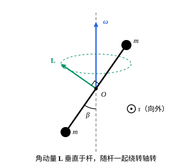

## 这一节要回答的问题

定轴转动（fixed-axis rotation）时，角动量（angular momentum）沿转轴的分量是$L_z=I\omega$，转动动能（rotational kinetic energy）是$\frac12I\omega^2$，转动惯量（moment of inertia）$I=\sum_im_id_i^2$只和质量相对转轴的分布有关。刚体（rigid body）绕固定点转动、:term[角速度]{id="physics.analytical-mechanics.angular-velocity"}（angular velocity）可以指向任何方向时，角动量还和角速度同向吗？汽车的轮子装得稍微歪一点，转快了，轴承（bearing）就会受到周期性的力，这和角动量的方向有什么关系？

## 讲解

### 惯性张量

设刚体绕固定点$O$转动，:term[角速度]{id="physics.analytical-mechanics.angular-velocity"}是$\boldsymbol{\omega}$，第$i$个质点的质量是$m_i$，相对$O$的位置是$\vb{r}_i=(x_i,y_i,z_i)\T$，也写作$(x_{i1},x_{i2},x_{i3})\T$，速度是$\vb{v}_i=\boldsymbol{\omega}\times\vb{r}_i$（见[刚体的角速度与欧拉角](lesson:physics.analytical-mechanics.rigid-body-kinematics)）。用$\vb{a}\times(\vb{b}\times\vb{c})=\vb{b}(\vb{a}\cdot\vb{c})-\vb{c}(\vb{a}\cdot\vb{b})$，对$O$的角动量是

$$
\vb{L}=\sum_im_i\vb{r}_i\times(\boldsymbol{\omega}\times\vb{r}_i)=\sum_im_i\bigl(r_i^2\boldsymbol{\omega}-(\vb{r}_i\cdot\boldsymbol{\omega})\vb{r}_i\bigr),
$$

它的第$j$个分量是$L_j=\sum_kI_{jk}\omega_k$，系数$I_{jk}=\sum_im_i\bigl(r_i^2\delta_{jk}-x_{ij}x_{ik}\bigr)$只和质量分布有关，$\delta_{jk}$在$j=k$时为$1$、否则为$0$。

::anchor{id="def-inertia-tensor"}
以$I_{jk}$为元素的$3\times3$对称矩阵（symmetric matrix）$I$叫作刚体对$O$点的:term[惯性张量]{id="physics.analytical-mechanics.inertia-tensor"}（inertia tensor），于是$\vb{L}=I\boldsymbol{\omega}$。连续分布的刚体把求和换成体积分，$I_{jk}=\iiint\rho\,(r^2\delta_{jk}-x_jx_k)\,\dd V$，$\rho$是密度。对角元如$I_{11}=\sum_im_i(y_i^2+z_i^2)$是对坐标轴的转动惯量；非对角元如$I_{12}=-\sum_im_ix_iy_i$叫作惯量积（product of inertia）。

::anchor{id="thm-rotational-kinetic-energy"}
定理：刚体绕固定点转动的动能是$T=\frac12\boldsymbol{\omega}\cdot\vb{L}=\frac12\boldsymbol{\omega}\T I\boldsymbol{\omega}$。

证明：$T=\frac12\sum_im_i|\boldsymbol{\omega}\times\vb{r}_i|^2$。三重积（triple product）可以轮换，$(\boldsymbol{\omega}\times\vb{r}_i)\cdot(\boldsymbol{\omega}\times\vb{r}_i)=\boldsymbol{\omega}\cdot\bigl(\vb{r}_i\times(\boldsymbol{\omega}\times\vb{r}_i)\bigr)$；乘$\frac12m_i$再求和，括号里的和正是$\vb{L}$。

为什么这样定义：$I$把角速度线性地变成角动量，又给出动能，而且只和质量分布有关，刚体怎样转都用同一个$I$。绕单位矢量$\vb{n}$方向的轴转动时$\boldsymbol{\omega}=\omega\vb{n}$，$T=\frac12(\vb{n}\T I\vb{n})\omega^2$，对比定轴转动的$\frac12I\omega^2$，$\vb{n}\T I\vb{n}=\sum_im_i\bigl(r_i^2-(\vb{n}\cdot\vb{r}_i)^2\bigr)=\sum_im_id_i^2$就是对这根轴的转动惯量，$d_i$是第$i$个质点到这根轴的距离。绕$z$轴转时$L_z=I_{33}\omega$，和定轴转动一致；但$\vb{L}$还有分量$I_{13}\omega$、$I_{23}\omega$，惯量积不为零时，角动量不沿转轴。

边界情况：所有质点都在过$O$的一条直线上（细杆）时，绕这条直线的转动惯量是零，$I$只是半正定（positive semidefinite）的；其他情况下，对任何单位矢量$\vb{n}$都有$\vb{n}\T I\vb{n}>0$，$I$正定（positive definite）。

$I$的元素和坐标轴的选取有关。换一组右手正交规范基（orthonormal basis），新的基矢量排成:term[转动矩阵]{id="physics.analytical-mechanics.rotation-matrix"}（rotation matrix）$Q$的各列，矢量的分量变成$Q\T\boldsymbol{\omega}$、$Q\T\vb{L}$，由$Q\T\vb{L}=(Q\T IQ)(Q\T\boldsymbol{\omega})$，新的元素是$Q\T IQ$；按这种方式变换的量是二阶张量（tensor），「惯性张量」的名字由此而来。在体坐标轴（body axes）下，各质点的坐标不随时间变，$I$是常数矩阵；在空间坐标轴（space axes）下，$I=RI'R\T$随刚体转动而变，$I'$是体坐标轴下的惯性张量。所以讲刚体的转动时，通常在体坐标轴下写$\vb{L}$和$T$。

### 惯量主轴

$I$是实对称矩阵（real symmetric matrix）。由谱定理（spectral theorem），有一组正交规范的特征向量（eigenvector）$\vb{u}_1,\vb{u}_2,\vb{u}_3$，$I\vb{u}_k=I_k\vb{u}_k$；必要时把其中一个换成相反方向，可以让它们构成右手系（right-handed system）。

::anchor{id="def-principal-axes"}
过$O$、沿$\vb{u}_1,\vb{u}_2,\vb{u}_3$的三根轴叫作刚体对$O$点的:term[惯量主轴]{id="physics.analytical-mechanics.principal-axes"}（principal axes of inertia），对应的特征值（eigenvalue）$I_1,I_2,I_3$叫作主转动惯量（principal moments of inertia）。取惯量主轴为体坐标轴，:term[惯性张量]{id="physics.analytical-mechanics.inertia-tensor"}是对角矩阵（diagonal matrix）$\operatorname{diag}(I_1,I_2,I_3)$，

$$
\vb{L}=I_1\omega'_1\vb{e}'_1+I_2\omega'_2\vb{e}'_2+I_3\omega'_3\vb{e}'_3,\qquad T=\frac12\bigl(I_1(\omega'_1)^2+I_2(\omega'_2)^2+I_3(\omega'_3)^2\bigr).
$$

为什么这样定义：在主轴坐标下三个方向互不干扰，:term[角速度]{id="physics.analytical-mechanics.angular-velocity"}沿哪根主轴，角动量就沿那根轴，$\vb{L}=I_k\boldsymbol{\omega}$；主转动惯量互不相等时，角速度不沿主轴，$\vb{L}$就和$\boldsymbol{\omega}$不平行。主轴也是转动惯量取极值（extremum）的方向：$\vb{n}\T I\vb{n}=I_1n_1^2+I_2n_2^2+I_3n_3^2$，$n_k$是$\vb{n}$在主轴上的分量，单位矢量里它的最大值、最小值在最大、最小主转动惯量的主轴上取到。边界情况：主转动惯量有相等的，主轴就不唯一；$I_1=I_2$时$1'2'$平面里任何方向都是主轴，均匀的球和立方体对中心的三个主转动惯量都相等，每个方向都是主轴（例 1）。

::anchor{id="thm-symmetry-plane"}
定理：若刚体的质量分布关于过$O$的某个平面镜面对称（mirror symmetric），这个平面的法线就是刚体对$O$点的一根惯量主轴。

证明：取这个平面为$z=0$。镜面对称是说把每个质点换到$(x,y,-z)$处，质量分布不变，所以$\sum_im_ix_iz_i$、$\sum_im_iy_iz_i$里的项成对抵消，平面上的质点贡献为零。于是$I_{13}=I_{23}=0$，$I\vb{e}_3=I_{33}\vb{e}_3$。

刚体有一根$n$次对称轴（$n$-fold symmetry axis），即绕它转$\frac{2\pi}{n}$质量分布不变，$n\ge3$时，这根轴是主轴，另外两个主转动惯量相等，证明见 p6。

### 平行轴定理

::anchor{id="thm-parallel-axis"}
定理：设刚体的总质量是$M$，质心（center of mass）$C$相对$O$的位置是$\vb{d}$，$I^C$是刚体对$C$点的:term[惯性张量]{id="physics.analytical-mechanics.inertia-tensor"}（坐标轴的方向和对$O$的相同），那么

$$
I^O_{jk}=I^C_{jk}+M\bigl(|\vb{d}|^2\delta_{jk}-d_jd_k\bigr).
$$

证明：记$\vb{r}_i=\vb{d}+\vb{s}_i$，$\vb{s}_i$是第$i$个质点相对质心的位置，$\sum_im_i\vb{s}_i=0$。代进$I_{jk}=\sum_im_i\bigl(r_i^2\delta_{jk}-x_{ij}x_{ik}\bigr)$展开，$r_i^2=|\vb{d}|^2+2\vb{d}\cdot\vb{s}_i+s_i^2$，交叉项都带着因子$\sum_im_i\vb{s}_i$，等于零。剩下的是$I^C_{jk}$，加上一个放在质心、质量为$M$的质点对$O$的惯性张量。

两边取$\vb{n}\T(\cdot)\vb{n}$，$|\vb{d}|^2-(\vb{n}\cdot\vb{d})^2$是两根平行轴之间距离的平方，得到的正是[转动动能与平行轴定理](lesson:physics.newtonian-mechanics.rotational-energy)里的平行轴定理（parallel axis theorem）。有了它，只要知道对质心的惯性张量，就能写出对任何点的。

## 几何图像

两个质量$m$的小球装在长$2a$的轻杆两端，杆过$O$、和竖直转轴成$\beta$角，整体以$\boldsymbol{\omega}$绕竖直轴转（例 2）。角动量$\vb{L}$垂直于杆，不沿转轴；刚体一转，$\vb{L}$跟着杆一起绕转轴转，箭头尖画出虚线圆。$\vb{L}$在变，就要有力矩（torque），轴承得一直提供这个力矩，轮子装歪时轴承受力就是这个原因。

:::anim{component="function-plot"}
range: { x: [0, 3.1416], y: [0, 3] }
functions:
  - expr: "2*cos(x)^2 + 2*c*sin(x)*cos(x) + sin(x)^2"
    label: |
      $\vb{n}\T I\vb{n}$
  - expr: "1.5 + sqrt(0.25 + c^2)"
    label: |
      $I_1$
  - expr: "1.5 - sqrt(0.25 + c^2)"
    label: |
      $I_2$
points:
  - { x: "0.5*atan2(2*c, 1) + pi*(1 - sign(c + 1e-9))/2", y: "1.5 + sqrt(0.25 + c^2)" }
  - { x: "0.5*atan2(2*c, 1) + pi*(1 - sign(c + 1e-9))/2 - (pi/2)*sign(0.5*atan2(2*c, 1) + pi*(1 - sign(c + 1e-9))/2 - pi/2)", y: "1.5 - sqrt(0.25 + c^2)" }
sliders:
  - name: c
    min: -1
    max: 1
    step: 0.05
    default: 0.6
    label: |
      惯量积$I_{12}=c$
:::

设刚体对$O$的:term[惯性张量]{id="physics.analytical-mechanics.inertia-tensor"}里$3'$轴已经是:term[主轴]{id="physics.analytical-mechanics.principal-axes"}（例如$1'2'$平面是对称面），$I_{11}=2$、$I_{22}=1$、$I_{12}=c$（单位任取）。曲线是绕$1'2'$平面里、与$1'$轴成$x$角的轴的转动惯量$\vb{n}\T I\vb{n}=I_{11}\cos^2x+2I_{12}\sin x\cos x+I_{22}\sin^2x$，两条水平线是这个$2\times2$块的两个特征值。曲线的最高点、最低点正好碰到两条水平线，所在的角度相差$\frac\pi2$，就是$1'2'$平面里的两根主轴；拖动$c$，主轴的方向跟着转，$c=0$时主轴就是$1'$轴和$2'$轴。

## 例题

### 例 1　立方体对顶点和对中心的惯性张量

质量$M$、棱长$a$的均匀立方体，取一个顶点为$O$，从$O$出发的三条棱为坐标轴。求它对$O$的:term[惯性张量]{id="physics.analytical-mechanics.inertia-tensor"}和:term[惯量主轴]{id="physics.analytical-mechanics.principal-axes"}，再求它对中心的惯性张量。

**为什么想到这么做**：立方体占据$0\le x,y,z\le a$，直接做三重积分；三个坐标地位相同，只要算一个对角元、一个非对角元。体对角线（body diagonal）方向$(1,1,1)$在三个坐标轮换下不变，可以猜它是主轴。

**推导**：密度$\rho=M/a^3$。$I_{11}=\rho\iiint(y^2+z^2)\,\dd V=\rho\cdot2\cdot a\cdot a\cdot\frac{a^3}{3}=\frac23Ma^2$，$I_{12}=-\rho\iiint xy\,\dd V=-\rho\cdot\frac{a^2}{2}\cdot\frac{a^2}{2}\cdot a=-\frac14Ma^2$，所以

$$
I^O=Ma^2\begin{pmatrix}\frac23&-\frac14&-\frac14\\-\frac14&\frac23&-\frac14\\-\frac14&-\frac14&\frac23\end{pmatrix},\qquad I^O\vb{v}=Ma^2\Bigl(\frac{11}{12}\vb{v}-\frac14(v_1+v_2+v_3)(1,1,1)\T\Bigr).
$$

所以$(1,1,1)\T$是特征向量，特征值$Ma^2\bigl(\frac{11}{12}-\frac34\bigr)=\frac16Ma^2$；和它垂直的$\vb{v}$满足$v_1+v_2+v_3=0$，特征值都是$\frac{11}{12}Ma^2$。惯量主轴是体对角线，以及任意两根和它垂直、彼此也垂直的轴，主转动惯量是$\frac16Ma^2$、$\frac{11}{12}Ma^2$、$\frac{11}{12}Ma^2$。绕一条棱转动时$\boldsymbol{\omega}=\omega\vb{e}_1$，$\vb{L}=Ma^2\omega\bigl(\frac23,-\frac14,-\frac14\bigr)\T$，不沿这条棱。

对中心：质心相对$O$的位置是$\vb{d}=\frac a2(1,1,1)\T$，$|\vb{d}|^2=\frac34a^2$，$d_jd_k=\frac{a^2}{4}$。由平行轴定理，$I^C$的对角元是$\frac23Ma^2-M\bigl(\frac34-\frac14\bigr)a^2=\frac16Ma^2$，非对角元是$-\frac14Ma^2+\frac14Ma^2=0$，$I^C$是$\frac16Ma^2$乘单位矩阵（identity matrix）。立方体对中心的每根轴都是主轴，转动惯量都是$\frac16Ma^2$，这一点和球一样。

### 例 2　倾斜的哑铃

两个质量$m$的小球装在长$2a$的轻杆两端（哑铃，dumbbell），杆的中点$O$固定，杆和竖直轴成$\beta$角，整体以恒定的:term[角速度]{id="physics.analytical-mechanics.angular-velocity"}$\boldsymbol{\omega}=\omega\vb{e}_3$绕竖直轴转。求角动量，以及维持这个转动所需的力矩。

**为什么想到这么做**：两个质点的:term[惯性张量]{id="physics.analytical-mechanics.inertia-tensor"}直接按定义写。固连在刚体上的矢量$\vb{A}=R\vb{A}'$（$\vb{A}'$是不变的体分量）满足$\dot{\vb{A}}=\dot R\vb{A}'=\boldsymbol{\omega}\times\vb{A}$；$\boldsymbol{\omega}$沿转轴不变时，它的体分量$R\T\boldsymbol{\omega}$也不变，$\vb{L}$的体分量$I'R\T\boldsymbol{\omega}$跟着不变，所以力矩就是$\dot{\vb{L}}=\boldsymbol{\omega}\times\vb{L}$。

**推导**：取此刻杆在$xz$平面里，方向是$\vb{u}=(\sin\beta,0,\cos\beta)\T$，两个小球在$\pm a\vb{u}$。每个小球的$r^2=a^2$，$x_jx_k=a^2u_ju_k$，所以$I_{jk}=2ma^2(\delta_{jk}-u_ju_k)$，

$$
\vb{L}=2ma^2\bigl(\boldsymbol{\omega}-(\vb{u}\cdot\boldsymbol{\omega})\vb{u}\bigr)=2ma^2\omega\sin\beta\,(-\cos\beta,\,0,\,\sin\beta)\T .
$$

$\vb{L}\cdot\vb{u}=0$，角动量垂直于杆，和转轴成$\frac\pi2-\beta$角。所需的力矩是

$$
\boldsymbol{\tau}=\dot{\vb{L}}=\boldsymbol{\omega}\times\vb{L}=-2ma^2\omega^2\sin\beta\cos\beta\,\vb{e}_2,\qquad|\boldsymbol{\tau}|=ma^2\omega^2\sin2\beta .
$$

它垂直于杆和转轴所在的平面，随刚体一起转，由轴承提供。$\beta=0$或$\frac\pi2$时转轴本身是:term[主轴]{id="physics.analytical-mechanics.principal-axes"}（沿杆，或垂直于杆），力矩为零；$\beta=\frac\pi4$时力矩最大。

## 常见误区

- 「角动量总是和:term[角速度]{id="physics.analytical-mechanics.angular-velocity"}同向。」只有角速度沿:term[惯量主轴]{id="physics.analytical-mechanics.principal-axes"}时才同向；例 2 的哑铃，角动量垂直于杆，和转轴成$\frac\pi2-\beta$角。
- 「:term[惯性张量]{id="physics.analytical-mechanics.inertia-tensor"}是刚体自己的性质，和参考点、坐标轴无关。」它依赖参考点（平行轴定理），元素还依赖坐标轴；参考点定了以后，主转动惯量才和坐标轴无关。
- 「立方体绕体对角线转，和绕过中心、平行于棱的轴转，转动惯量不同。」对中心的惯性张量是$\frac16Ma^2$乘单位矩阵，过中心的每根轴转动惯量都一样（例 1）。
- 「主轴要靠对称性才找得到。」谱定理保证任何刚体对任何点都有三根互相垂直的主轴；对称性只是帮忙一眼看出它们。
- 「转动动能就是$\frac12I\omega^2$，$I$是一个固定的转动惯量。」一般情况下$T=\frac12\boldsymbol{\omega}\T I\boldsymbol{\omega}$，等于对瞬时转轴（instantaneous axis of rotation）的转动惯量乘$\frac12|\boldsymbol{\omega}|^2$，而瞬时转轴随时间变。
