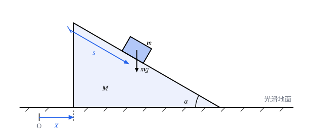

## 这一节要回答的问题

上一节的:term[达朗贝尔原理]{id="physics.analytical-mechanics.dalembert-principle"}（d'Alembert's principle）已经给出了不含:term[约束力]{id="physics.analytical-mechanics.constraint-force"}（constraint force）的运动方程，可方程左边要先算出每个质点的加速度。用角度这样的坐标时，加速度的表达式很长，单是平面极坐标里的加速度就有四项。能不能只算速度、写出动能，就按固定的步骤得到运动方程？

## 讲解

### 广义速度与两个恒等式

每个质点的位置是:term[广义坐标]{id="physics.analytical-mechanics.generalized-coordinates"}（generalized coordinates）和时间的函数$\vb{r}_i(q_1,\dots,q_n,t)$。沿着一个运动，$q_j$随时间变化，由多元复合函数的链式法则（multivariable chain rule），质点的速度是

$$
\dot{\vb{r}}_i=\sum_{k=1}^{n}\frac{\partial\vb{r}_i}{\partial q_k}\,\dot q_k+\frac{\partial\vb{r}_i}{\partial t}.
$$

::anchor{id="def-generalized-velocity"}
广义坐标对时间的导数$\dot q_1,\dots,\dot q_n$叫作:term[广义速度]{id="physics.analytical-mechanics.generalized-velocity"}（generalized velocities）。在拉格朗日力学里，把$q_j$和$\dot q_j$当作互相独立的变量：同一个位置上，系统可以有任意的速度。

为什么这样定义：动能由位置和速度决定，用广义坐标写出来是$T(q,\dot q,t)$。对$\dot q_j$求偏导数时让所有$q$不动，对$q_j$求偏导数时让所有$\dot q$不动；只有沿着一个确定的运动，$\dot q_j$才等于$q_j(t)$的导数，那是求完偏导数以后的事。例如单摆的$T=\frac12ml^2\dot\theta^2$，$\frac{\partial T}{\partial\theta}=0$，尽管沿着运动$\dot\theta$会随$\theta$变化。

从速度的表达式能读出两个恒等式，下面的推导全靠它们。第一个叫「消点」：$\dot{\vb{r}}_i$是$\dot q_k$的一次式，$\dot q_j$前面的系数是$\frac{\partial\vb{r}_i}{\partial q_j}$，而这个系数不含$\dot q$，所以

$$
\frac{\partial\dot{\vb{r}}_i}{\partial\dot q_j}=\frac{\partial\vb{r}_i}{\partial q_j}.
$$

第二个叫「交换」：对时间求导和对$q_j$求偏导数可以交换次序，

$$
\dv{}{t}\frac{\partial\vb{r}_i}{\partial q_j}=\frac{\partial\dot{\vb{r}}_i}{\partial q_j}.
$$

证明：按链式法则，左边等于$\sum_k\frac{\partial^2\vb{r}_i}{\partial q_k\,\partial q_j}\dot q_k+\frac{\partial^2\vb{r}_i}{\partial t\,\partial q_j}$；右边是对速度的表达式求$\frac{\partial}{\partial q_j}$，等于$\sum_k\frac{\partial^2\vb{r}_i}{\partial q_j\,\partial q_k}\dot q_k+\frac{\partial^2\vb{r}_i}{\partial q_j\,\partial t}$。$\vb{r}_i$的二阶偏导数连续时，混合偏导数和求导的次序无关，两边相等。

### 从达朗贝尔原理到拉格朗日方程

上一节由:term[达朗贝尔原理]{id="physics.analytical-mechanics.dalembert-principle"}得到，对每个$j$都有$\sum_i m_i\ddot{\vb{r}}_i\cdot\frac{\partial\vb{r}_i}{\partial q_j}=Q_j$，其中$Q_j$是:term[广义力]{id="physics.analytical-mechanics.generalized-force"}（generalized force）。把左边的每一项按乘积的求导法则倒过来写：

$$
m_i\ddot{\vb{r}}_i\cdot\frac{\partial\vb{r}_i}{\partial q_j}=\dv{}{t}\Bigl(m_i\dot{\vb{r}}_i\cdot\frac{\partial\vb{r}_i}{\partial q_j}\Bigr)-m_i\dot{\vb{r}}_i\cdot\dv{}{t}\frac{\partial\vb{r}_i}{\partial q_j}.
$$

用「消点」把第一项里的$\frac{\partial\vb{r}_i}{\partial q_j}$换成$\frac{\partial\dot{\vb{r}}_i}{\partial\dot q_j}$，用「交换」把第二项里的$\dv{}{t}\frac{\partial\vb{r}_i}{\partial q_j}$换成$\frac{\partial\dot{\vb{r}}_i}{\partial q_j}$：

$$
m_i\ddot{\vb{r}}_i\cdot\frac{\partial\vb{r}_i}{\partial q_j}=\dv{}{t}\Bigl(m_i\dot{\vb{r}}_i\cdot\frac{\partial\dot{\vb{r}}_i}{\partial\dot q_j}\Bigr)-m_i\dot{\vb{r}}_i\cdot\frac{\partial\dot{\vb{r}}_i}{\partial q_j}.
$$

动能$T=\sum_i\frac12m_i\dot{\vb{r}}_i\cdot\dot{\vb{r}}_i$写成$q$、$\dot q$、$t$的函数以后，$\frac{\partial T}{\partial\dot q_j}=\sum_i m_i\dot{\vb{r}}_i\cdot\frac{\partial\dot{\vb{r}}_i}{\partial\dot q_j}$，$\frac{\partial T}{\partial q_j}=\sum_i m_i\dot{\vb{r}}_i\cdot\frac{\partial\dot{\vb{r}}_i}{\partial q_j}$。所以对$i$求和以后，左边正好是动能的导数：

$$
\dv{}{t}\frac{\partial T}{\partial\dot q_j}-\frac{\partial T}{\partial q_j}=Q_j,\qquad j=1,\dots,n.
$$

再设:term[主动力]{id="physics.analytical-mechanics.applied-force"}（applied force）都是保守力，上一节已经得到$Q_j=-\frac{\partial V}{\partial q_j}$。势能$V(q,t)$不含速度，$\frac{\partial V}{\partial\dot q_j}=0$，所以可以把$V$并进左边的两项里。

::anchor{id="def-lagrangian"}
动能减去势能，$L(q,\dot q,t)=T-V$，叫作系统的:term[拉格朗日量]{id="physics.analytical-mechanics.lagrangian"}（Lagrangian）。

::anchor{id="def-lagrange-equations"}
受:term[理想约束]{id="physics.analytical-mechanics.ideal-constraint"}（ideal constraint）、主动力都是保守力的系统，满足:term[拉格朗日方程]{id="physics.analytical-mechanics.lagrange-equations"}（Lagrange's equations）：对每个:term[广义坐标]{id="physics.analytical-mechanics.generalized-coordinates"}，$\dv{}{t}\frac{\partial L}{\partial\dot q_j}-\frac{\partial L}{\partial q_j}=0$，$j=1,\dots,n$。

为什么是$T-V$：推导到最后是$\dv{}{t}\frac{\partial T}{\partial\dot q_j}-\frac{\partial T}{\partial q_j}+\frac{\partial V}{\partial q_j}=0$，要把$V$和$T$并成一个函数，$V$前面只能是负号。反例：用$T+V$，单摆的方程会变成$\ddot\theta=+\frac{g}{l}\sin\theta$，摆球被推离最低点。边界情况：拉格朗日量乘一个非零常数或加一个常数，方程不变，所以$L$不是能量；有不保守的主动力（比如阻力）时，把它们的广义力$Q_j'$留在右边：$\dv{}{t}\frac{\partial L}{\partial\dot q_j}-\frac{\partial L}{\partial q_j}=Q_j'$。

推导里允许$\vb{r}_i$显含$t$，所以:term[非定常约束]{id="physics.analytical-mechanics.rheonomic-constraint"}（rheonomic constraint）下方程照样成立。但出发点是惯性系里的牛顿定律，$T$必须用惯性系里的速度来算。方程的个数等于:term[自由度]{id="physics.analytical-mechanics.degrees-of-freedom"}（degrees of freedom），:term[约束力]{id="physics.analytical-mechanics.constraint-force"}一个也不出现。

### 按步骤写运动方程

用:term[拉格朗日方程]{id="physics.analytical-mechanics.lagrange-equations"}解题，步骤是固定的：选好:term[广义坐标]{id="physics.analytical-mechanics.generalized-coordinates"}；写出各质点的$\vb{r}_i(q,t)$，求速度，得到$T(q,\dot q,t)$；写出$V(q,t)$，得到:term[拉格朗日量]{id="physics.analytical-mechanics.lagrangian"}$L=T-V$；对每个$q_j$算出$\frac{\partial L}{\partial\dot q_j}$、它对时间的导数和$\frac{\partial L}{\partial q_j}$，代进方程。

以单摆为例。取悬点为原点、$y$轴竖直向上，摆球在$(l\sin\theta,\,-l\cos\theta)$，速度是$(l\cos\theta\,\dot\theta,\ l\sin\theta\,\dot\theta)$，所以$T=\frac12ml^2\dot\theta^2$。势能$V=mgy=-mgl\cos\theta$，于是

$$
L=\frac12ml^2\dot\theta^2+mgl\cos\theta .
$$

$\frac{\partial L}{\partial\dot\theta}=ml^2\dot\theta$，对时间求导得$ml^2\ddot\theta$；$\frac{\partial L}{\partial\theta}=-mgl\sin\theta$。代进方程得$ml^2\ddot\theta+mgl\sin\theta=0$，即$\ddot\theta=-\frac{g}{l}\sin\theta$。绳子的拉力始终没有出现，也没有算过一次加速度。

## 几何图像

:::anim{component="phase-portrait"}
system: { theta: "w", w: "-k*sin(theta)" }
range: { theta: [-6.3, 6.3], w: [-4, 4] }
dt: 0.01
initial:
  - [1, 0]
  - [2.6, 0]
  - [-6.2, 2.2]
  - [6.2, -2.2]
sliders:
  - name: k
    min: 0.5
    max: 3
    step: 0.1
    default: 1
    label: |
      $g/l$
:::

这是上面推出的单摆方程$\ddot\theta=-\frac{g}{l}\sin\theta$的解。横轴是摆角$\theta$（图上写作 theta），纵轴是:term[广义速度]{id="physics.analytical-mechanics.generalized-velocity"}$\dot\theta$（写作 w）：:term[拉格朗日方程]{id="physics.analytical-mechanics.lagrange-equations"}是二阶方程，知道了此刻的$\theta$和$\dot\theta$，以后的运动就定了，所以平面上每一点只有一条轨迹经过。闭合的曲线是来回摆动，上下两条波浪线是绕悬点转圈（图上不把角度折回，转圈的轨迹跑出画面后，按「重置」再看一遍）；在图上点一下可以从那里放一条新轨迹，拖动$g/l$看摆动变快。

## 例题

### 例 1　放在光滑地面上的斜面和滑块

质量$M$、倾角$\alpha$的斜面放在光滑的水平地面上，质量$m$的滑块从光滑斜面上滑下。求滑块沿斜面的加速度和斜面的加速度。

**为什么想到这么做**：用牛顿定律要分析两个物体，滑块和斜面之间的支持力、地面的支持力都要出现，滑块的加速度还要相对一个在加速的斜面去分解。这里两个物体之间、斜面和地面之间都是光滑接触，是:term[理想约束]{id="physics.analytical-mechanics.ideal-constraint"}，用:term[拉格朗日方程]{id="physics.analytical-mechanics.lagrange-equations"}这些力都不出现。系统有两个:term[自由度]{id="physics.analytical-mechanics.degrees-of-freedom"}，取斜面的位置$X$和滑块沿斜面下滑的距离$s$作:term[广义坐标]{id="physics.analytical-mechanics.generalized-coordinates"}。

**推导**：斜面在$x=X$处，滑块在$(X+s\cos\alpha,\ -s\sin\alpha)$（$y$轴竖直向上，原点取在斜面顶端的初始高度）。滑块的速度是$(\dot X+\dot s\cos\alpha,\ -\dot s\sin\alpha)$，所以

$$
T=\frac12M\dot X^2+\frac12m\bigl[(\dot X+\dot s\cos\alpha)^2+\dot s^2\sin^2\alpha\bigr]=\frac12(M+m)\dot X^2+m\cos\alpha\,\dot X\dot s+\frac12m\dot s^2 .
$$

势能$V=-mgs\sin\alpha$，:term[拉格朗日量]{id="physics.analytical-mechanics.lagrangian"}$L=T-V$。$L$不含$X$，所以$X$的方程是$\dv{}{t}\bigl[(M+m)\dot X+m\cos\alpha\,\dot s\bigr]=0$，即

$$
(M+m)\ddot X+m\cos\alpha\,\ddot s=0 .
$$

$s$的方程是$\dv{}{t}\bigl(m\cos\alpha\,\dot X+m\dot s\bigr)-mg\sin\alpha=0$，即$\cos\alpha\,\ddot X+\ddot s=g\sin\alpha$。由第一式$\ddot X=-\frac{m\cos\alpha}{M+m}\ddot s$，代进第二式解出

$$
\ddot s=\frac{(M+m)\,g\sin\alpha}{M+m\sin^2\alpha},\qquad \ddot X=-\frac{m\,g\sin\alpha\cos\alpha}{M+m\sin^2\alpha}.
$$

检验：$M\to\infty$时斜面不动，$\ddot s\to g\sin\alpha$，回到固定斜面的结果；$\ddot X<0$，斜面向和滑块水平运动相反的方向退。$X$的方程说明$(M+m)\dot X+m\cos\alpha\,\dot s$不随时间变，它的来历在讲:term[循环坐标]{id="physics.analytical-mechanics.cyclic-coordinate"}（cyclic coordinate）的那一节解释。

### 例 2　转动铁丝上的珠子

光滑的直铁丝在水平面内绕一端以角速度$\omega$匀速转动，珠子套在铁丝上。求珠子沿铁丝的运动。

**为什么想到这么做**：铁丝在转，这是:term[非定常约束]{id="physics.analytical-mechanics.rheonomic-constraint"}，而推导允许$\vb{r}_i$显含$t$，所以照样用:term[拉格朗日方程]{id="physics.analytical-mechanics.lagrange-equations"}。系统只有一个:term[自由度]{id="physics.analytical-mechanics.degrees-of-freedom"}，取珠子到转轴的距离$s$。动能要用惯性系里的速度，铁丝转动带来的那部分速度不能漏。

**推导**：珠子在$(s\cos\omega t,\ s\sin\omega t)$，速度是$(\dot s\cos\omega t-s\omega\sin\omega t,\ \dot s\sin\omega t+s\omega\cos\omega t)$，平方后交叉项相消：

$$
T=\frac12m\bigl(\dot s^2+s^2\omega^2\bigr).
$$

铁丝在水平面内，重力不做功，取$V=0$，$L=T$。$\frac{\partial L}{\partial\dot s}=m\dot s$，$\frac{\partial L}{\partial s}=ms\omega^2$，方程是$m\ddot s=ms\omega^2$，解为$s=Ae^{\omega t}+Be^{-\omega t}$，由初始位置$s_0>0$和初速度$\dot s_0$定出$A=\frac12\bigl(s_0+\frac{\dot s_0}{\omega}\bigr)$。只要$A>0$，也就是初速度向外、为零，或者向内但小于$\omega s_0$，珠子最终都会被越甩越远，距离随时间指数增长；向内的初速度恰好等于$\omega s_0$时，珠子渐近地滑向转轴，再大就会在有限时间里滑到转轴。铁丝的推力始终没有出现。

## 常见误区

- 「求$\frac{\partial L}{\partial q_j}$时要把$\dot q_j$看成$q_j$的函数。」求偏导数时$q$和:term[广义速度]{id="physics.analytical-mechanics.generalized-velocity"}$\dot q$互相独立，单摆的$\frac{\partial}{\partial\theta}\bigl(\frac12ml^2\dot\theta^2\bigr)=0$；求完偏导数以后，才沿着运动对时间求导。
- 「:term[拉格朗日量]{id="physics.analytical-mechanics.lagrangian"}就是能量。」$L=T-V$是差，能量是$T+V$；$L$加一个常数、乘一个非零常数都给出同样的方程。
- 「动能可以用相对于转动铁丝的速度来算。」推导的出发点是惯性系里的牛顿定律，$T$要用惯性系里的速度，例 2 里漏掉$s\omega$就得不到向外甩的效果。
- 「:term[拉格朗日方程]{id="physics.analytical-mechanics.lagrange-equations"}只能处理保守力。」不保守的:term[主动力]{id="physics.analytical-mechanics.applied-force"}写成:term[广义力]{id="physics.analytical-mechanics.generalized-force"}$Q_j'$放在右边就行。
