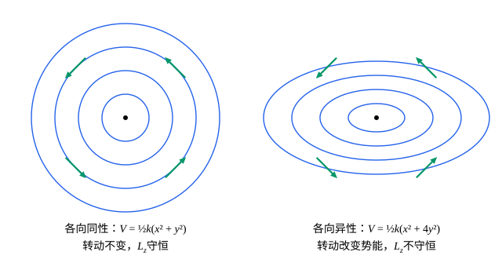

## 这一节要回答的问题

:term[循环坐标]{id="physics.analytical-mechanics.cyclic-coordinate"}（cyclic coordinate）能给出守恒量，可它依赖坐标怎么选：同一个守恒的总动量，换一组坐标就看不出来了。能不能直接从「:term[拉格朗日量]{id="physics.analytical-mechanics.lagrangian"}（Lagrangian）在某种变换下不变」读出守恒量，而不必先找到合适的坐标？空间平移、空间转动、时间平移下的不变性，又分别对应哪个守恒量？

## 讲解

### 连续对称性

先看两个例子。质点系的势能只依赖质点之间的相对位置时（例如万有引力、弹簧连接），把所有质点一起平移$s\vb{n}$，势能不变；速度也不变，所以:term[拉格朗日量]{id="physics.analytical-mechanics.lagrangian"}不变。势能只依赖质点到原点的距离和质点之间的距离时，把所有质点绕过原点的某根轴一起转过角度$s$，拉格朗日量也不变：转动不改变距离，也不改变速度的大小。

::anchor{id="def-continuous-symmetry"}
设有一族依赖实数参数$s$的变换$q\mapsto Q(q,s)$，$Q(q,0)=q$，对$s$可导。如果对每个$s$和任意路径$q(t)$，把路径换成$Q(q(t),s)$以后拉格朗日量的值不变，即$L(Q,\dot Q,t)=L(q,\dot q,t)$，就说拉格朗日量有一个:term[连续对称性]{id="physics.analytical-mechanics.continuous-symmetry"}（continuous symmetry）。$K_j(q)=\frac{\partial Q_j}{\partial s}\big|_{s=0}$描述无穷小变换的方向，$Q_j\approx q_j+sK_j(q)$，叫作这族变换的生成元（generator）。

为什么这样定义：要求的是一整族、可以任意小的变换，因为守恒量来自导数，只对一个固定的变换不变（比如单摆只对$\theta\to\theta+2\pi$不变）推不出守恒量。具体用到的只是$s=0$处的导数：对$L(Q,\dot Q,t)=L(q,\dot q,t)$两边求$\frac{\partial}{\partial s}$再令$s=0$，注意$\frac{\partial\dot Q_j}{\partial s}\big|_{s=0}=\dv{}{t}K_j(q(t))$，记作$\dot K_j$，得到

$$
\sum_j\Bigl(\frac{\partial L}{\partial q_j}K_j+\frac{\partial L}{\partial\dot q_j}\dot K_j\Bigr)=0 .
$$

反例：自由质点没有势能，在伸缩变换$x\mapsto e^sx$下势能自然不变，动能却变成$e^{2s}$倍，所以伸缩不是对称性：动能和势能都要看。

### 诺特定理

::anchor{id="def-noether"}
:term[诺特定理]{id="physics.analytical-mechanics.noether-theorem"}（Noether's theorem）：如果:term[拉格朗日量]{id="physics.analytical-mechanics.lagrangian"}有一个:term[连续对称性]{id="physics.analytical-mechanics.continuous-symmetry"}，生成元是$K(q)$，那么沿着每一个真实运动，$I=\sum_jp_jK_j(q)$守恒，其中$p_j=\frac{\partial L}{\partial\dot q_j}$是:term[广义动量]{id="physics.analytical-mechanics.generalized-momentum"}（generalized momentum）。

证明：$\dv{I}{t}=\sum_j\bigl(\dot p_jK_j+p_j\dot K_j\bigr)$。由:term[拉格朗日方程]{id="physics.analytical-mechanics.lagrange-equations"}（Lagrange's equations）$\dot p_j=\frac{\partial L}{\partial q_j}$，所以$\dv{I}{t}=\sum_j\bigl(\frac{\partial L}{\partial q_j}K_j+\frac{\partial L}{\partial\dot q_j}\dot K_j\bigr)$，这正是上面那个式子的左边，等于零。

:term[循环坐标]{id="physics.analytical-mechanics.cyclic-coordinate"}是它的特例：$q_k$是循环坐标，就是$L$在$q_k\mapsto q_k+s$（别的坐标不变）下不变，生成元只有第$k$个分量为$1$，于是$I=p_k$。可对称性是对变换本身的说法，不依赖坐标。讲循环坐标时例 2 的「两个物体一起水平平移」，在$(x,X)$坐标里生成元是$(1,1)$，直接算出$I=p_x+p_X=m\dot x+M\dot X$（$\tan^2\alpha$的项相消），不用先找到让它变成循环坐标的那组坐标。

### 平移与动量，转动与角动量

用$N$个质点的直角坐标作:term[广义坐标]{id="physics.analytical-mechanics.generalized-coordinates"}（generalized coordinates），$L=\sum_i\frac12m_i\dot{\vb{r}}_i^2-V$。把所有质点平移$s\vb{n}$，每个质点的生成元都是$\vb{n}$。若$V$在这种平移下不变，:term[诺特定理]{id="physics.analytical-mechanics.noether-theorem"}给出

$$
I=\sum_im_i\dot{\vb{r}}_i\cdot\vb{n}=\vb{P}\cdot\vb{n},
$$

总动量沿$\vb{n}$的分量守恒；$V$在所有方向的平移下都不变时，总动量$\vb{P}$守恒。

转动取$z$轴为转轴，转过$s$角时$(x,y,z)\mapsto(x\cos s-y\sin s,\ x\sin s+y\cos s,\ z)$，对$s$求导再令$s=0$，每个质点的生成元是$(-y_i,x_i,0)=\uv{z}\times\vb{r}_i$。动能在转动下不变，若$V$也不变，则

$$
I=\sum_im_i\dot{\vb{r}}_i\cdot(\uv{z}\times\vb{r}_i)=\uv{z}\cdot\sum_i\vb{r}_i\times m_i\dot{\vb{r}}_i=L_z ,
$$

这里用了$\vb{a}\cdot(\vb{b}\times\vb{c})=\vb{b}\cdot(\vb{c}\times\vb{a})$。转动对称给出总角动量沿转轴的分量守恒；绕任何轴转动都对称时，总角动量$\vb{L}$守恒。

### 只差一个全导数，以及时间平移

讲:term[哈密顿原理]{id="physics.analytical-mechanics.hamiltons-principle"}（Hamilton's principle）时说过，给$L$加上一个全导数不改变运动方程。所以只要变换让$L$的改变是全导数，它仍然把真实运动变成真实运动。设沿任意路径$\frac{\partial}{\partial s}L(Q,\dot Q,t)\big|_{s=0}=\dv{}{t}G(q,t)$，同样的证明给出$\dv{}{t}\sum_jp_jK_j=\dv{G}{t}$，所以守恒的是

$$
I=\sum_jp_jK_j-G .
$$

证明里只用到了「变换后的路径对$s$求导等于$K$」，所以变换可以显含时间，生成元甚至可以依赖速度，结论不变。例如均匀重力场里把所有质点竖直抬高$s$，势能$\sum_im_igy_i$增加$Mgs$（$M$是总质量），$\frac{\partial L}{\partial s}=-Mg=\dv{}{t}(-Mgt)$，所以$P_y+Mgt$守恒：总动量的竖直分量以$Mg$的速率减少。

时间平移是把整个运动在时间上挪动：$q_s(t)=q(t+s)$，生成元是$K_j=\dot q_j$。$L$不显含时间时，

$$
\frac{\partial}{\partial s}L\bigl(q(t+s),\dot q(t+s),t\bigr)\Big|_{s=0}=\sum_j\Bigl(\frac{\partial L}{\partial q_j}\dot q_j+\frac{\partial L}{\partial\dot q_j}\ddot q_j\Bigr)=\dv{L}{t},
$$

即$G=L$。守恒量是$\sum_jp_j\dot q_j-L$，正是:term[能量函数]{id="physics.analytical-mechanics.energy-function"}（energy function）$h$。

| 对称性 | 生成元 | 守恒量 |
| --- | --- | --- |
| 沿$\vb{n}$平移 | 每个质点都是$\vb{n}$ | $\vb{P}\cdot\vb{n}$ |
| 绕$\vb{n}$转动 | $\vb{n}\times\vb{r}_i$ | $\vb{L}\cdot\vb{n}$ |
| 时间平移 | $\dot q_j$ | $h$ |

## 几何图像

两张图里的曲线是等势线，箭头是绕中心无穷小转动的方向。左边的势能各向同性，箭头始终沿着等势线，转一下势能不变，这是:term[连续对称性]{id="physics.analytical-mechanics.continuous-symmetry"}，所以$L_z$守恒。右边的势能在$y$方向更陡，箭头穿过等势线，转动改变势能，不是对称性，$L_z$也就不守恒。

:::anim{component="function-plot"}
range: { x: [0, 20], y: [-1.6, 1.6] }
functions:
  - expr: "cos(x)*cos(r*x) + sin(r*x)*sin(x)/r"
    label: |
      $L_z$
  - expr: "1"
    label: |
      $E$
sliders:
  - name: r
    min: 0.5
    max: 2
    step: 0.05
    default: 1.3
    label: |
      $\omega_y/\omega_x$
:::

这是平面振子$V=\frac12m(\omega_x^2x^2+\omega_y^2y^2)$的一个运动，取$m=1$、$\omega_x=1$，从$(1,0)$以速度$(0,1)$出发，横轴是时间。拖动$\omega_y/\omega_x$：只有它等于$1$（势能各向同性）时$L_z$才是一条水平线；而无论取什么值，$L$都不显含时间，能量$E$一直守恒。

## 例题

### 例 1　螺旋对称的势能

质量$m$的质点在势能$V(\rho,\ \varphi-kz)$里运动，$(\rho,\varphi,z)$是柱坐标，$k\ne0$是常数。这种势能绕$z$轴转一个角度不变吗？沿$z$轴平移呢？找出一个守恒量。

**为什么想到这么做**：单独转动$\varphi\mapsto\varphi+s$会改变$\varphi-kz$，单独平移$z\mapsto z+s$也会；但一边转$s$、一边沿轴前进$\frac{s}{k}$，$\varphi-kz$就不变，就像拧螺丝。所以对称性是这种螺旋运动，用:term[诺特定理]{id="physics.analytical-mechanics.noether-theorem"}直接写出守恒量。

**推导**：柱坐标里

$$
L=\frac12m\bigl(\dot\rho^2+\rho^2\dot\varphi^2+\dot z^2\bigr)-V(\rho,\ \varphi-kz).
$$

变换$\varphi\mapsto\varphi+s$、$z\mapsto z+\frac{s}{k}$、$\rho$不变：动能只含$\dot\varphi$、$\dot z$和$\rho$，不变；势能的第二个自变量$(\varphi+s)-k(z+\frac{s}{k})=\varphi-kz$，也不变。生成元是$(K_\rho,K_\varphi,K_z)=(0,1,\frac1k)$，守恒量

$$
I=p_\varphi+\frac{p_z}{k}=m\rho^2\dot\varphi+\frac{m\dot z}{k}=L_z+\frac{p_z}{k}.
$$

单独的$L_z$和$p_z$都不守恒，它们的这个组合守恒。直接验证：$\dot p_\varphi=-V_2$，$\dot p_z=kV_2$（$V_2$是$V$对第二个自变量的偏导数），所以$\dot p_\varphi+\frac{\dot p_z}{k}=0$。在柱坐标里没有一个坐标是:term[循环坐标]{id="physics.analytical-mechanics.cyclic-coordinate"}，要换成$u=\varphi-kz$这样的坐标才看得出来，而诺特定理不需要换坐标。

### 例 2　转动圆环上的珠子有哪些对称性

讲:term[能量函数]{id="physics.analytical-mechanics.energy-function"}时例 1 的珠子：竖直圆环绕竖直直径以恒定的$\omega$转动。它的:term[能量函数]{id="physics.analytical-mechanics.energy-function"}守恒对应什么对称性？珠子绕竖直轴的角动量守恒吗？

**为什么想到这么做**：对每一个守恒量，都去找对应的:term[连续对称性]{id="physics.analytical-mechanics.continuous-symmetry"}；反过来，看起来有对称性的地方，要确认它真的是珠子的:term[广义坐标]{id="physics.analytical-mechanics.generalized-coordinates"}的变换。

**推导**：$L=\frac12mR^2\bigl(\dot\theta^2+\omega^2\sin^2\theta\bigr)+mgR\cos\theta$不显含$t$，系统有时间平移对称性：圆环匀速转动，任何时刻开始做实验，看到的都一样。由上面的推导，守恒量是$h$，这和讲能量函数时的结论一致。

绕竖直轴转动不是珠子的对称性：珠子只有一个坐标$\theta$，方位角$\varphi=\omega t$是电机规定好的，不能拿来做变换。珠子绕竖直轴的角动量是$mR^2\sin^2\theta\,\omega$，$\theta$变化时它跟着变，不守恒，多出来的角动量来自电机的力矩。所以「装置看起来绕轴对称」和「:term[拉格朗日量]{id="physics.analytical-mechanics.lagrangian"}在绕轴转动下不变」是两回事，:term[诺特定理]{id="physics.analytical-mechanics.noether-theorem"}只认后者。

## 常见误区

- 「势能在变换下不变，就是对称性。」整个:term[拉格朗日量]{id="physics.analytical-mechanics.lagrangian"}都要不变（或只差一个全导数），动能也要看：伸缩变换下自由质点的势能不变，动能却变了。
- 「:term[诺特定理]{id="physics.analytical-mechanics.noether-theorem"}只能用在:term[循环坐标]{id="physics.analytical-mechanics.cyclic-coordinate"}上。」反过来，循环坐标是诺特定理的特例；螺旋对称给出的$L_z+\frac{p_z}{k}$在柱坐标里没有对应的循环坐标。
- 「镜像反射这样的对称性也给出守恒量。」只有能连续地、任意小地做的变换才给出守恒量。
- 「时间平移也是一个$q\mapsto Q(q,s)$的坐标变换。」时间平移是把整个运动挪动，生成元$\dot q$依赖速度，$L$也只是差一个全导数$\dv{L}{t}$；守恒量是:term[能量函数]{id="physics.analytical-mechanics.energy-function"}，$L$显含时间时它不守恒。
